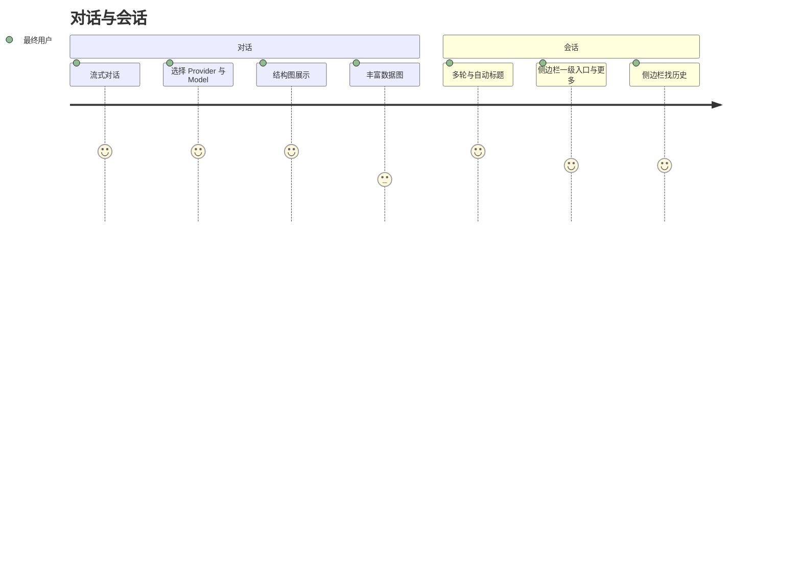
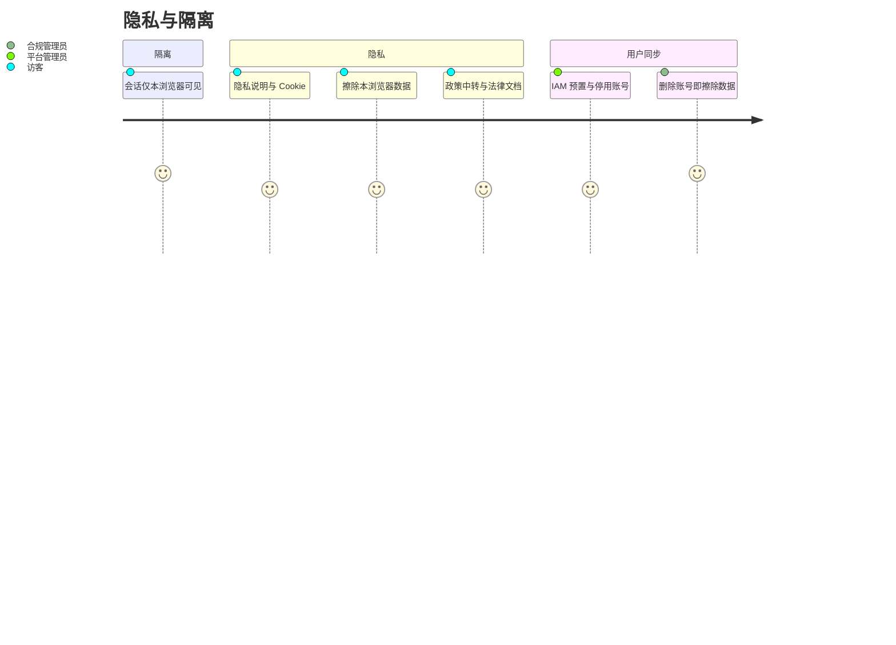
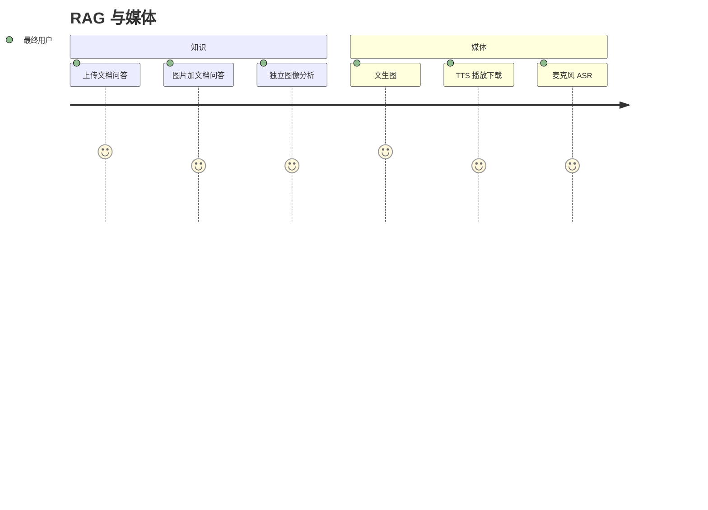
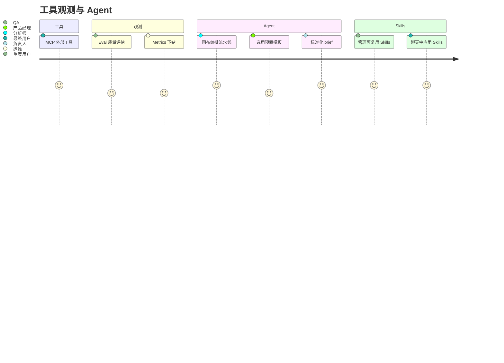

# 用户故事地图 | User Story Map — Explore AI
> Jeff Patton 用户故事地图；正文与验收标准合并于本文（单一文档）。  
> Jeff Patton user-story map; epics and GWT acceptance criteria live in this single document.  
> 格式 / Format：Background → `As a` / `I want` / `So that` → Scenario GIVEN-WHEN-THEN（双语 / bilingual）。

## 用户画像 | Personas

| 角色 / Role | 说明 / Description |
|------|------|
| 最终用户 / End User | 在浏览器中使用对话、RAG、媒体与工具能力 / Uses chat, RAG, media, and tools in the browser |
| 访客 / Guest | 未登录使用 ExploreAI；会话按浏览器隔离 / Uses ExploreAI without login; sessions isolated per browser |
| QA 工程师 / QA Engineer | 在 Eval 页评估回答质量 / Evaluates answer quality on the Eval page |
| 管理员 / Admin | 查看 AI 指标与域健康 / Views AI metrics and domain health |
| 业务分析师 / Business Analyst | 使用 Multi-Agent 工作台与研判输出 / Uses the multi-agent workbench and research outputs |
| 平台工程师 / Platform Engineer | 平台管道、领域建模与 Lab 编排；C4 Code 领域模型已反映当前系统 / Platform pipelines, domain modeling, and Lab orchestration; C4 Code reflects the system |
| 企业员工 / Enterprise Employee | 企业场景（规划） / Enterprise scenarios (planned) |

## 旅程总览 | Journey Overview

### 对话与会话

### 隐私与隔离

### RAG 与视觉 / 媒体

### 工具、观测与 Agent

---

## Backbone 故事地图 | Backbone

### 已交付

| 对话与会话 | 隐私与隔离 | RAG 与视觉 | 媒体 | MCP | 评估与指标 | 工作流 | Skills |
|------------|------------|------------|------|-----|------------|-------------|--------|
| [US-01](#us-01-ai-对话) AI 对话 | [US-04](#us-04-按浏览器隔离聊天会话) 浏览器隔离 | [US-06](#us-06-rag-知识问答) RAG | [US-09](#us-09-图像生成) 图像生成 | [US-12](#us-12-mcp-工具调用) MCP | [US-13](#us-13-chat-质量评估) Eval | [US-15](#us-15-multi-agent-pipeline-工作台) Pipeline | [US-30](#us-30-管理可复用-skills) 管理 Skills |
| [US-02](#us-02-provider--model-选择) Provider/Model | [US-05](#us-05-欧盟隐私告知同意与擦除控制) 隐私控制 / [US-05b](#us-05b-政策中转页与法律文档) 政策文档 | [US-07](#us-07-vision-多模态-rag) Vision RAG | [US-10](#us-10-语音合成-tts) TTS | | [US-14](#us-14-ai-指标看板) Metrics / [US-36](#us-36-lab-与隐私页跟随界面语言) 界面语言覆盖 | [US-16](#us-16-企业工作流模版内置--可自定义) 工作流模版 | [US-31](#us-31-在聊天中应用-skills) 聊天应用 / [US-35](#us-35-工作台页布局与-metrics-一致) 布局与 Metrics 一致 |
| [US-03](#us-03-多轮对话与自动标题) 多轮与标题 | [US-39](#us-39-擦除与登录合并覆盖全部功能数据) 擦除与合并全覆盖 | [US-08](#us-08-图像分析独立) 图像分析 | [US-11](#us-11-流式-asr-语音识别) ASR / [US-11b](#us-11b-原生-voice-conversationios) Voice Conversation iOS | | | [US-17](#us-17-企业研判标准化输出) 标准化输出 / [US-18](#us-18-消费-agent-模版目录) 画布 Worker 目录 | |
| [US-03b](#us-03b-会话地址与切换加载) 会话地址与切换加载 | | | | | | | |
| [US-03c](#us-03c-聊天中的结构图) 聊天结构图 | | | | | | | |
| [US-03d](#us-03d-聊天中的丰富数据图) 丰富数据图 | | | | | | | |

### 已实现（商业化增量）

| 故事 |
|------|
| [US-18b](#us-18b-可选-oauth-登录与访客模式) 可选 Google/GitHub 登录 + 访客模式 |
| [C4 Code 领域模型](../c4-model/README.md#code---领域模型) 对齐 `com.ai.*.domain` 的实体 / 值对象 / 仓储总览（[EXP-356](https://felixzhu.atlassian.net/browse/EXP-356)） |
| [US-37](#us-37-explore-iam-预置与更新账号) Explore IAM 通过 SCIM 预置与停用账号 |
| [US-38](#us-38-删除账号时擦除数据) SCIM 删除账号时擦除数据 |

### 进行中

| 对话与会话 | 商业化与平台 | 企业自动化 |
|------------|--------------|------------|
| [US-03e](#us-03e-聊天中的高级数据图布局) 高级数据图布局 ([EXP-358](https://felixzhu.atlassian.net/browse/EXP-358)) | [US-18](#us-18-商业化底座配额法务页与账号雏形) 商业化底座 | [US-27a](#us-27a-工作流定时任务与邮件结果) 工作流定时 + 邮件 |
| | [US-18c](#us-18c-account-data-isolation-via-owner-key) Owner Key 数据隔离 | ✅ |
| | [US-19](#us-19-rag-etl-管道) RAG ETL | |
| | [US-20](#us-20-文本分析) 文本分析 | |
| | [US-21](#us-21-tools-天气查询) Tools 天气 | |
| | [US-22](#us-22-supervisor-自动路由) Supervisor | |

### 未来（规划中）

| 企业与 Lab |
|------------|
| [US-23](#us-23-aiops-智能运维) AIOps |
| [US-24](#us-24-知识与制度) 知识与制度 |
| [US-25](#us-25-沟通与内容生产) 沟通与内容 |
| [US-26](#us-26-决策支持与运营轻量) 决策支持 |
| [US-27](#us-27-治理与人机协同) 治理 |
| [US-28](#us-28-spring-ai-workflow-原语产品化) Spring AI Workflow Lab |
| [US-29](#us-29-会话导出) 会话导出 |

---

## Epic 索引 | Epic Index

| Epic | 锚点 / Anchor | 状态 / Status |
|------|---------------|---------------|
| E1 对话与会话 | [#e1](#e1) | — |
| E2 隐私与隔离 | [#e2](#e2) | — |
| E3 RAG 与视觉 | [#e3](#e3) | — |
| E4 媒体 | [#e4](#e4) | — |
| E5 MCP | [#e5](#e5) | — |
| E6 评估与指标 | [#e6](#e6) | — |
| E7 Pipeline（工作流） | [#e7](#e7) | — |
| E8 商业化与平台 | [#e8](#e8) | — |
| E9 企业与未来 | [#e9](#e9) | — |
| E10 Skills | [#e10](#e10) | — |
| E11 Deep Agent（已退役） | [#e11](#e11) | — |
| E12 SCIM 用户同步 | [#e12](#e12) | — |
| E13 Agent façade + A2A | [#e13](#e13) | — |
| E14 Agent Gallery 与产品对标互操作 | [#e14](#e14) | — |

---

# 用户故事正文 | User Stories

## E1 对话与会话 / Chat & Sessions

### 背景 | Background

用户需要在 Explore AI 中顺畅对话、选用模型并延续上下文。若会话难以找回或回复体验割裂，将降低信任与复用。产品以流式回复、模型选择与自动会话标题支撑连续协作。 / Users expect smooth chat, model choice, and context continuity in Explore AI. Hard-to-find sessions or broken reply UX erodes trust. The product delivers streaming replies, model selection, and auto-generated session titles for ongoing collaboration.

### US-01 流式 AI 对话 / Streaming AI chat

**As a** 最终用户 / End user  
**I want** 在 Chat 页与 AI 助手进行流式对话 / chat with the AI assistant on the Chat page with streaming replies  
**So that** 我能边看边读回复并连续追问 / I can read answers as they arrive and keep the conversation going

#### 验收标准 | Acceptance Criteria

1. **Scenario** 发送消息并看到流式回复 / Send a message and see a streaming reply  
   **GIVEN** 我已打开 Chat 页且当前会话可用 / I am on the Chat page and the current session is ready  
   **WHEN** 我输入消息并发送 / I type a message and send it  
   **THEN** 助手回复以流式方式出现在对话区 / the assistant's reply appears incrementally in the conversation area  
   **AND** 流式结束后完整回答仍可见 / when streaming finishes the full answer remains visible  

2. **Scenario** 等待回复时可感知进行中 / See progress while waiting for a reply  
   **GIVEN** 我已发送消息且助手尚未完成回复 / I have sent a message and the assistant has not finished replying  
   **WHEN** 我查看对话区域 / I look at the conversation area  
   **THEN** 我能看到回复正在生成或更新 / I can see that a reply is being generated or updated  

#### 状态 | Status

已实现 / Done

---

### US-02 选择模型与提供商 / Choose provider and model

**As a** 最终用户 / End user  
**I want** 进入 Chat 页时看到可用的 Provider 与 Model 列表 / see available providers and models when I open the Chat page  
**So that** 我能按场景选用合适模型且不被错误提示打断 / I can pick the right model for the task without confusing errors

#### 验收标准 | Acceptance Criteria

1. **Scenario** 展示可用 Provider 与 Model / Show available providers and models  
   **GIVEN** 我打开 Chat 页 / I open the Chat page  
   **WHEN** 页面加载完成 / the page finishes loading  
   **THEN** 界面展示可用的 Provider 与 Model 列表 / the UI lists available providers and models  
   **AND** 列表可用时不出现因加载失败导致的错误提示 / when the list is available I do not see spurious load-failure errors  

2. **Scenario** 所选模型用于后续对话 / Selected model is used for chat  
   **GIVEN** Provider 与 Model 列表已展示 / the provider and model list is visible  
   **WHEN** 我选择某一 Model 并发送消息 / I select a model and send a message  
   **THEN** 助手使用该模型生成回复 / the assistant replies using that model  

#### 状态 | Status

已实现 / Done

---

### US-03 多轮对话与自动标题 / Multi-turn chat and auto titles

**As a** 最终用户 / End user  
**I want** 在同一会话中连续追问并由系统自动生成会话标题 / ask follow-ups in one session and get an automatic session title  
**So that** 上下文得以延续且我能在侧边栏快速找到历史会话 / context carries over and I can quickly find past sessions in the sidebar

#### 验收标准 | Acceptance Criteria

1. **Scenario** 同会话连续对话保留上下文 / Follow-ups keep context in the same session  
   **GIVEN** 我已在当前会话中至少完成一轮对话 / I have already exchanged at least one turn in the current session  
   **WHEN** 我继续发送追问 / I send another follow-up message  
   **THEN** 助手回复体现同一会话的上下文 / the assistant's reply reflects the same session context  
   **AND** 新消息仍显示在该会话中 / the new messages stay in that session  

2. **Scenario** 自动标题出现在侧边栏 / Auto title appears in the sidebar  
   **GIVEN** 会话中已有足够内容可生成标题 / the session has enough content to generate a title  
   **WHEN** 我查看会话侧边栏 / I open the session sidebar  
   **THEN** 该会话显示系统生成的标题 / that session shows a system-generated title  
   **AND** 我可凭标题从侧边栏定位该历史会话 / I can locate that history session from the sidebar by its title  

#### 状态 | Status

已实现 / Done

---

### US-03b 会话地址与切换体验 / Session URLs and switching

**As a** 最终用户 / End user  
**I want** 每个会话有稳定地址，切换时获得清晰的加载反馈 / each session has a stable URL and clear loading feedback when I switch  
**So that** 刷新后仍停留在当前会话，切换时不会误显示为空对话 / refresh keeps me on the same session and switching does not look like an empty chat by mistake

#### 验收标准 | Acceptance Criteria

1. **Scenario** 切换有历史的会话时地址更新 / URL updates when switching to a session with history  
   **GIVEN** 侧边栏存在多个已有消息的会话 / the sidebar lists multiple sessions that already have messages  
   **WHEN** 我选择另一个会话 / I select a different session  
   **THEN** 浏览器地址变为 `/chat/<sessionId>` / the browser address becomes `/chat/<sessionId>`  
   **AND** 侧边栏高亮我所选会话 / the sidebar highlights the session I selected  

2. **Scenario** 新会话在首条消息前不暴露 id / New session hides id until the first message  
   **GIVEN** 我新建或打开尚无消息的会话 / I create or open a session with no messages yet  
   **WHEN** 会话处于空状态 / the session is still empty  
   **THEN** 浏览器地址为 `/chat`（不含 sessionId） / the browser address is `/chat` without a sessionId  
   **AND** 发出第一条消息后地址变为 `/chat/<sessionId>` / after the first message the address becomes `/chat/<sessionId>`  
   **AND** 无消息的会话不写入本地持久化 / sessions without messages are not persisted locally  
   **AND** 在 `/chat` 刷新后仍为空会话欢迎态，不会自动打开有历史的会话 / refreshing on `/chat` keeps the empty welcome state and does not auto-open a history session  
   **AND** 尚无消息的会话不出现在侧边栏列表，直至发出第一条消息 / sessions without messages do not appear in the sidebar until the first message is sent  

3. **Scenario** 地址升级后首条回复仍实时出现 / First reply still streams after URL upgrade  
   **GIVEN** 我在空会话 `/chat` 发出第一条消息 / I send the first message on empty `/chat`  
   **WHEN** 地址升级为 `/chat/<sessionId>` / the URL upgrades to `/chat/<sessionId>`  
   **THEN** 助手回复仍在当前页流式出现，无需刷新 / the assistant reply still streams on the current page without refresh  
   **AND** 「思考中」占位在回复完成后消失 / the “thinking” placeholder disappears when the reply completes  

4. **Scenario** 刷新后恢复当前会话 / Refresh restores the current session  
   **GIVEN** 我正在查看 `/chat/<sessionId>` / I am viewing `/chat/<sessionId>`  
   **WHEN** 我刷新页面 / I refresh the page  
   **THEN** 仍停留在同一会话并展示其消息历史 / I remain on the same session with its message history visible  

5. **Scenario** 切换时显示加载占位 / Loading placeholder while switching  
   **GIVEN** 我选择另一尚未展示历史的会话 / I select another session whose history is not yet shown  
   **WHEN** 历史消息正在加载 / message history is loading  
   **THEN** 显示轻量加载占位而非欢迎空态 / a light loading placeholder appears instead of the empty welcome state  
   **AND** 加载结束后展示消息或真正的空会话欢迎页 / after loading, messages appear or the true empty-session welcome shows  

6. **Scenario** 非法或他人会话被安全重定向 / Invalid or foreign sessions redirect safely  
   **GIVEN** 地址指向不存在或不属于当前身份的 `/chat/<sessionId>` / the address is a `/chat/<sessionId>` that does not exist or does not belong to me  
   **WHEN** 页面尝试打开该会话 / the app tries to open that session  
   **THEN** 重定向到 `/chat`，不展示他人内容 / I am redirected to `/chat` without seeing someone else's content  
   **AND** 不出现打扰性 toast / no intrusive toast appears  

#### 状态 | Status

已实现 / Done

---

### US-03c 对话内结构图展示 / Structure diagrams in chat

**As a** 最终用户 / End user  
**I want** 在助手回复中看到时序图、类图等结构图以图片呈现 / see sequence and class diagrams in replies rendered as images  
**So that** 我可在对话内理解设计与流程，无需复制到外部工具 / I can understand design and flows in context without copying to external tools

#### 验收标准 | Acceptance Criteria

1. **Scenario** 完整时序图以图展示 / Complete sequence diagram renders as image  
   **GIVEN** 助手回复包含完整的时序结构图 / the assistant reply includes a complete sequence diagram  
   **WHEN** 我在聊天中查看该回复 / I view that reply in chat  
   **THEN** 结构图以图片形式展示 / the diagram appears as an image  
   **AND** 周围正文仍可读 / surrounding text remains readable  

2. **Scenario** 完整类图以图展示 / Complete class diagram renders as image  
   **GIVEN** 助手回复包含完整的类结构图 / the assistant reply includes a complete class diagram  
   **WHEN** 我在聊天中查看该回复 / I view that reply in chat  
   **THEN** 结构图以图片形式展示 / the diagram appears as an image  

3. **Scenario** 流式未完成时界面保持稳定 / Incomplete streaming diagram stays calm  
   **GIVEN** 结构图仍在流式生成且尚未闭合 / a diagram is still streaming and not yet complete  
   **WHEN** 我查看该回复 / I view the reply  
   **THEN** 其余回复内容仍可读 / the rest of the reply remains readable  
   **AND** 界面不出现失败提示或空图壳 / the UI does not show failure chrome or an empty diagram shell  

4. **Scenario** 无法绘制时保留源码与说明 / Unrenderable diagram keeps source and hint  
   **GIVEN** 助手回复包含无法绘制的结构图源码 / the reply includes diagram source that cannot be rendered  
   **WHEN** 我查看该回复 / I view the reply  
   **THEN** 原始源码仍可见 / the original source remains visible  
   **AND** 显示简短说明无法绘制的原因 / a brief calm message explains that rendering failed  

5. **Scenario** 普通代码块仍为代码展示 / Ordinary code blocks stay as code  
   **GIVEN** 助手回复包含非结构图的普通围栏代码块 / the reply includes a normal fenced code block that is not a diagram  
   **WHEN** 我查看该回复 / I view the reply  
   **THEN** 该块仍以代码块形式展示 / that block still displays as a code block  

6. **Scenario** 点击结构图可全屏查看 / Tap diagram for fullscreen view  
   **GIVEN** 助手回复中已展示结构图 / a structure diagram is shown in the reply  
   **WHEN** 我点击该图 / I click the diagram  
   **THEN** 结构图在全屏层展示 / the diagram opens in a fullscreen layer  
   **AND** 我可关闭并回到对话 / I can close it and return to the chat  
   **AND** 聊天内联图不展示悬停工具按钮 / inline chat diagrams do not show hover tool buttons  

7. **Scenario** 全屏中可下载结构图 / Download diagram from fullscreen  
   **GIVEN** 我已打开结构图全屏层 / I have opened the diagram fullscreen view  
   **WHEN** 我选择下载 / I choose download  
   **THEN** 浏览器下载 SVG 文件 / the browser downloads an SVG file  

#### 状态 | Status

已实现 / Done

---

### US-03d 对话内丰富数据图 / Rich data charts in chat

**As a** 最终用户 / End user  
**I want** 在助手回复中查看多系列与专用布局的数据图 / view data charts with multiple series and specialized layouts in replies  
**So that** 我可在对话内比较趋势、分布与多维指标，无需离开会话 / I can compare trends, distributions, and multi-dimensional metrics without leaving the session

#### 验收标准 | Acceptance Criteria

1. **Scenario** 专用图类型以图展示 / Specialized chart types render as images  
   **GIVEN** 助手回复包含完整的散点图等专用图表 / the reply includes a complete specialized chart such as a scatter plot  
   **WHEN** 我在聊天中查看该回复 / I view that reply in chat  
   **THEN** 图表以可读图片展示 / the chart appears as a readable image  
   **AND** 周围正文仍可读 / surrounding text remains readable  

2. **Scenario** 多系列对比图可区分系列 / Multi-series chart distinguishes series  
   **GIVEN** 我要求在同一类别上比较两个及以上系列 / I ask to compare two or more series in the same category  
   **WHEN** 助手返回完整的多系列图 / the assistant returns a complete multi-series chart  
   **THEN** 各系列在图中可区分 / each series is visually distinct  
   **AND** 图例或标签能标识系列 / legends or labels identify each series  

3. **Scenario** 趋势与量组合于同一图 / Trend and volume combined in one chart  
   **GIVEN** 我要求同时查看趋势与数量 / I ask to see trend and volume together  
   **WHEN** 助手返回完整的组合图 / the assistant returns a complete combo chart  
   **THEN** 两种度量同图呈现且标签互不遮挡 / both measures appear in one chart without overlapping labels  

4. **Scenario** 原有简单图仍可用 / Simple charts still work as before  
   **GIVEN** 助手回复包含完整的柱状图等简单图表 / the reply includes a complete simple chart such as a bar chart  
   **WHEN** 我查看该回复 / I view the reply  
   **THEN** 图表仍按既有方式正确展示 / the chart still renders correctly as before  

5. **Scenario** 结构图与数据图分开展示 / Structure diagrams stay separate from data charts  
   **GIVEN** 我要求时序或类结构图 / I ask for a sequence or class structure diagram  
   **WHEN** 助手回复 / the assistant replies  
   **THEN** 以结构图图片展示 / it appears as a structure diagram image  
   **AND** 不以数据图形式呈现 / it is not shown as a data chart  

6. **Scenario** 无数据或非法图时界面平静 / Invalid or empty chart data stays calm  
   **GIVEN** 工具结果缺少可用数字或图表载荷无效 / tool output lacks usable numbers or the chart payload is invalid  
   **WHEN** 我查看该回复 / I view the reply  
   **THEN** 界面不出现损坏的空图壳 / the UI does not show a broken empty chart shell  
   **AND** 我仍能看到可读正文或简短说明 / I still see readable text or a brief explanation  

#### 状态 | Status

已实现 / Done

---

### US-03e 对话内高级数据图 / Advanced data charts in chat

**As a** 最终用户 / End user  
**I want** 在回复中查看层级、流向、关系、分布、K 线、多维与日历等高级数据图 / view advanced charts—hierarchy, flow, relations, distribution, candlestick, parallel coordinates, and calendar heatmaps—in replies  
**So that** 我可在对话内把握结构、流向与分布，无需离开会话 / I can grasp structure, flow, and distribution in context without leaving the session

#### 验收标准 | Acceptance Criteria

1. **Scenario** 层级图以图展示 / Hierarchy charts render as images  
   **GIVEN** 助手回复包含完整的矩形树图等层级图 / the reply includes a complete hierarchy chart such as a treemap  
   **WHEN** 我在聊天中查看该回复 / I view that reply in chat  
   **THEN** 图表以可读图片展示 / the chart appears as a readable image  
   **AND** 周围正文仍可读 / surrounding text remains readable  

2. **Scenario** 流向与关系图以图展示 / Flow and relationship charts render as images  
   **GIVEN** 助手回复包含完整的桑基图或带数值边的关系图 / the reply includes a complete Sankey or relationship chart with weighted edges  
   **WHEN** 我在聊天中查看该回复 / I view that reply in chat  
   **THEN** 图表以可读图片展示 / the chart appears as a readable image  
   **AND** 不以结构图形式呈现 / it is not shown as a structure diagram  

3. **Scenario** 分布与 K 线图以图展示 / Distribution and candlestick charts render  
   **GIVEN** 助手回复包含完整的箱线图或 K 线图 / the reply includes a complete box plot or candlestick chart  
   **WHEN** 我在聊天中查看该回复 / I view that reply in chat  
   **THEN** 图表以可读图片展示 / the chart appears as a readable image  

4. **Scenario** 多维与日历图以图展示 / Multivariate and calendar charts render  
   **GIVEN** 助手回复包含完整的平行坐标、主题河流或日历热力图 / the reply includes parallel coordinates, theme river, or calendar heatmap  
   **WHEN** 我在聊天中查看该回复 / I view that reply in chat  
   **THEN** 图表以可读图片展示 / the chart appears as a readable image  

5. **Scenario** 原有数据图仍可用 / Existing data charts still work  
   **GIVEN** 助手回复包含完整的柱状图等既有图表 / the reply includes an existing chart type such as a bar chart  
   **WHEN** 我查看该回复 / I view the reply  
   **THEN** 图表仍按既有方式正确展示 / the chart still renders correctly as before  

6. **Scenario** 结构图与数据图分开展示 / Structure diagrams stay separate from data charts  
   **GIVEN** 我要求时序或类结构图 / I ask for a sequence or class structure diagram  
   **WHEN** 助手回复 / the assistant replies  
   **THEN** 以结构图图片展示 / it appears as a structure diagram image  
   **AND** 不以数据图形式呈现 / it is not shown as a data chart  

7. **Scenario** 无数据或非法图时界面平静 / Invalid or empty chart data stays calm  
   **GIVEN** 工具结果缺少可用数字或图表载荷无效 / tool output lacks usable numbers or the chart payload is invalid  
   **WHEN** 我查看该回复 / I view the reply  
   **THEN** 界面不出现损坏的空图壳 / the UI does not show a broken empty chart shell  
   **AND** 我仍能看到可读正文或简短说明 / I still see readable text or a brief explanation  

#### 状态 | Status

进行中 / In progress

---

## E2 隐私与数据隔离 / Privacy & Data Isolation

### 背景 | Background

访客在未登录场景下使用 Explore AI，期望对话仅留在本设备且能行使隐私权利。缺乏告知与控制会增加合规与品牌风险。产品按浏览器隔离会话，并提供隐私说明、分析 Cookie 选择与本地数据擦除。 / Guests using Explore AI expect conversations to stay on their device with clear privacy controls. Missing notice and choice raises compliance risk. The product isolates sessions per browser and offers privacy notices, analytics cookie choice, and local data erasure.

### US-04 按浏览器隔离聊天会话 / Browser-isolated chat sessions

**As a** Explore AI 访客 / Explore AI guest  
**I want** 让我的聊天会话仅在本浏览器可见 / keep my chat sessions visible only in this browser  
**So that** 其他设备或浏览器无法看到或操作我的对话 / other devices or browsers cannot see or control my conversations

#### 验收标准 | Acceptance Criteria

1. **Scenario** 本浏览器可继续自己的会话 / This browser can resume its sessions  
   **GIVEN** 我曾在当前浏览器产生聊天会话 / I have created chat sessions in this browser  
   **WHEN** 我在同一浏览器再次打开应用 / I open the app again in the same browser  
   **THEN** 仍可看到并继续本浏览器下的会话 / I can still see and continue sessions from this browser  

2. **Scenario** 其他环境看不到该访客会话 / Other environments cannot see guest sessions  
   **GIVEN** 我仅在浏览器 A 使用过 Explore AI / I have only used Explore AI in browser A  
   **WHEN** 我在另一台电脑或另一浏览器打开应用 / I open the app on another computer or browser  
   **THEN** 不展示浏览器 A 中的聊天会话 / sessions from browser A are not shown  
   **AND** 无法操作浏览器 A 中的对话 / I cannot operate conversations from browser A  

#### 状态 | Status

已实现 / Done

---

### US-05 隐私告知、Cookie 同意与数据擦除 / Privacy notice, cookie consent, and erasure

**As a** Explore AI 访客 / Explore AI guest  
**I want** 查看隐私说明、选择是否启用分析 Cookie，并能擦除本浏览器数据 / read privacy information, choose analytics cookies, and erase data stored in this browser  
**So that** 我了解数据处理目的并行使基本隐私控制权 / I understand how data is used and can exercise basic privacy controls

#### 验收标准 | Acceptance Criteria

1. **Scenario** 查看隐私说明并选择分析 Cookie / View privacy notice and analytics cookie choice  
   **GIVEN** 我正在使用 Explore AI / I am using Explore AI  
   **WHEN** 我打开隐私说明或同意控件 / I open privacy information or consent controls  
   **THEN** 我可以看到隐私说明 / I can read the privacy notice  
   **AND** 我可以选择是否启用分析 Cookie / I can choose whether to enable analytics cookies  

2. **Scenario** 擦除本浏览器数据 / Erase this browser's data  
   **GIVEN** 本浏览器已存有相关本地或会话数据 / this browser has relevant local or session data  
   **WHEN** 我执行擦除本浏览器数据 / I trigger erase data for this browser  
   **THEN** 本浏览器相关数据被清除 / relevant data for this browser is cleared  
   **AND** 我可以继续以干净状态使用应用 / I can continue using the app in a clean state  

#### 状态 | Status

已实现 / Done

---

### US-05b 政策索引与法律文档 / Policy hub and legal documents

**As a** Explore AI 访客 / Explore AI guest  
**I want** 从帮助菜单进入政策索引或隐私控制，并阅读使用条款与隐私政策 / open the policy hub or privacy controls from Help and read terms and privacy policy  
**So that** 我能在两级菜单内了解服务规则与数据处理方式 / I can understand service rules and data handling within a two-level Help menu

#### 验收标准 | Acceptance Criteria

1. **Scenario** 打开政策中转页 / Open the policy hub  
   **GIVEN** 我正在使用 Explore AI / I am using Explore AI  
   **WHEN** 我从「帮助 → 政策」打开中转页或访问 `/policies` / I open Help → Policies or visit `/policies`  
   **THEN** 看到使用条款、隐私政策、Cookie 政策与子处理方摘要列表 / I see summaries for terms, privacy, cookies, and subprocessors  
   **AND** 帮助子菜单仅含「政策」与「隐私」两项，正文从中转页进入 / Help submenu has only Policies and Privacy; full text opens from the hub  

2. **Scenario** 阅读政策正文 / Read full policy text  
   **GIVEN** 我在政策中转页 / I am on the policy hub  
   **WHEN** 我打开使用条款或隐私政策 / I open terms of use or privacy policy  
   **THEN** 看到分章节正文与更新日期 / I see sectioned content and last-updated date  
   **AND** 正文语言与当前界面语言一致 / the document language matches my UI language  

3. **Scenario** 旧法律链接仍可访问 / Legacy legal URLs still work  
   **GIVEN** 我持有旧的 `/legal/...` 书签 / I have an old bookmark to `/legal/...`  
   **WHEN** 我打开该地址 / I open that URL  
   **THEN** 被带到对应的 `/policies/<slug>` 文档 / I land on the matching `/policies/<slug>` document  

#### 状态 | Status

已实现（Jira: [AI-339](https://felixzhu.atlassian.net/browse/AI-339)） / Done (Jira: [AI-339](https://felixzhu.atlassian.net/browse/AI-339))

---

### US-39 擦除与登录合并覆盖全部功能数据 / Erasure and login merge across all features

**As a** Explore AI 访客或已登录用户 / Explore AI guest or signed-in user  
**I want** 擦除本机数据或登录合并时，各功能里属于我的数据被一并正确处理 / have all my data across features handled together when I erase local data or merge on login  
**So that** 新增功能不会留下漏删或未合并的数据 / new features do not leave orphaned data after erasure or merge

#### 验收标准 | Acceptance Criteria

1. **Scenario** 擦除不留残余 / Erasure leaves no residue  
   **GIVEN** 我在聊天、文档、Skills、工作流、自动化等均有数据并产生过调用指标 / I have data across chat, documents, Skills, workflows, automations, and usage metrics  
   **WHEN** 我擦除本浏览器数据，或通过 explore-iam SCIM 删除该用户 / I erase this browser's data or the user is deleted via explore-iam SCIM  
   **THEN** 上述功能中该所有者的数据全部被删除 / all of that owner's data in those features is deleted  
   **AND** 其他访客的数据不受影响 / other guests' data is unaffected  

2. **Scenario** 登录合并与关联同生共死 / Login merge and link succeed or fail together  
   **GIVEN** 我在浏览器中已有访客数据 / I have guest data in the browser  
   **WHEN** 我登录并关联账号 / I sign in and link my account  
   **THEN** 浏览器关联与全部数据合并在同一事务中完成 / browser linking and full data merge complete in one transaction  
   **AND** 合并失败时关联也不会生效 / if merge fails, the link does not take effect  

3. **Scenario** 各功能自行处理本域数据 / Each feature handles its own domain data  
   **GIVEN** 账号模块发出擦除或合并的领域事件 / the account module emits erase or merge domain events  
   **WHEN** 各功能模块处理该事件 / each feature module handles the event  
   **THEN** 每个模块只删除或迁移自己的数据 / each module deletes or migrates only its own data  
   **AND** 聊天、RAG、工作流、工具与视觉等功能不依赖指标模块完成擦除 / chat, RAG, workflows, tools, and vision do not depend on the metrics module for erasure  

#### 状态 | Status

已实现 / Done

---

## E3 RAG 与视觉 / RAG & Vision

### 背景 | Background

团队需要将自有资料用于可信问答，并在需要时做独立视觉分析。答案若无法溯源或能力混杂，会影响决策质量。产品支持 RAG 文档问答，并将图像分析放在独立页面以保持体验清晰。 / Teams need trustworthy Q&A over their documents plus dedicated vision analysis when needed. Unverifiable or cluttered experiences hurt decisions. The product supports RAG document Q&A and separates image analysis on its own page.

### US-06 RAG 文档知识问答 / RAG document Q&A

**As a** 最终用户 / End user  
**I want** 上传文档并就其内容向 AI 提问 / upload documents and ask the AI questions about their content  
**So that** 回答有据可查，便于核对与决策 / answers are grounded in my documents so I can verify and decide

#### 验收标准 | Acceptance Criteria

1. **Scenario** 上传文档后基于内容提问 / Ask questions after uploading documents  
   **GIVEN** 我已上传可用于问答的文档 / I have uploaded documents available for Q&A  
   **WHEN** 我就文档内容提问 / I ask a question about the document content  
   **THEN** AI 基于文档内容给出回答 / the AI answers using the document content  
   **AND** 回答可追溯至文档依据 / the answer can be traced to evidence in the document  

2. **Scenario** 无文档时不假装已引用 / No document means no fake grounding  
   **GIVEN** 我尚未上传相关文档 / I have not uploaded relevant documents  
   **WHEN** 我发起依赖文档的知识问答 / I start a document-dependent knowledge Q&A  
   **THEN** 系统不表现为已基于该文档作答 / the system does not pretend to answer from that document  
   **AND** 我可先上传文档再提问 / I can upload documents first and then ask  

#### 状态 | Status

已实现 / Done

---

### US-07 文档问答与独立视觉分离 / Document Q&A separate from vision

**As a** 最终用户 / End user  
**I want** 在文档问答中专注文本提问与文档依据 / focus on text questions and document grounding in document Q&A  
**So that** 输入区不被附图控件打断，图像分析走独立视觉页 / the composer stays text-focused and image analysis lives on a dedicated vision page

#### 验收标准 | Acceptance Criteria

1. **Scenario** 文档问答输入区无附图入口 / Document Q&A composer has no image attach  
   **GIVEN** 我打开文档问答 / I open document Q&A  
   **WHEN** 我查看消息输入区 / I look at the message composer  
   **THEN** 输入框旁无图片上传按钮 / there is no image upload button beside the composer  
   **AND** 我仍可通过侧栏上传文档后提问 / I can still upload documents from the sidebar and ask questions  

2. **Scenario** 图像分析走独立能力页 / Image analysis uses the dedicated page  
   **GIVEN** 我需要描述、检测或 OCR 等视觉分析 / I need vision analysis such as description, detection, or OCR  
   **WHEN** 我打开独立图像分析页 / I open the dedicated image analysis page  
   **THEN** 可完成结构化视觉分析（见 US-08） / I can complete structured vision analysis (see US-08)  

#### 状态 | Status

已实现（Jira: [AI-340](https://felixzhu.atlassian.net/browse/AI-340)；Doc Q&A 附图入口已移除） / Done (Jira: [AI-340](https://felixzhu.atlassian.net/browse/AI-340); image attach removed from Doc Q&A)

---

### US-08 独立图像分析 / Standalone image analysis

**As a** 最终用户 / End user  
**I want** 在独立页面完成图像描述、目标检测与 OCR / run image description, object detection, and OCR on a dedicated page  
**So that** 无需进入 RAG 对话即可获得结构化视觉结果 / I get structured vision results without opening RAG chat

#### 验收标准 | Acceptance Criteria

1. **Scenario** 独立页完成描述、检测与 OCR / Dedicated page delivers description, detection, and OCR  
   **GIVEN** 我打开独立图像分析页并提供图像 / I open the image analysis page and provide an image  
   **WHEN** 我触发图像分析 / I start image analysis  
   **THEN** 可获得描述、目标检测与 OCR 相关结果 / I receive description, detection, and OCR results  
   **AND** 无需进入 RAG 对话页即可完成 / I complete this without opening RAG chat  

2. **Scenario** 结果为结构化视觉分析 / Results are structured and readable  
   **GIVEN** 图像分析已成功完成 / image analysis has completed successfully  
   **WHEN** 我查看结果区域 / I view the results area  
   **THEN** 结果以可阅读的结构化形式展示 / results appear in a structured, readable format  
   **AND** 描述、检测与 OCR 分区清晰可辨 / description, detection, and OCR sections are clearly distinguished  

#### 状态 | Status

已实现 / Done

---

## E4 多媒体能力 / Multimodal Media

### 背景 | Background

用户希望通过文字、语音与图像多渠道与 AI 协作。能力不足或失败无反馈会打断工作流。产品提供文生图、语音合成、实时语音识别及 iOS 原生语音对话。 / Users want to work with AI through text, voice, and images. Missing capabilities or silent failures interrupt workflows. The product offers image generation, TTS, streaming ASR, and native iOS voice conversation.

### US-09 文生图 / Text-to-image generation

**As a** 最终用户 / End user  
**I want** 用文字描述生成图像 / generate images from a text description  
**So that** 生成结果可预览、下载或用于后续对话 / I can preview, download, or reuse images in later conversations

#### 验收标准 | Acceptance Criteria

1. **Scenario** 文字描述生成图像 / Generate image from text description  
   **GIVEN** 我处于图像生成相关页面或入口 / I am on the image generation page or entry point  
   **WHEN** 我输入文字描述并请求生成 / I enter a description and request generation  
   **THEN** 系统返回生成的图像 / the system returns a generated image  
   **AND** 我可在界面中查看该图像 / I can view the image in the UI  

2. **Scenario** 生成失败时有可感知反馈 / Clear feedback when generation fails  
   **GIVEN** 我已提交生成请求 / I have submitted a generation request  
   **WHEN** 生成未能成功完成 / generation does not complete successfully  
   **THEN** 我能感知失败或错误反馈 / I see clear failure or error feedback  
   **AND** 我可调整描述后重试 / I can adjust the description and try again  

#### 状态 | Status

已实现 / Done

---

### US-10 文本转语音（TTS） / Text-to-speech (TTS)

**As a** 最终用户 / End user  
**I want** 将文本合成为语音并播放或下载 / synthesize speech from text and play or download it  
**So that** 我可以用听觉方式消费 AI 输出内容 / I can consume AI output by listening

#### 验收标准 | Acceptance Criteria

1. **Scenario** 文本合成并可播放 / Synthesize and play speech  
   **GIVEN** 我有待合成的文本 / I have text ready to synthesize  
   **WHEN** 我请求语音合成 / I request speech synthesis  
   **THEN** 系统生成可播放的语音 / the system produces playable audio  
   **AND** 我可播放以收听内容 / I can play it to listen to the content  

2. **Scenario** 下载合成语音 / Download synthesized speech  
   **GIVEN** 语音合成已成功 / speech synthesis succeeded  
   **WHEN** 我选择下载 / I choose download  
   **THEN** 我可获得语音文件用于本地保存 / I receive an audio file I can save locally  

#### 状态 | Status

已实现 / Done

---

### US-11 流式语音识别（ASR） / Streaming speech recognition (ASR)

**As a** 最终用户 / End user  
**I want** 通过麦克风实时将语音转写为文字 / transcribe my speech to text in real time via the microphone  
**So that** 我可以用语音输入与 AI 交互 / I can interact with the AI using voice input

#### 验收标准 | Acceptance Criteria

1. **Scenario** 麦克风实时转写为文字 / Microphone transcribes speech in real time  
   **GIVEN** 我处于支持语音输入的界面且已允许麦克风 / I am on a voice-enabled screen and microphone access is allowed  
   **WHEN** 我通过麦克风说话 / I speak into the microphone  
   **THEN** 语音被实时转写为文字 / my speech is transcribed to text in real time  
   **AND** 文字可用于继续与 AI 交互 / the text is available to continue interacting with the AI  

2. **Scenario** 无麦克风权限时无法完成转写 / No permission means no transcription  
   **GIVEN** 浏览器未授予麦克风权限 / the browser has not granted microphone permission  
   **WHEN** 我尝试语音输入 / I try voice input  
   **THEN** 无法完成实时转写 / real-time transcription cannot complete  
   **AND** 我仍可改用文字输入 / I can still type instead  

#### 状态 | Status

已实现 / Done

---

### US-11b iOS 原生语音对话 / Native voice conversation (iOS)

**As a** 最终用户 / End user  
**I want** 在 Explore AI iOS 客户端用实时语音与助手对话 / talk to the assistant hands-free on the Explore AI iOS app  
**So that** 我可以边说边听，无需打字 / I can speak and listen without typing

#### 验收标准 | Acceptance Criteria

1. **Scenario** 语音对话形成闭环 / Voice conversation closes the loop  
   **GIVEN** 我已登录 IAM 且 Explore AI iOS 客户端可用 / I am signed in to IAM and the Explore AI iOS app is available  
   **WHEN** 我打开 Voice Conversation 并允许麦克风 / I open Voice Conversation and allow the microphone  
   **THEN** 我说话内容经流式 ASR 转写 / my speech is transcribed via streaming ASR  
   **AND** 助手回复经 TTS 播报 / the assistant reply is spoken via TTS  

2. **Scenario** 可打断正在播报的回复 / Barge-in stops playback  
   **GIVEN** 助手正在播报回复 / the assistant is speaking a reply  
   **WHEN** 我再次说话 / I speak again  
   **THEN** 播报停止并继续听取我的语音 / playback stops and the app listens to me again  

#### 状态 | Status

已实现 / Done

---

## E5 MCP 工具集成 / MCP Tool Integration

### 背景 | Background

仅文本对话无法完成查资料、调 API 等任务。若工具未接入却被「假装调用」，用户会失去信任。产品通过 MCP 在对话中安全调用已注册的外部工具。 / Text-only chat cannot fetch live data or call APIs. Faking tool use destroys trust. The product uses MCP to invoke registered external tools from within conversation.

### US-12 MCP 工具调用 / MCP tool invocation

**As a** 最终用户 / End user  
**I want** 在对话中调用已接入的外部工具 / invoke connected external tools from within chat  
**So that** AI 能完成查天气、搜文档等超出纯文本生成的任务 / the AI can complete tasks beyond text generation such as weather lookup or document search

#### 验收标准 | Acceptance Criteria

1. **Scenario** 对话中调用已接入工具 / Invoke connected tools from chat  
   **GIVEN** 系统已接入可用的外部工具 / the system has connected external tools available  
   **WHEN** 我在对话中提出需要工具完成的请求（如查天气、搜文档） / I ask in chat for something that needs a tool (e.g. weather or document search)  
   **THEN** AI 能调用相应已接入工具 / the AI invokes the appropriate connected tool  
   **AND** 我获得超出纯文本的任务结果 / I receive task results beyond plain text  

2. **Scenario** 未接入工具时不伪造成功 / Unconnected tools are not faked  
   **GIVEN** 我的请求依赖尚未接入的工具能力 / my request depends on a tool that is not connected  
   **WHEN** 我在对话中发出该请求 / I send that request in chat  
   **THEN** 系统不表现为已成功调用该未接入工具 / the system does not claim a successful call to that tool  
   **AND** 我仍能看到对话层面的说明或普通回复 / I still see an explanation or a normal reply in chat  

#### 状态 | Status

已实现 / Done

---

## E6 质量评估与可观测性 / Quality Evaluation & Observability

### 背景 | Background

发布前需要量化对话质量，上线后需要看见调用健康度。缺少评估与指标难以发现回退和异常。产品在 Eval 页做自动与黄金集回归，并为管理员提供指标看板与 Lab 本地化。 / Teams need measurable quality before release and observable health in production. Without evals and metrics, regressions go unnoticed. The product offers Eval automation, golden-set regression, an admin metrics dashboard, and localized Lab pages.

### US-13 Chat 质量自动评估 / Automated Chat quality evaluation

**As a** QA 工程师 / QA engineer  
**I want** 在 Eval 页自动评估 AI 回答质量 / automatically evaluate AI answer quality on the Eval page  
**So that** 我能量化对话效果并持续改进 / I can measure dialogue quality and improve it over time

#### 验收标准 | Acceptance Criteria

1. **Scenario** 在 Eval 页发起自动评估 / Run automatic evaluation on Eval  
   **GIVEN** 我作为 QA 工程师打开 Eval 页 / as a QA engineer I open the Eval page  
   **WHEN** 我触发对 AI 回答的质量评估 / I trigger quality evaluation of AI answers  
   **THEN** 系统自动完成评估并展示结果 / the system completes evaluation and shows results  
   **AND** 结果可用于量化对话效果 / results can be used to quantify dialogue quality  

2. **Scenario** 评估结果支持对比改进 / Evaluation results support comparison  
   **GIVEN** 至少一次评估已完成 / at least one evaluation has completed  
   **WHEN** 我查看评估输出 / I review the evaluation output  
   **THEN** 我可以看到可比较或可记录的质量信息 / I see quality information I can compare or record  
   **AND** 信息可用于后续改进决策 / the information supports follow-up improvement decisions  

#### 状态 | Status

已实现 / Done

---

### US-17 Chat 与 Document QA 黄金集回归 / Golden-set regression for Chat and Document QA

**As a** QA 工程师 / QA engineer  
**I want** 用固定黄金集对 Chat 与 Document QA 的真实回答做回归评估 / run regression evaluation on real Chat and Document QA answers using a fixed golden set  
**So that** 提示词或模型变更导致的质量回退能在发版前被发现 / quality regressions from prompt or model changes are caught before release

#### 验收标准 | Acceptance Criteria

1. **Scenario** 运行 Chat 黄金集 / Run Chat golden set  
   **GIVEN** Chat 黄金 JSONL 已就绪 / the Chat golden JSONL is ready  
   **WHEN** 我执行黄金评估集成测试 / I run the golden evaluation integration test  
   **THEN** 每条用例对真实生成结果给出通过/失败与评估反馈 / each case reports pass/fail and feedback on the real generation  
   **AND** 汇总通过率可用 / an aggregate pass rate is available  

2. **Scenario** 运行 Document QA 黄金集 / Run Document QA golden set  
   **GIVEN** RAG 黄金 JSONL 与 fixture 文档已就绪 / the RAG golden JSONL and fixture documents are ready  
   **WHEN** 我执行黄金评估集成测试 / I run the golden evaluation integration test  
   **THEN** 每条用例基于检索或参考上下文打分 / each case is scored against retrieval or reference context  
   **AND** 汇总通过率可用 / an aggregate pass rate is available  

#### 状态 | Status

已实现 / Done

---

### US-14 AI 指标看板 / AI metrics dashboard

**As a** 管理员 / Administrator  
**I want** 查看 AI 请求量、延迟、错误率与域健康，并能下钻到调用明细 / view AI request volume, latency, error rate, and domain health with drill-down to call details  
**So that** 我能快速定位异常调用并继续排查 / I can quickly spot anomalies and investigate further

#### 验收标准 | Acceptance Criteria

1. **Scenario** 查看聚合指标与域健康 / View aggregate metrics and domain health  
   **GIVEN** 我以管理员身份打开指标看板 / as an administrator I open the metrics dashboard  
   **WHEN** 看板数据加载完成 / dashboard data has loaded  
   **THEN** 我可查看 AI 请求量、延迟、错误率与域健康 / I can see AI request volume, latency, error rate, and domain health  

2. **Scenario** 下钻到调用明细 / Drill down to call details  
   **GIVEN** 看板已展示聚合指标 / aggregate metrics are visible on the dashboard  
   **WHEN** 我对某一异常或关注项下钻 / I drill into an anomaly or item of interest  
   **THEN** 我可查看相关调用明细 / I can see related call details  
   **AND** 明细便于我继续排查 / the details support further investigation  

#### 状态 | Status

已实现 / Done

---

### US-36 Lab 与隐私页界面语言一致 / Lab and privacy pages match UI language

**As a** 访客 / Guest  
**I want** Metrics、Eval、ASR、MCP 与隐私页的界面文案跟随已选语言 / Metrics, Eval, ASR, MCP, and privacy pages follow my selected UI language  
**So that** 切换语言后 Lab 与隐私相关页面不再残留英文硬编码 / after switching language, Lab and privacy pages do not show hard-coded English

#### 验收标准 | Acceptance Criteria

1. **Scenario** Lab 页文案随语言切换 / Lab pages localize with language  
   **GIVEN** 我已选择界面语言（如中文、英文或日文） / I have selected a UI language (e.g. Chinese, English, or Japanese)  
   **WHEN** 我打开 Metrics、Eval、ASR 或 MCP 页 / I open Metrics, Eval, ASR, or MCP  
   **THEN** 标题、表单、状态、错误与表格列头等 UI 文案使用该语言 / titles, forms, status, errors, and table headers use that language  
   **AND** 品牌名 Explore AI 保持不翻译 / the Explore AI brand name stays untranslated  

2. **Scenario** 隐私页完整本地化 / Privacy pages are fully localized  
   **GIVEN** 我选择日语等界面语言 / I select a UI language such as Japanese  
   **WHEN** 我打开隐私页 / I open the privacy page  
   **THEN** 告知、子处理方用途与控制文案为对应语言（非英文占位） / notices, subprocessors, and control copy are in that language—not English placeholders  
   **AND** 子处理方品牌名（DeepSeek、OpenAI 等）保持原样 / subprocessor brand names (DeepSeek, OpenAI, etc.) stay unchanged  

3. **Scenario** 共享界面无障碍文案随语言 / Shared chrome accessibility strings localize  
   **GIVEN** 我已选择界面语言 / I have selected a UI language  
   **WHEN** 我使用侧栏、顶栏菜单、语言选择器、RAG 删文档或 TTS 播放控制 / I use the sidebar, top bar, language picker, RAG document delete, or TTS controls  
   **THEN** 相关 aria-label 使用当前语言 / relevant aria-label values use the current language  

#### 状态 | Status

已实现（Jira: [AI-341](https://felixzhu.atlassian.net/browse/AI-341)） / Done (Jira: [AI-341](https://felixzhu.atlassian.net/browse/AI-341))

---

## E7 工作流编排 / Workflow Orchestration

### 背景 | Background

企业研判需要可视化编排多步 AI 流程并可复用模版。从零搭图成本高，非结构化输出则难汇报。产品提供画布工作台、内置模版、Fact–Inference–Recommendation 结构化研判与 Worker 目录。 / Enterprise analysis needs visual multi-step AI flows and reusable templates. Building from scratch is costly; unstructured output is hard to report. The product provides a canvas workbench, built-in templates, FIR-structured briefs, and a Worker catalog.

### US-15 工作流画布工作台 / Workflow canvas workbench

**As a** 业务分析师 / Business analyst  
**I want** 在画布上编排工作流并流式审阅各阶段与结果 / orchestrate workflows on a canvas and stream-review stages and outcomes  
**So that** 我能按企业流程定制多步 AI 工作流 / I can tailor multi-step AI workflows to our business processes

#### 验收标准 | Acceptance Criteria

1. **Scenario** 画布编排工作流 / Orchestrate workflow on canvas  
   **GIVEN** 我作为业务分析师打开工作流工作台 / as a business analyst I open the workflow workbench  
   **WHEN** 我在画布上编排工作流 / I arrange a workflow on the canvas  
   **THEN** 工作流结构可见并可按多步流程定制 / the workflow structure is visible and customizable as a multi-step process  

2. **Scenario** 流式审阅阶段与结果 / Stream-review stages and results  
   **GIVEN** 工作流已编排并可运行 / a workflow is arranged and runnable  
   **WHEN** 我在画布任务框填写任务并点击 Run / I fill the canvas task box and click Run  
   **THEN** 我可流式审阅各阶段进展与结果 / I can stream-review progress and results for each stage  
   **AND** 最终结果在右侧结果轨查看（结果轨不再作为主任务输入） / final output appears in the right result rail (not as the main task input)  

3. **Scenario** 编辑节点 Agent 副本 / Edit a node Agent copy on canvas  
   **GIVEN** 画布上已有 Worker 节点 / the canvas already has Worker nodes  
   **WHEN** 我双击该节点并修改名称或配置 / I double-click the node and change its name or configuration  
   **THEN** 仅本图画布副本变更，再次运行时使用节点快照 / only this canvas copy changes and the next run uses the node snapshot  

#### 状态 | Status

已实现 / Done

---

### US-16 企业工作流模版 / Enterprise workflow templates

**As a** 产品经理 / Product manager  
**I want** 从多语言内置模版一键选用，并可添加到我的模版库后自定义 / pick a multilingual built-in template in one click and customize it in my template library  
**So that** 常见企业研判无需从零搭图，且团队流程可沉淀为模版 / common enterprise workflows start from templates and team flows can be saved

#### 验收标准 | Acceptance Criteria

1. **Scenario** 一键选用多语言内置模版 / One-click built-in template  
   **GIVEN** 工作台已从后端加载当前语言的预置编排模版 / the workbench has loaded preset templates for my UI language  
   **WHEN** 我作为产品经理一键选用某一模版 / as a product manager I select a template in one click  
   **THEN** 画布加载该模版对应的编排 / the canvas loads that template's orchestration  
   **AND** 无需从零搭图即可开始 / I can start without building from scratch  

2. **Scenario** 添加并自定义我的模版 / Add and customize my template  
   **GIVEN** 我打开工作流工作台 / I open the workflow workbench  
   **WHEN** 我将内置模版添加到库、自定义字段并保存 / I add a built-in template to my library, customize fields, and save  
   **THEN** 我的模版列表可见该条目 / my template list shows the new entry  
   **AND** 我可再次选用、编辑、启停或删除 / I can select, edit, enable, disable, or delete it again  

3. **Scenario** 选用后可运行研判类流程 / Run analysis flow from template  
   **GIVEN** 我已选用企业研判相关模版 / I have selected an enterprise analysis template  
   **WHEN** 我按模版运行 / I run the workflow from the template  
   **THEN** 可得到基于该模版的流程输出 / I receive process output based on that template  

#### 状态 | Status

已实现 / Done

---

### US-17 企业研判标准化输出 / Standardized enterprise analysis output

**As a** 业务或技术负责人 / Business or technical lead  
**I want** 研判流程输出以 Fact、Inference、Recommendation 结构呈现 / analysis workflow output follows Fact, Inference, and Recommendation structure  
**So that** 研判结果可复核、可汇报 / analysis results can be reviewed and reported with confidence

#### 验收标准 | Acceptance Criteria

1. **Scenario** 简报含 FIR 结构 / Brief includes FIR structure  
   **GIVEN** 我运行会产生 Analyst brief 的研判流程 / I run an analysis workflow that produces an Analyst brief  
   **WHEN** 流程完成并展示 brief / the run completes and the brief is shown  
   **THEN** 输出包含 Fact、Inference、Recommendation 结构 / output includes Fact, Inference, and Recommendation sections  
   **AND** 内容可用于复核与汇报 / the content is suitable for review and reporting  

2. **Scenario** 结构完整便于汇报 / Complete structure supports reporting  
   **GIVEN** brief 已生成 / the brief has been generated  
   **WHEN** 负责人阅读输出 / a lead reads the output  
   **THEN** 可区分事实、推断与建议 / facts, inferences, and recommendations are clearly distinguished  
   **AND** 无需自行重组结构即可汇报 / they can report without restructuring the content  

#### 状态 | Status

已实现 / Done

---

### US-18 工作流 Worker 目录 / Workflow Worker catalog

**As a** 业务分析师 / Business analyst  
**I want** 工作流调色板从多语言内置目录加载 Worker，并在画布上编辑节点副本 / load Workers from a multilingual catalog into the palette and edit node copies on the canvas  
**So that** 无需独立 Agent 模块也能为每步定制角色与工具 / I can customize each step's role and tools without a separate Agent module

#### 验收标准 | Acceptance Criteria

1. **Scenario** 调色板随界面语言本地化 / Palette localizes with UI language  
   **GIVEN** 我切换了界面语言 / I switch the UI language  
   **WHEN** 我打开工作流调色板 / I open the workflow palette  
   **THEN** Agent 名称与描述来自按语言加载的内置目录 API / Agent names and descriptions come from the built-in catalog API for that language  

2. **Scenario** 模版选用时可视化选择 Worker / Pick Workers visually when authoring templates  
   **GIVEN** 我创建或编辑工作流模版 / I create or edit a workflow template  
   **WHEN** 我选择参与编排的 Workers / I choose Workers for the orchestration  
   **THEN** 通过调色板点选与排序完成（而非手输逗号分隔 typeKey） / I complete selection and ordering via the palette—not by typing comma-separated type keys  

#### 状态 | Status

已实现 / Done

---

## E8 商业化与平台能力 / Commercialization & Platform

### 背景 | Background

访客试用与正式商用前，缺少用量约束、法务披露与账号状态可见性，成本和合规风险难以及时管控。Explore AI 需先落地日配额、法务页、Metrics 访问控制与匿名账号雏形。完成最小商业化底座后，运营方可控成本并满足上架合规要求。 / Before broad adoption, usage could run unchecked and legal obligations were hard to meet without visible quotas, policy pages, and account state. Explore AI needs daily limits, legal docs, optional Metrics lock, and anonymous account handling. That minimal foundation lets operators control cost and open a compliant commercial entry.

### US-18 商业化底座：配额、法务与账号雏形 / Commercial foundation: quotas, legal pages, and accounts

**As a** Explore AI 访客与运营方 / Explore AI guest and operator  
**I want** 看到日用量配额、可访问的法务文档、按策略上锁的 Metrics，以及当前账号（含匿名）状态 / see daily usage quotas, accessible legal documents, Metrics protected when locked, and my current account state including anonymous mode  
**So that** 产品在可控成本与合规前提下具备可商用、可运营的起步能力 / the product can be operated commercially with controlled cost and a compliant starting posture

#### 验收标准 | Acceptance Criteria

1. **Scenario** 用量、法务与账号状态一目了然 / Quotas, legal docs, and account state are visible  
   **GIVEN** 我是访客或运营方，并打开与用量或账号相关的界面 / I am a guest or operator on a screen that shows usage or account information  
   **WHEN** 我查看该界面 / I review that screen  
   **THEN** 我能看到当日配额如何约束用量与成本 / I can see how the daily quota limits usage and cost  
   **AND** 我能打开所需法务文档 / I can open the required legal documents  
   **AND** 我能看到当前账号状态（含匿名） / I can see my current account state, including anonymous mode  

2. **Scenario** Metrics 可按策略上锁 / Metrics access respects lock policy  
   **GIVEN** Metrics 已部署且运营方启用了上锁策略 / Metrics is deployed and an operator has enabled the lock policy  
   **WHEN** 我尝试访问 Metrics / I try to access Metrics  
   **THEN** 访问受上锁策略约束，未授权者无法查看敏感指标 / access follows the lock policy and unauthorized viewers cannot see protected metrics  
   **AND** 整体仍服务于可商用、可合规的最小入口 / the experience still supports the minimal commercial and compliance entry point  

#### 状态 | Status

进行中 / In progress

---

### US-18b 可选 OAuth 登录并保留访客模式 / Optional OAuth sign-in while keeping guest mode

**As a** Explore AI 访客 / Explore AI guest  
**I want** 在继续使用访客模式的同时，按需用 Google 或 GitHub 登录，并随时登出 / keep using guest mode while optionally signing in with Google or GitHub, and sign out whenever I choose  
**So that** 我能在不被强制登录墙挡住的前提下绑定身份并延续同一会话数据 / I can bind my identity without a forced login wall and keep continuity of my session data

#### 验收标准 | Acceptance Criteria

1. **Scenario** 未启用 OAuth 时保持纯访客 / Pure guest when OAuth is off  
   **GIVEN** Google 与 GitHub OAuth 均未配置启用 / neither Google nor GitHub OAuth is enabled  
   **WHEN** 我打开侧栏账号菜单 / I open the sidebar account menu  
   **THEN** 账号接口表明当前为匿名模式（`mode=anonymous`） / the account API shows anonymous mode (`mode=anonymous`)  
   **AND** 不展示登录入口（`loginAvailable=false`，`loginProviders=[]`） / no sign-in entry is shown (`loginAvailable=false`, `loginProviders=[]`)  
   **AND** 会话数据仍按 Anonymous id 隔离 / session data remains isolated by Anonymous id  

2. **Scenario** 启用 Google 后可完成登录 / Sign in with Google when enabled  
   **GIVEN** Google OAuth 已启用且客户端凭证已配置 / Google OAuth is enabled with valid client credentials  
   **WHEN** 我选择 Continue with Google 并完成授权 / I choose Continue with Google and complete authorization  
   **THEN** 账号关联到当前 Anonymous id，不丢失既有数据 / my account links to the current Anonymous id without losing existing data  
   **AND** 账号接口返回已认证模式与邮箱（`mode=authenticated`） / the account API returns authenticated mode and email (`mode=authenticated`)  
   **AND** 侧栏展示登出操作 / the sidebar shows sign out  

3. **Scenario** 启用 GitHub 后可完成登录 / Sign in with GitHub when enabled  
   **GIVEN** GitHub OAuth 已启用且 OAuth App 凭证已配置 / GitHub OAuth is enabled with valid app credentials  
   **WHEN** 我选择 Continue with GitHub 并完成授权 / I choose Continue with GitHub and complete authorization  
   **THEN** 账号关联到当前 Anonymous id（`provider=github`） / my account links to the current Anonymous id (`provider=github`)  
   **AND** 账号接口返回已认证模式（`mode=authenticated`） / the account API returns authenticated mode (`mode=authenticated`)  
   **AND** 可用登录方式列表包含 `github` / `loginProviders` includes `github`  

4. **Scenario** 登出后回到访客模式 / Sign out returns to guest mode  
   **GIVEN** 我已登录 Explore AI / I am signed in to Explore AI  
   **WHEN** 我选择 Log out / I choose Log out  
   **THEN** 会话认证状态被清除 / my session authentication is cleared  
   **AND** 我仍可继续使用访客模式（Anonymous id cookie 保留） / I can continue as a guest with the Anonymous id cookie retained  

#### 状态 | Status

已实现 / Done

---

### US-18c 登录后按 Owner Key 隔离账号数据 / Account data isolation via Owner Key after sign-in

**As a** 登录前的 Explore AI 访客 / Explore AI guest who later signs in  
**I want** 登录后访客阶段产生的会话与库内容归入我的账号分区 / have guest-browser sessions and library items move under my account partition after OAuth  
**So that** 认证后同一数据可跨设备延续，而不是遗留在匿名分区 / the same sessions and library items follow me across devices once I am authenticated

#### 验收标准 | Acceptance Criteria

_（无） / (none)_

#### 状态 | Status

已实现 / Done

---

### US-19 可插拔 RAG 文档处理管道 / Pluggable RAG document ETL pipeline

**As a** 平台工程师 / platform engineer  
**I want** 通过可插拔 ETL 能力接入多种文档格式 / ingest multiple document formats through a pluggable ETL capability  
**So that** 新增文档类型时不必改动应用层代码 / I can add document types without changing application-layer code

#### 验收标准 | Acceptance Criteria

1. **Scenario** 多格式文档经统一管道处理 / Multiple formats flow through one pipeline  
   **GIVEN** 平台已提供可插拔 ETL 接入点 / the platform exposes a pluggable ETL port  
   **WHEN** 我接入或处理某一种文档格式 / I connect or process a given document format  
   **THEN** 文档沿该接入点完成抽取、转换与入库流水线 / the document completes extract-transform-load through that port  

2. **Scenario** 扩展类型无需改应用层 / New types without application changes  
   **GIVEN** 需要支持一种新的文档类型 / a new document type must be supported  
   **WHEN** 我通过扩展 ETL 实现该类型 / I implement the type as an ETL extension  
   **THEN** 无需修改应用层代码即可纳入 RAG 处理 / RAG processing includes the type without application-layer changes  

#### 状态 | Status

进行中 / In progress

---

### US-20 文本情感与结构化分析 / Structured text sentiment analysis

**As a** 管理员 / administrator  
**I want** 对反馈或运营文本获得结构化情感分析结果 / run structured sentiment analysis on feedback or operational text  
**So that** 我能把握用户情绪倾向并优先处理问题 / I can see emotional trends in user feedback and prioritize responses

#### 验收标准 | Acceptance Criteria

1. **Scenario** 触发分析并得到结构化结果 / Trigger analysis and get structured output  
   **GIVEN** 我已提供待分析的文本 / I have supplied text to analyze  
   **WHEN** 我触发文本情感分析 / I trigger sentiment analysis  
   **THEN** 系统返回结构化的情感分析结果 / the system returns a structured sentiment result  

2. **Scenario** 结果支撑情绪研判 / Results support mood interpretation  
   **GIVEN** 情感分析已完成 / sentiment analysis has completed  
   **WHEN** 我查看分析结果 / I review the analysis result  
   **THEN** 我能识别用户反馈的情绪倾向（如正、负、中性） / I can read the emotional tendency of the feedback (e.g., positive, negative, neutral)  

#### 状态 | Status

进行中 / In progress

---

### US-21 天气查询领域能力 / Weather lookup as a domain capability

**As a** 开发者 / developer  
**I want** 在领域模型中封装天气查询规则，而非散落的脚本调用 / encapsulate weather lookup rules in the domain model instead of ad hoc scripts  
**So that** 工具调用与业务建模一致，便于维护与扩展 / tool invocations align with domain modeling and stay maintainable

#### 验收标准 | Acceptance Criteria

1. **Scenario** 天气逻辑由领域模型承载 / Weather logic lives in the domain model  
   **GIVEN** 天气查询作为产品内工具能力存在 / weather lookup exists as an in-product tool capability  
   **WHEN** 我查看或扩展天气查询实现 / I inspect or extend the weather lookup implementation  
   **THEN** 查询与校验逻辑封装在充血领域模型中 / query and validation logic is encapsulated in a rich domain model  

2. **Scenario** 调用路径符合领域实践 / Invocation follows domain practices  
   **GIVEN** 对话或工作流调用了天气工具 / a chat or workflow invokes the weather tool  
   **WHEN** 执行一次天气查询 / a weather query runs  
   **THEN** 调用链遵循领域建模约定，而非贫血脚本堆砌 / the call path follows domain conventions rather than thin script glue  

#### 状态 | Status

进行中 / In progress

---

### US-22 Supervisor 自动分派专家 Agent / Supervisor auto-routes to expert agents

**As a** 最终用户 / end user  
**I want** 用自然语言描述任务后由 Supervisor 分派合适的专家 Agent / describe a task in natural language and have Supervisor assign the right expert agent  
**So that** 我不必手写或拖拽编排流水线即可推进任务 / I can advance work without manually designing a pipeline

#### 验收标准 | Acceptance Criteria

1. **Scenario** 描述任务即自动分派 / Describe task and auto-assign  
   **GIVEN** Supervisor 路由能力已启用 / Supervisor routing is available  
   **WHEN** 我用自然语言描述一项任务 / I describe a task in natural language  
   **THEN** Supervisor 自动分派匹配的专家 Agent / Supervisor assigns a matching expert agent  
   **AND** 我无需手动设计流水线 / I do not need to manually design a pipeline  

2. **Scenario** 无需画布编排即可继续 / Continue without canvas orchestration  
   **GIVEN** 我只提供了任务描述，未编排画布 / I provided only a task description and did not lay out a canvas  
   **WHEN** 系统完成分派并进入执行 / the system completes assignment and starts execution  
   **THEN** 我能获得后续处理入口与结果，而无需在画布上手工编排 / I receive a path to continued processing and results without manual canvas orchestration  

#### 状态 | Status

进行中 / In progress

---

## E9 企业能力与路线图 / Enterprise capabilities & roadmap

### 背景 | Background

企业场景下运维、知识、内容、决策与治理等能力仍在规划中；本批故事仅界定验收意图，不扩大交付范围。对齐后可分阶段把 AIOps、制度知识库、内容生产、决策辅助、治理协同、Workflow Lab 与会话导出等产品化。 / Enterprise scenarios for ops, knowledge, content, decisions, and governance are still planned; these stories state acceptance intent only without expanding scope. Once aligned, Explore AI can phase in AIOps, policy knowledge, content production, decision support, governance, Workflow Lab, and session export.

### US-23 AIOps 智能运维 / Intelligent AIOps for operations

**As a** 运维管理员 / operations administrator  
**I want** 查看系统健康、用自然语言检索日志，并在异常时收到告警 / monitor system health, query logs in natural language, and receive alerts when something is wrong  
**So that** 运维问题能被及时发现与处置，减少宕机与排查时间 / operational issues are caught early and resolved faster

#### 验收标准 | Acceptance Criteria

1. **Scenario** 健康视图与自然语言查日志 / Health view and natural-language log search  
   **GIVEN** 我使用 Explore AI 的 AIOps 相关能力 / I am using Explore AI AIOps capabilities  
   **WHEN** 我查看系统健康或用自然语言查询日志 / I check system health or search logs in natural language  
   **THEN** 我能看到健康状态或匹配的日志查询结果 / I see health status or matching log search results  

2. **Scenario** 异常时收到告警 / Receive alerts on anomalies  
   **GIVEN** 系统出现需要关注的运维异常 / the system has an operational condition that needs attention  
   **WHEN** 告警条件被满足 / alert conditions are met  
   **THEN** 我能收到告警以便及时跟进 / I receive an alert so I can respond promptly  

#### 状态 | Status

规划中 / Planned

---

### US-24 企业知识与制度库 / Enterprise knowledge and policies

**As a** 企业员工 / enterprise employee  
**I want** 按权限查阅制度文档、使用入职知识包，并在文档过期时得到提醒 / access policies within my permissions, use onboarding knowledge packs, and get reminded when documents expire  
**So that** 团队口径一致且知识保持有效、不失效被遗忘 / teams share consistent guidance and knowledge stays current

#### 验收标准 | Acceptance Criteria

1. **Scenario** 按权限使用制度与入职包 / Policies and onboarding packs by permission  
   **GIVEN** 我具备相应内容访问权限 / I have permission to access the content  
   **WHEN** 我查询制度或使用入职知识包 / I look up a policy or open an onboarding knowledge pack  
   **THEN** 仅在授权范围内看到内容 / I see content only within my authorization  
   **AND** 回答与引用可与组织口径一致 / answers and citations align with organizational standards  

2. **Scenario** 过期文档主动提醒 / Proactive expiry reminders  
   **GIVEN** 存在已过期或即将过期的知识文档 / knowledge documents are expired or nearing expiry  
   **WHEN** 我使用知识相关能力 / I use knowledge-related features  
   **THEN** 系统提醒我注意过期文档 / the system alerts me about expired or expiring documents  
   **AND** 有助于避免继续使用失效知识 / this helps avoid relying on outdated knowledge  

#### 状态 | Status

规划中 / Planned

---

### US-25 沟通与内容生产 / Communication and content production

**As a** 知识工作者 / knowledge worker  
**I want** 从会议纪要生成行动项、按受众起草公文，并在生成时遵守术语与本地化约束 / generate action items from meeting notes, draft communications for specific audiences, and honor terminology and localization rules  
**So that** 对外沟通可闭环且用语统一 / outward communication closes the loop with consistent wording

#### 验收标准 | Acceptance Criteria

1. **Scenario** 纪要转行动项与受众化起草 / Notes to actions and audience-specific drafts  
   **GIVEN** 我提供了会议记录或起草素材 / I provided meeting notes or draft source material  
   **WHEN** 我请求生成行动项或按受众起草公文 / I request action items or an audience-specific draft  
   **THEN** 我得到行动项列表或符合受众的公文草稿 / I receive action items or a draft suited to the intended audience  

2. **Scenario** 术语与本地化约束生效 / Terminology and localization constraints apply  
   **GIVEN** 组织配置了术语表或本地化要求 / the organization has terminology or localization requirements  
   **WHEN** 我生成沟通类内容 / I generate communication content  
   **THEN** 输出遵循术语与本地化约束 / the output follows terminology and localization constraints  
   **AND** 有助于统一口径并完成沟通闭环 / this keeps wording consistent and closes the communication loop  

#### 状态 | Status

规划中 / Planned

---

### US-26 轻量决策支持与运营辅助 / Lightweight decision support for operations

**As a** 业务或一线人员 / business or frontline staff  
**I want** 获得竞品或供应商对比、客服答复草稿、合同要点提取与复盘初稿 / get competitor or vendor comparisons, customer-service reply drafts, contract highlights, and retrospective first drafts  
**So that** 我能更快决策与响应，并在采用前人工确认 / I can decide and respond faster while confirming outcomes before adoption

#### 验收标准 | Acceptance Criteria

1. **Scenario** 按需获得对比与草稿 / On-demand comparisons and drafts  
   **GIVEN** 我提出了对应的业务任务 / I stated a relevant business task  
   **WHEN** 我请求对比、答复草稿、合同要点或复盘初稿 / I request a comparison, reply draft, contract highlights, or retrospective draft  
   **THEN** 系统给出匹配的草稿或要点输出 / the system provides the matching draft or highlight output  

2. **Scenario** 采用前可人工确认 / Human confirmation before adoption  
   **GIVEN** 系统已生成草稿或要点 / the system has produced a draft or highlights  
   **WHEN** 我审阅该输出 / I review the output  
   **THEN** 我可以在正式采用前进行确认或修改 / I can confirm or edit before adopting it  
   **AND** 从而在保证质量的前提下加快决策与响应 / this speeds decisions and responses while keeping quality in check  

#### 状态 | Status

规划中 / Planned

---

### US-27 AI 治理与人机协同 / AI governance and human–AI collaboration

**As a** 合规与平台管理员 / compliance and platform administrator  
**I want** 在工作流中配置审批、入模前脱敏、用量审计，以及 IM、邮件与定时触发 / configure approvals, pre-model desensitization, usage auditing, and IM, email, and scheduled triggers in workflows  
**So that** AI 工作流能安全嵌入日常企业流程 / AI workflows embed safely into everyday enterprise processes

#### 验收标准 | Acceptance Criteria

1. **Scenario** 审批、脱敏与用量审计 / Approval, desensitization, and usage audit  
   **GIVEN** 我作为合规或平台管理员配置治理能力 / I configure governance as a compliance or platform administrator  
   **WHEN** AI 工作流经过敏感或需管控的步骤 / an AI workflow includes sensitive or controlled steps  
   **THEN** 支持审批节点、入模前脱敏与用量审计 / approvals, pre-model desensitization, and usage auditing are enforced  

2. **Scenario** 经 IM、邮件与定时触发 / Trigger via IM, email, and schedules  
   **GIVEN** 需要将工作流嵌入日常协作节奏 / workflows must fit everyday collaboration rhythms  
   **WHEN** 我配置 IM、邮件通知或定时触发 / I configure IM, email notifications, or scheduled triggers  
   **THEN** 工作流可按这些通道或时间点启动 / workflows can start through those channels or at those times  
   **AND** 从而更安全地融入企业日常流程 / this embeds them more safely into enterprise routines  

#### 状态 | Status

规划中（MVP 见 US-27a） / Planned (MVP in US-27a)

---

### US-27a 工作流定时运行与邮件摘要 / Scheduled workflow runs with email summaries

**As a** 业务分析师 / business analyst  
**I want** 为已保存的工作流设定定时或单次运行，并在完成后收到可读的邮件摘要 / schedule one-off or recurring runs for saved workflows and receive readable email summaries when they finish  
**So that** 我不必守在浏览器前也能按节奏拿到研判结果 / I get analysis results on a cadence without waiting at the browser

#### 验收标准 | Acceptance Criteria

1. **Scenario** 创建定时或单次自动化 / Create scheduled or one-off automation  
   **GIVEN** 我至少有一条已保存且启用的工作流 / I have at least one saved, enabled workflow  
   **WHEN** 我填写名称、收件邮箱、时区与运行频率（每天、每周或单次）并保存 / I enter name, recipient email, time zone, and cadence (daily, weekly, or once) and save  
   **THEN** 系统保存自动化规则并计算下次运行时间 / the system saves the rule and computes the next run time  
   **AND** 该规则仅对当前浏览器身份可见 / the rule is visible only to my current browser identity  

2. **Scenario** 到期运行并邮件送达 / Run on schedule and deliver email  
   **GIVEN** 一条已启用的自动化到达计划运行时间 / an enabled automation reaches its scheduled run time  
   **WHEN** 系统执行对应工作流 / the system runs the linked workflow  
   **THEN** 结果摘要以可读排版发送至规则中的收件邮箱（HTML 主视图与纯文本备选） / a readable summary is emailed to the rule’s recipients (HTML primary with plain-text fallback)  
   **AND** 留下可查看的运行历史（成功或失败） / run history remains available (success or failure)  

3. **Scenario** 停用自动化规则 / Disable an automation rule  
   **GIVEN** 我打开自动化列表 / I open the automation list  
   **WHEN** 我停用某条规则 / I disable a rule  
   **THEN** 该规则不再被调度执行 / the rule is no longer scheduled  
   **AND** 历史记录仍可查看 / history remains viewable  

4. **Scenario** 单次任务完成后可改期 / Reschedule after a one-off run  
   **GIVEN** 一条单次自动化已执行完成 / a one-off automation has finished running  
   **WHEN** 我编辑并保存新的未来运行时间 / I edit and save a new future run time  
   **THEN** 该规则重新启用并在新时间再执行一次 / the rule is re-enabled and runs once at the new time  

#### 状态 | Status

已实现 / Done

---

### US-28 Spring AI Workflow 原语产品化 / Productize Spring AI Workflow primitives

**As a** 平台工程师 / platform engineer  
**I want** 在 Lab 中组合 Chain、Parallel 等原语并运行 LLM 工作流 / compose Chain, Parallel, and other primitives in Lab and run LLM workflows  
**So that** 即使尚未接入 Agent 注册表，也能验证与交付编排能力 / I can validate and deliver orchestration without an agent registry

#### 验收标准 | Acceptance Criteria

1. **Scenario** 在 Lab 组合工作流原语 / Compose workflow primitives in Lab  
   **GIVEN** 我打开 Spring AI Workflow Lab / I open Spring AI Workflow Lab  
   **WHEN** 我组合 Chain、Parallel 等工作流原语 / I compose primitives such as Chain and Parallel  
   **THEN** 我能形成并可运行 LLM 工作流编排 / I can form and run an LLM workflow orchestration  

2. **Scenario** 无 Agent 注册表亦可编排 / Orchestrate without agent registry  
   **GIVEN** 当前未使用 Agent 注册表 / no agent registry is in use  
   **WHEN** 我在 Lab 中完成原语组合并运行 / I finish composing primitives in Lab and run them  
   **THEN** 仍能编排并执行 LLM 工作流 / LLM workflows can still be orchestrated and executed  

#### 状态 | Status

规划中 / Planned

---

### US-29 导出历史会话 / Export conversation history

**As a** 最终用户 / end user  
**I want** 将历史会话导出为可携带的内容 / export my conversation history as portable content  
**So that** 我能归档或在产品外继续使用对话结果 / I can archive outcomes or reuse them outside Explore AI

#### 验收标准 | Acceptance Criteria

1. **Scenario** 导出选定会话 / Export a selected session  
   **GIVEN** 我存在至少一条历史会话 / I have at least one conversation in history  
   **WHEN** 我选择导出该会话 / I choose to export that session  
   **THEN** 我获得可下载、可带走的会话内容 / I receive downloadable, portable session content  

2. **Scenario** 用于归档或站外复用 / Archive or reuse offline  
   **GIVEN** 导出已完成 / export has completed  
   **WHEN** 我保存或打开导出文件 / I save or open the export file  
   **THEN** 我可以在站外归档或继续使用对话结果 / I can archive or continue using the conversation results outside the product  

#### 状态 | Status

规划中 / Planned

---

## E10 Skills 指令包 / Skills instruction packs

### 背景 | Background

用户希望用可复用的 Skill 指令包统一语气、结构与领域规则，并在聊天中按需选用，而不是每轮从零约定。 / Users want reusable Skill instruction packs to unify tone, structure, and domain rules in chat instead of renegotiating guidance every turn.

### US-30 管理可复用 Skills / Manage reusable Skills

**As a** 重度用户 / power user  
**I want** 创建、编辑、启用/停用并删除自己的 Skills / create, edit, enable or disable, and delete my Skills  
**So that** 我能把一致的指引保存下来供后续对话复用 / I can keep consistent guidance for later conversations

#### 验收标准 | Acceptance Criteria

1. **Scenario** 创建 Skill 并出现在我的列表 / Create a Skill listed for me only  
   **GIVEN** Skills 模块可用 / the Skills module is available  
   **WHEN** 我创建带名称与指令内容的 Skill / I create a Skill with a name and instructions  
   **THEN** 该 Skill 出现在我的列表中 / the Skill appears in my list  
   **AND** 仅本人可见 / only I can see it  

2. **Scenario** 编辑、启停与删除 / Edit, enable, disable, and delete  
   **GIVEN** 我已拥有一条 Skill / I already own a Skill  
   **WHEN** 我编辑、禁用或删除它 / I edit, disable, or delete it  
   **THEN** 列表与详情同步反映变更 / the list and detail views reflect the change  
   **AND** 已停用的 Skill 不能选入新的聊天回合 / disabled Skills cannot be selected for new chat turns  

3. **Scenario** 从模板快速新建 / Create from built-in template  
   **GIVEN** 产品提供内置 Skill 模板 / built-in Skill templates are available  
   **WHEN** 我一键添加模板或自定义后保存 / I add a template in one click or customize and save  
   **THEN** 我的库中出现对应 Skill 副本 / a copy appears in my library  
   **AND** 同名冲突时自动追加后缀（如 `Brief Style (2)`） / duplicate names get an automatic suffix (e.g., `Brief Style (2)`)  

#### 状态 | Status

已实现 / Done

---

### US-31 在聊天中应用 Skills / Apply Skills in chat

**As a** 聊天用户 / chat user  
**I want** 发送消息前选择一个或多个已启用的 Skills / select one or more enabled Skills before I send a message  
**So that** 助手回复遵循我选定的指令包 / assistant replies follow the instruction packs I chose

#### 验收标准 | Acceptance Criteria

1. **Scenario** 选中 Skill 后回复受其约束 / Replies honor selected Skills  
   **GIVEN** 我至少有一个已启用的 Skill / I have at least one enabled Skill  
   **WHEN** 我在聊天中选中 Skill 并发送消息 / I select Skill(s) in chat and send a message  
   **THEN** 助手回复体现所选 Skill 的指令 / the assistant’s reply reflects the selected Skill instructions  

2. **Scenario** 未选 Skill 时使用默认指引 / Default guidance when none selected  
   **GIVEN** 我有 Skills 但本轮未选中任何一条 / I have Skills but selected none for this turn  
   **WHEN** 我发送聊天消息 / I send a chat message  
   **THEN** 回复使用默认指引，不附加未选 Skill 的指令包 / the reply uses default guidance without unselected Skill packs  

#### 状态 | Status

已实现 / Done

---

### US-35 工作台页面壳与 Metrics 一致 / Workspace shell aligned with Metrics

**As a** 访客 / guest  
**I want** 在 Skills、Agents、自动化与工作流画廊看到与 Metrics 一致的页壳与层次 / see the same page shell and hierarchy as Metrics on Skills, Agents, automation, and workflow gallery  
**So that** 标题、主操作与内容宽度在各模块间可预期、不突兀 / titles, primary actions, and content width feel predictable across modules

#### 验收标准 | Acceptance Criteria

1. **Scenario** Skills、Agents 与自动化首屏一致 / Consistent first screen on key modules  
   **GIVEN** 我作为访客打开 Skills、Agents 或自动化 / I open Skills, Agents, or automation as a guest  
   **WHEN** 我查看首屏 / I view the first screen  
   **THEN** 可见 Explore AI 眉题、左对齐大标题及同排主操作按钮 / I see the Explore AI eyebrow, left-aligned title, and primary action on the same row  
   **AND** 不出现 sticky 顶部分割栏 / there is no sticky top divider bar  

2. **Scenario** 工作流画廊页眉对齐 Metrics / Workflow gallery header matches Metrics  
   **GIVEN** 我打开工作流画廊 / I open the workflow gallery  
   **WHEN** 我查看画廊页眉与空状态 / I view the gallery header and empty state  
   **THEN** 不使用居中双层空状态大标题 / there is no centered two-tier empty-state headline  
   **AND** 页眉以 Metrics 风格展示工作流标题，同排提供「添加」 / the header shows the workflow title Metrics-style with Add on the same row  

3. **Scenario** 控件保持克制视觉权重 / Controls stay visually quiet  
   **GIVEN** 我查看 Agents 或工作流相关操作区 / I view Agents or workflow action areas  
   **WHEN** 我查看主按钮与次按钮 / I look at primary and secondary buttons  
   **THEN** 次按钮仍以边框样式为主，避免压过内容 / secondary actions remain border-style so they do not overpower content  

#### 状态 | Status

已实现（Jira: [AI-340](https://felixzhu.atlassian.net/browse/AI-340)） / Done (Jira: [AI-340](https://felixzhu.atlassian.net/browse/AI-340))

---

## E12 SCIM 用户同步 / SCIM user provisioning

### 背景 | Background

企业在 Okta 等 IdP 中维护员工目录，需通过 SCIM 将账号预置到 Explore AI，避免双处手工维护并支撑企业 SSO。删除与停用须与合规要求一致。 / Enterprises maintain directories in Okta and similar IdPs and need SCIM provisioning into Explore AI to avoid dual manual upkeep and support SSO. Deactivation and deletion must meet compliance expectations.

### US-37 经 Explore IAM 预置与更新账号 / Provision and update accounts via Explore IAM

**As a** 合规与平台管理员 / compliance and platform administrator  
**I want** Explore IAM 通过 `/scim/v2/Users` 创建、更新和停用 Explore AI 账号 / have Explore IAM create, update, and deactivate Explore AI accounts through `/scim/v2/Users`  
**So that** 员工账号与企业目录保持一致，无需在 Explore AI 手工维护 / employee accounts stay aligned with the corporate directory without manual upkeep in Explore AI

#### 验收标准 | Acceptance Criteria

1. **Scenario** 仅接受 IAM 签发的 SCIM 令牌 / Accept only IAM-issued SCIM tokens  
   **GIVEN** 请求携带 IAM 签发且含 `write:ai_scim` 的令牌 / a request carries an IAM-issued token with `write:ai_scim`  
   **WHEN** 调用 `/scim/v2/**` 接口 / the `/scim/v2/**` endpoint is called  
   **THEN** 合法请求被处理；缺令牌返回 401，缺 scope 返回 403（SCIM Error） / valid requests succeed; missing token returns 401, missing scope returns 403 (SCIM Error)  

2. **Scenario** 预置账号在首次登录时复用 / Provisioned account reused on first login  
   **GIVEN** IAM 已 `POST /scim/v2/Users`，且 `externalId` 为 IAM 用户 id / IAM posted `/scim/v2/Users` with `externalId` set to the IAM user id  
   **WHEN** 该员工首次以 Explore IAM 登录 Explore AI / the employee signs in to Explore AI with Explore IAM for the first time  
   **THEN** 复用同一 Account（身份 `explore-iam` + IAM `sub`），不会重复建号 / the same Account is reused (`explore-iam` identity + IAM `sub`) without duplicate creation  

3. **Scenario** 唯一性冲突返回明确错误 / Uniqueness conflicts return clear errors  
   **GIVEN** 相同 `externalId` 或 `userName` 已存在 / the same `externalId` or `userName` already exists  
   **WHEN** 再次尝试创建同一用户 / a duplicate create is attempted  
   **THEN** 返回 409 `uniqueness`；`PUT` 可更新既有记录 / the API returns 409 `uniqueness`; `PUT` can update the existing record  

4. **Scenario** 停用后无法继续使用 / Deactivated users cannot continue  
   **GIVEN** IAM 将账号设为 `active=false` / IAM sets the account to `active=false`  
   **WHEN** 员工尝试登录或调用受保护 `/api` / the employee tries to sign in or call protected `/api`  
   **THEN** 返回 403 `ACCOUNT_INACTIVE`，数据保留至账号被删除 / the API returns 403 `ACCOUNT_INACTIVE` and data is retained until deletion  

5. **Scenario** 机器令牌不创建用户账号 / Machine tokens do not create user accounts  
   **GIVEN** 调用方使用 `client_credentials` 令牌（`aud` 含 `sub`） / the caller uses a `client_credentials` token (`aud` includes `sub`)  
   **WHEN** 调用需要用户登录的 `/api` 端点 / it calls a user-facing `/api` endpoint  
   **THEN** 返回 403 `MACHINE_TOKEN`，且不创建 Account / the API returns 403 `MACHINE_TOKEN` and does not create an Account  

#### 状态 | Status

已实现 / Done

---

### US-38 删除账号时擦除全部数据 / Erase all data when an account is deleted

**As a** 合规与平台管理员 / compliance and platform administrator  
**I want** IAM 删除用户时 Explore AI 删除账号并擦除其全部数据 / when IAM deletes a user, Explore AI removes the account and erases all associated data  
**So that** 满足删除权等合规要求（如 GDPR 第 17 条） / we meet erasure obligations such as GDPR Article 17

#### 验收标准 | Acceptance Criteria

1. **Scenario** 删除用户即擦除数据 / User deletion triggers erasure  
   **GIVEN** 账号下存在会话、文档、向量、Skills、工作流与自动化等数据 / the account holds sessions, documents, vectors, Skills, workflows, and automations  
   **WHEN** IAM 调用 `DELETE /scim/v2/Users/{id}` / IAM calls `DELETE /scim/v2/Users/{id}`  
   **THEN** 先按 Owner Key 擦除全部数据，再删除 Account，并返回 204 / all data is erased by Owner Key, then the Account is deleted, returning 204  

2. **Scenario** SCIM 列表仅暴露 IAM 账号 / SCIM lists only IAM-provisioned accounts  
   **GIVEN** 环境中同时存在 OAuth 访客账号与 `explore-iam` 账号 / both OAuth guest-linked and `explore-iam` accounts exist  
   **WHEN** IAM 列出或查询 `/scim/v2/Users` / IAM lists or queries `/scim/v2/Users`  
   **THEN** 仅返回 `explore-iam` 预置账号 / only `explore-iam` provisioned accounts are returned  

#### 状态 | Status

已实现 / Done

---

## E13 Agent 门面与 A2A / Agent façade and A2A

### 背景 | Background

兄弟产品与外部 Agent 需要调用 Explore AI 的 baseline Agent，而不嵌入 Pipeline 画布。Explore AI 对外提供 Published Language（`/api/agents`）与 Linux Foundation A2A Protocol v1.0 最小服务（Agent Card 与 message:send）。 / Sibling products and external agents need Explore AI baseline agents without embedding the Pipeline canvas. Explore AI exposes a published language (`/api/agents`) and a minimal Linux Foundation A2A v1.0 surface (Agent Card and message:send).

### US-40 调用 baseline Agent 目录 / Invoke baseline catalog agents

**As a** 兄弟系统开发者 / sibling product developer  
**I want** 通过 `/api/agents` 列出并调用目录中的 Agent / list and invoke catalog agents through `/api/agents`  
**So that** 我的产品 BFF 无需嵌入 Pipeline 画布即可获得推理、工具与回复链路 / my product BFF gets reason → tools → reply without embedding the Pipeline canvas

#### 验收标准 | Acceptance Criteria

1. **Scenario** 列出可用 Agent / List available agents  
   **GIVEN** `module-pipelines` 已开启且调用方已认证 / `module-pipelines` is enabled and the caller is authenticated  
   **WHEN** 调用 `GET /api/agents` / `GET /api/agents` is called  
   **THEN** 返回各 Agent 的 type、名称等目录信息 / the response returns catalog metadata such as type and name for each agent  

2. **Scenario** 同步调用并得到回复 / Synchronous invoke returns reply  
   **GIVEN** 目录中存在 `research` 等 Agent / agents such as `research` exist in the catalog  
   **WHEN** 调用 `POST /api/agents/research/invoke` 并传入 `message` / `POST /api/agents/research/invoke` is called with a `message`  
   **THEN** 返回该 Agent 的 reply 正文 / the agent’s reply content is returned  

#### 状态 | Status

已实现 / Done

---

### US-41 A2A Agent Card 与消息任务 / A2A Agent Card and message tasks

**As a** 外部 A2A 客户端 / external A2A client  
**I want** 发现 Agent Card 并通过 message:send 提交任务 / discover the Agent Card and submit work through message:send  
**So that** 我能按行业标准与 Explore AI Agent 互操作 / I can interoperate with Explore AI agents using industry-standard A2A

#### 验收标准 | Acceptance Criteria

1. **Scenario** 发现 Agent Card / Discover Agent Card  
   **GIVEN** Explore AI 已部署并可对外提供 A2A / Explore AI is deployed with A2A enabled  
   **WHEN** 请求 `GET /.well-known/agent-card.json` / `GET /.well-known/agent-card.json` is requested  
   **THEN** 返回 skills（内置 worker）与 HTTP+JSON 接口描述，且不包含 PII / skills (built-in workers) and HTTP+JSON bindings are returned without PII  

2. **Scenario** 发送消息并得到 Task 结果 / Send message and receive Task outcome  
   **GIVEN** 持有有效 IAM Bearer（含 `write:ai_agent`） / a valid IAM Bearer token includes `write:ai_agent`  
   **WHEN** 调用 `POST /a2a/v1/message:send` 并携带 text parts / `POST /a2a/v1/message:send` is called with text parts  
   **THEN** 返回 completed Task（默认 skill `research`）或明确的 failed Task / a completed Task (default skill `research`) or a failed Task is returned  

#### 状态 | Status

已实现 / Done

---

## E14 Agent Gallery 与互操作 / Agent Gallery and interoperability

### 背景 | Background

Explore AI 提供 Gallery（目录）、Studio（Pipeline）与 Runtime API（`/api/agents` 与 A2A Card）。兄弟系统经各自 BFF 调用；IAM 以 `write:ai_agent` 约束可调用客户端。 / Explore AI offers Gallery (catalog), Studio (Pipeline), and runtime APIs (`/api/agents` and the A2A Card). Sibling systems call through their own BFFs; IAM restricts clients with `write:ai_agent`.

### US-42 在 Gallery 对话试用 Agent / Try agents in Gallery chat

**As a** 访客或登录用户 / guest or signed-in user  
**I want** 在 Agents Gallery 选中一位 Agent 并以对话方式提问 / pick an agent in Agents Gallery and ask questions in a conversational trial  
**So that** 我能像浏览产品目录一样试用 Worker，而无需打开 Pipeline 或调试面板 / I can try workers like browsing a catalog without opening Pipeline or debug panels

#### 验收标准 | Acceptance Criteria

1. **Scenario** 选中 research 并看到回复 / Select research and see a reply  
   **GIVEN** Agents 页已加载精选目录 / the Agents page has loaded the curated catalog  
   **WHEN** 我选中研究 Agent，输入短问题并发送 / I select the research agent, enter a short question, and send  
   **THEN** 经 `POST /api/agents/{type}/invoke` 返回 reply，并在右侧面板以对话气泡展示 / `POST /api/agents/{type}/invoke` returns a reply shown as chat bubbles in the side panel  

#### 状态 | Status

已实现 / Done

---

### US-43 互操作能力对用户静默就绪 / Interoperability ready without exposing protocol noise

**As a** 访客或登录用户 / guest or signed-in user  
**I want** 在界面上看到这些 Agent 可供已连接应用使用 / see that these agents are available to connected applications  
**So that** 我理解 Gallery 也是对外运行时目录，而无需阅读 Agent Card JSON / I understand Gallery is a runtime catalog for partners without reading Agent Card JSON

#### 验收标准 | Acceptance Criteria

1. **Scenario** 页脚展示互联提示而非 JSON / Footer shows integration hint, not JSON  
   **GIVEN** 后端 A2A Agent Card 可用 / the backend A2A Agent Card is available  
   **WHEN** 我打开 Agents 页 / I open the Agents page  
   **THEN** 页脚展示「可供已连接的应用使用」及 skill 友好名称，不展示原始 JSON / the footer shows that connected apps can use these skills with friendly names, not raw JSON  

#### 状态 | Status

已实现 / Done

---

### US-44 Chat 经 BFF 调用 Service Agent / Chat invokes service agents via BFF

**As a** Chat 用户 / Chat user  
**I want** 在 Chat 消息页通过本产品 BFF 向 Gallery Agent（含 support）提问 / ask Gallery agents (including support) through this product’s Chat BFF from the messages page  
**So that** 浏览器不直连 Explore AI，仍能获得客服/助手能力 / the browser does not call Explore AI directly yet still gets support/assistant capabilities

#### 验收标准 | Acceptance Criteria

1. **Scenario** 经 BFF 列表与调用 / List and invoke through BFF  
   **GIVEN** Chat 已配置 `EXPLORE_AI_BASE_URL` 与 `EXPLORE_AI_SERVICE_KEY` / Chat is configured with `EXPLORE_AI_BASE_URL` and `EXPLORE_AI_SERVICE_KEY`  
   **WHEN** 客户端调用 `GET /api/v1/ai/explore/agents` 与 `POST .../agents/{type}/invoke` / the client calls `GET /api/v1/ai/explore/agents` and `POST .../agents/{type}/invoke`  
   **THEN** Chat 以 `Authorization: Bearer` 与 `Anonymous-Id` 转发 Explore AI，并返回摘要或 reply / Chat forwards to Explore AI with `Authorization: Bearer` and `Anonymous-Id`, returning a summary or reply  

#### 状态 | Status

已实现 / Done

---

### US-45 IAM 管控 `write:ai_agent` 访问 / IAM controls `write:ai_agent` access

**As a** IAM 管理员 / IAM administrator  
**I want** 为 OAuth 客户端授予或撤销 `write:ai_agent` / grant or revoke `write:ai_agent` for OAuth clients  
**So that** 仅获准的客户端可调用 A2A 与受保护的 Agent 接口 / only approved clients can call A2A and protected agent APIs

#### 验收标准 | Acceptance Criteria

1. **Scenario** 持有 scope 时调用不被拒绝 / Calls succeed when scope is granted  
   **GIVEN** 客户端 scopes 含 `write:ai_agent` 且持有有效 Bearer / the client’s scopes include `write:ai_agent` with a valid Bearer token  
   **WHEN** 调用 `POST /a2a/v1/message:send` / `POST /a2a/v1/message:send` is called  
   **THEN** 请求不因 scope 被拒绝（可完成或因业务原因失败） / the request is not rejected for missing scope (it may complete or fail on business grounds)  

2. **Scenario** 缺少 scope 时被拒绝 / Missing scope is rejected  
   **GIVEN** 客户端未授权 `write:ai_agent` / the client lacks `write:ai_agent`  
   **WHEN** 调用同一 A2A 端点 / the same A2A endpoint is called  
   **THEN** 返回 403 或等效未授权响应 / the API returns 403 or an equivalent unauthorized response  

#### 状态 | Status

已实现 / Done

---

### US-46 Commerce 经薄 BFF 调用 Agent / Commerce invokes agents via thin BFF

**As a** Commerce API 调用方 / Commerce API consumer  
**I want** 经 Commerce 代理列出并调用 Explore AI Agent，并可注入订单等业务摘要作 grounding / list and invoke Explore AI agents through Commerce with optional order summaries for grounding  
**So that** 业务上下文经 BFF 注入调用，且无需嵌入第三方 Agent SDK / business context is injected at the BFF without embedding a third-party agent SDK

#### 验收标准 | Acceptance Criteria

1. **Scenario** 代理 invoke 并返回 reply / Proxied invoke returns reply  
   **GIVEN** Commerce API 已配置 Explore AI 上游与 service key / Commerce API is configured with Explore AI upstream and a service key  
   **WHEN** 调用 `POST /api/ai/agents/:type/invoke` / `POST /api/ai/agents/:type/invoke` is called  
   **THEN** 请求转发至 Explore AI `/api/agents/{type}/invoke` 并返回 reply / the request is forwarded to Explore AI `/api/agents/{type}/invoke` and the reply is returned  

#### 状态 | Status

已实现 / Done

---

## 参考 | References

- [User Story Mapping — Jeff Patton](https://www.jpattonassociates.com/user-story-mapping/)
- [Domain Glossary](../Glossary.md)

