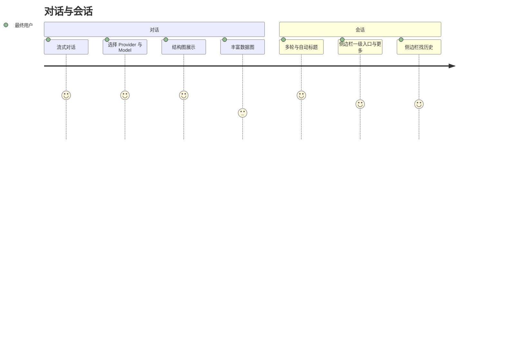
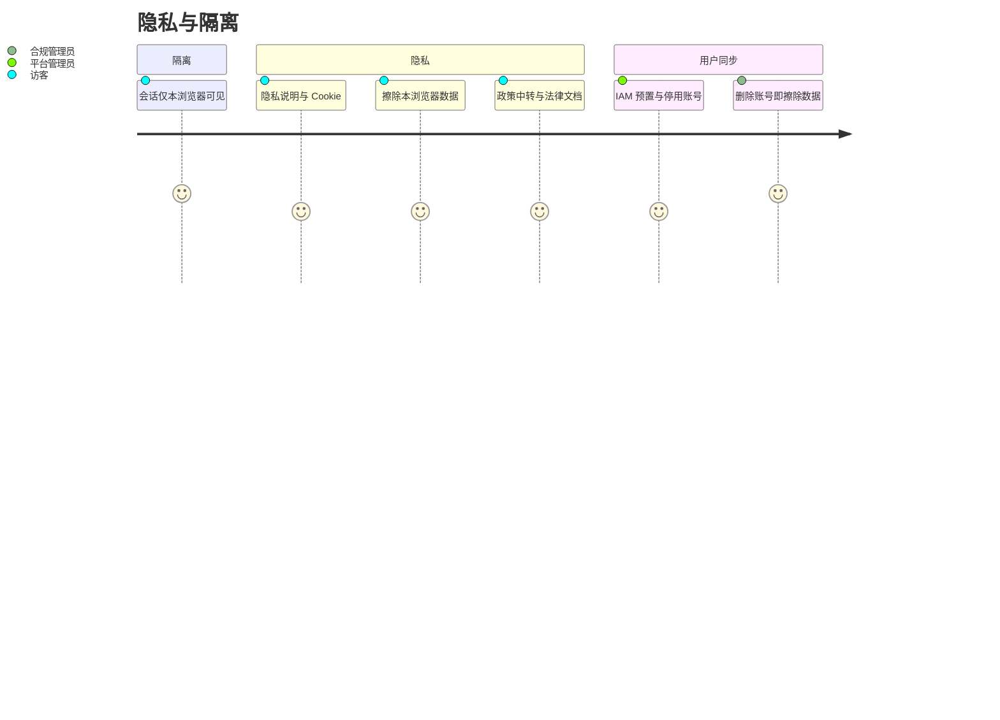
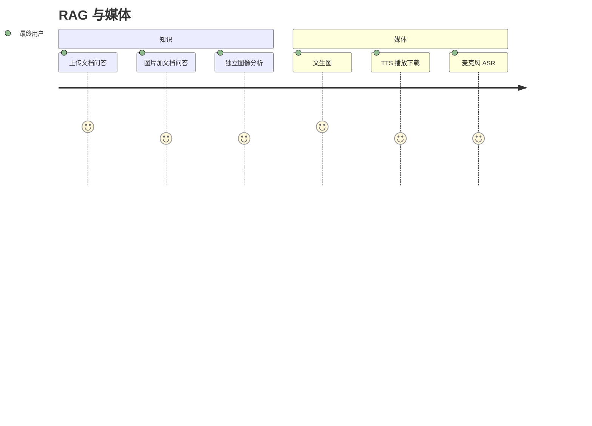
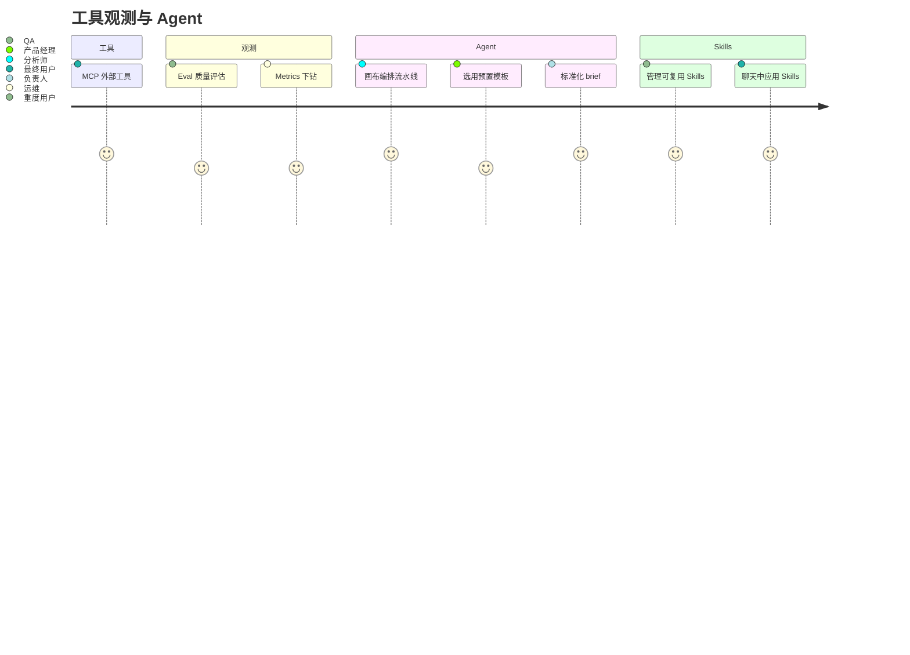

# 用户故事地图 | User Story Map — Explore AI
> Jeff Patton 用户故事地图；正文与验收标准合并于本文（单一文档）。  
> Jeff Patton user-story map; epics and GWT acceptance criteria live in this single document.  
> 格式 / Format：Background → `As a` / `I want` / `So that` → Scenario GIVEN-WHEN-THEN（双语 / bilingual）。

## 用户画像 | Personas

| 角色 / Role | 说明 / Description |
|------|------|
| 最终用户 / End User | 在浏览器中使用对话、RAG、媒体与工具能力 / Uses chat, RAG, media, and tools in the browser |
| 访客 / Guest | 未登录使用 ExploreAI；会话按浏览器隔离 / Uses ExploreAI without login; sessions isolated per browser |
| QA 工程师 / QA Engineer | 在 Eval 页评估回答质量 / Evaluates answer quality on the Eval page |
| 管理员 / Admin | 查看 AI 指标与域健康 / Views AI metrics and domain health |
| 业务分析师 / Business Analyst | 使用 Multi-Agent 工作台与研判输出 / Uses the multi-agent workbench and research outputs |
| 平台工程师 / Platform Engineer | 平台管道、领域建模与 Lab 编排；C4 Code 领域模型已反映当前系统 / Platform pipelines, domain modeling, and Lab orchestration; C4 Code reflects the system |
| 企业员工 / Enterprise Employee | 企业场景（规划） / Enterprise scenarios (planned) |

## 旅程总览 | Journey Overview

### 对话与会话

### 隐私与隔离

### RAG 与视觉 / 媒体

### 工具、观测与 Agent

---

## Backbone 故事地图 | Backbone

### 已交付

| 对话与会话 | 隐私与隔离 | RAG 与视觉 | 媒体 | MCP | 评估与指标 | 工作流 | Skills |
|------------|------------|------------|------|-----|------------|-------------|--------|
| [US-01](#us-01-ai-对话) AI 对话 | [US-04](#us-04-按浏览器隔离聊天会话) 浏览器隔离 | [US-06](#us-06-rag-知识问答) RAG | [US-09](#us-09-图像生成) 图像生成 | [US-12](#us-12-mcp-工具调用) MCP | [US-13](#us-13-chat-质量评估) Eval | [US-15](#us-15-multi-agent-pipeline-工作台) Pipeline | [US-30](#us-30-管理可复用-skills) 管理 Skills |
| [US-02](#us-02-provider--model-选择) Provider/Model | [US-05](#us-05-欧盟隐私告知同意与擦除控制) 隐私控制 / [US-05b](#us-05b-政策中转页与法律文档) 政策文档 | [US-07](#us-07-vision-多模态-rag) Vision RAG | [US-10](#us-10-语音合成-tts) TTS | | [US-14](#us-14-ai-指标看板) Metrics / [US-36](#us-36-lab-与隐私页跟随界面语言) 界面语言覆盖 | [US-16](#us-16-企业工作流模版内置--可自定义) 工作流模版 | [US-31](#us-31-在聊天中应用-skills) 聊天应用 / [US-35](#us-35-工作台页布局与-metrics-一致) 布局与 Metrics 一致 |
| [US-03](#us-03-多轮对话与自动标题) 多轮与标题 | [US-39](#us-39-擦除与登录合并覆盖全部功能数据) 擦除与合并全覆盖 | [US-08](#us-08-图像分析独立) 图像分析 | [US-11](#us-11-流式-asr-语音识别) ASR / [US-11b](#us-11b-原生-voice-conversationios) Voice Conversation iOS | | | [US-17](#us-17-企业研判标准化输出) 标准化输出 / [US-18](#us-18-消费-agent-模版目录) 画布 Worker 目录 | |
| [US-03b](#us-03b-会话地址与切换加载) 会话地址与切换加载 | | | | | | | |
| [US-03c](#us-03c-聊天中的结构图) 聊天结构图 | | | | | | | |
| [US-03d](#us-03d-聊天中的丰富数据图) 丰富数据图 | | | | | | | |

### 已实现（商业化增量）

| 故事 |
|------|
| [US-18b](#us-18b-可选-oauth-登录与访客模式) 可选 Google/GitHub 登录 + 访客模式 |
| [C4 Code 领域模型](../c4-model/README.md#code---领域模型) 对齐 `com.ai.*.domain` 的实体 / 值对象 / 仓储总览（[EXP-356](https://felixzhu.atlassian.net/browse/EXP-356)） |
| [US-37](#us-37-explore-iam-预置与更新账号) Explore IAM 通过 SCIM 预置与停用账号 |
| [US-38](#us-38-删除账号时擦除数据) SCIM 删除账号时擦除数据 |

### 进行中

| 对话与会话 | 商业化与平台 | 企业自动化 |
|------------|--------------|------------|
| [US-03e](#us-03e-聊天中的高级数据图布局) 高级数据图布局 ([EXP-358](https://felixzhu.atlassian.net/browse/EXP-358)) | [US-18](#us-18-商业化底座配额法务页与账号雏形) 商业化底座 | [US-27a](#us-27a-工作流定时任务与邮件结果) 工作流定时 + 邮件 |
| | [US-18c](#us-18c-account-data-isolation-via-owner-key) Owner Key 数据隔离 | ✅ |
| | [US-19](#us-19-rag-etl-管道) RAG ETL | |
| | [US-20](#us-20-文本分析) 文本分析 | |
| | [US-21](#us-21-tools-天气查询) Tools 天气 | |
| | [US-22](#us-22-supervisor-自动路由) Supervisor | |

### 未来（规划中）

| 企业与 Lab |
|------------|
| [US-23](#us-23-aiops-智能运维) AIOps |
| [US-24](#us-24-知识与制度) 知识与制度 |
| [US-25](#us-25-沟通与内容生产) 沟通与内容 |
| [US-26](#us-26-决策支持与运营轻量) 决策支持 |
| [US-27](#us-27-治理与人机协同) 治理 |
| [US-28](#us-28-spring-ai-workflow-原语产品化) Spring AI Workflow Lab |
| [US-29](#us-29-会话导出) 会话导出 |

---

## Epic 索引 | Epic Index

| Epic | 锚点 / Anchor | 状态 / Status |
|------|---------------|---------------|
| E1 对话与会话 | [#e1](#e1) | — |
| E2 隐私与隔离 | [#e2](#e2) | — |
| E3 RAG 与视觉 | [#e3](#e3) | — |
| E4 媒体 | [#e4](#e4) | — |
| E5 MCP | [#e5](#e5) | — |
| E6 评估与指标 | [#e6](#e6) | — |
| E7 Pipeline（工作流） | [#e7](#e7) | — |
| E8 商业化与平台 | [#e8](#e8) | — |
| E9 企业与未来 | [#e9](#e9) | — |
| E10 Skills | [#e10](#e10) | — |
| E11 Deep Agent（已退役） | [#e11](#e11) | — |
| E12 SCIM 用户同步 | [#e12](#e12) | — |
| E13 Agent façade + A2A | [#e13](#e13) | — |
| E14 Agent Gallery 与产品对标互操作 | [#e14](#e14) | — |

---

# 用户故事正文 | User Stories

## E1 对话与会话 / Dialogue remarks

### 背景 | Background

用户在 Chat 页与 AI 流式对话、选择可用模型，并在同一会话中连续追问。系统为会话生成标题，供侧边栏定位。 / User is on Chat Pages and AI Fluid dialogue, selection of available models, and follow-up in the same session. The system generates headers for sessions to locate sidebars.

### US-01 AI 对话 / AI chat

**As a** 最终用户 / End User  
**I want** 与 AI 助手进行流式对话 / and AI Assistant for fluid conversation  
**So that** 回复在对话中流式可见，并可继续追问 / Responses are visible in conversations and can be pursued

#### 验收标准 | Acceptance Criteria

1. **Scenario** 发送消息并看到流式回复 / Can not open message  
   **GIVEN** 用户处于 Chat 页且会话已就绪 / User is on Chat Pages and sessions are ready  
   **WHEN** 用户输入消息并发送 / User enters a message and send  
   **THEN** 界面以流式方式展示助手回复 / Interface displays assistant responses in a fluid manner  
   **AND** 对话结束后完整回答可见 / The full answer can be found after the conversation.  

2. **Scenario** 等待回复时可感知进行中 / We're in the process of waiting for a response.  
   **GIVEN** 用户已发送一条消息且助手尚未结束回复 / User has sent a message and the assistant has yet to reply  
   **WHEN** 用户查看对话区域 / User View Dialog Area  
   **THEN** 可看到回复正在生成或更新中 / Can see responses being generated or updated  

#### 状态 | Status

已实现 / Done

---

### US-02 Provider

**As a** 最终用户 / End User  
**I want** 进入 Chat 页时看到可用的 Provider 与 Model 列表 / Enter Chat Available on Page Provider and Model List  
**So that** 我可以选择模型且无错误提示 / I can choose the model without a hint.

#### 验收标准 | Acceptance Criteria

1. **Scenario** 展示可用 Provider 与 Model / Show Available Provider and Model  
   **GIVEN** 用户打开 Chat 页 / User opens Chat Page  
   **WHEN** 页面加载完成 / Page Load Finished  
   **THEN** 展示可用的 Provider 与 Model 列表 / Show Available Provider and Model List  
   **AND** 不出现因列表加载失败导致的错误提示（列表可用时） / No error hint due to failure to load the list (when list is available))  

2. **Scenario** 选择模型后用于对话 / Select a model for dialogue  
   **GIVEN** Provider 与 Model 列表已展示 / Provider and Model List displayed  
   **WHEN** 用户选择某一 Model 并发送消息 / User Selection Model Send messages  
   **THEN** 对话使用所选模型进行回复 / Dialogue with selected model to respond  

#### 状态 | Status

已实现 / Done

---

### US-03 多轮对话与自动标题 / Multi-cycle dialogue and automatic title

**As a** 最终用户 / End User  
**I want** 在同一会话中连续对话并由系统自动生成会话标题 / Repeat in the same session and automatically generate session titles from the system  
**So that** 我可以记住上下文并在侧边栏快速找到历史会话 / I can remember the context and quickly find the history session in the sidebar.

#### 验收标准 | Acceptance Criteria

1. **Scenario** 同会话连续对话保留上下文 / Keep context for consecutive dialogue  
   **GIVEN** 用户已在当前会话发送过至少一轮对话 / User has sent at least one session of the current session  
   **WHEN** 用户继续发送追问 / user  
   **THEN** 助手回复可基于同一会话上下文 / The assistant's reply can be based on the context of the same session  
   **AND** 消息仍显示在同一会话中 / Message still shows in the same session  

2. **Scenario** 自动标题出现在侧边栏 / Autoheading in Sidebar  
   **GIVEN** 用户已在会话中产生足够内容以生成标题 / User has generated enough content in session to generate title  
   **WHEN** 用户查看会话侧边栏 / User View Session Sidebar  
   **THEN** 该会话显示系统生成的标题 / The session shows the title generated by the system  
   **AND** 用户可借此从侧边栏定位该历史会话 / This allows users to locate the history session from the sidebar  

#### 状态 | Status

已实现 / Done

---

### US-03b 会话地址与切换加载 / Session Address & Switch Load

**As a** 最终用户 / End User  
**I want** 每个会话有稳定地址，切换时有柔和加载反馈 / Each session has a stable address and switch with soft and loaded feedback  
**So that** 刷新后仍停留在当前会话，且切换不会误显示成空对话 / Stay in the current session after refreshing, and toggle does not miss empty conversations

#### 验收标准 | Acceptance Criteria

1. **Scenario** 有历史的会话地址更新 / Historical Session Address Update  
   **GIVEN** 侧边栏有多个已有消息的会话 / Multiple message sessions in the sidebar  
   **WHEN** 用户选择另一会话 / User Select Another Session  
   **THEN** 浏览器地址变为 `/chat/<sessionId>` / Browser Address To `/chat/<sessionId>`  
   **AND** 侧边栏仍高亮所选会话 / The sidebar is still highlighted for selected sessions  

2. **Scenario** 新会话不暴露 id / New session not exposed id  
   **GIVEN** 用户新建或打开尚无消息的会话 / The user creates or opens a session that has no messages yet  
   **WHEN** 会话处于空状态 / Session empty  
   **THEN** 浏览器地址为 `/chat`（不带 sessionId） / Browser Addresses `/chat`(Not sessionId)  
   **AND** 发出第一条消息后地址变为 `/chat/<sessionId>` / After sending the first message, the address becomes `/chat/<sessionId>`  
   **AND** 无消息的会话不写入本地持久化 / Sessions with no messages are not persisted locally  
   **AND** 在 `/chat` 刷新后仍停留在空会话欢迎态，不会自动打开有历史的会话 / Via `/chat` Keep empty session welcome after refreshing, and do not automatically open a history session  
   **AND** 尚无消息的会话不出现在侧边栏会话列表（发出第一条消息后才进入列表） / Sessions with no messages do not appear in the sidebar list until the first message is sent  

3. **Scenario** 首条回复在地址升级后仍实时出现 / The first response appears in real time after the upgrade.  
   **GIVEN** 用户在空会话 `/chat` 发出第一条消息 / contains `/chat` Send the first message.  
   **WHEN** 地址升级为 `/chat/<sessionId>` / `/chat/<sessionId>`  
   **THEN** 助手回复在当前页面流式出现，无需刷新 / The assistant returns the current stream, no refreshing  
   **AND** 「思考中」占位在回复完成后消失 / The "Thinking…" placeholder disappears after the reply completes  

4. **Scenario** 刷新恢复当前会话 / Refresh Current Session  
   **GIVEN** 用户正在查看 `/chat/<sessionId>` / User is viewing `/chat/<sessionId>`  
   **WHEN** 用户刷新页面 / User Refresh Pages  
   **THEN** 仍停留在同一会话并展示其消息历史 / Still staying in the same session and showing his message history  

5. **Scenario** 切换时显示加载占位 / Show loading placeholder when switching  
   **GIVEN** 用户选择另一尚未展示历史的会话 / User selects another session with no history yet displayed  
   **WHEN** 历史消息加载中 / Loading History Messages  
   **THEN** 显示轻量加载占位而非欢迎空态 / Show light load placeholder instead of welcoming empty state  
   **AND** 加载结束后展示消息（或真·空会话欢迎页） / Show messages after loading (or real empty session welcome) Page)  

6. **Scenario** 非法或他人会话重定向 / Unlawful or other session redirection  
   **GIVEN** 地址为不存在或不属于当前身份的 `/chat/<sessionId>` / Address does not exist or does not belong to the current identity `/chat/<sessionId>`  
   **WHEN** 页面尝试打开该会话 / Page tries to open the session  
   **THEN** 直接重定向到 `/chat`，不展示他人内容 / Directly redirect to `/chat`, Do Not Show Others  
   **AND** 不出现 toast  

#### 状态 | Status

已实现 / Done

---

### US-03c 聊天中的结构图 / Structure Chart in Chat

**As a** 最终用户 / End User  
**I want** 助手回复中的结构图以图片形式展示 / The structure of the assistant's reply is presented as a picture  
**So that** 我可以在对话内看懂时序与类设计，而无需拷到站外工具 / I can read time series and type designs in conversation without having to copy them off site.

#### 验收标准 | Acceptance Criteria

1. **Scenario** 完整时序图以图展示 / Full Scheduling Show  
   **GIVEN** 助手回复包含完整的时序结构图 / The assistant reply contains the complete time-series structure  
   **WHEN** 用户在聊天中查看该回复 / must use  
   **THEN** 结构图以图片形式展示 / The structure is presented as a picture  
   **AND** 周围正文仍可读 / The text is still readable.  

2. **Scenario** 完整类图以图展示 / Full class diagram to display  
   **GIVEN** 助手回复包含完整的类结构图 / The assistant reply contains the complete group chart  
   **WHEN** 用户在聊天中查看该回复 / must use  
   **THEN** 结构图以图片形式展示 / The structure is presented as a picture  

3. **Scenario** 流式未完成的图保持平静 / Fluid uncompleted maps remain calm  
   **GIVEN** 结构图仍在流式生成且尚未闭合 / The structure is still flowing and not closed  
   **WHEN** 用户查看回复 / User View Responses  
   **THEN** 其余回复内容仍可读 / The rest of the responses are still readable  
   **AND** 界面不出现失败或空图壳 / Interface does not fail or empty shell  

4. **Scenario** 非法图源保留源码与提示 / Invalid chart sources retain source code and an explanatory hint  
   **GIVEN** 助手回复包含无法绘制的结构图源码 / The assistant reply contains a structure map source that cannot be drawn Code  
   **WHEN** 用户查看回复 / User View Responses  
   **THEN** 原始源码仍可见 / Original source code still visible  
   **AND** 显示简短平静提示说明无法绘制 / Show a short calm hint that cannot be drawn  

5. **Scenario** 普通代码块仍是代码 / The normal code block is still code.  
   **GIVEN** 助手回复包含非结构图的普通围栏代码块 / The assistant answers the normal fence code blocks with non-structured maps  
   **WHEN** 用户查看回复 / User View Responses  
   **THEN** 该块仍以代码块展示 / The piece is still shown in code blocks.  

6. **Scenario** 点击结构图可全屏查看 / Click on the structure chart to view full screen  
   **GIVEN** 助手回复中已展示结构图 / Structure chart displayed in assistant reply  
   **WHEN** 用户点击该图 / User click on this chart  
   **THEN** 结构图以全屏层展示 / The structure is displayed on the full screen  
   **AND** 可关闭回到对话 / Can close back to dialogue  
   **AND** 聊天内联图不展示悬停工具按钮 / Interconnection chart does not show hover tool buttons  

7. **Scenario** 全屏中可下载结构图 / The structure of the full screen can be downloaded  
   **GIVEN** 用户已打开结构图全屏层 / User has opened the full screen of the structure  
   **WHEN** 用户选择下载 / User Select Download  
   **THEN** 浏览器下载 SVG 文件 / Browser Download SVG Documentation  

#### 状态 | Status

已实现 / Done

---

### US-03d 聊天中的丰富数据图 / A rich data map in a chat

**As a** 最终用户 / End User  
**I want** 助手回复中支持更丰富的数据图（含多系列与专用布局） / The assistant responded with support for more extensive data maps (multi-series and specialized layouts))  
**So that** 我可以在对话内比较趋势、分布与多维得分，而无需离开会话 / I can compare trends, distributions and multidimensional scores in conversation without leaving the session.

#### 验收标准 | Acceptance Criteria

1. **Scenario** 专用图类型以图展示 / Special graph type to display  
   **GIVEN** 助手回复包含完整的散点  
   **WHEN** 用户在聊天中查看该回复 / must use  
   **THEN** 图表以可读图片展示 / Charts presented as readable pictures  
   **AND** 周围正文仍可读 / The text is still readable.  

2. **Scenario** 多系列对比图 / Multiseries contrasts  
   **GIVEN** 用户要求在同一类别上比较两个及以上系列 / User requests to compare two and more series in the same category  
   **WHEN** 助手返回完整多系列图 / The assistant returns the full multi-series diagram  
   **THEN** 各系列在图中可区分 / The series can be distinguished in the figure  
   **AND** 图例或标签能标识系列 / Legends or labels identify series  

3. **Scenario** 趋势与量组合图 / Trends and volume combinations  
   **GIVEN** 用户要求同时看趋势与量 / User requests to view trends and volumes simultaneously  
   **WHEN** 助手返回完整组合图 / The assistant returns the full combination  
   **THEN** 两种度量出现在同一图中且标签不互相遮挡 / Both measures appear in the same picture and labels are not hidden from each other  

4. **Scenario** 原有简单图仍可用 / The original simple diagram is still available.  
   **GIVEN** 助手回复包含完整的柱状  
   **WHEN** 用户查看回复 / User View Responses  
   **THEN** 图表仍按原方式展示 / The chart is still shown as it was.  

5. **Scenario** 结构图仍是结构图 / The structure is still the structure.  
   **GIVEN** 用户要求时序或类结构图 / User request time series or class structure  
   **WHEN** 助手回复 / Assistant respond.  
   **THEN** 以结构图图片展示 / Display as a chart image  
   **AND** 不以数据图呈现 / Not as Data Map  

6. **Scenario** 无数据或非法图保持平静 / No data or illegal attempts to remain calm  
   **GIVEN** 工具结果缺少可用数字或图表载荷无效 / The tool result lacks available numbers or chart load is invalid  
   **WHEN** 用户查看回复 / User View Responses  
   **THEN** 界面不出现损坏的空图壳 / Empty shell without damage to interface  
   **AND** 用户仍能看到可读正文或简短平静说明 / Users can still see readable text or brief calm statements  

#### 状态 | Status

已实现 / Done

---

### US-03e 聊天中的高级数据图布局 / Advanced Data Layout in Chat

**As a** 最终用户 / End User  
**I want** 助手回复中支持层级、流向、关系、分布、K 线、多维与日历等高级数据图 / Support level, flow, relationship, distribution in assistant response, K Advanced data graphs such as lines, multi-dimensional and calendars  
**So that** 我可以在对话内把握结构、流向与分布，而无需离开会话 / I can capture structure, direction and distribution in dialogue without leaving the session.

#### 验收标准 | Acceptance Criteria

1. **Scenario** 层级图以图展示 / Level Charts to Show  
   **GIVEN** 助手回复包含完整的矩形树图  
   **WHEN** 用户在聊天中查看该回复 / must use  
   **THEN** 图表以可读图片展示 / Charts presented as readable pictures  
   **AND** 周围正文仍可读 / The text is still readable.  

2. **Scenario** 流向与关系图以图展示 / Flow and relational chart to show  
   **GIVEN** 助手回复包含完整的桑基图或带数值边的关系图 / The assistant reply contains a complete Sankey chart or a relationship with a numerical margin Figure  
   **WHEN** 用户在聊天中查看该回复 / must use  
   **THEN** 图表以可读图片展示 / Charts presented as readable pictures  
   **AND** 不以结构图呈现 / Not presented in structure  

3. **Scenario** 分布与 K 线图以图展示 / Distribution and K Lines to Display  
   **GIVEN** 助手回复包含完整的箱线图或 K 线图 / The assistant reply contains the full box chart or K Line  
   **WHEN** 用户在聊天中查看该回复 / must use  
   **THEN** 图表以可读图片展示 / Charts presented as readable pictures  

4. **Scenario** 多维与日历图以图展示 / Multi-dimensional and calendar charts to display  
   **GIVEN** 助手回复包含完整的平行坐标、主题河流或日历热力 / The assistant reply contains complete parallel coordinates, theme river or calendar heat  
   **WHEN** 用户在聊天中查看该回复 / must use  
   **THEN** 图表以可读图片展示 / Charts presented as readable pictures  

5. **Scenario** 原有数据图仍可用 / The original data diagram is still available.  
   **GIVEN** 助手回复包含完整的柱状  
   **WHEN** 用户查看回复 / User View Responses  
   **THEN** 图表仍按原方式展示 / The chart is still shown as it was.  

6. **Scenario** 结构图仍是结构图 / The structure is still the structure.  
   **GIVEN** 用户要求时序或类结构图 / User request time series or class structure  
   **WHEN** 助手回复 / Assistant respond.  
   **THEN** 以结构图图片展示 / Display as a chart image  
   **AND** 不以数据图呈现 / Not as Data Map  

7. **Scenario** 无数据或非法图保持平静 / No data or illegal attempts to remain calm  
   **GIVEN** 工具结果缺少可用数字或图表载荷无效 / The tool result lacks available numbers or chart load is invalid  
   **WHEN** 用户查看回复 / User View Responses  
   **THEN** 界面不出现损坏的空图壳 / Empty shell without damage to interface  
   **AND** 用户仍能看到可读正文或简短平静说明 / Users can still see readable text or brief calm statements  

#### 状态 | Status

进行中 / In Progress

---

## E2 隐私与隔离 / Privacy and isolation

### 背景 | Background

访客使用 ExploreAI 时，聊天会话按浏览器隔离。产品提供隐私说明、分析 Cookie 选择与本浏览器数据擦除。 / Guests ExploreAI , the chat session is isolated by the browser. Product provides privacy statements, analysis Cookie Select Erase With This Browser Data.

### US-04 按浏览器隔离聊天会话 / Isolate chat sessions by browser by browser

**As a** 使用 ExploreAI 的访客 / ExploreAI Guest  
**I want** 我的聊天会话只对本浏览器可见 / My chat session is only visible to this browser  
**So that** 其他电脑无法看到或操作我的对话 / Other computers can't see or operate my conversation.

#### 验收标准 | Acceptance Criteria

1. **Scenario** 本浏览器可见自己的会话 / This browser can see its own sessions  
   **GIVEN** 访客已在当前浏览器产生聊天会话 / Guests have generated chat sessions in the current browser  
   **WHEN** 访客在同一浏览器再次打开应用 / Guests open again in the same browser  
   **THEN** 仍可看到或继续本浏览器下的会话 / Can still see or continue a session under this browser  

2. **Scenario** 其他电脑看不到该访客会话 / The other computers can't see the guest.  
   **GIVEN** 访客仅在浏览器 A 使用过 ExploreAI / Guests only in browsers A Used ExploreAI  
   **WHEN** 在另一台电脑或另一浏览器打开应用 / Open application on another computer or browser  
   **THEN** 不展示浏览器 A 中的聊天会话 / Do not display browser A Chat Session in  
   **AND** 无法操作浏览器 A 中的对话 / Cannot operate browser A Dialogue in progress  

#### 状态 | Status

已实现 / Done

---

### US-05 欧盟隐私告知、同意与擦除控制 / EU privacy notification, consent and removal control

**As a** 使用 ExploreAI 的访客 / ExploreAI Guest  
**I want** 看到隐私说明、选择分析 Cookie，并能擦除本浏览器数据 / See privacy notes, selection analysis. Cookie, And you can erase this browser data.  
**So that** 我了解处理目的并行使基本隐私控制 / I understand the purpose and exercise basic privacy control.

#### 验收标准 | Acceptance Criteria

1. **Scenario** 查看隐私说明并选择分析 Cookie / View privacy statements and select analysis Cookie  
   **GIVEN** 访客使用 ExploreAI / Guests ExploreAI  
   **WHEN** 访客打开隐私相关说明或同意控件 / Guests open privacy statements or consent controls  
   **THEN** 可看到隐私说明 / Access to privacy notes  
   **AND** 可选择是否启用分析 Cookie / Select whether to enable analysis Cookie  

2. **Scenario** 擦除本浏览器数据 / Erase this browser data  
   **GIVEN** 访客本浏览器已有相关本地或会话数据 / Visitor book browser already has relevant local or session data  
   **WHEN** 访客执行擦除本浏览器数据 / Guests execute eraser data  
   **THEN** 本浏览器相关数据被清除 / This browser data cleared  
   **AND** 访客可继续以干净状态使用应用 / Guests can continue using the app in a clean state  

#### 状态 | Status

已实现 / Done

---

### US-05b 政策中转页与法律文档 / Policy Transit Pages and Legal Documents

**As a** 使用 ExploreAI 的访客 / ExploreAI Guest  
**I want** 从帮助菜单进入政策索引或隐私控制，并阅读使用条款与隐私政策等文档 / Enter policy index or privacy control from the help menu and read documents such as usage clauses and privacy policies  
**So that** 我在两级菜单内即可了解服务规则与数据处理方式（无三级菜单） / I can understand service rules and data processing in two-tier menus.)

#### 验收标准 | Acceptance Criteria

1. **Scenario** 打开政策中转页 / Open policy transition page  
   **GIVEN** 访客使用 ExploreAI / Guests ExploreAI  
   **WHEN** 访客从帮助 → 政策打开中转页或访问 `/policies` / Guests from help → Policy Open Transit or Access `/policies`  
   **THEN** 看到使用条款、隐私政策、Cookie 政策、子处理方的摘要列表 / See the terms of use, privacy policy., Cookie Summary list of policies, subprocessors  
   **AND** 帮助子菜单仅含「政策」与「隐私」两项（政策正文从中转页进入） / The help submenu contains only "policies" and "privacy" (policy body enters from the center page))  

2. **Scenario** 阅读政策正文 / Reading Policy Body  
   **GIVEN** 访客在政策中转页 / Guests in the middle of policy page  
   **WHEN** 访客打开使用条款或隐私政策 / Guests open usage terms or privacy policies  
   **THEN** 看到分章节的政策正文与更新日期 / See the chapter-by-chapter policy text and update date  
   **AND** 正文语言与当前界面语言一致（en  

3. **Scenario** 旧法律链接仍可用 / The old law link is still available  
   **GIVEN** 访客持有旧的 `/legal/...` 书签 / Guests hold old ones. `/legal/...` Bookmarks  
   **WHEN** 打开该地址 / Open this address  
   **THEN** 被带到对应的 `/policies/<slug>` 文档 / They're taken to their counterpart. `/policies/<slug>` Document  

#### 状态 | Status

已实现（Jira: [AI-339](https://felixzhu.atlassian.net/browse/AI-339)）

---

### US-39 擦除与登录合并覆盖全部功能数据 / Erase and login to overwrite all functionality data

**As a** 使用 ExploreAI 的访客或已登录用户 / ExploreAI Guest or Signed-in User  
**I want** 擦除数据或登录合并时，每个功能里属于我的数据都被一起处理 / When erases data or login merges, the data that belongs to me in each function is processed together.  
**So that** 新增功能不会留下漏删或漏合并的数据 / Add function does not leave missing or missing consolidated data

#### 验收标准 | Acceptance Criteria

1. **Scenario** 擦除不留残余 / Erase the residue.  
   **GIVEN** 访客在聊天、文档、Skills、工作流、自动化中都有数据，且产生过调用指标 / Guests talking, documents., Skills, Workstreams, automated data, and generated call indicators  
   **WHEN** 访客擦除本浏览器数据，或 explore-iam 通过 SCIM 删除该用户 / Guests erase the browser data, or explore-iam via SCIM Delete user  
   **THEN** 上述功能中该所有者的数据全部被删除 / All data of the owner in the above feature deleted  
   **AND** 其他访客的数据不受影响 / Data on other guests is unaffected  

2. **Scenario** 登录合并与关联同生共死 / Login merges and links to life and death  
   **GIVEN** 访客在浏览器中已有数据 / Guests have data in the browser  
   **WHEN** 访客登录并关联账号 / Guests login and associated accounts  
   **THEN** 浏览器关联与全部数据合并在同一事务中完成 / Browser association merged with all data in the same transaction  
   **AND** 合并失败时关联也不会生效 / The association will not take effect when the merger fails.  

3. **Scenario** 功能自行处理自己的数据 / Functional self-processing of data  
   **GIVEN** 账号模块发出擦除或合并的领域事件 / Account module sends out removal or consolidation of field events  
   **WHEN** 各功能模块处理该事件 / Functional modules to handle the event  
   **THEN** 每个模块只删除或迁移自己的表 / Each module only removes or moves its own table  
   **AND** 聊天、RAG、工作流、工具、视觉代码不依赖指标模块 / Chat, RAG, Workstreams, tools, visual codes do not rely on indicator modules  

#### 状态 | Status

已实现 / Done

---

## E3 RAG 与视觉 / RAG And visual

### 背景 | Background

用户上传文档做知识问答；可结合图片与文档做多模态问答；或在独立页面做图像描述、检测与 OCR。 / User uploading documents for knowledge questions and answers; multi-modular questions and answers in combination with pictures and documents; or image descriptions, tests and OCR.

### US-06 RAG 知识问答 / RAG knowledge Q&A

**As a** 最终用户 / End User  
**I want** 上传文档并基于文档内容提问 / Upload documents and ask questions based on their contents  
**So that** AI 回答有据可查 / AI There's evidence for that.

#### 验收标准 | Acceptance Criteria

1. **Scenario** 上传文档后基于内容提问 / Question based on content after uploading document  
   **GIVEN** 用户已上传可用于问答的文档 / User has uploaded a document for question and answer purposes  
   **WHEN** 用户就文档内容提问 / User questions about document contents  
   **THEN** AI 基于文档内容给出回答 / AI Answer based on the contents of the document  
   **AND** 回答可对应到文档依据（有据可查） / The answer corresponds to the basis of the document (documented))  

2. **Scenario** 未提供文档时无法依赖文档回答 / Unable to rely on document answers when documents are not available  
   **GIVEN** 用户尚未上传相关文档 / User has not uploaded relevant documents  
   **WHEN** 用户发起依赖文档的知识问答 / User-initiated document-dependent knowledge questions Answer  
   **THEN** 系统不表现为已基于该文档作答 / The system does not appear to have been answered on the basis of this document  
   **AND** 用户可先上传文档再提问 / Users can upload documents before asking questions  

#### 状态 | Status

已实现 / Done

---

### US-07 Vision 多模态 RAG / Vision Multimodular RAG

**As a** 最终用户 / End User  
**I want** 在文档问答中专注文本提问与文档依据 / Focus on text questions and document bases in document questions and answers  
**So that** 输入区不被附图控件打断（图像分析走独立视觉页） / The input area is not interrupted by a graphic control (image analysis takes independent visual) Page)

#### 验收标准 | Acceptance Criteria

1. **Scenario** 文档问答作曲家无附图入口 / Document Query Composer without a chart entry  
   **GIVEN** 用户打开文档问答 / User opens Document Q & Questions  
   **WHEN** 查看消息输入区 / View Message Input Area  
   **THEN** 输入框左侧无图片按钮 / No pictures button on the left side of the input box  
   **AND** 仍可通过侧栏上传文档后提问 / Ask after uploading the document through the sidebar  

2. **Scenario** 图像分析走独立能力 / Image analysis independent capability  
   **GIVEN** 用户需要描述  
   **WHEN** 打开独立图像分析页 / Open independent image analysis page  
   **THEN** 可完成结构化视觉分析（见 US-08） / Structured visual analysis completed (see US-08)  

#### 状态 | Status

已实现（Jira: [AI-340](https://felixzhu.atlassian.net/browse/AI-340)；Doc Q&A 附图入口已移除）

---

### US-08 图像分析（独立） / Image analysis (independent))

**As a** 最终用户 / End User  
**I want** 在独立页面完成图像描述、目标检测与 OCR / Finish image description, target detection and OCR  
**So that** 无需进入 RAG 对话即可获得结构化视觉分析结果 / No access. RAG Dialogue allows for structured visual analysis

#### 验收标准 | Acceptance Criteria

1. **Scenario** 独立页完成描述、检测与 OCR / Independent page completed description, testing and OCR  
   **GIVEN** 用户打开独立图像分析页面并提供图像 / Users open independent image analysis pages and provide images  
   **WHEN** 用户触发图像分析 / User Trigger Image Analysis  
   **THEN** 可获得图像描述、目标检测与 OCR 相关结果 / Image description, target detection and OCR Relevant results  
   **AND** 无需进入 RAG 对话页即可完成 / No access. RAG dialogue page complete  

2. **Scenario** 结果为结构化视觉分析 / The result is structured visual analysis.  
   **GIVEN** 图像分析已成功完成 / Image analysis successfully completed  
   **WHEN** 用户查看结果区域 / User View Result Area  
   **THEN** 结果以可阅读的结构化形式展示（描述  

#### 状态 | Status

已实现 / Done

---

## E4 媒体 / Media

### 背景 | Background

用户用文字生成图像；将文本合成为语音并播放或下载；经麦克风实时转写语音为文字，再与 AI 交互。 / Users generate images in text; synthesize text into voice and play or download it; and translate voice into text in real time through microphones and then with AI Interactive.

### US-09 图像生成 / Image Generation

**As a** 最终用户 / End User  
**I want** 用文字描述生成图像 / Generate images with text description  
**So that** 生成结果可下载或用于后续对话 / Generate results that can be downloaded or used for subsequent dialogues

#### 验收标准 | Acceptance Criteria

1. **Scenario** 文字描述生成图像 / Text description to generate images  
   **GIVEN** 用户处于图像生成相关页面或入口 / User is on page or entry for image generation  
   **WHEN** 用户输入文字描述并请求生成 / User input text description and request generation  
   **THEN** 系统返回生成的图像 / System returns the resulting image  
   **AND** 用户可查看该视觉素材 / Users can view the visual material  

2. **Scenario** 生成失败时有可感知反馈 / Sensible feedback when generating failure  
   **GIVEN** 用户已提交生成请求 / User has submitted a request for generation  
   **WHEN** 生成未能成功完成 / Generate failed successfully  
   **THEN** 用户能感知失败或错误反馈 / User can sense failure or error feedback  
   **AND** 可调整描述后重试 / Try again after adjusting the description  

#### 状态 | Status

已实现 / Done

---

### US-10 语音合成 TTS / Speech synthesis TTS

**As a** 最终用户 / End User  
**I want** 将文本合成为语音并播放或下载 / Synthesizing text as voice and playing or downloading  
**So that** 我可以听读 AI 输出的内容 / I can read it. AI Output Contents

#### 验收标准 | Acceptance Criteria

1. **Scenario** 文本合成并可播放 / Text synthesis and playable  
   **GIVEN** 用户有待合成的文本 / Text to be synthesized by user  
   **WHEN** 用户请求语音合成 / User requests voice synthesis  
   **THEN** 系统生成可播放的语音 / System to generate playable voice  
   **AND** 用户可播放以听读内容 / Users can play to read content  

2. **Scenario** 下载合成语音 / Download Synthetic Voice  
   **GIVEN** 语音合成已成功 / Voice synthesis successful  
   **WHEN** 用户选择下载 / User Select Download  
   **THEN** 用户可获得语音文件用于本地下载 / Users can access voice files for local lower use Load  

#### 状态 | Status

已实现 / Done

---

### US-11 流式 ASR 语音识别 / streaming ASR Voice recognition

**As a** 最终用户 / End User  
**I want** 通过麦克风实时转写语音为文字 / Convert voice to text in real time via microphone  
**So that** 我可以用语音输入与 AI 交互 / I can enter with voice. AI Interactive

#### 验收标准 | Acceptance Criteria

1. **Scenario** 麦克风实时转写为文字 / The microphone is translated into text in real time.  
   **GIVEN** 用户处于支持语音输入的界面且允许麦克风 / User is in an interface that supports voice input and allows microphones  
   **WHEN** 用户通过麦克风说话 / Users speak via microphones.  
   **THEN** 语音被实时转写为文字 / Voice is converted to text in real time  
   **AND** 文字可用于继续与 AI 交互 / Text to continue AI Interactive  

2. **Scenario** 无麦克风权限时无法完成转写 / Transcription cannot complete without microphone permission  
   **GIVEN** 浏览器未授予麦克风权限 / Browser does not grant microphone privacy  
   **WHEN** 用户尝试语音输入 / User tried voice input  
   **THEN** 无法完成实时转写 / Could not complete real time transfer  
   **AND** 用户仍可改用文字输入 / User can still enter text instead  

#### 状态 | Status

已实现 / Done

---

### US-11b 原生 Voice Conversation（iOS） / Native Voice Conversation(iOS)

**As a** 最终用户 / End User  
**I want** 在 AI iOS 上用实时语音与助手对话 / Via AI iOS Talk to your assistant with real-time voice.  
**So that** 我可以边说边听，无需打字 / I can talk and listen without typing.

#### 验收标准 | Acceptance Criteria

1. **Scenario** 语音对话闭环 / Voice Conversation Closed  
   **GIVEN** 已登录 IAM 且 explore-ai  
   **WHEN** 用户打开 Voice Conversation 并允许麦克风 / User opens Voice Conversation And allow microphones.  
   **THEN** 说话内容经流式 ASR 转写 / Word flow ASR Convert  
   **AND** 助手回复经 TTS 播报 / Assistant reply. TTS Report  

2. **Scenario** 打断播报 / Interrupted.  
   **GIVEN** 助手正在播报 / The assistant is broadcasting.  
   **WHEN** 用户再次说话 / User Speaks Again  
   **THEN** 播报停止并继续听取 / The broadcast stopped and continued.  

#### 状态 | Status

已实现 / Done

---

## E5 MCP

### 背景 | Background

用户在对话中调用已接入的外部工具，使 AI 完成查天气、搜文档等超出纯文本的任务。 / Users call on accessed external tools in dialogue so that AI Completion of weather check, document search, etc. beyond plain text.

### US-12 MCP 工具调用 / MCP Tool Call

**As a** 最终用户 / End User  
**I want** 在对话中调用已接入的外部工具 / Call external access tools in dialogue  
**So that** AI 能完成查天气、搜文档等超出纯文本的任务 / AI I've been able to check the weather, search the documents, and so on.

#### 验收标准 | Acceptance Criteria

1. **Scenario** 对话中调用已接入工具 / Called Accessed Tool in Dialogue  
   **GIVEN** 系统已接入可用的外部工具 / The system has access to available external tools  
   **WHEN** 用户在对话中提出需要工具完成的请求（如查天气、搜文档） / User requests for tools during the dialogue (e.g., weather check, document search))  
   **THEN** AI 能调用相应已接入工具 / AI Can call the corresponding access tool  
   **AND** 用户获得超出纯文本生成的任务结果 / User gets task results beyond plain text generation  

2. **Scenario** 未接入所需工具时不能伪造成功调用 / Successful calls cannot be forged without access to required tools  
   **GIVEN** 用户请求依赖尚未接入的工具能力 / User requests rely on unconnected tool capabilities  
   **WHEN** 用户在对话中发出该请求 / Users send the request during the dialogue  
   **THEN** 系统不表现为已成功调用该未接入工具 / The system does not reflect a successful call to the unconnected tool  
   **AND** 用户仍可看到对话层面的说明或普通回复 / Users can still see description at the level of the dialogue or general responses  

#### 状态 | Status

已实现 / Done

---

## E6 评估与指标 / Assessment and indicators

### 背景 | Background

QA 在 Eval 页自动评估 AI 回答质量。管理员/运维查看请求量、延迟、错误率与域健康，并下钻到调用明细。 / QA Via Eval Autoassessment of page AI Quality of answer. Admin/Transport to check requests, delays, error rates and domain health and drill down to call details.

### US-13 Chat 质量评估 / Chat Quality assessment

**As a** QA 工程师 / QA Engineer  
**I want** 在 Eval 页自动评估 AI 回答的质量 / Via Eval Autoassessment of page AI Quality of responses  
**So that** 我可以量化对话效果并持续改进 / I can quantify the effectiveness of the dialogue and keep improving.

#### 验收标准 | Acceptance Criteria

1. **Scenario** 在 Eval 页发起自动评估 / Via Eval Page initiates automatic assessment  
   **GIVEN** QA 工程师打开 Eval 页 / QA Engineer open Eval Page  
   **WHEN** 触发对 AI 回答的质量评估 / Trigger right. AI Quality assessment of responses  
   **THEN** 系统自动完成评估并展示结果 / The system automatically completes the assessment and displays the results  
   **AND** 结果可用于量化对话效果 / Results can be used to quantify dialogue effects  

2. **Scenario** 评估结果可用于对比改进 / Results of evaluations can be used for comparative improvements  
   **GIVEN** 至少一次评估已完成 / At least one assessment completed  
   **WHEN** QA 查看评估输出 / QA View Assessment Output  
   **THEN** 可看到可比较或可记录的质量信息 / Available comparable or recordable quality information  
   **AND** 可用于后续改进判断 / Available for subsequent improvement judgement  

#### 状态 | Status

已实现 / Done

---

### US-17 Chat

**As a** QA 工程师 / QA Engineer  
**I want** 用固定黄金集对 Chat 与 Document QA 的真实回答做回归评估 / With fixed gold. Chat and Document QA The real answer is a regression assessment.  
**So that** 提示词或模型变更导致的质量回退能在发版前被发现 / Quality retreat caused by a change in the hint or model can be detected before release

#### 验收标准 | Acceptance Criteria

1. **Scenario** 运行 Chat 黄金集 / Run Chat Gold Collection  
   **GIVEN** Chat 黄金 JSONL 已就绪 / Chat Gold JSONL Ready  
   **WHEN** 执行黄金评估集成测试 / Implementation of integrated gold assessment tests  
   **THEN** 每条用例对真实生成结果给出通过/失败与评估反馈 / Each example gives approval to the actual result of the generation/Failure and assessment feedback  
   **AND** 汇总通过率可用 / Summary pass rate available  

2. **Scenario** 运行 Document QA 黄金集 / Run Document QA Gold Collection  
   **GIVEN** RAG 黄金 JSONL 与 fixture 文档已就绪 / RAG Gold JSONL and fixture Document ready  
   **WHEN** 执行黄金评估集成测试 / Implementation of integrated gold assessment tests  
   **THEN** 每条用例基于检索或参考上下文打分 / Rating for each example based on search or reference context  
   **AND** 汇总通过率可用 / Summary pass rate available  

#### 状态 | Status

已实现 / Done

---

### US-14 AI 指标看板 / AI metrics dashboard

**As a** 管理员 / Admin  
**I want** 查看 AI 请求量、延迟、错误率与域健康，并能下钻到调用明细 / View AI Request volume, delay, error rate and domain health, with access to call details  
**So that** 我可以快速定位异常调用并继续排查 / I can quickly locate unusual calls and keep checking.

#### 验收标准 | Acceptance Criteria

1. **Scenario** 查看聚合指标与域健康 / View aggregate indicators and domain health  
   **GIVEN** 管理员 / Admin  
   **WHEN** 看板数据加载完成 / Board data loaded.  
   **THEN** 可查看 AI 请求量、延迟、错误率与域健康相关信息 / Viewable AI Request quantity, delay, error rate and domain health-related information  

2. **Scenario** 下钻到调用明细 / Down to call.  
   **GIVEN** 看板已展示聚合指标 / The panel has shown the aggregate indicators.  
   **WHEN** 用户下钻某一异常或关注项 / Users drill down an anomaly or concern  
   **THEN** 可查看相关调用明细 / View relevant call details  
   **AND** 便于继续排查 / It's easy to keep running.  

#### 状态 | Status

已实现 / Done

---

### US-36 Lab 与隐私页跟随界面语言 / Lab Follow interface language with privacy page

**As a** 访客 / Guest  
**I want** Metrics、Eval、ASR、MCP 与隐私页的界面文案跟随已选语言 / Metrics, Eval, ASR, MCP Interface text files with privacy pages follow selected languages  
**So that** 切换语言后 Lab 与隐私相关页面不再残留英文硬编码 / After Switching Language Lab No more hard English coding on privacy-related pages

#### 验收标准 | Acceptance Criteria

1. **Scenario** Lab 页文案随语言切换 / Lab Pages are changed by language  
   **GIVEN** 访客已选择界面语言（en  
   **WHEN** 打开 Metrics、Eval、ASR 或 MCP 页 / Open Metrics, Eval, ASR or MCP Page  
   **THEN** 标题、表单、状态、错误与表格列头等 UI 文案使用该语言 / Title, form, status, error and table first UI The language is used in the case.  
   **AND** 品牌名 ExploreAI 保持不翻译 / Brand name ExploreAI is not translated  

2. **Scenario** 隐私页完整本地化 / Complete localization of privacy pages  
   **GIVEN** 访客选择 ja  
   **WHEN** 打开隐私页 / Open Private Page  
   **THEN** 告知、子处理方用途与控制文案为对应语言（非英文占位） / Notification, sub-processor use and control of the language (non-English position))  
   **AND** 子处理方品牌名（DeepSeek、OpenAI 等）保持原样 / Subprocessor brand name(DeepSeek, OpenAI remain unchanged.  

3. **Scenario** 共享 chrome 无障碍文案随语言 / Share chrome Accessible languages  
   **GIVEN** 访客已选择界面语言 / Guests selected interface language  
   **WHEN** 使用侧栏、顶栏菜单、语言选择器、RAG 删除文档或 TTS 播放控制 / Use sidebar, topbar menu, language selection, RAG Delete Document or TTS Play Control  
   **THEN** 相关 aria-label 使用当前语言 / Relevant aria-label Use current language  

#### 状态 | Status

已实现（Jira: [AI-341](https://felixzhu.atlassian.net/browse/AI-341)）

---

## E7 Pipeline（工作流） / Pipeline (workflows)

### 背景 | Background

业务分析师在画布编排工作流并流式审阅阶段与结果。产品经理一键选用预置模板。研判输出以 Fact

### US-15 工作流工作台 / Workflow workbench

**As a** 业务分析师 / Business Analyst  
**I want** 在画布上编排工作流并流式审阅阶段与结果 / Placing workflow reading stages and results on canvas  
**So that** 我可以按企业流程定制多步 AI 工作流 / I can customize it to business processes. AI Workstream

#### 验收标准 | Acceptance Criteria

1. **Scenario** 画布编排工作流 / Layout Workstream  
   **GIVEN** 业务分析师打开工作流工作台 / Business analyst opens the workflow Station  
   **WHEN** 在画布上编排工作流 / Draw workflows on canvass  
   **THEN** 工作流结构可见并可按多步流程定制 / Workstream structure is visible and can be customized to multi-step processes  

2. **Scenario** 流式审阅阶段与结果 / Fluent review phase and results  
   **GIVEN** 已编排并可运行的工作流 / Scheduled and running workflows  
   **WHEN** 在画布任务框填写任务并点击 Run / Fill in the canvas task box and click Run  
   **THEN** 可流式审阅各阶段进展与结果 / Review of progress and results at all stages in a truncated manner  
   **AND** 最终结果可在右侧结果轨查看（结果轨不再作为主任务输入） / Final results can be viewed on the right result track (result tracks are no longer entered as main task))  

3. **Scenario** 编辑节点 Agent 副本 / Edit Node Agent Copy  
   **GIVEN** 画布上已有 Worker 节点 / It's on the canvas. Worker Nodes  
   **WHEN** 双击该节点并修改名称  
   **THEN** 仅本图画布副本变更，再次运行时 invoke 使用节点快照 / Only copy of this canvas changed, running again invoke Use node snapshot  

#### 状态 | Status

已实现 / Done

---

### US-16 企业工作流模版（内置 + 可自定义） / Business Flow Template (Inlined) + Customise)

**As a** 产品经理 / Product Manager  
**I want** 从多语言内置模版一键选用，并可添加到我的模版库后自定义 / Select a key from the embedded template in multiple languages and then customise it after adding it to my template library  
**So that** 常见企业研判无需从零搭图，且可按团队流程沉淀模版 / Common business studies do not need to be based on a zero-sum map and can sink in a team process.

#### 验收标准 | Acceptance Criteria

1. **Scenario** 一键选用多语言内置模版 / Select a multiple-language internal template for one key  
   **GIVEN** 工作台从后端加载当前语言的预置编排模版 / Load preset template for the current language from the back of the desk  
   **WHEN** 产品经理一键选用某一模版 / The Product Manager selects a template in one key  
   **THEN** 画布加载该模版对应的编排 / The canvas carries the corresponding layout of the template  
   **AND** 无需从零搭图即可开始 / You don't have to start with a zero.  

2. **Scenario** 添加并自定义我的模版 / Add and customise my template  
   **GIVEN** 产品经理打开工作流工作台 / The Product Manager opens the workflow desk.  
   **WHEN** 将内置模版添加到库、自定义字段并保存 / Add the built-in template to the library, custom field and save  
   **THEN** 我的模版列表可见该条目 / My template list is available for this entry.  
   **AND** 可再次选用、编辑、启停或删除 / Could re-select, edit, suspend or delete  

3. **Scenario** 选用后可运行研判类流程 / Selectively run the study class process  
   **GIVEN** 已选用企业研判相关模版 / Selected business studies of relevant templates  
   **WHEN** 按模版运行 / Run by Template  
   **THEN** 可得到基于该模版的流程输出 / Can get process output based on this template  

#### 状态 | Status

已实现 / Done

---

### US-17 企业研判标准化输出 / Corporate research standardized output

**As a** 业务或技术负责人 / Business or Technical Lead  
**I want** Analyst 以 Fact  
**So that** 研判结果可复核、可汇报 / Results reviewed and reported

#### 验收标准 | Acceptance Criteria

1. **Scenario** brief 含 Fact  
   **GIVEN** 用户运行会产生 Analyst brief 的研判流程 / The user will be running. Analyst brief must use  
   **WHEN** 流程完成并展示 brief / Process completed and displayed brief  
   **THEN** 输出包含 Fact、Inference、Recommendation 结构 / Output contains Fact, Inference, Recommendation Structure  
   **AND** 内容可用于复核与汇报 / Content for review and reporting  

2. **Scenario** 结构完整便于汇报 / Complete structure to facilitate reporting  
   **GIVEN** brief 已生成 / brief Generated  
   **WHEN** 负责人阅读输出 / Responsible Read Output  
   **THEN** 可区分事实、推断与建议 / Distinguishing facts, inferences and recommendations  
   **AND** 不必自行重组结构即可汇报 / You don't have to restructure yourself to report.  

#### 状态 | Status

已实现 / Done

---

### US-18 消费画布 Worker 目录 / Consumer canvas Worker Contents

**As a** 业务分析师 / Business Analyst  
**I want** 工作流调色板从多语言内置目录加载 Worker，并在画布上编辑节点副本 / Workflow palette loaded from a multilingual inner directory Worker, And edit a copy of the node on the canvas.  
**So that** 无需独立 Agent 模块也能定制每步角色与工具 / No need for independence. Agent Modules can also customise every role and tool

#### 验收标准 | Acceptance Criteria

1. **Scenario** 调色板随语言本地化 / Palette Localize with Language  
   **GIVEN** 我切换 UI 语言 / I'll switch. UI Languages  
   **WHEN** 打开工作流调色板 / Open Work Stream Palette  
   **THEN** Agent 名称与描述来自 `GET /api/pipelines/agent-types?lang=` / Agent Name and description from `GET /api/pipelines/agent-types?lang=`  

2. **Scenario** 模版选用可视化选 Agent / Template selection with visual selection Agent  
   **GIVEN** 我创建或编辑工作流模版 / I create or edit workflow models Version  
   **WHEN** 选择参与编排的 Workers / Selection of participants Workers  
   **THEN** 通过调色板点选与排序完成（而非手输逗号分隔 typeKey） / Finish by selecting and sorting by palette (rather than hand-lost comma) typeKey)  

#### 状态 | Status

已实现 / Done

---

## E8 商业化与平台 / Commercialization and Platforms

### 背景 | Background

进行中能力：商业化最小入口（配额、法务、Metrics 上锁、匿名账号）；可选 Google/GitHub OAuth 登录（访客模式保留）；可插拔 RAG ETL；文本情感分析；天气工具领域化；Supervisor 自动分派专家 Agent。 / In Progress capabilities: minimal commercial entry (quotas, legal pages, Metrics lock, anonymous accounts); optional Google/GitHub OAuth sign-in (guest mode retained); pluggable RAG ETL; text sentiment analysis; weather tool as domain capability; Supervisor auto-routes to expert Agents.

### US-18 商业化底座：配额、法务页与账号雏形 / Commercial foundation: quotas, legal pages, and account baseline

**As a** ExploreAI 访客与运营方 / ExploreAI Guest and Operator  
**I want** 日配额保护成本、法务文档可访问、Metrics 可按需上锁，并看到匿名账号状态 / Cost of daily quota protection, access to legal files, Metrics Lock as required and see anonymous account status  
**So that** 产品具备可商业化的最小计费与合规入口 / The product has the most commercial sub-cost and compliance portal

#### 验收标准 | Acceptance Criteria

1. **Scenario** 日配额与法务、账号状态可见 / The daily quota and the law, account status is visible.  
   **GIVEN** 访客或运营方使用产品相关入口 / Guests or operators use product-related portals  
   **WHEN** 访问涉及用量或账号的界面 / Access to an interface with usage or account  
   **THEN** 日配额可保护成本相关使用 / The daily quota protects the cost-related use  
   **AND** 法务文档可访问 / Legal documents are accessible  
   **AND** 可看到匿名账号状态 / Can see anonymous account status  

2. **Scenario** Metrics 可按需上锁 / Metrics Lock it as required.  
   **GIVEN** Metrics 能力已部署 / Metrics Capacity deployed  
   **WHEN** 运营方按需启用上锁 / Operator enabled lock as required  
   **THEN** Metrics 访问受上锁策略约束 / Metrics Access subject to locking strategy  
   **AND** 仍服务于可商业化的最小合规入口 / Still serves the smallest commercial compliance portal  

#### 状态 | Status

进行中 / In Progress

---

### US-18b 可选 OAuth 登录与访客模式 / Optional OAuth Login and Guest Mode

**As a** ExploreAI 访客 / ExploreAI Guest  
**I want** 在保留访客模式的同时可选 Google 或 GitHub 登录，并随时登出 / Optional while retaining guest mode Google or GitHub Login and login at any time  
**So that** 我可以按需绑定身份而不被强制登录墙挡住 / I can tie up my identity as required without being forced into the wall.

#### 验收标准 | Acceptance Criteria

1. **Scenario** 未配置 OAuth 时仍为访客 / Not configured OAuth Still a visitor.  
   **GIVEN** Google 与 GitHub OAuth 均未启用 / Google and GitHub OAuth None enabled  
   **WHEN** 打开侧栏账号菜单 / Open sidebar account menu  
   **THEN** `/api/account/me` 返回 `mode=anonymous` / `/api/account/me` returns `mode=anonymous`  
   **AND** 不显示登录入口（`loginAvailable=false`，`loginProviders=[]`） / Do not show login entrance(`loginAvailable=false`, `loginProviders=[]`)  
   **AND** 会话仍按 Anonymous id 隔离 / Session still press Anonymous id Segregation  

2. **Scenario** 启用 Google 后可登录 / Enable Google Later login  
   **GIVEN** `APP_OAUTH_GOOGLE_ENABLED=true` 且 Client 凭证已配置 / `APP_OAUTH_GOOGLE_ENABLED=true` and Client must use  
   **WHEN** 用户选择 Continue with Google 并完成授权 / User Selection Continue with Google And complete the authorization.  
   **THEN** 账号关联到当前 Anonymous id / Account Link to Current Anonymous id  
   **AND** `/api/account/me` 返回 `mode=authenticated` 与邮箱 / `/api/account/me` returns `mode=authenticated` and email  
   **AND** 侧栏显示登出 / Sidebar Show Logout  

3. **Scenario** 启用 GitHub 后可登录 / Enable GitHub Later login  
   **GIVEN** `APP_OAUTH_GITHUB_ENABLED=true` 且 GitHub OAuth App 凭证已配置 / `APP_OAUTH_GITHUB_ENABLED=true` and GitHub OAuth App must use  
   **WHEN** 用户选择 Continue with GitHub 并完成授权 / User Selection Continue with GitHub And complete the authorization.  
   **THEN** 账号关联到当前 Anonymous id（`provider=github`） / Account Link to Current Anonymous id(`provider=github`)  
   **AND** `/api/account/me` 返回 `mode=authenticated` / `/api/account/me` returns `mode=authenticated`  
   **AND** `loginProviders` 包含 `github` / `loginProviders` contains `github`  

4. **Scenario** 登出后回到访客 / Get back to the guests after boarding.  
   **GIVEN** 用户已登录 / User Login  
   **WHEN** 用户选择 Log out / User Selection Log out  
   **THEN** 会话认证清除 / session  
   **AND** 仍可使用访客模式（Anonymous id cookie 保留） / Guest mode still available(Anonymous id cookie Reservations)  

#### 状态 | Status

已实现 / Done

---

### US-18c Account data isolation via Owner Key

**As a** ExploreAI visitor who signs in  
**I want** my guest-browser data to move under my account partition after OAuth  
**So that** the same sessions and library items follow me across devices once authenticated

#### 验收标准 | Acceptance Criteria

_（无） / (none)_

#### 状态 | Status

已实现 / Done

---

### US-19 RAG ETL 管道 / RAG ETL Pipes

**As a** 平台工程师 / Platform Engineer  
**I want** 通过可插拔的 ETL 端口处理不同格式文档 / It's plugged through. ETL Port processes documents in different formats  
**So that** 新增文档类型时无需修改应用层代码 / No changes in application layer codes are required to add new document type

#### 验收标准 | Acceptance Criteria

1. **Scenario** 经 ETL 端口处理不同格式文档 / Via ETL Port processes documents in different formats  
   **GIVEN** 平台提供可插拔 ETL 端口 / Platform provides plug-in ETL Port  
   **WHEN** 接入或处理某一文档格式 / Access or process a document format  
   **THEN** 文档经该端口完成处理流水线 / The document completes the current line through the port  

2. **Scenario** 新增文档类型不改应用层 / Add a new document type without changing the application layer  
   **GIVEN** 需要支持新的文档类型 / Need to support new document type  
   **WHEN** 通过扩展 ETL 端口实现该类型 / By Extension ETL Port achieves this type  
   **THEN** 无需修改应用层代码即可纳入处理 / Add to processing without changing the application layer code  

#### 状态 | Status

进行中 / In Progress

---

### US-20 文本分析 / Text Analysis

**As a** 管理员 / Admin  
**I want** 对文本进行结构化情感分析 / Structured emotional analysis of texts  
**So that** 我可以了解用户反馈的情绪倾向 / I can understand the mood for feedback.

#### 验收标准 | Acceptance Criteria

1. **Scenario** 对文本做结构化情感分析 / Structured emotional analysis of text  
   **GIVEN** 管理员提供待分析文本 / Admin provides text to be analysed  
   **WHEN** 触发文本情感分析 / Trigger text emotional analysis  
   **THEN** 得到结构化的情感分析结果 / Get a structured emotional analysis.  

2. **Scenario** 结果反映情绪倾向 / The result reflects emotional tendencies.  
   **GIVEN** 情感分析已完成 / Emotional analysis completed.  
   **WHEN** 管理员查看结果 / Admin to view results  
   **THEN** 可了解用户反馈的情绪倾向 / Understand the emotional orientation of user feedback  

#### 状态 | Status

进行中 / In Progress

---

### US-21 Tools 天气查询 / Tools contains

**As a** 开发者 / Developer  
**I want** 通过充血领域模型封装天气查询逻辑 / Encapsulating weather query logic through a blood field model  
**So that** 工具调用遵循领域建模最佳实践 / Tool calls for best practices in field-based compliance modelling

#### 验收标准 | Acceptance Criteria

1. **Scenario** 天气查询逻辑由领域模型承载 / Weather query logic is carried by field models  
   **GIVEN** 天气查询作为工具能力存在 / Weather queries exist as tools  
   **WHEN** 开发者查看或扩展天气查询 / Developer view or expand weather queries  
   **THEN** 查询逻辑封装在充血领域模型中 / Query logical encapsulation in a blood-filled field model Medium  

2. **Scenario** 工具调用符合领域建模实践 / Tool call match field modelling practice  
   **GIVEN** 天气工具被调用 / Weather tool is invoked  
   **WHEN** 执行查询 / Execute queries  
   **THEN** 调用路径遵循领域建模最佳实践（相对贫血脚本式堆砌） / Call paths follow best practice in field modelling (relative to anemia script stack))  

#### 状态 | Status

进行中 / In Progress

---

### US-22 Supervisor 自动路由 / Supervisor Auto route

**As a** 最终用户 / End User  
**I want** 描述任务后由 Supervisor 自动分派专家 Agent / Synchronising folder Supervisor Automatic assignment of experts Agent  
**So that** 我不必手动设计流水线 / I don't have to design water lines manually.

#### 验收标准 | Acceptance Criteria

1. **Scenario** 描述任务后自动分派专家 Agent / Automatically assign experts after describing tasks Agent  
   **GIVEN** Supervisor 路由能力可用 / Supervisor Route capacity available  
   **WHEN** 用户描述任务 / must use  
   **THEN** Supervisor 自动分派合适的专家 Agent / Supervisor Automatically assign appropriate experts Agent  
   **AND** 用户不必手动设计流水线 / Users don't have to design current lines manually.  

2. **Scenario** 用户无需搭图即可推进任务 / Users can advance the mission without mapping  
   **GIVEN** 用户仅提供任务描述 / must use  
   **WHEN** 系统完成分派与执行入口 / System complete assignment and implementation portal  
   **THEN** 用户可在不手动编排画布的情况下获得后续处理 / Users can receive follow-up without manual layout  

#### 状态 | Status

进行中 / In Progress

---

## E9 企业与未来 / Business and the future

### 背景 | Background

规划中能力：AIOps、知识与制度、沟通与内容生产、决策支持、治理与人机协同、Spring AI Workflow Lab、会话导出。以下验收标准仅复述故事意图，不扩展范围。 / Planned capabilities: AIOps, knowledge and policy, content production, decision support, governance and human–AI collaboration, Spring AI Workflow Lab, session export. Acceptance criteria below restate story intent only and do not expand scope.

### US-23 AIOps 智能运维 / AIOps Smart travel

**As a** 管理员 / Admin  
**I want** 监控系统健康、用自然语言查日志并收到告警 / Surveillance systems are healthy, logs are checked in natural languages and alerts are received  
**So that** 运维问题可被及时发现与处理 / Transport problems can be detected and addressed in a timely manner

#### 验收标准 | Acceptance Criteria

1. **Scenario** 监控健康并用自然语言查日志 / Monitor health and check logs in natural languages  
   **GIVEN** 管理员使用 AIOps 相关能力 / The Admin uses AIOps Relevant capacity  
   **WHEN** 查看系统健康或用自然语言查询日志 / View system health or search logs in natural languages  
   **THEN** 可获得健康状态或日志查询结果 / Health status or log search results are available  

2. **Scenario** 收到运维告警 / We got a warning.  
   **GIVEN** 系统出现需关注的运维问题 / System issues of concern  
   **WHEN** 告警条件满足 / The conditions are met.  
   **THEN** 管理员能收到告警以便及时处理 / Admins receive alerts so they can respond promptly  

#### 状态 | Status

规划中 / Planned

---

### US-24 知识与制度 / Knowledge and systems

**As a** 企业员工 / Enterprise Employee  
**I want** 按权限查制度、使用入职知识包，并提醒过期文档 / Check the system by permission, use the induction package and remind expired documents  
**So that** 口径一致且知识不过期 / Consensual and unexpired knowledge

#### 验收标准 | Acceptance Criteria

1. **Scenario** 按权限查制度并使用入职知识包 / Access to the system and use of entry knowledge by authority Package  
   **GIVEN** 企业员工已具备相应权限 / The employees of the enterprise have their rights.  
   **WHEN** 查询制度或使用入职知识包 / Query system or use of entry knowledge Package  
   **THEN** 仅在权限范围内获得内容 / Access to content only within its competence  
   **AND** 可用于统一口径 / Available for consistent wording  

2. **Scenario** 过期文档提醒 / Expiry Document Alarm  
   **GIVEN** 存在过期或即将过期的文档 / Existence of expired or expired documents  
   **WHEN** 员工使用知识相关能力 / Use of knowledge-related competencies by staff  
   **THEN** 系统提醒过期文档 / System Alarm Expire Document  
   **AND** 有助于知识不过期 / It helps to keep knowledge up.  

#### 状态 | Status

规划中 / Planned

---

### US-25 沟通与内容生产 / Communication and content production

**As a** 知识工作者 / knowledge worker  
**I want** 会议纪要生成行动项、按受众起草公文，并做术语约束本地化 / Proceedings generate action lines, draft correspondence by audience and localize terminology  
**So that** 沟通可闭环且口径统一 / Communication is closed and uniform.

#### 验收标准 | Acceptance Criteria

1. **Scenario** 纪要生成行动项并按受众起草 / Summaries generate action lines and draft them by audience  
   **GIVEN** 知识工作者提供会议或起草素材 / Knowledge workers provide meetings or drafting materials Box  
   **WHEN** 请求生成行动项或按受众起草公文 / Request to generate action items or draft correspondence by audience  
   **THEN** 得到行动项或对应受众的公文草稿 / Draft communications received from action lines or counterparts  

2. **Scenario** 术语约束本地化 / Localization of terminological constraints  
   **GIVEN** 存在术语约束或本地化要求 / Existence of terminological restraints or localization requirements  
   **WHEN** 生成沟通内容 / Generate content of communication  
   **THEN** 输出遵循术语约束本地化 / Output is subject to terminological localization  
   **AND** 有助于口径统一与沟通闭环 / It helps to harmonize wording and close communication loops.  

#### 状态 | Status

规划中 / Planned

---

### US-26 决策支持与运营轻量 / Decision support and lightweight ops

**As a** 业务或一线人员 / Business / Frontline Staff  
**I want** 竞品/供应商对比、客服答复草稿、合同要点与复盘初稿 / The competition./Vendor comparison, draft responses to client service, contract elements and preliminary drafts of the lump sum  
**So that** 决策与响应更快且可人工确认 / Faster decision-making and response and manual validation

#### 验收标准 | Acceptance Criteria

1. **Scenario** 获得对比、答复草稿、合同要点或复盘初稿 / Access to comparison, draft responses, contract elements or preliminary drafts  
   **GIVEN** 业务或一线人员提出相应任务 / Operational or front-line personnel provide corresponding tasks  
   **WHEN** 请求竞品/供应商对比、客服答复草稿、合同要点或复盘初稿 / Request competition./Vendor comparison, draft response to client service, contract elements or preliminary copy  
   **THEN** 系统提供对应草稿或要点输出 / System provides corresponding drafts or points output  

2. **Scenario** 结果可人工确认 / The results can be manually confirmed.  
   **GIVEN** 系统已给出草稿或要点 / The system has given drafts or points  
   **WHEN** 用户审阅 / User Review  
   **THEN** 可在采用前进行人工确认 / Manual confirmation before adoption  
   **AND** 用于更快决策与响应 / For faster decision-making and response  

#### 状态 | Status

规划中 / Planned

---

### US-27 治理与人机协同 / Governance and human-AI collaboration

**As a** 合规与平台管理员 / Compliance and Platform Admin  
**I want** 审批节点、入模前脱敏、审计用量，以及 IM/邮件与定时触发 / approval nodes, pre-mobilization, audit usage, and IM/Mail and Time Trigger  
**So that** AI 工作流可安全嵌入日常企业流程 / AI Workstreams can safely embed into daily business processes

#### 验收标准 | Acceptance Criteria

1. **Scenario** 审批、脱敏与用量审计 / Audit of approval, dissensitization and usage  
   **GIVEN** 合规与平台管理员配置或使用治理能力 / Compliance and Platform Admin configuration or use of governance capacity  
   **WHEN** AI 工作流涉及敏感或需管控的步骤 / AI Workstreams involve sensitive or controlled steps  
   **THEN** 支持审批节点、入模前脱敏与用量审计 / Support for approval nodes, pre-motion sensitization and usage audits  

2. **Scenario** IM/邮件与定时触发 / IM/Mail and Time Trigger  
   **GIVEN** 需将工作流嵌入日常流程 / Workstreams need to be embedded into routine processes  
   **WHEN** 配置 IM/邮件通知或定时触发 / Configure IM/Mail notification or timing trigger  
   **THEN** 工作流可按这些通道或时间触发 / The work stream can be triggered by these channels or times.  
   **AND** 有助于安全嵌入企业日常流程 / Helps securely embed business routines  

#### 状态 | Status

规划中（MVP 切片见 [US-27a](#us-27a-工作流定时任务与邮件结果)）

---

### US-27a 工作流定时任务与邮件结果 / Task flow time jobs and mail results

**As a** 业务分析师 / Business Analyst  
**I want** 为自己已保存的工作流指定定时或单次运行，并在完成后收到可读的邮件摘要 / Specify a time or single run for a saved workflow and receive readable mail summaries after completion  
**So that** 无需守在浏览器前也能按节奏拿到研判结果 / You don't have to watch the browser to get the results.

#### 验收标准 | Acceptance Criteria

1. **Scenario** 创建定时自动化 / Create Time Automation  
   **GIVEN** 用户已有至少一条已保存且启用的工作流 / User has at least one saved and enabled workflow  
   **WHEN** 填写名称、收件邮箱、时区与运行频率（每天  
   **THEN** 系统保存该自动化规则并计算下次运行时间 / The system keeps the automated rule and calculates the next running time  
   **AND** 规则仅对当前浏览器身份可见 / The rules are only visible to the current browser identity  

2. **Scenario** 到期运行并邮件送达 / Run and mail delivery due  
   **GIVEN** 一条已启用的自动化规则到达计划时间 / A activated automated rule reaches the planned time  
   **WHEN** 系统执行对应工作流 / System execution of corresponding workflows  
   **THEN** 将结果摘要以可读排版发送至规则上的收件邮箱（HTML 主视图 + 纯文本备选） / Summaries of results sent to rule-based inboxes in readable layout(HTML Main View + Pure Text Alternate)  
   **AND** 留下可查看的运行历史（成功  

3. **Scenario** 停用规则 / Disable rules  
   **GIVEN** 用户打开自动化列表 / User opens Automation List  
   **WHEN** 停用某条规则 / Disable a rule  
   **THEN** 该规则不再被调度执行 / The rule is no longer enforced by dispatch.  
   **AND** 历史记录仍可查看 / History is still available.  

4. **Scenario** 单次任务完成后重新安排 / Reschedule after completion of a single task  
   **GIVEN** 一条单次自动化已执行完成 / One single automation completed  
   **WHEN** 用户编辑并保存新的未来运行时间 / User edits and saves new running time  
   **THEN** 该规则重新启用并在新时间再次执行一次 / The rule is reactivated and re-enforced at a new time  

#### 状态 | Status

已实现 / Done

---

### US-28 Spring AI Workflow 原语产品化 / Spring AI Workflow Productization of original languages

**As a** 平台工程师 / Platform Engineer  
**I want** 在 Lab 中组合 Chain  
**So that** 无 Agent 注册表时也能编排 LLM 工作流 / None Agent It can be arranged on the register. LLM Workstream

#### 验收标准 | Acceptance Criteria

1. **Scenario** Lab 中组合工作流原语 / Lab Combining Work Streams  
   **GIVEN** 平台工程师打开 Lab / Platform Engineer open Lab  
   **WHEN** 组合 Chain  
   **THEN** 可形成可运行的 LLM 工作流编排 / You can create a running one. LLM Workstreaming  

2. **Scenario** 无 Agent 注册表也可编排 / None Agent Registration forms can also be arranged.  
   **GIVEN** 未使用 Agent 注册表 / Unused Agent Registration form  
   **WHEN** 在 Lab 中完成原语组合并运行 / Via Lab in which to group and run the original language  
   **THEN** 仍能编排并执行 LLM 工作流 / Still organized and implemented LLM Workstream  

#### 状态 | Status

规划中 / Planned

---

### US-29 会话导出 / Session Export

**As a** 最终用户 / End User  
**I want** 导出历史会话内容 / Export history session content  
**So that** 我可以归档或在站外继续使用对话结果 / I can file it or use it outside the station.

#### 验收标准 | Acceptance Criteria

1. **Scenario** 导出历史会话内容 / Export history session content  
   **GIVEN** 用户存在历史会话 / User exists for history sessions  
   **WHEN** 用户选择导出该会话 / User Select Export Session  
   **THEN** 获得可带走的会话内容 / Get Removeable Sessions  

2. **Scenario** 用于归档或站外使用 / For archive or offsite use  
   **GIVEN** 导出已完成 / Export completed  
   **WHEN** 用户保存或打开导出结果 / User saves or opens export results  
   **THEN** 可用于归档或在站外继续使用对话结果 / Available for archiving or continued use of dialogue results outside the site  

#### 状态 | Status

规划中 / Planned

---

## E10 Skills

### 背景 | Background

用户用可复用指令包（Skill）统一语气、结构与领域规则，并在聊天时按需选用，禁止每轮从零约定。

Jira: [AI-325](https://felixzhu.atlassian.net/browse/AI-325)、[AI-326](https://felixzhu.atlassian.net/browse/AI-326)

### US-30 管理可复用 Skills / Manage Reusable Skills

**As a** 重度用户 / power user  
**I want** 创建、编辑、启停与删除可复用 Skills / Create, edit, disable and delete reusable Skills  
**So that** 我能把一致的指引保存下来供后续对话使用 / I can keep consistent guidance for subsequent dialogue.

#### 验收标准 | Acceptance Criteria

1. **Scenario** 创建并列出 Skills / Create and list Skills  
   **GIVEN** Skills 模块可用 / Skills Modules Available  
   **WHEN** 用户创建带名称与指令的 Skill / User created with name and command Skill  
   **THEN** 该 Skill 出现在本人列表中 / The Skill Show in Personal List  
   **AND** 仅本人可见 / I can only see it myself.  

2. **Scenario** 编辑、启停与删除 / Edit, Stop and Delete  
   **GIVEN** 用户拥有已有 Skill / User owned already Skill  
   **WHEN** 编辑、禁用或删除 / Edit, disable or delete  
   **THEN** 列表与详情反映变更 / List and Details Reflect Changes  
   **AND** 已禁用的 Skill 不能被选入新的聊天回合 / Disabled Skills cannot be selected for new chat turns  

3. **Scenario** 从模板新建 / New From Template  
   **GIVEN** 提供内置 Skill 模板 / Provide Internal Skill template  
   **WHEN** 用户一键添加模板，或自定义后保存 / Add a template to the user or save it after custom  
   **THEN** 库中出现对应 Skill 副本 / Counterpart in library Skill Copy  
   **AND** 同名冲突时自动后缀（如 `Brief Style (2)`） / Automatic suffix in conflict with the same name `Brief Style (2)`)  

#### 状态 | Status

已实现 / Done

---

### US-31 在聊天中应用 Skills / Apply in Chat Skills

**As a** 聊天用户 / chat user  
**I want** 发送消息时选择一个或多个已启用的 Skills / Select one or more enabled messages when sending Skills  
**So that** 回复遵循我选定的指令包 / Follow the instructions I chose.

#### 验收标准 | Acceptance Criteria

1. **Scenario** 聊天中应用 Skills / Apply in Chat Skills  
   **GIVEN** 至少有一个已启用的 Skill / At least one enabled Skill  
   **WHEN** 在聊天中选中并发送消息 / Can not open message  
   **THEN** 助手回复体现该 Skill 的指令 / The assistant's response reflects this. Skill must use  

2. **Scenario** 未选择 Skills / No Selection Skills  
   **GIVEN** 存在 Skills 但未选中 / Existence Skills but not selected  
   **WHEN** 发送聊天消息 / Can not open message  
   **THEN** 回复使用默认指引，不附加这些 Skill 指令包 / Reply to use default guidance without these Skill Instruction package  

#### 状态 | Status

已实现 / Done

---

### US-35 工作台页布局与 Metrics 一致 / Table layout and Metrics Unanimously

**As a** 访客 / Guest  
**I want** Skills、Agents、自动化与工作流画廊的页壳与指标页一致 / Skills, Agents, Automation and workstream gallery shell aligned to indicator page  
**So that** 标题、主操作与内容宽度在各模块间可预期 / Title, master operation and content width can be expected between modules

#### 验收标准 | Acceptance Criteria

1. **Scenario** Skills  
   **GIVEN** 访客打开 Skills、Agents 或自动化 / Guests open Skills, Agents or automation  
   **WHEN** 查看首屏 / View First Screen  
   **THEN** 可见 ExploreAI 眉题、左对齐大标题，以及同排主 CTA / Visible ExploreAI Headers, left-to-left headers, and rows CTA  
   **AND** 无 sticky 顶部分割栏 / None sticky Top Cut  

2. **Scenario** 工作流画廊页眉对齐指标 / Workstream Gallery Header Alignment Indicator  
   **GIVEN** 访客打开工作流画廊 / Guests open the workstream gallery.  
   **WHEN** 查看画廊 / View Gallery  
   **THEN** 无居中的双层空状态标题 / Two-tier empty-state header  
   **AND** Metrics 式页眉展示工作流标题，同排「添加」 / Metrics-style page header shows the workflow title with "Add" on the same row  

3. **Scenario** 控件保持安静权重 / Controls keep quiet weights  
   **GIVEN** 访客查看 Agents 或工作流操作 / Guests ' View Agents or Workstream Operations  
   **WHEN** 查看主/次按钮 / View Master/Subbutton  
   **THEN** 仍为边框  

#### 状态 | Status

已实现（Jira: [AI-340](https://felixzhu.atlassian.net/browse/AI-340)）

---

## E11 Deep Agent（已退役） / Deep Agent (retired)

## E12 SCIM 用户同步 / SCIM Synchronise Action

### 背景 | Background

企业在 Okta

### US-37 Explore IAM 预置与更新账号 / Explore IAM Preset and update accounts

**As a** 合规与平台管理员 / Compliance and Platform Admin  
**I want** Explore IAM 通过 `/scim/v2/Users` 创建、更新和停用 Explore AI 账号 / Explore IAM via `/scim/v2/Users` Create, update and disable Explore AI Account  
**So that** 员工账号与企业目录保持一致，无需在 Explore AI 手工维护 / The employee accounts are consistent with the business directory and do not need to be in Explore AI Manual maintenance

#### 验收标准 | Acceptance Criteria

1. **Scenario** 只接受 IAM 的 SCIM 令牌 / Accept only IAM Via SCIM token  
   **GIVEN** 请求携带 IAM 签发、含 `write:ai_scim` 的令牌 / Request to carry IAM Issuance, including `write:ai_scim` A token.  
   **WHEN** 调用 `/scim/v2/**` / Call `/scim/v2/**`  
   **THEN** 请求被处理；缺少令牌返回 401，缺少 scope 返回 403（SCIM Error） / Request processed; missing token return 401, Missing scope returns 403(SCIM Error)  

2. **Scenario** 预置账号并在首次登录时复用 / Preset account numbers and reuse them at first login  
   **GIVEN** IAM `POST /scim/v2/Users`，`externalId` 为 IAM 用户 id / IAM `POST /scim/v2/Users`, `externalId` is IAM User id  
   **WHEN** 该员工之后用 Explore IAM 登录 / After the employee. Explore IAM Login  
   **THEN** 复用同一个 Account（身份 `explore-iam` + IAM `sub`），不会重复建号 / Repeating the same Account(Identity `explore-iam` + IAM `sub`), No duplicates.  

3. **Scenario** 冲突与并发 / Conflict and parallel development  
   **GIVEN** 相同 `externalId` 或 `userName` 已存在 / Same `externalId` or `userName` Exists  
   **WHEN** 再次创建 / Create again  
   **THEN** 返回 409 `uniqueness`；`PUT`  

4. **Scenario** 停用后不能登录 / Unable to log in after disablement  
   **GIVEN** IAM 将账号设为 `active=false` / IAM Set Account as `active=false`  
   **WHEN** 员工登录或调用 `/api` / Employee login or call `/api`  
   **THEN** 返回 403 `ACCOUNT_INACTIVE`，数据保留至账号被删除 / Back 403 `ACCOUNT_INACTIVE`, Data reserved to account deleted  

5. **Scenario** 机器令牌不会成为账号 / Machine tokens don't make accounts.  
   **GIVEN** `client_credentials` 令牌（`aud` 包含 `sub`） / `client_credentials` token(`aud` contains `sub`)  
   **WHEN** 调用需要登录的 `/api` 端点 / Call for login `/api` Peer  
   **THEN** 返回 403 `MACHINE_TOKEN`，不创建 Account / Back 403 `MACHINE_TOKEN`, Do Not Create Account  

#### 状态 | Status

已实现 / Done

---

### US-38 删除账号时擦除数据 / Erase data while deleting account

**As a** 合规与平台管理员 / Compliance and Platform Admin  
**I want** IAM 删除用户时，Explore AI 删除账号并擦除其全部数据 / IAM When deleting user, Explore AI Delete account number and erase all its data  
**So that** 满足删除权（GDPR 第 17 条） / Satisfactory to delete(GDPR I don't think so. 17 Article)

#### 验收标准 | Acceptance Criteria

1. **Scenario** 删除即擦除 / Delete or Erase  
   **GIVEN** 账号拥有会话、文档、向量、Skills、工作流和自动化 / Account has sessions, documents, vectors, Skills, Workflow and automation  
   **WHEN** IAM 调用 `DELETE /scim/v2/Users/{id}` / IAM Call `DELETE /scim/v2/Users/{id}`  
   **THEN** 先按 Owner Key 擦除所有数据，再删除 Account，返回 204 / Press first. Owner Key Erase all data, then delete Account, returns 204  

2. **Scenario** 只暴露 IAM 账号 / Only exposed IAM Account  
   **GIVEN** 存在 Google  
   **WHEN** IAM 列出或查询 `/scim/v2/Users` / IAM List or query `/scim/v2/Users`  
   **THEN** 只返回 `explore-iam` 账号 / Only return `explore-iam` Account  

#### 状态 | Status

已实现 / Done

---

## E13 Agent façade + A2A

### 背景 | Background

Sibling 产品与外部 Agent 调用 Explore AI 的 baseline Agent，不绑定 Pipeline 画布。Explore AI 提供 Published Language（`/api/agents`）与 Linux Foundation A2A Protocol v1.0 最小服务端（Agent Card + message:send

### US-40 调用 baseline Agent / Call baseline Agent

**As a** 兄弟系统开发者 / Sibling System Developer  
**I want** 通过 `/api/agents` 列出并调用 catalog Agent / via `/api/agents` List and call catalog Agent  
**So that** 我的产品 BFF 无需嵌入 Pipeline 画布即可获得 reason → tools → reply / My product. BFF No embedded Pipeline The canvas is available. reason → tools → reply

#### 验收标准 | Acceptance Criteria

1. **Scenario** 列出 Agent / List Agent  
   **GIVEN** `module-pipelines` 开启且调用方已认证 / `module-pipelines` Enabled and caller certified  
   **WHEN** `GET /api/agents`  
   **THEN** 返回 type  

2. **Scenario** 同步调用 / Synchronize Call  
   **GIVEN** catalog 中存在 `research` / catalog Existence `research`  
   **WHEN** `POST /api/agents/research/invoke` 带 `message` / `POST /api/agents/research/invoke` with `message`  
   **THEN** 返回该 Agent 的 reply / Return to the Agent Via reply  

#### 状态 | Status

已实现 / Done

---

### US-41 A2A Agent Card 与 Task / A2A Agent Card and Task

**As a** 外部 A2A Client / External A2A Client  
**I want** 发现 Agent Card 并用 message:send  
**So that** 我可以按行业标准与 Explore AI Agents 互操作 / I can do this by industry standards. Explore AI Agents Interoperating

#### 验收标准 | Acceptance Criteria

1. **Scenario** 发现 / Found  
   **GIVEN** Explore AI 已部署 / Explore AI Deployed  
   **WHEN** `GET /.well-known/agent-card.json`  
   **THEN** 返回 skills（builtin workers）与 HTTP+JSON 接口，不含 PII  

2. **Scenario** 发送消息 / Send Message  
   **GIVEN** 有效 IAM Bearer（`write:ai_agent`） / Valid. IAM Bearer(`write:ai_agent`)  
   **WHEN** `POST /a2a/v1/message:send` 带 text parts / `POST /a2a/v1/message:send` with text parts  
   **THEN** 返回 completed Task（默认 skill `research`）或 failed Task / Back completed Task(Default skill `research`)or failed Task  

#### 状态 | Status

已实现 / Done

---

## E14 Agent Gallery 与产品对标互操作 / Agent Gallery Interoperating with products

### 背景 | Background

Explore AI 提供 Gallery（目录）、Studio（Pipeline）与 Runtime API（`/api/agents` + A2A Card）。兄弟系统经各自 BFF 调用。IAM 以 `write:ai_agent` 约束可调用客户端。产品对照见文末表。 / Explore AI provides Gallery (catalog), Studio (Pipeline), and Runtime API (`/api/agents` + A2A Card). Sibling systems call via their own BFFs. IAM restricts callable clients with `write:ai_agent`. See the product comparison table at the end.

### US-42 Gallery 对话试用 / Gallery Dialogue trial

**As a** 访客或登录用户 / Guest or signed-in user  
**I want** 在 Agents Gallery 选中一位 Agent 并用对话方式提问 / Via Agents Gallery Select one. Agent And ask questions in dialogue.  
**So that** 我能像使用产品目录一样试用 Worker，而无需打开 Pipeline 或调试面板 / I could try it like I used the catalogue. Worker, You don't have to open it. Pipeline Or debug panel

#### 验收标准 | Acceptance Criteria

1. **Scenario** 选中 research 并提问 / Select research And ask questions.  
   **GIVEN** Agents 页已加载精选目录 / Agents Pages loaded with selected directories  
   **WHEN** 选中研究 Agent，输入短问题并发送 / Selected studies Agent, Enter short questions and send them  
   **THEN** 经 `POST /api/agents/{type}/invoke` 返回 reply，并以对话气泡展示在右侧面板 / Via `POST /api/agents/{type}/invoke` returns reply, And with dialogue bubbles on the right panel  

#### 状态 | Status

已实现 / Done

---

### US-43 互操作静默就绪 / Interoperability is silent.

**As a** 访客或登录用户 / Guest or signed-in user  
**I want** 看到这些 Agent 可供已连接应用使用 / See these? Agent Available for connected applications  
**So that** 我理解 Gallery 也是对外运行时目录，而无需面对 Card JSON

#### 验收标准 | Acceptance Criteria

1. **Scenario** Card 静默发现 / Card Quietly found.  
   **GIVEN** 后端 A2A Agent Card 可用 / Backend A2A Agent Card Available  
   **WHEN** 打开 Agents 页 / Open Agents Page  
   **THEN** 页脚展示「可供已连接的应用使用」及 skill 友好名称；不展示 JSON  

#### 状态 | Status

已实现 / Done

---

### US-44 Chat 消息内 Service Agent / Chat Message Service Agent

**As a** Chat 用户 / Chat User  
**I want** 在消息页通过 Chat BFF 向 Gallery Agent（含 support）提问 / Passes by Message Page Chat BFF Center Gallery Agent(Includes support)Question  
**So that** 浏览器经本产品 BFF 调用客服/助手 Agent，不直连 Explore AI / Browser by its product BFF Call the client./Assistant Agent, No direct connection. Explore AI

#### 验收标准 | Acceptance Criteria

1. **Scenario** 经 BFF 列表与调用 / Via BFF List and Call  
   **GIVEN** Chat 已配置 `EXPLORE_AI_BASE_URL` 与 `EXPLORE_AI_SERVICE_KEY` / Chat Configured `EXPLORE_AI_BASE_URL` and `EXPLORE_AI_SERVICE_KEY`  
   **WHEN** 客户端调用 `GET /api/v1/ai/explore/agents` 与 `POST .../agents/{type}/invoke` / Client Call `GET /api/v1/ai/explore/agents` and `POST .../agents/{type}/invoke`  
   **THEN** Chat 以 `Authorization: Bearer` + `Anonymous-Id` 转发 Explore AI，返回摘要或 reply / Chat Here. `Authorization: Bearer` + `Anonymous-Id` Forward Explore AI, returns summary or reply  

#### 状态 | Status

已实现 / Done

---

### US-45 IAM Agent Registry（write:ai_agent）

**As a** IAM 管理员 / IAM Admin  
**I want** 为 OAuth 客户端授予或撤销 `write:ai_agent` / Yes OAuth Client grant or undo `write:ai_agent`  
**So that** 仅获准客户端可调用 A2A 与受保护的 Agent 接口 / Only allowed client to call A2A With protected Agent Interface

#### 验收标准 | Acceptance Criteria

1. **Scenario** 有 scope / Has the required scope  
   **GIVEN** 客户端 scopes 含 `write:ai_agent` 且持有有效 Bearer / Client scopes includes `write:ai_agent` And it's valid. Bearer  
   **WHEN** 调用 `POST /a2a/v1/message:send` / Call `POST /a2a/v1/message:send`  
   **THEN** 请求不被 scope 拒绝（可完成或业务失败） / Request not received scope Rejection (capable or business failure))  

2. **Scenario** 无 scope / None scope  
   **GIVEN** 客户端无 `write:ai_agent` / No client `write:ai_agent`  
   **WHEN** 调用同一 A2A 端点 / Call Same A2A Peer  
   **THEN** 返回 403（或等价未授权） / Back 403(Or the equivalent is not authorized.)  

#### 状态 | Status

已实现 / Done

---

### US-46 Commerce 领域 Agent（薄 BFF） / Commerce Area Agent(Thin BFF)

**As a** Commerce API 调用方 / Commerce API Consumer  
**I want** 经 Commerce 代理列出并调用 Explore AI Agents（可选订单摘要 grounding） / Via Commerce contains Explore AI Agents(Summary of optional orders grounding)  
**So that** 订单等业务摘要可经 BFF 注入 invoke，且不嵌入第三方 Agent SDK / Summary of business such as orders BFF Injection invoke, Without embedding third parties. Agent SDK

#### 验收标准 | Acceptance Criteria

1. **Scenario** 代理 invoke / Proxy invoke  
   **GIVEN** Commerce API 已配置 Explore AI 上游与 service key / Commerce API Configured Explore AI Upstream service key  
   **WHEN** `POST /api/ai/agents/:type/invoke`  
   **THEN** 转发至 Explore AI `/api/agents/{type}/invoke` 并返回 reply / Forward to Explore AI `/api/agents/{type}/invoke` And back reply  

#### 状态 | Status

已实现 / Done

---

## 参考 | References

- [User Story Mapping — Jeff Patton](https://www.jpattonassociates.com/user-story-mapping/)
- [Domain Glossary](../Glossary.md)

