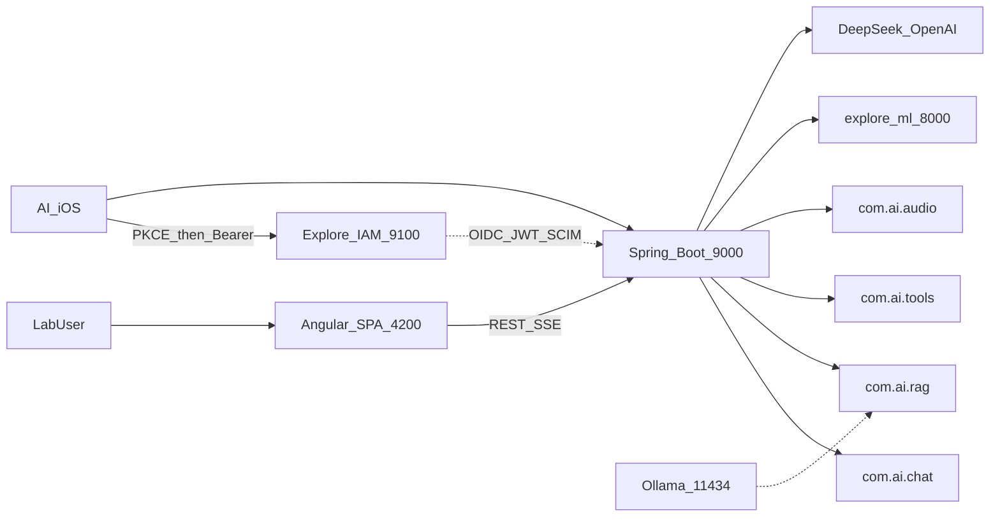
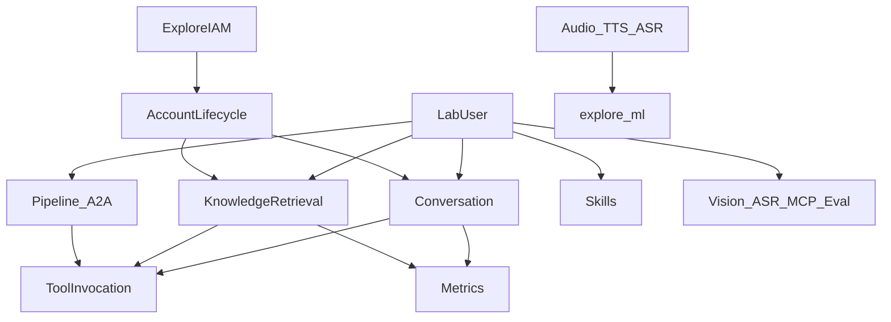
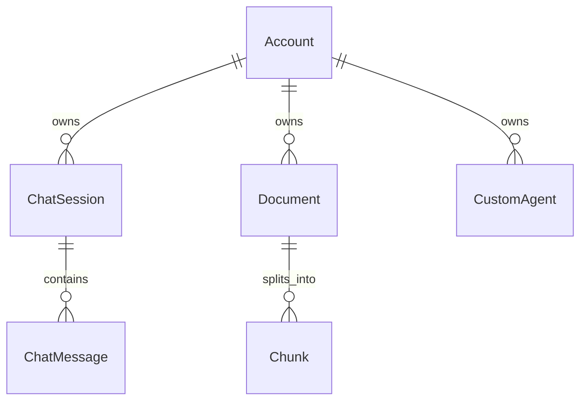
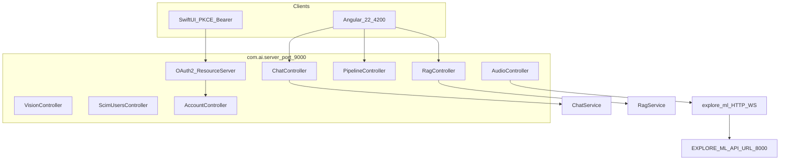
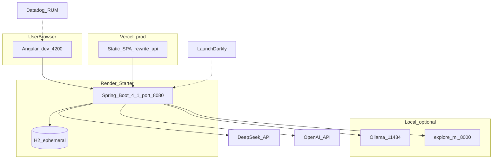
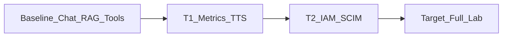

# Architecture Definition Document — Explore AI Lab

| Field | Value |
| --- | --- |
| Deliverable | Architecture Definition Document (TOGAF Architecture Content Framework) |
| Reference | [TOGAF Architecture Deliverables §32.2.3](https://pubs.opengroup.org/architecture/togaf9-doc/m/chap32.html) |
| Capability | Explore AI Lab (Chat, RAG, Tool Calling, optional Lab modules) |
| ADM phases | B–D (Architecture Vision from Phase A summarized in §1) |
| Architecture states | Baseline, Transition (T1, T2), Target |
| Companion | Architecture Requirements Specification (quantitative) — separate deliverable |
| Code-level models | [C4 model](../c4-model/README.md) |
| Preferred Terms | Idiomatic English ([Glossary](../../Glossary.md)) |

**Purpose.** Explore AI Lab fails when every new capability reinvents persistence, auth, and module boundaries. This Architecture Definition Document records how the Lab is organized today and how it evolved from a minimal chat-plus-RAG baseline: qualitative models across Business, Data, Application, and Technology domains, with honest Baseline and Transition states and an as-built Target that matches the codebase on this branch—not a wish list dressed as fact.

---

## Contents

- [1. Vision](#1-vision)
- [2. Architecture principles](#2-architecture-principles)
- [3. Architecture models](#3-architecture-models)
  - [3.1 Business Architecture](#31-business-architecture)
  - [3.2 Data Architecture](#32-data-architecture)
  - [3.3 Application Architecture](#33-application-architecture)
  - [3.4 Technology Architecture](#34-technology-architecture)
- [4. Re-use, standards, and landscape](#4-re-use-standards-and-landscape)
  - [4.1 Re-use assessment](#41-re-use-assessment)
  - [4.2 Mapping to standards](#42-mapping-to-standards)
  - [4.3 Mapping to architecture landscape](#43-mapping-to-architecture-landscape)
- [5. Transition Architecture](#5-transition-architecture)
- [6. References](#6-references)

---

## 1. Vision

### Problem

Teams experimenting with LLMs repeatedly rebuild the same glue: session memory, document grounding, tool orchestration, and optional sign-in. Without a shared platform, each experiment ships its own auth model, leaks secrets into logs, and cannot be gated for production cost or compliance. The failure mode is fragmented demos that never compose into one Lab a user can trust with documents and identity.

### Stakeholders and concerns

| Stakeholder | Concern | Architectural response |
| --- | --- | --- |
| Lab User | Reliable chat, RAG, and tools; optional modules only when enabled | Core routes always on; Lab surfaces behind LaunchDarkly and `ModuleAccessFilter` |
| Operator | Predictable deploy, Golden Eval regression, flag-controlled prod surface | Render + Vercel split; `GOLDEN_EVAL_IT` for live eval ITs |
| Enterprise IdP admin | Accounts provisioned before first login | Inbound SCIM at `/scim/v2/Users` when JWT issuer is configured |
| Security / Privacy | Owner Key isolation, no PII in prompts in logs, IAM Bearer for native clients | `OwnerId` on every aggregate; resource server on `SPRING_SECURITY_OAUTH2_RESOURCESERVER_JWT_ISSUERURI` |

### Solution

An Angular 22 SPA on port **4200** proxies `/api/*` to a Spring Boot **4.1** API on port **9000** (Java **25**, Spring AI **2.0**). Each business capability lives in `com.ai.<feature>` with `controller → service → domain ← infra`. Chat, RAG, Tool Calling, Image Generation, TTS, Metrics, and Account flows ship without feature flags; Pipeline, Skills, Automations, Vision, ASR, MCP, and Eval require explicit LaunchDarkly keys. Optional Explore IAM supplies OAuth login (`APP_OAUTH_EXPLORE_IAM_ISSUER_URI`) and JWT validation for native clients; SCIM from IAM arrives only when the resource-server issuer is set.

Runtime detail for RAG streaming, document ETL, and chat tools appears in [C4-Dynamic-Rag-Ask.puml](../c4-model/C4-Dynamic-Rag-Ask.puml) and [C4-Dynamic-Chat-Tools.puml](../c4-model/C4-Dynamic-Chat-Tools.puml). Native sign-in follows [C4-Dynamic-IamNativeSignIn.puml](../c4-model/C4-Dynamic-IamNativeSignIn.puml): AI iOS generates PKCE material, completes authorization against IAM `:9100`, exchanges the code for an access token, then calls `GET /api/account/me` on `:9000` with `Authorization: Bearer` while the resource server validates issuer and JWKS—no session cookie and no CSRF on Bearer paths. Deployment topology is in [C4-Deployment.puml](../c4-model/C4-Deployment.puml).

---

## 2. Architecture principles

Each principle states a failure mode, the decision, and an enforceable constraint.

1. **Domain isolation** — *Failure:* business rules drift into controllers and leak across features. *Decision:* domain packages have zero outward dependencies. *Constraint:* new code uses per-feature `domain/model`, `domain/repository`, `domain/event` only; no `domain/port/` or top-level `web/` / `application/` packages.

2. **Owner Key partitioning** — *Failure:* one user reads another’s sessions or documents. *Decision:* every durable row carries `owner_id` from `OwnerId` (`c:{clientId}` or `u:{accountUserId}`). *Constraint:* repositories extend `OwnerScopedRepository` with explicit `findByIdAndOwnerId`; cross-owner access returns 404, not 403, for existence hiding.

3. **SSE for long operations** — *Failure:* blocking HTTP ties up threads on multi-minute LLM and RAG streams. *Decision:* Chat, RAG query, pipeline invoke, and tool-heavy paths emit Server-Sent Events with stable event names. *Constraint:* clients use `http/sse-client.ts`; server controllers document SSE content types in [api.md](../api.md).

4. **Glossary-first naming** — *Failure:* API and UI disagree on module names. *Decision:* Preferred Terms in [Glossary](../../Glossary.md) are law for routes, packages, and flags. *Constraint:* e.g. `com.ai.vision` serves `/api/vision` and route `/vision`, not ad hoc synonyms.

5. **Module flags for optional Lab surfaces** — *Failure:* heavy ONNX, MCP stdio, or ASR processes break cloud-minimal prod boots. *Decision:* LaunchDarkly gates optional modules via `FeatureFlagService` and `ModuleAccessFilter`. *Constraint:* keys `module-pipelines`, `module-skills`, `module-automations`, `module-vision`, `module-audio-asr`, `module-mcp`, `module-eval` must be true (locally and in LD) for matching `/api/*` and Angular `moduleEnabledGuard` routes; prod fallbacks per [C4 README](../c4-model/README.md) keep Vision / ASR / MCP / Eval off unless explicitly enabled.

6. **IAM as optional trust anchor** — *Failure:* dev friction when IAM is down. *Decision:* blank `SPRING_SECURITY_OAUTH2_RESOURCESERVER_JWT_ISSUERURI` disables JWT validation and denies all `/scim/v2/**`. *Constraint:* set both `APP_OAUTH_EXPLORE_IAM_ISSUER_URI` and resource-server issuer to `http://localhost:9100` when pairing with `pnpm dev ai iam`; SCIM scope `write:ai_scim` required for IAM push ([C4-Dynamic-ScimProvisioning.puml](../c4-model/C4-Dynamic-ScimProvisioning.puml)).

7. **Audio loopback to explore-ml** — *Failure:* bundling Qwen ASR/TTS weights into the JVM image. *Decision:* TTS and ASR delegate to explore-ml speech service. *Constraint:* `EXPLORE_ML_API_URL` defaults to `http://localhost:8000`; ASR WebSocket terminates at `ws://localhost:9000/ws/audio/transcribe` and proxies upstream only when `module-audio-asr` is on; TTS via `/api/audio` stays available without that flag.

8. **Quota before infinite spend** — *Failure:* anonymous abuse of paid LLM APIs. *Decision:* `UsageQuotaFilter` enforces daily plan limits. *Constraint:* returns `429` with `QUOTA_EXCEEDED`; distinct from short-window rate limiting documented in Glossary Plan Quota entries.

---

## 3. Architecture models

Baseline, Transition, and **Target** are labeled explicitly. Target describes what ships on this branch; roadmap-only capabilities appear only in §5 or roadmap notes—not as Target facts.

### 3.1 Business Architecture

#### Baseline

A fork-sized Lab: **Chat**, **RAG**, and **Tool Calling** on the **current** stack—Java 25, Spring Boot 4.1, Spring AI 2.0, Angular 22—persisting sessions and documents to H2, embedding via Ollama, chatting via DeepSeek. No IAM login, no SCIM, no LaunchDarkly-gated modules beyond the three core domains, no Metrics dashboard, no Pipeline canvas.

#### Target

| Actor | Role |
| --- | --- |
| Lab User | Converses, uploads documents, runs Work and Lab modules within flags and quotas |
| Provisioned Account | SCIM-synchronized `Account` before first IAM sign-in |
| Operator | Toggles modules in LaunchDarkly; reviews Metrics when `METRICS_ADMIN_API_KEY` is set |

| Business service | Package / route | Flag | Outcome |
| --- | --- | --- | --- |
| Conversation | `com.ai.chat` `/chat` | — | Multi-turn sessions, SSE tools, A2UI charts |
| Knowledge Retrieval | `com.ai.rag` `/rag` | — | Upload ETL, vector search, grounded SSE Q&A |
| Tool Invocation | `com.ai.tools` | — | Weather simulator, Serper web search, datetime |
| Text Analysis | `com.ai.textanalysis` | — | Structured analysis APIs without dedicated UI |
| Pipeline / Agent / A2A | `com.ai.pipeline`, `com.ai.agent`, `com.ai.a2a` | `module-pipelines` | Canvas DAG, agent façade, `/.well-known/agent-card.json`, `/a2a/v1` |
| Automation | `com.ai.automation` `/automations` | `module-automations` | Scheduled workflow runs, email summaries via Resend |
| Skill | `com.ai.skill` `/skills` | `module-skills` | User-managed instruction packs applied in Chat |
| Quality Assurance | `com.ai.eval` `/eval` | `module-eval` | LLM-as-a-Judge Golden Eval |
| Image Generation | `com.ai.image` `/generate/image` | — | DALL-E via OpenAI API |
| Image Analysis | `com.ai.vision` `/vision` | `module-vision` | Caption, detect, OCR (ONNX + Tesseract) |
| Audio (TTS + ASR) | `com.ai.audio` `/generate/tts`, `/speech-to-text` | `module-audio-asr` (ASR only) | TTS always on; ASR via explore-ml loopback |
| MCP | `com.ai.mcp` `/mcp` | `module-mcp` | MCP server and client in one package |
| Metrics | `com.ai.metrics` `/metrics` | — | `AiInvocationEvent` overview and drill-down |
| Account Lifecycle | `com.ai.account`, `com.ai.scim` | — | Guest Owner Key, OAuth, IAM Bearer, SCIM CRUD + erase |
| Privacy | Chat privacy routes | — | Owner-scoped erasure per GDPR-style consent model |

### 3.2 Data Architecture

#### Baseline

`ChatSession` / `ChatMessage` in H2; `Document` / `Chunk` with vector embeddings; no `Account` linkage beyond anonymous `OwnerId`; no SCIM, pipeline graphs, skills, eval runs, or `ai_invocation_event` metrics.

#### Target

| Entity | Role |
| --- | --- |
| `ChatSession` / `ChatMessage` | Conversation aggregate; tool call metadata |
| `Document` / `Chunk` | RAG corpus; embeddings in `H2SpringAiVectorStore` |
| `Account` | OAuth / IAM subject; `userName` for SCIM; active flag |
| `CustomAgent`, `Pipeline`, schedules | Workflow and automation graphs (owner-scoped) |
| `BundledSkill` | Skill packs |
| `EvalRun` | Eval results when module enabled |
| `AiInvocationEvent` | Immutable metrics row per capability invocation |

| Store | Content | Notes |
| --- | --- | --- |
| H2 | JPA owner-aware aggregates + JDBC chat memory | Liquibase; dev `./data/explore-ai`, prod ephemeral on Render Starter |
| Vector index | Chunk embeddings | Default Ollama `qwen3-embedding:0.6b` (1024-dim); re-ingest on model change |
| Browser | `explore-ai.*` keys, pinned session ids | Not authoritative; Anonymous id in `__Host-explore_anonymous_id` cookie |

SCIM **delete** on `/scim/v2/Users` triggers account erasure across features via domain events. Kernel types: [C4-Code-Domain-Model.puml](../c4-model/C4-Code-Domain-Model.puml).

### 3.3 Application Architecture

#### Baseline

Chat and RAG controllers with Tool Calling orchestration; Angular routes `/chat` and `/rag` only; no account OAuth, no iOS Bearer path, no optional module controllers registered in the SPA nav.

#### Target

| Surface | Contract |
| --- | --- |
| Chat | `POST /api/chat/stream`, `/api/chat/sessions`, SSE tool events |
| RAG | `POST /api/rag/documents`, SSE `documents:query` |
| Tools | Invoked from chat orchestration; `/api/tools/*` |
| Pipeline / Agent / A2A | `/api/pipelines/*`, `/api/agents/*`, `/a2a/v1/message:send` |
| Vision | `/api/vision/*` behind `module-vision` |
| Audio | `POST /api/audio` (TTS); `ws://host:9000/ws/audio/transcribe` (ASR flag) |
| MCP | `/api/mcp`, `/api/mcp/client` behind `module-mcp` |
| Eval | `/api/eval` behind `module-eval` |
| SCIM | `/scim/v2/Users` scope `write:ai_scim` |
| Account | `/api/account/me` modes `anonymous` \| `authenticated`; IAM Bearer skips CSRF |

Full REST contracts: [api.md](../api.md).

### 3.4 Technology Architecture

#### Baseline

Same runtime line as Target (**Java 25**, **Spring Boot 4.1**, **Spring AI 2.0**, **Angular 22**) but trimmed to core modules; local dev ports **9000** (API) and **4200** (web); Ollama **11434** for embeddings; DeepSeek for chat; no Vercel/Render prod wiring in daily dev.

#### Target

| Node | Decision |
| --- | --- |
| Backend | `0.0.0.0:$PORT` on Render; dev **9000**, prod **8080** |
| Frontend | Angular 22; dev **4200** proxy; prod `https://www.felixzhu.chat` via Vercel rewrites |
| Embeddings | Ollama local; cloud-minimal prod may disable Ollama—revisit ingest strategy before enabling |
| Identity | IAM issuer env pair; iOS client `explore-ai-ios` with PKCE |
| Speech | `EXPLORE_ML_API_URL` → explore-ml Qwen3 TTS/ASR |
| Observability | Datadog RUM optional; `METRICS_ADMIN_API_KEY` guards admin metrics API |

**Roadmap note (not Target):** Computer-using agent automation is out of scope for this ADD’s Target business model; any future desktop automation belongs in the product backlog only.

---

## 4. Re-use, standards, and landscape

### 4.1 Re-use assessment

| Asset | Re-use |
| --- | --- |
| Explore IAM OIDC + outbound SCIM | Login, native Bearer, enterprise account lifecycle |
| Spring AI ChatClient, advisors, VectorStore SPI | Chat, RAG, eval, pipeline workers |
| explore-ml speech | TTS and ASR without JVM model weights |
| LaunchDarkly module pattern | Consistent guard for Vision, MCP, Eval, Pipelines, Skills, Automations, ASR |
| C4 + Glossary | Package boundaries and dynamic views for onboarding |

### 4.2 Mapping to standards

| Standard | Application |
| --- | --- |
| OIDC / OAuth 2.0 | IAM issuer; authorization code + PKCE on iOS |
| SCIM 2.0 | Inbound `/scim/v2/Users` from IAM (`write:ai_scim`) |
| SSE | Long-running chat, RAG, pipeline streams |
| Clean Architecture per feature | `controller → service → domain ← infra` (+ `mapper` without business rules) |
| A2A (minimal) | Agent Card + `message:send` / `message:stream` with IAM scope `write:ai_agent` |

### 4.3 Mapping to architecture landscape

| Landscape element | Position |
| --- | --- |
| Product URL | `https://www.felixzhu.chat` |
| Direct API | `https://explore-ai-3krr.onrender.com/api` |
| Monorepo paths | `ai/server`, `ai/web`, `ai/ios` |
| Peer IAM | `http://localhost:9100` dev; Render single-origin prod |
| Dynamic views | RAG ask, chat tools, IAM native sign-in, SCIM provisioning, A2A message |
| Backlog | [User Story Map](../../product-owner/User-Story-Map.md) |

---

## 5. Transition Architecture

| State | Definition |
| --- | --- |
| Baseline | Chat + RAG + tools on Java 25 / Boot 4.1 / Spring AI 2.0 / Angular 22; anonymous Owner Key only |
| T1 | Core trio + Metrics + Image Gen + TTS; H2 persistence; LaunchDarkly local only |
| T2 | IAM OAuth login + JWT resource server + inbound SCIM; Golden Eval behind `module-eval` |
| Target | Full Lab module map on `main` with prod flag matrix (`cloud-minimal`); Render + Vercel |

### T1 — Knowledge, tools, and speech loopback

| Domain | Change |
| --- | --- |
| Business | Conversation + Knowledge Retrieval + Tool Invocation + Metrics overview |
| Data | `ChatSession`, `Document`, `Chunk`, `AiInvocationEvent` |
| Application | RAG ETL, SSE query, `/api/metrics` |
| Technology | Ollama embeddings; `EXPLORE_ML_API_URL` for TTS; ports 9000 / 4200 |

### T2 — Identity and quality gate

| Domain | Change |
| --- | --- |
| Business | Account Lifecycle; Provisioned Account |
| Data | `Account` linked to Owner Key; SCIM external ids |
| Application | JWT validation; `/scim/v2` when issuer set; Eval module |
| Technology | IAM `:9100`; iOS PKCE per C4-Dynamic-IamNativeSignIn |

### Target — Full Lab (per-domain delta from T2)

| Domain | Change |
| --- | --- |
| Business | Pipeline, Skills, Automations, Vision, ASR, MCP, Eval as flagged modules |
| Data | Pipeline graphs, skills, eval runs, automation schedules |
| Application | Full Glossary route map; `ModuleAccessFilter` on all flagged prefixes |
| Technology | Vercel + Render; LaunchDarkly server + client; cloud-minimal Docker profile |

---

## 6. References

- [TOGAF Architecture Deliverables — Architecture Definition Document §32.2.3](https://pubs.opengroup.org/architecture/togaf9-doc/m/chap32.html)
- [Spring AI reference](https://docs.spring.io/spring-ai/reference/)
- [Spring Authorization Server (IAM peer)](https://docs.spring.io/spring-authorization-server/reference/index.html)
- [Glossary](../../Glossary.md)
- [C4 model](../c4-model/README.md)
- [User Story Map](../../product-owner/User-Story-Map.md)
- [API reference](../api.md)
- [Quick Start](../QUICKSTART.md)