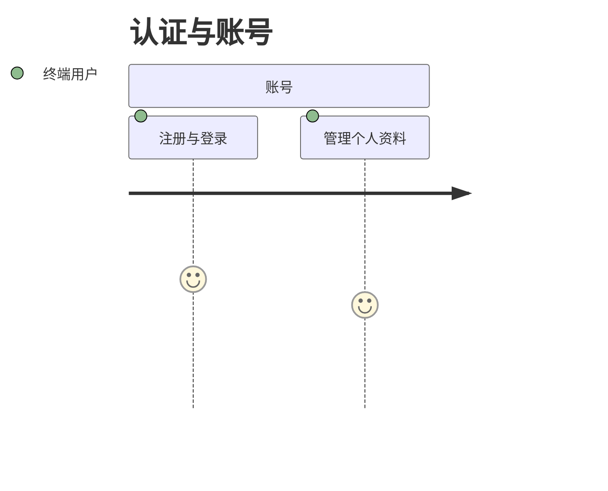
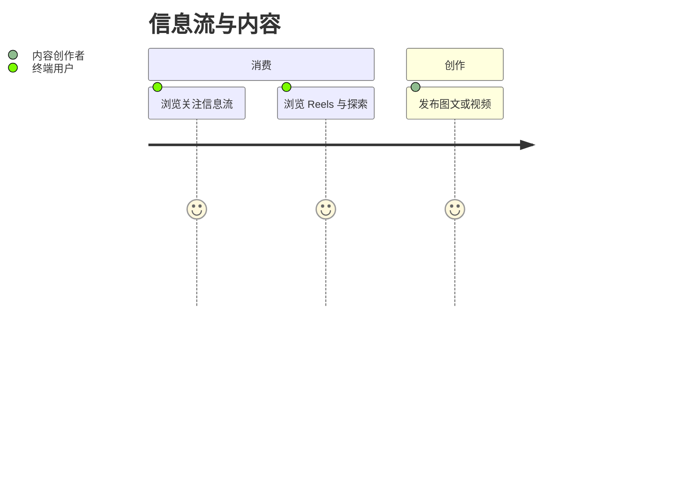
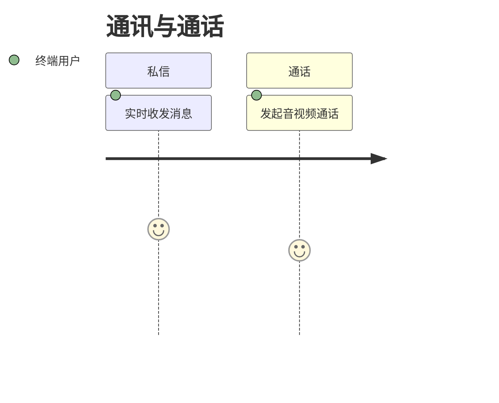
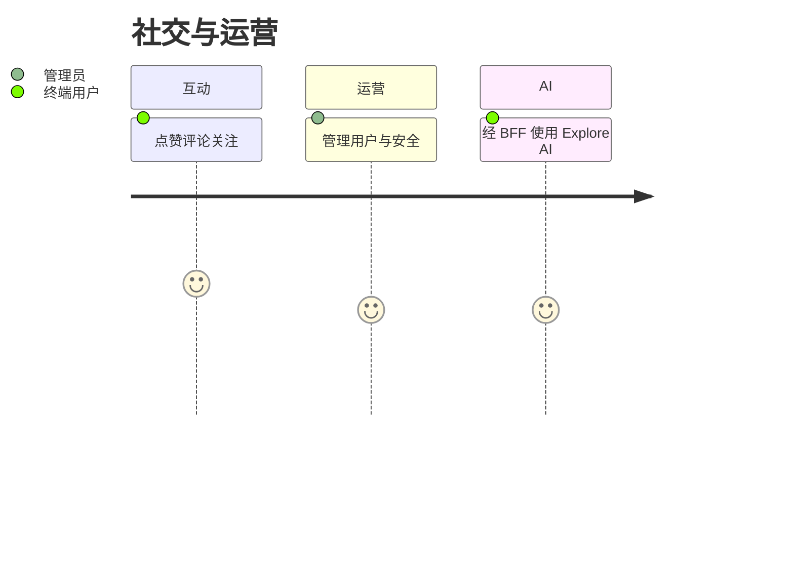

# 用户故事地图 | User Story Map — Explore Chat
> Jeff Patton 用户故事地图；正文与验收标准合并于本文（单一文档）。  
> Jeff Patton user-story map; epics and GWT acceptance criteria live in this single document.  
> 格式 / Format：Background → `As a` / `I want` / `So that` → Scenario GIVEN-WHEN-THEN（双语 / bilingual）。

## 用户画像 | Personas

| 角色 / Role | 说明 / Description |
| ------------------- | --------------------------------------------- |
| 终端用户 / End User | 使用信息流、Reels、探索、私信与通话 / Uses feed, Reels, explore, DMs, and calls |
| 内容创作者 / Content Creator | 发帖、上传媒体、管理个人主页 / Publishes posts, uploads media, manages profile |
| 管理员 / Admin | 经管理后台运营用户与内容安全 / Operates users and content safety via admin |
| 开发者 / Developer | 部署、对象存储、推荐与审核链路（进行中/规划） / Deploys object storage, recommendation, and moderation (in progress/planned) |

## 旅程总览 | Journey Overview

### 认证与账号

### 信息流与内容

### 通讯与通话

### 社交与运营

---

## Backbone 故事地图 | Backbone

### 已交付

| 认证                                                                 | 私信                                                            | 信息流                                                               | Reels/探索                                                         | 互动                                                                      | 通话                                                      | 管理                                                        | AI BFF                                                                                   |
| -------------------------------------------------------------------- | --------------------------------------------------------------- | -------------------------------------------------------------------- | ------------------------------------------------------------------ | ------------------------------------------------------------------------- | --------------------------------------------------------- | ----------------------------------------------------------- | ---------------------------------------------------------------------------------------- |
| [US-01](#us-01-注册与登录) 注册登录 | [US-02](#us-02-实时私信) 实时私信 | [US-03](#us-03-浏览信息流) 浏览信息流 | [US-05](#us-05-浏览-reels) Reels | [US-07](#us-07-点赞收藏与评论) 互动 | [US-09](#us-09-音视频通话) 通话 | [US-10](#us-10-管理后台) 管理后台 | [US-11](#us-11-经-bff-使用-explore-ai) Explore AI BFF |
|                                                                      |                                                                 | [US-04](#us-04-发布帖子) 发帖         | [US-06](#us-06-探索网格) 探索    | [US-08](#us-08-关注关系) 关注       |                                                           |                                                             |                                                                                          |

### 进行中

| 平台                                                                          |
| ----------------------------------------------------------------------------- |
| [US-12](#us-12-生产部署) 生产部署         |
| [US-13](#us-13-对象存储媒体) 对象存储媒体 |

### 未来（规划中）

| 平台                                                                              |
| --------------------------------------------------------------------------------- |
| [US-14](#us-14-完整推荐与审核) 推荐与审核     |
| [US-15](#us-15-离线与多设备同步) 离线与多设备 |

---

## Epic 索引 | Epic Index

| Epic | 锚点 / Anchor | 状态 / Status |
|------|---------------|---------------|
| E1 认证与账号 | [#e1](#e1) | — |
| E2 即时通讯 | [#e2](#e2) | — |
| E3 信息流与帖子 | [#e3](#e3) | — |
| E4 Reels 与探索 | [#e4](#e4) | — |
| E5 互动与社交 | [#e5](#e5) | — |
| E6 音视频通话 | [#e6](#e6) | — |
| E7 管理后台 | [#e7](#e7) | — |
| E8 Explore AI BFF | [#e8](#e8) | — |
| E9 平台与未来 | [#e9](#e9) | — |

---

# 用户故事正文 | User Stories

## E1 认证与账号 / Authentication and account number

### 背景 | Background

用户须安全注册与登录，方可使用 Chat 的社交与通讯能力。 / Users must register and log in safely to use Chat Socialization and communication skills.

### US-01 注册与登录 / Registration and Login

**As a** 终端用户 / End User  
**I want** 安全注册与登录 / Secure registration and login  
**So that** 我可以使用 Chat 的社交与通讯功能 / I can use it. Chat Social and communication functions

#### 验收标准 | Acceptance Criteria

1. **Scenario** 新用户完成注册并进入已登录状态 / New users are registered and entering login status  
   **GIVEN** 用户未登录且打开注册流程 / User not login and open registration process  
   **WHEN** 用户提交有效注册信息 / User submits valid registration information  
   **THEN** 账号创建成功且用户处于已登录状态 / Account created successfully and user is in login status  

2. **Scenario** 已有用户登录成功 / User login successful  
   **GIVEN** 用户拥有有效账号 / User has valid account number  
   **WHEN** 用户提交正确凭证登录 / User submits correct voucher login  
   **THEN** 用户进入已登录状态并可访问主功能 / User enters login status and accesss main functionality  

#### 状态 | Status

已实现 / Done

---

## E2 即时通讯 / contains

### 背景 | Background

用户须与联系人实时收发私信，保持沟通连续。 / Users are required to receive and send private correspondence in real time with contacts and to communicate continuously.

### US-02 实时私信 / Real-time private mail

**As a** 终端用户 / End User  
**I want** 发送与接收私信（含实时推送） / Send and receive private correspondence (including real time delivery))  
**So that** 我可以与联系人即时沟通 / I can communicate with the contact immediately.

#### 验收标准 | Acceptance Criteria

1. **Scenario** 发送消息后对方可实时看到 / Only when you send a message can you see it in real time?  
   **GIVEN** 双方均已登录且存在会话 / Both parties are logged in and there are meetings.  
   **WHEN** 用户发送一条文本消息 / User sends a text message  
   **THEN** 消息出现在会话中 / Message in Session  
   **AND** 接收方可在无需整页刷新的情况下看到新消息 / Receiver sees new messages without having to refresh the entire page  

2. **Scenario** 删除消息后会话列表不再展示 / Can not open message  
   **GIVEN** 用户已发送一条消息 / User sent a message  
   **WHEN** 用户删除该消息 / Can not open message  
   **THEN** 消息以软删除保留（`isDeleted`） / Can not open message(`isDeleted`)  
   **AND** 会话消息列表不再返回该消息 / The message no longer appears in the session message list  

3. **Scenario** 会话列表可定位历史对话 / Session list to locate history dialogues  
   **GIVEN** 用户已有多个会话 / User has multiple sessions  
   **WHEN** 用户打开消息入口 / must use  
   **THEN** 可看到会话列表并进入目标会话 / Can see session list and enter target session  

#### 状态 | Status

已实现 / Done

---

## E3 信息流与帖子 / Information flows and posts

### 背景 | Background

用户浏览关注信息流并发布图文/视频帖。 / Users view the flow of information and publish the text/Video post.

### US-03 浏览信息流 / Browse the feed

**As a** 终端用户 / End User  
**I want** 浏览关注信息流 / Browse the followed feed  
**So that** 我可以消费关注对象的最新内容 / I can consume up-to-date information about people I care about.

#### 验收标准 | Acceptance Criteria

1. **Scenario** 已登录用户看到信息流条目 / Login users see stream entries  
   **GIVEN** 用户已登录且关注了至少一名创作者（或有本人帖子） / Users log in and pay attention to at least one creator (or have their own post))  
   **WHEN** 用户打开首页信息流 / User Opens home page stream  
   **THEN** 可见帖子列表（含媒体与基础互动入口） / Visible Poster List (includes media and basic interactive portals))  

#### 状态 | Status

已实现 / Done

---

### US-04 发布帖子 / Publish post

**As a** 内容创作者 / Content Creator  
**I want** 发布图文或视频帖（含可选封面） / Publication of graphs or video posts (with optional cover))  
**So that** 我可以分享内容给关注者 / I can share with people who care.

#### 验收标准 | Acceptance Criteria

1. **Scenario** 上传媒体并成功发帖 / Upload media and post successfully  
   **GIVEN** 用户已登录且选择了媒体文件 / User login and selected media files  
   **WHEN** 用户完成上传并提交发帖 / User finish uploading and posting  
   **THEN** 帖子创建成功并出现在信息流或个人页 / The post was created successfully and appeared in the information stream or individual Page  
   **AND** 视频帖可带独立封面（coverUrl）而不混入 mediaUrls / Video posts with separate cover(coverUrl)Not blending in. mediaUrls  

#### 状态 | Status

已实现 / Done

---

## E4 Reels 与探索 / Reels And exploration.

### 背景 | Background

用户经短视频与探索网格发现内容与创作者。 / Users discover content and creators via short video and exploration grid.

### US-05 浏览 Reels / Browse Reels

**As a** 终端用户 / End User  
**I want** 浏览短视频 Reels / Browse for short videos Reels  
**So that** 我可以沉浸式消费竖屏视频内容 / I can immerse the content of the consumer screen video.

#### 验收标准 | Acceptance Criteria

1. **Scenario** 打开 Reels 看到可播放视频流 / Open Reels Sees video stream available  
   **GIVEN** 用户已登录 / User Login  
   **WHEN** 用户进入 Reels / User access Reels  
   **THEN** 可见竖屏视频流并可播放/暂停与基础互动 / Visible vertical video stream and can be played/Suspension and base interaction  

#### 状态 | Status

已实现 / Done

---

### US-06 探索网格 / Explore Grid

**As a** 终端用户 / End User  
**I want** 浏览探索网格 / Browse for Explore Grid  
**So that** 我可以发现未关注创作者的内容 / I can see that there's no focus on the creator.

#### 验收标准 | Acceptance Criteria

1. **Scenario** 探索页展示网格内容 / Show grid content on explore page  
   **GIVEN** 用户已登录 / User Login  
   **WHEN** 用户打开探索 / User opens Explore  
   **THEN** 可见内容网格（含视频封面等）并可进入详情或互动 / Visible content grid (including video cover, etc.) and access to details or interactions  

#### 状态 | Status

已实现 / Done

---

## E5 互动与社交 / Interaction and socialization

### 背景 | Background

用户通过对帖子互动与关注关系建立社交连接。 / Users build social connections through posting interactions and attention.

### US-07 点赞收藏与评论 / Likes, saves, and comments

**As a** 终端用户 / End User  
**I want** 对帖子点赞、收藏与评论 / It's a compliment, a collection and a comment.  
**So that** 我可以与内容互动 / I can interact with content.

#### 验收标准 | Acceptance Criteria

1. **Scenario** 点赞后计数更新 / Count updates after a few words.  
   **GIVEN** 用户已登录并打开一条帖子 / User login and open a post  
   **WHEN** 用户点赞 / User Approving  
   **THEN** 点赞状态与计数对用户可见为已更新 / user can  

2. **Scenario** 发表评论可见 / Comments can be found  
   **GIVEN** 用户已登录并打开评论入口 / User login and open comment entry  
   **WHEN** 用户提交评论 / User submits comments  
   **THEN** 评论出现在评论列表中 / Comments appear in the comment list  

#### 状态 | Status

已实现 / Done

---

### US-08 关注关系 / Follow relationships

**As a** 终端用户 / End User  
**I want** 关注/取关其他用户并查看粉丝列表 / Attention/Close other users and view the fan list  
**So that** 我可以建立社交关系 / I can build social relationships.

#### 验收标准 | Acceptance Criteria

1. **Scenario** 关注后出现在关注列表 / Watch Behind Focus List  
   **GIVEN** 用户已登录并打开他人主页 / User login and open another homepage  
   **WHEN** 用户关注该用户 / User Focus on User  
   **THEN** 关注状态变为已关注 / The state of concern becomes one.  
   **AND** 可在关注列表中看到对方 / You can see each other in the focus list  

#### 状态 | Status

已实现 / Done

---

## E6 音视频通话 / Audio and video calls

### 背景 | Background

用户须在应用内发起 WebRTC 音视频通话。 / User must initiate in application WebRTC Audio and video calls.

### US-09 音视频通话 / Audio and video calls

**As a** 终端用户 / End User  
**I want** 发起 WebRTC 音视频通话 / Start WebRTC Audio and video calls  
**So that** 我可以进行实时语音或视频交流 / I can communicate live voice or video.

#### 验收标准 | Acceptance Criteria

1. **Scenario** 发起通话信令可达 / Start the call.  
   **GIVEN** 双方已登录且网络可用 / Both parties are logged in and the network is available  
   **WHEN** 用户向联系人发起通话 / User to Contact  
   **THEN** 对方收到来电或信令提示 / The other side received a call or a message.  
   **AND** 接通后可建立媒体会话（依赖 TURN/STUN 可达） / Connect to create a media session (dependent) TURN/STUN reachable)  

#### 状态 | Status

已实现 / Done

---

## E7 管理后台 / Manage backstage

### 背景 | Background

管理员须运营用户与内容安全相关配置。 / Admins must operate user-related configurations for content security.

### US-10 管理后台 / Manage backstage

**As a** 管理员 / Admin  
**I want** 管理用户与内容安全相关配置 / Manage user-related content security configurations  
**So that** 我可以运营平台 / I can run the platform.

#### 验收标准 | Acceptance Criteria

1. **Scenario** 管理员进入后台完成基础运营操作 / The Admin goes backstage and finishes basic operations.  
   **GIVEN** 用户具备管理员权限并已登录 / User with Admin privacy and login  
   **WHEN** 用户打开管理后台 / User Opens Management Backstage  
   **THEN** 可访问用户或内容安全相关管理入口并完成允许的操作 / Access to user or content security-related management portals and permitted operations  

#### 状态 | Status

已实现 / Done

---

## E8 Explore AI BFF

### 背景 | Background

Chat 经 Spring BFF 代理 Explore AI，禁止浏览器直连上游并暴露服务凭证。对标 Agentforce Service Agent：消息页可 Ask Agent。 / Chat Spring BFF Explore AI, credential . Agentforce Service Agent: can Ask Agent.

### US-11 经 BFF 使用 Explore AI / Via BFF Use Explore AI

**As a** 终端用户 / End User  
**I want** 通过 Chat 后端使用 Explore AI 能力 / via Chat Backend Use Explore AI Capacity  
**So that** 我无需也不应直接暴露上游 AI 服务凭证 / I don't have to and shouldn't be exposed directly up there. AI Service credentials

#### 验收标准 | Acceptance Criteria

1. **Scenario** 客户端只调用 Chat API / Client calls only Chat API  
   **GIVEN** Explore AI BFF 已配置 `EXPLORE_AI_BASE_URL` 与 `EXPLORE_AI_SERVICE_KEY` / Explore AI BFF Configured `EXPLORE_AI_BASE_URL` and `EXPLORE_AI_SERVICE_KEY`  
   **WHEN** 用户触发经 BFF 暴露的 AI 能力 / User Trigger BFF It's exposed. AI Capacity  
   **THEN** 浏览器请求指向 Chat API（`/api/v1/ai/explore/*`） / Browser Request Orientation Chat API(`/api/v1/ai/explore/*`)  
   **AND** 上游服务密钥不出现在客户端 / Upstream service keys do not appear on the client  

2. **Scenario** Gallery list + invoke  
   **GIVEN** 同上且用户已登录 / Same as above and user login  
   **WHEN** 调用 `GET /api/v1/ai/explore/agents` 与 `POST /api/v1/ai/explore/agents/{type}/invoke` / Call `GET /api/v1/ai/explore/agents` and `POST /api/v1/ai/explore/agents/{type}/invoke`  
   **THEN** Chat 以 `X-Service-Key` + `X-Client-Id` 转发 Explore AI 并返回 JSON / Chat Here. `X-Service-Key` + `X-Client-Id` Forward Explore AI And back JSON  
   **AND** 未配置 service key 时返回 503 / Not configured service key returns 503  

#### 状态 | Status

已实现 / Done

---

## E9 平台与未来 / Platform and future

### 背景 | Background

平台可靠性、媒体持久化、推荐审核与多设备同步仍在进行或规划中。 / Platform reliability, media continuity, recommendation for review and multi-equipment synchronization ongoing or planned Medium.

### US-12 生产部署 / Production deployment

**As a** 开发者 / Developer  
**I want** 将 Nest API 与托管 Postgres/Redis 部署到云平台 / Will Nest API With hosting Postgres/Redis Deployed to cloud platforms  
**So that** 预发/生产环境可稳定访问 / Advance/Stable access to the production environment

#### 验收标准 | Acceptance Criteria

1. **Scenario** 生产拓扑可访问健康检查 / Production scale-up to access health check-ups  
   **GIVEN** API 已部署到目标平台且数据库与 Redis 已配置 / API Deployed to target platform and database Redis Configured  
   **WHEN** 运维访问健康检查端点 / Movement access health check point  
   **THEN** 返回健康状态且服务可对外提供 API / Return to health and services are available externally API  

#### 状态 | Status

进行中 / In Progress

---

### US-13 对象存储媒体 / Object Storage Media

**As a** 终端用户 / End User  
**I want** 上传的媒体在重启后仍可访问 / Uploaded media are still accessible after restart  
**So that** 帖子媒体不因临时磁盘而丢失 / The post is not lost on a temporary disk.

#### 验收标准 | Acceptance Criteria

1. **Scenario** 重启后媒体 URL 仍可用 / Media after Restart URL Still available  
   **GIVEN** 用户已上传媒体并成功发帖 / User uploaded media and successfully posted  
   **WHEN** API 进程或实例重启 / API Process or instance restart  
   **THEN** 原媒体 URL 仍可访问（对象存储或等效持久化） / Original media URL Still accessible (object storage or endurance))  

#### 状态 | Status

进行中 / In Progress

---

### US-14 完整推荐与审核 / Full recommendation and review

**As a** 终端用户 / End User  
**I want** 更个性化的探索排序与可靠内容审核 / More personalized sequencing of exploration and reliable content review Nuclear  
**So that** 发现体验更安全、更相关 / Finding experience safer and more relevant

#### 验收标准 | Acceptance Criteria

1. **Scenario** 探索排序与审核可感知 / Explore Sorting and Audit Visibility  
   **GIVEN** 推荐与审核链路已启用 / The referral and audit link is active  
   **WHEN** 用户浏览探索或发帖 / User Browse Explore or Poster  
   **THEN** 排序结果反映个性化/热度策略 / Sorting results reflect individualisation/Thermal Policy  
   **AND** 违规内容按策略被拦截或标记 / The content of the violation is stopped or marked strategically  

#### 状态 | Status

规划中 / Planned

---

### US-15 离线与多设备同步 / Synchronize offline with multiple devices

**As a** 移动端用户 / mobile user  
**I want** 弱网下可靠收发消息 / Credible incoming and outgoing messages from the weak web  
**So that** 通讯体验接近主流 IM / Communication experience close to the mainstream IM

#### 验收标准 | Acceptance Criteria

1. **Scenario** 弱网恢复后消息可达 / Weak web is back on the line.  
   **GIVEN** 用户曾短暂离线并发送或接收消息 / User has briefly offline and sent or received messages  
   **WHEN** 网络恢复 / Network Restoration  
   **THEN** 消息最终一致地出现在会话中 / The message eventually appeared in the conversation.  

#### 状态 | Status

规划中 / Planned

---

## 参考 | References

- [User Story Mapping — Jeff Patton](https://www.jpattonassociates.com/user-story-mapping/)
- [Guideline](../Guideline.md)
- [Domain Glossary](../Glossary.md)
- [C4 模型](../c4-model/README.md)

