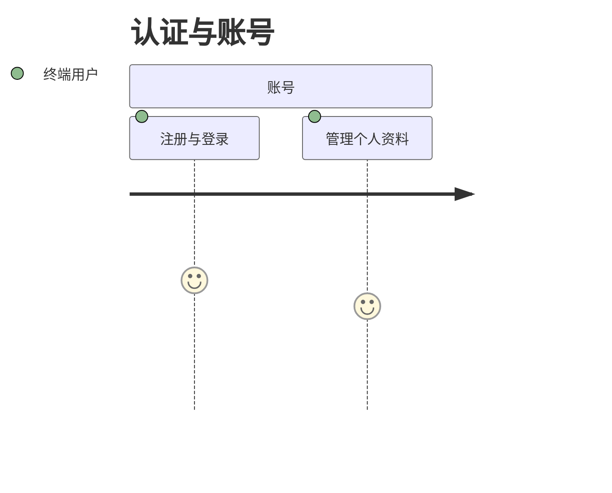
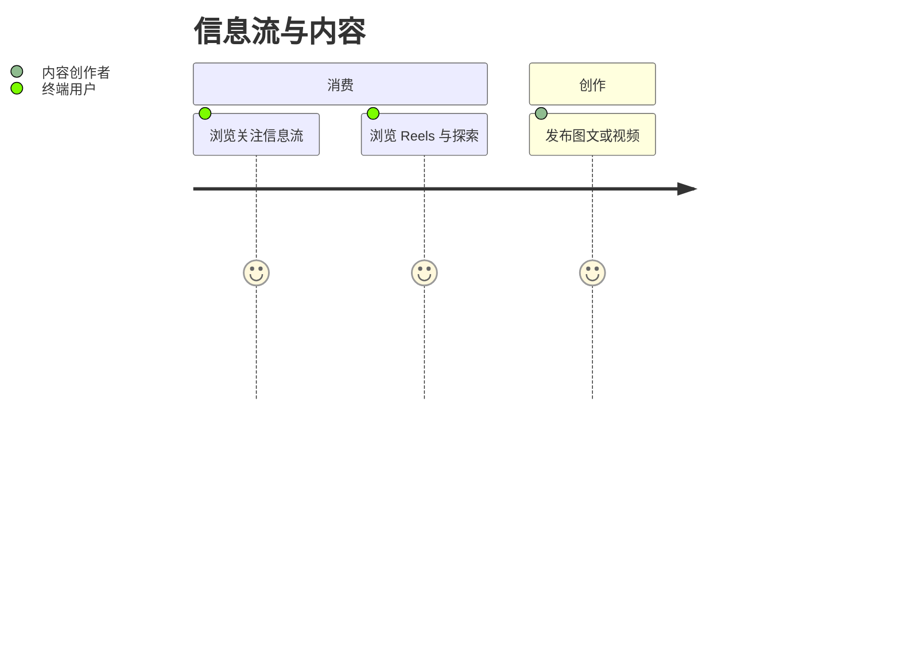
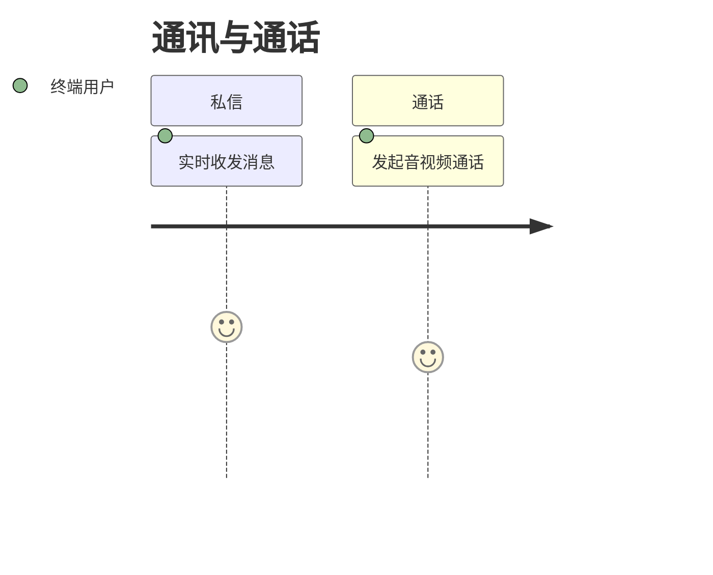
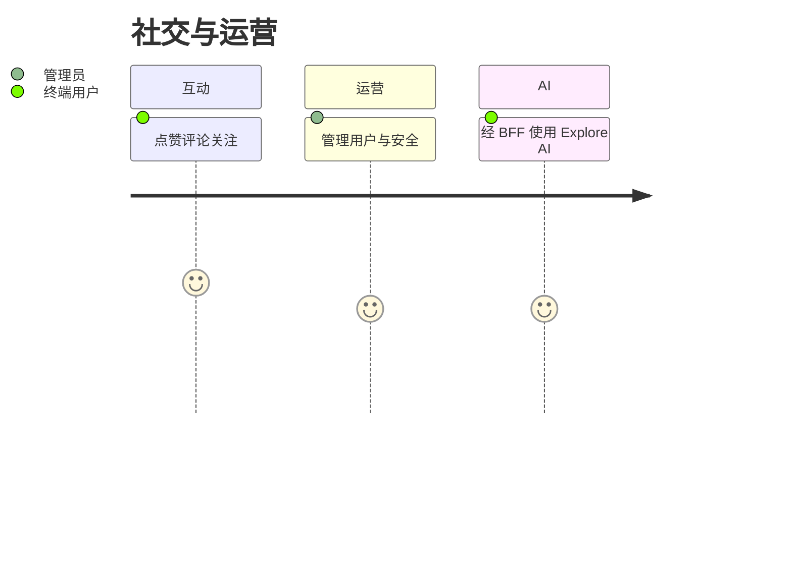

# 用户故事地图 | User Story Map — Explore Chat
> Jeff Patton 用户故事地图；正文与验收标准合并于本文（单一文档）。  
> Jeff Patton user-story map; epics and GWT acceptance criteria live in this single document.  
> 格式 / Format：Background → `As a` / `I want` / `So that` → Scenario GIVEN-WHEN-THEN（双语 / bilingual）。

## 用户画像 | Personas

| 角色 / Role | 说明 / Description |
| ------------------- | --------------------------------------------- |
| 终端用户 / End User | 使用信息流、Reels、探索、私信与通话 / Uses feed, Reels, explore, DMs, and calls |
| 内容创作者 / Content Creator | 发帖、上传媒体、管理个人主页 / Publishes posts, uploads media, manages profile |
| 管理员 / Admin | 经管理后台运营用户与内容安全 / Operates users and content safety via admin |
| 开发者 / Developer | 部署、对象存储、推荐与审核链路（进行中/规划） / Deploys object storage, recommendation, and moderation (in progress/planned) |

## 旅程总览 | Journey Overview

### 认证与账号

### 信息流与内容

### 通讯与通话

### 社交与运营

---

## Backbone 故事地图 | Backbone

### 已交付

| 认证                                                                 | 私信                                                            | 信息流                                                               | Reels/探索                                                         | 互动                                                                      | 通话                                                      | 管理                                                        | AI BFF                                                                                   |
| -------------------------------------------------------------------- | --------------------------------------------------------------- | -------------------------------------------------------------------- | ------------------------------------------------------------------ | ------------------------------------------------------------------------- | --------------------------------------------------------- | ----------------------------------------------------------- | ---------------------------------------------------------------------------------------- |
| [US-01](#us-01-注册与登录) 注册登录 | [US-02](#us-02-实时私信) 实时私信 | [US-03](#us-03-浏览信息流) 浏览信息流 | [US-05](#us-05-浏览-reels) Reels | [US-07](#us-07-点赞收藏与评论) 互动 | [US-09](#us-09-音视频通话) 通话 | [US-10](#us-10-管理后台) 管理后台 | [US-11](#us-11-经-bff-使用-explore-ai) Explore AI BFF |
|                                                                      |                                                                 | [US-04](#us-04-发布帖子) 发帖         | [US-06](#us-06-探索网格) 探索    | [US-08](#us-08-关注关系) 关注       |                                                           |                                                             |                                                                                          |

### 进行中

| 平台                                                                          |
| ----------------------------------------------------------------------------- |
| [US-12](#us-12-生产部署) 生产部署         |
| [US-13](#us-13-对象存储媒体) 对象存储媒体 |

### 未来（规划中）

| 平台                                                                              |
| --------------------------------------------------------------------------------- |
| [US-14](#us-14-完整推荐与审核) 推荐与审核     |
| [US-15](#us-15-离线与多设备同步) 离线与多设备 |

---

## Epic 索引 | Epic Index

| Epic | 锚点 / Anchor | 状态 / Status |
|------|---------------|---------------|
| E1 认证与账号 | [#e1](#e1) | — |
| E2 即时通讯 | [#e2](#e2) | — |
| E3 信息流与帖子 | [#e3](#e3) | — |
| E4 Reels 与探索 | [#e4](#e4) | — |
| E5 互动与社交 | [#e5](#e5) | — |
| E6 音视频通话 | [#e6](#e6) | — |
| E7 管理后台 | [#e7](#e7) | — |
| E8 Explore AI BFF | [#e8](#e8) | — |
| E9 平台与未来 | [#e9](#e9) | — |

---

# 用户故事正文 | User Stories

## E1 账号与安全登录 / Accounts and secure sign-in

### 背景 | Background

用户无法安全注册或登录时，将无法使用社交与通讯能力，留存与活跃受损。凭证泄露或流程繁琐也会削弱信任。我们需要可靠、可感知的注册与登录体验。 / Without secure sign-up and sign-in, users cannot access social and messaging, hurting retention. Weak flows erode trust. We need reliable, clear registration and login.

### US-01 注册与登录 / Register and sign in

**As a** 终端用户 / End user  
**I want** 安全完成注册与登录 / to register and sign in securely  
**So that** 我能使用 Chat 的社交与通讯功能 / I can use Chat’s social and messaging features

#### 验收标准 | Acceptance Criteria

1. **Scenario** 新用户注册后进入已登录状态 / New user lands signed in after registration  
   **GIVEN** 用户未登录并打开注册流程 / the user is signed out and starts registration  
   **WHEN** 用户提交有效的注册信息 / they submit valid registration details  
   **THEN** 账号创建成功且用户处于已登录状态 / the account is created and the user is signed in  

2. **Scenario** 已有用户使用正确凭证登录 / Returning user signs in with valid credentials  
   **GIVEN** 用户拥有有效账号 / the user has a valid account  
   **WHEN** 用户提交正确的登录凭证 / they submit correct sign-in credentials  
   **THEN** 用户进入已登录状态并可访问主功能 / they are signed in and can access main features  

#### 状态 | Status

已交付 / Delivered

---

## E2 即时私信 / Direct messaging

### 背景 | Background

用户与联系人需要实时收发私信，沟通中断会降低粘性与满意度。消息延迟或列表难找历史对话会增加挫败感。我们希望提供接近主流 IM 的连续会话体验。 / Users need real-time private messages with contacts; broken threads hurt engagement. Delays and hard-to-find history frustrate users. We want continuous conversations comparable to mainstream IM.

### US-02 实时收发私信 / Send and receive direct messages in real time

**As a** 终端用户 / End user  
**I want** 发送与接收私信并实时看到新消息 / to send and receive direct messages and see new ones in real time  
**So that** 我能与联系人即时沟通 / I can communicate with contacts immediately

#### 验收标准 | Acceptance Criteria

1. **Scenario** 发送后对方及时看到新消息 / Recipient sees a new message promptly  
   **GIVEN** 双方均已登录且处于同一会话 / both parties are signed in and share an active conversation  
   **WHEN** 用户发送一条文本消息 / one user sends a text message  
   **THEN** 消息出现在会话时间线中 / the message appears in the conversation timeline  
   **AND** 接收方无需整页刷新即可看到新消息 / the recipient sees it without refreshing the whole page  

2. **Scenario** 删除后列表不再展示该消息 / Deleted message no longer shown in the list  
   **GIVEN** 用户已发送一条消息 / the user has sent a message  
   **WHEN** 用户删除该消息 / they delete that message  
   **THEN** 消息在系统内按软删除保留审计能力 / the message is soft-deleted for audit while hidden from normal view  
   **AND** 会话消息列表不再显示该消息 / the conversation message list no longer shows that message  

3. **Scenario** 从会话列表进入历史对话 / Open past conversations from the session list  
   **GIVEN** 用户已有多个会话 / the user has multiple conversations  
   **WHEN** 用户打开消息入口 / they open the messages entry point  
   **THEN** 看到会话列表并可进入目标会话 / they see a conversation list and can open the target chat  

#### 状态 | Status

已交付 / Delivered

---

## E3 信息流与发帖 / Feed and posting

### 背景 | Background

用户希望看到关注对象的最新内容并轻松发布自己的图文或视频。内容难发现或发布失败会降低创作与消费意愿。我们需要可浏览的信息流与顺畅的发帖体验。 / Users want fresh content from people they follow and an easy way to publish. Hard discovery or failed posts reduce creation and consumption. We need a browsable feed and reliable publishing.

### US-03 浏览关注信息流 / Browse the following feed

**As a** 终端用户 / End user  
**I want** 浏览我关注对象的信息流 / to browse a feed from people I follow  
**So that** 我能看到他们在乎的最新内容 / I can see up-to-date content from people I care about

#### 验收标准 | Acceptance Criteria

1. **Scenario** 已登录用户看到信息流帖子 / Signed-in user sees feed posts  
   **GIVEN** 用户已登录且关注了至少一名创作者（或有自己的帖子） / the user is signed in and follows at least one creator (or has their own posts)  
   **WHEN** 用户打开首页信息流 / they open the home feed  
   **THEN** 看到帖子列表，含媒体与基础互动入口 / they see a post list with media and basic engagement actions  

#### 状态 | Status

已交付 / Delivered

---

### US-04 发布图文或视频帖 / Publish image, text, or video posts

**As a** 内容创作者 / Content creator  
**I want** 发布图文或视频帖（可选封面） / to publish image, text, or video posts with an optional cover  
**So that** 我能把内容分享给关注者 / I can share content with my followers

#### 验收标准 | Acceptance Criteria

1. **Scenario** 上传媒体并成功发布 / Upload media and publish successfully  
   **GIVEN** 用户已登录并选择了媒体文件 / the user is signed in and has selected media  
   **WHEN** 用户完成上传并提交发帖 / they finish upload and submit the post  
   **THEN** 帖子创建成功并出现在信息流或个人页 / the post is created and appears on the feed or profile  
   **AND** 视频帖可使用独立封面，不与正文媒体混列 / video posts can use a separate cover image distinct from inline media  

#### 状态 | Status

已交付 / Delivered

---

## E4 短视频与发现 / Short video and discovery

### 背景 | Background

用户通过竖屏短视频和探索网格发现新内容与创作者。推荐呆板或入口难找会降低停留时长。我们希望提供沉浸式的 Reels 与可浏览的探索体验。 / Users discover creators and content via vertical short video and an explore grid. Poor discovery cuts session time. We want immersive Reels and an explorable discovery surface.

### US-05 浏览 Reels 短视频 / Browse Reels short videos

**As a** 终端用户 / End user  
**I want** 浏览竖屏短视频 Reels 流 / to browse a vertical Reels video stream  
**So that** 我能沉浸式消费短视频内容 / I can immerse myself in short-form video

#### 验收标准 | Acceptance Criteria

1. **Scenario** 进入 Reels 可播放视频流 / Reels opens a playable video stream  
   **GIVEN** 用户已登录 / the user is signed in  
   **WHEN** 用户进入 Reels / they open Reels  
   **THEN** 看到竖屏视频流，可播放/暂停并进行基础互动 / they see a vertical stream they can play, pause, and engage with  

#### 状态 | Status

已交付 / Delivered

---

### US-06 浏览探索网格 / Browse the Explore grid

**As a** 终端用户 / End user  
**I want** 浏览探索页的内容网格 / to browse the content grid on Explore  
**So that** 我能发现尚未关注创作者的内容 / I can discover content from creators I do not yet follow

#### 验收标准 | Acceptance Criteria

1. **Scenario** 探索页展示可进入的网格内容 / Explore shows a tappable content grid  
   **GIVEN** 用户已登录 / the user is signed in  
   **WHEN** 用户打开探索页 / they open Explore  
   **THEN** 看到含封面预览的内容网格，可进入详情或互动 / they see a grid with previews and can open details or engage  

#### 状态 | Status

已交付 / Delivered

---

## E5 互动与关系 / Engagement and relationships

### 背景 | Background

用户通过对帖子互动与关注建立社交连接。互动反馈延迟或关系状态不清会削弱社区感。我们需要即时可见的点赞、评论与关注体验。 / Users build connections through likes, comments, and follows. Delayed feedback or unclear relationship state weakens community feel. We need instant, visible engagement and follow experiences.

### US-07 点赞、收藏与评论 / Like, save, and comment on posts

**As a** 终端用户 / End user  
**I want** 对帖子点赞、收藏并发表看法 / to like, save, and comment on posts  
**So that** 我能与内容建立互动 / I can engage with content meaningfully

#### 验收标准 | Acceptance Criteria

1. **Scenario** 点赞后状态与计数更新 / Like state and count update after tapping like  
   **GIVEN** 用户已登录并打开一条帖子 / the user is signed in and viewing a post  
   **WHEN** 用户点赞该帖子 / they like the post  
   **THEN** 点赞状态与计数对用户显示为已更新 / like state and count visibly update for the user  

2. **Scenario** 发表评论后出现在列表 / Submitted comment appears in the list  
   **GIVEN** 用户已登录并打开评论入口 / the user is signed in and opens comments  
   **WHEN** 用户提交一条评论 / they submit a comment  
   **THEN** 评论出现在评论列表中 / the comment appears in the comment list  

#### 状态 | Status

已交付 / Delivered

---

### US-08 关注与粉丝关系 / Follow and follower relationships

**As a** 终端用户 / End user  
**I want** 关注或取关他人并查看粉丝列表 / to follow or unfollow others and view follower lists  
**So that** 我能建立并管理社交关系 / I can build and manage my social graph

#### 验收标准 | Acceptance Criteria

1. **Scenario** 关注后状态更新并出现在关注列表 / Follow updates status and appears in following list  
   **GIVEN** 用户已登录并打开他人主页 / the user is signed in on another user’s profile  
   **WHEN** 用户关注对方 / they follow that user  
   **THEN** 关注状态显示为已关注 / follow status shows as following  
   **AND** 对方出现在用户的关注列表中 / that user appears in the following list  

#### 状态 | Status

已交付 / Delivered

---

## E6 语音与视频通话 / Voice and video calling

### 背景 | Background

用户需要在应用内与联系人进行实时语音或视频交流。来电不可达或接通失败会中断重要沟通。我们希望在网络可用时提供可感知的来电与通话体验。 / Users need in-app voice and video with contacts. Missed calls or failed connects break important conversations. We want reliable call signaling and media when the network allows.

### US-09 发起音视频通话 / Start a voice or video call

**As a** 终端用户 / End user  
**I want** 向联系人发起语音或视频通话 / to start a voice or video call with a contact  
**So that** 我能进行实时语音或视频交流 / I can talk face-to-face or by voice in real time

#### 验收标准 | Acceptance Criteria

1. **Scenario** 对方收到来电并可接通 / Contact receives the call and can connect  
   **GIVEN** 双方已登录且网络可用 / both parties are signed in and the network is available  
   **WHEN** 用户向联系人发起通话 / one user starts a call to a contact  
   **THEN** 对方收到来电或振铃提示 / the contact receives an incoming call or ring alert  
   **AND** 接听后可建立双向音视频会话 / after answering, a two-way audio/video session is established when relay allows  

#### 状态 | Status

已交付 / Delivered

---

## E7 平台运营管理 / Platform administration

### 背景 | Background

平台运营需要管理用户与内容安全相关设置，以控制风险与合规。缺少统一后台会增加响应时间与治理成本。我们需要可访问的管理入口完成基础运营操作。 / Operators must manage users and content-safety settings to control risk. Without a unified admin surface, response time and governance cost rise. We need accessible admin entry points for core operations.

### US-10 使用管理后台运营平台 / Operate the platform from the admin console

**As a** 管理员 / Admin  
**I want** 在管理后台处理用户与内容安全相关配置 / to manage user and content-safety settings in the admin console  
**So that** 我能持续、可控地运营平台 / I can run the platform in a controlled, ongoing way

#### 验收标准 | Acceptance Criteria

1. **Scenario** 管理员完成允许的基础运营操作 / Admin completes permitted core operations  
   **GIVEN** 用户具备管理员权限并已登录 / a user with admin privileges is signed in  
   **WHEN** 用户打开管理后台 / they open the admin console  
   **THEN** 可访问用户与内容安全相关入口并完成允许的操作 / they reach user and content-safety areas and complete permitted actions  

#### 状态 | Status

已交付 / Delivered

---

## E8 应用内 AI 助手 / In-app AI assistant

### 背景 | Background

用户希望在消息场景中使用 AI 助手，但不应在浏览器中暴露上游服务凭证。直连上游会增加泄露风险并违背安全预期。我们需要经 Chat 后端安全转发的 Explore AI 能力。 / Users want AI help in messaging without exposing upstream credentials in the browser. Direct upstream access raises leakage risk. We need Explore AI capabilities proxied securely through the Chat backend.

### US-11 通过 Chat 安全使用 Explore AI / Use Explore AI securely through Chat

**As a** 终端用户 / End user  
**I want** 在应用内使用 Explore AI 能力（如询问助手） / to use Explore AI capabilities in the app (for example, ask an agent)  
**So that** 我无需接触也不应看到上游 AI 服务凭证 / I neither need nor should see upstream AI service credentials

#### 验收标准 | Acceptance Criteria

1. **Scenario** 客户端仅请求 Chat 后端 / Client only calls the Chat backend  
   **GIVEN** Chat 后端已配置与 Explore AI 的安全连接 / the Chat backend is configured for secure Explore AI access  
   **WHEN** 用户触发应用内的 AI 能力 / the user triggers an in-app AI feature  
   **THEN** 浏览器请求发往 Chat 提供的 AI 接口 / browser requests go to Chat-hosted AI endpoints  
   **AND** 上游服务密钥不出现在客户端 / upstream service keys do not appear on the client  

2. **Scenario** 列出并调用 Gallery 助手 / List and invoke Gallery assistants  
   **GIVEN** 同上且用户已登录 / the same as above and the user is signed in  
   **WHEN** 用户查看助手列表或向某类助手提问 / the user lists assistants or invokes one by type  
   **THEN** Chat 代为转发 Explore AI 并返回结构化回复 / Chat proxies Explore AI and returns a structured response  
   **AND** 未配置服务密钥时用户看到服务不可用提示 / if service keys are missing, the user sees a clear unavailable response  

#### 状态 | Status

已交付 / Delivered

---

## E9 平台演进与可靠性 / Platform evolution and reliability

### 背景 | Background

生产可用性、媒体持久化、推荐审核与多设备同步仍在建设或规划中。可靠性不足会导致内容丢失与体验断层。我们需要可运维的部署、持久媒体与面向未来的发现与同步能力。 / Production reliability, durable media, moderation, and multi-device sync are still maturing. Gaps cause lost content and broken experiences. We need operable deployment, persistent media, and roadmap discovery and sync.

### US-12 生产环境稳定部署 / Stable production deployment

**As a** 开发者 / Developer  
**I want** 将 API 与托管数据库、缓存部署到云平台 / to deploy the API with managed database and cache to a cloud platform  
**So that** 预发与生产环境可被稳定访问与运维 / staging and production can be accessed and operated reliably

#### 验收标准 | Acceptance Criteria

1. **Scenario** 健康检查表明服务对外可用 / Health check shows the service is externally available  
   **GIVEN** API 已部署到目标平台且数据库与缓存已配置 / the API is deployed with database and cache configured  
   **WHEN** 运维访问健康检查端点 / operations hits the health check endpoint  
   **THEN** 返回健康状态且对外 API 可正常提供 / it reports healthy and the public API is reachable  

#### 状态 | Status

进行中 / In progress

---

### US-13 发帖媒体持久可访问 / Posted media stays accessible

**As a** 终端用户 / End user  
**I want** 我上传的媒体在系统重启后仍可访问 / uploaded media remain accessible after system restarts  
**So that** 帖子内容不会因临时存储而丢失 / post content is not lost because of ephemeral storage

#### 验收标准 | Acceptance Criteria

1. **Scenario** 重启后原媒体链接仍可用 / Original media links work after restart  
   **GIVEN** 用户已上传媒体并成功发帖 / the user uploaded media and published a post  
   **WHEN** API 服务或实例发生重启 / the API service or instance restarts  
   **THEN** 原媒体地址仍可正常打开（持久对象存储或等效方案） / the original media URL still loads via durable object storage or equivalent  

#### 状态 | Status

进行中 / In progress

---

### US-14 更相关的探索与可靠审核 / More relevant Explore and reliable moderation

**As a** 终端用户 / End user  
**I want** 在探索中看到更个性化的排序并获得可靠的内容审核 / to see more personalized Explore ordering with reliable content moderation  
**So that** 发现体验更安全、更贴合兴趣 / discovery feels safer and more relevant to my interests

#### 验收标准 | Acceptance Criteria

1. **Scenario** 探索排序与违规处理可感知 / Explore ranking and policy enforcement are perceptible  
   **GIVEN** 推荐与审核能力已启用 / recommendation and moderation capabilities are enabled  
   **WHEN** 用户浏览探索或发布内容 / the user browses Explore or publishes content  
   **THEN** 排序结果体现个性化或热度策略 / ranking reflects personalization or popularity strategy  
   **AND** 违规内容按策略被拦截或标记 / policy-violating content is blocked or flagged per policy  

#### 状态 | Status

规划中 / Planned

---

### US-15 弱网与多设备消息同步 / Message sync on weak networks and multiple devices

**As a** 移动端用户 / Mobile user  
**I want** 在弱网环境下仍能可靠收发消息 / to send and receive messages reliably on poor networks  
**So that** 通讯体验接近主流即时通讯应用 / messaging feels close to mainstream IM apps

#### 验收标准 | Acceptance Criteria

1. **Scenario** 网络恢复后消息最终一致出现 / Messages appear consistently after network returns  
   **GIVEN** 用户曾短暂离线并尝试收发消息 / the user was briefly offline and attempted to send or receive messages  
   **WHEN** 网络恢复 / connectivity is restored  
   **THEN** 消息最终出现在会话中且顺序一致 / messages eventually appear in the conversation with consistent ordering  

#### 状态 | Status

规划中 / Planned

---

## 参考 | References

- [User Story Mapping — Jeff Patton](https://www.jpattonassociates.com/user-story-mapping/)
- [Guideline](../Guideline.md)
- [Domain Glossary](../Glossary.md)
- [C4 模型](../c4-model/README.md)

