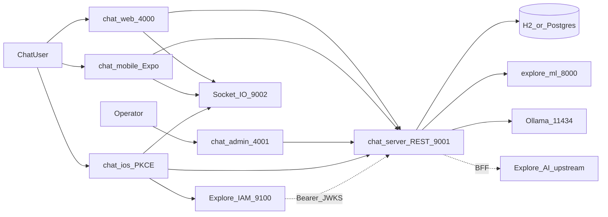
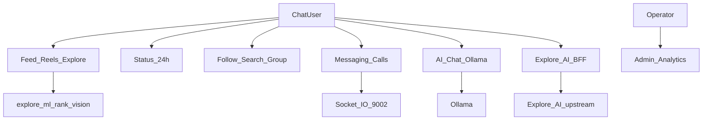
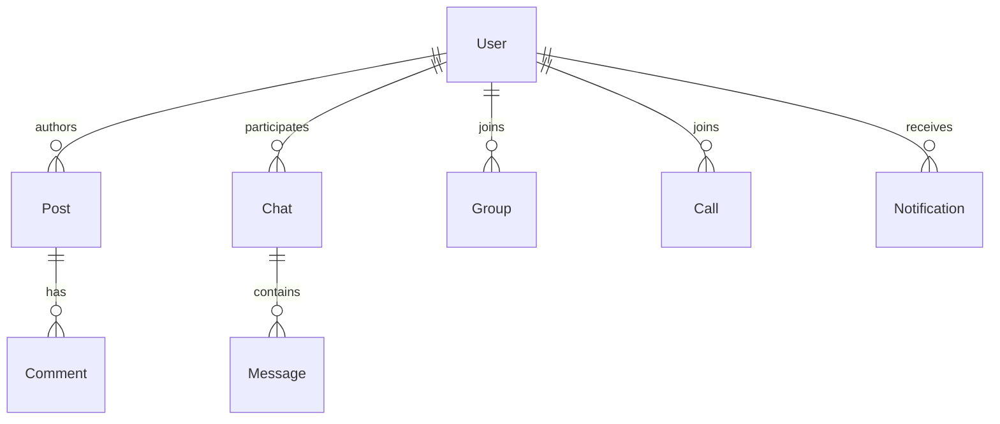
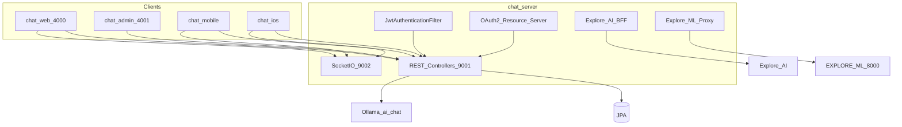
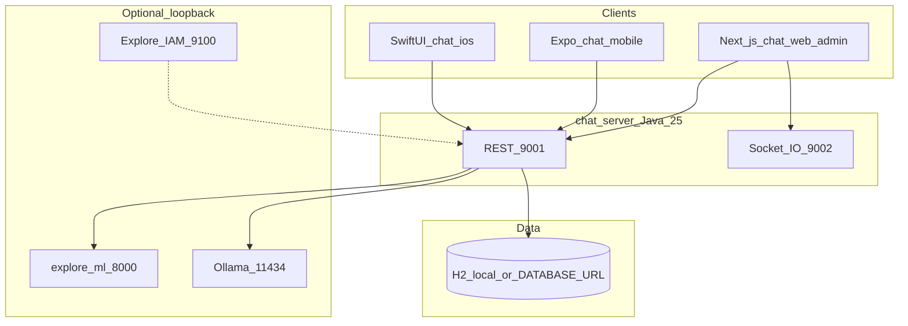
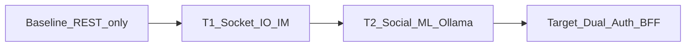

# Architecture Definition Document — Explore Chat

| Field | Value |
| --- | --- |
| Deliverable | Architecture Definition Document (TOGAF Architecture Content Framework) |
| Reference | [TOGAF Architecture Deliverables §32.2.3](https://pubs.opengroup.org/architecture/togaf9-doc/m/chap32.html) |
| Capability | Explore Chat (social feed, messaging, calls, status, optional ML + AI BFF) |
| ADM phases | B–D (Architecture Vision from Phase A summarized in §1) |
| Architecture states | Baseline, Transition (T1, T2), Target |
| Companion | Architecture Requirements Specification (quantitative) — separate deliverable |
| Code-level models | [C4 model](../c4-model/README.md) |
| Preferred Terms | Idiomatic English ([Glossary](../../Glossary.md)) |

**Purpose.** Explore Chat fails when every client invents its own wire shapes, when realtime push is bolted on as an afterthought, or when ML weights land inside the JVM. This Architecture Definition Document records how the product is organized today and how it evolved from a REST-only social prototype: qualitative models across Business, Data, Application, and Technology domains, with honest Baseline and Transition states and an as-built **Target** that matches the codebase on this branch—not roadmap items stated as shipped fact.

---

## Contents

- [1. Vision](#1-vision)
- [2. Architecture principles](#2-architecture-principles)
- [3. Architecture models](#3-architecture-models)
  - [3.1 Business Architecture](#31-business-architecture)
  - [3.2 Data Architecture](#32-data-architecture)
  - [3.3 Application Architecture](#33-application-architecture)
  - [3.4 Technology Architecture](#34-technology-architecture)
- [4. Re-use, standards, and landscape](#4-re-use-standards-and-landscape)
  - [4.1 Re-use assessment](#41-re-use-assessment)
  - [4.2 Mapping to standards](#42-mapping-to-standards)
  - [4.3 Mapping to architecture landscape](#43-mapping-to-architecture-landscape)
- [5. Transition Architecture](#5-transition-architecture)
- [6. References](#6-references)

---

## 1. Vision

### Problem

Users expect Instagram-style Feed, Reels, and Explore grids, ephemeral Status, group conversations, global Search with Follow graphs, reliable DMs with delivery semantics, and optional AI media—without exposing loopback ML services or upstream Explore AI credentials to browsers. The failure mode is fragmented clients (Web, Admin, Expo, native iOS) that disagree on message IDs, duplicate auth models, or poll REST for chat while operators cannot moderate from Admin or see analytics.

### Stakeholders and concerns

| Stakeholder | Concern | Architectural response |
| --- | --- | --- |
| End user | Fast feed, trustworthy DMs, calls, Reels | REST on `:9001`; Socket.IO on `:9002`; WebRTC via Call aggregate |
| Operator | Admin moderation and analytics | `chat/admin` on `:4001`; `/api/v1/admin` and `/api/v1/analytics` behind IAM `SCOPE_admin:chat` when Bearer is used |
| Platform engineer | One API boundary, consistent IM contract | [IM Contract](../../../../chat/im-contract/openapi.yaml); per-feature `controller → service → domain ← infra` in `chat/server` |
| Security | Dual login paths without scope leakage | HS JWT for local password login; optional IAM Bearer with GitHub-style module scopes |
| ML integrator | Heavy inference off the JVM | `EXPLORE_ML_API_URL` → Explore ML `:8000` loopback only |

### Solution

Clients talk only to **chat/server** (Spring Boot): **REST `:9001`** and **Socket.IO `:9002`**. **chat/web** (`:4000`), **chat/admin** (`:4001`), **chat/mobile** (Expo), and **chat/ios** (SwiftUI + PKCE) align DTOs with the IM contract—no codegen, handwritten mapping. Optional **Explore IAM** validates Bearer tokens when `CHAT_IAM_ISSUER_URI` is set. **Ollama** backs `/api/v1/ai` text chat; **Explore AI** is reached only through the **Explore AI BFF** at `/api/v1/ai/explore` with service key and client identity headers. Vision, recommendation, image/video/voice generation delegate to Explore ML on loopback.

Runtime paths for auth (password HS JWT vs IAM Bearer), post-create fan-out, search, and iOS sign-in are in [C4-Dynamic-Auth-Login.puml](../c4-model/C4-Dynamic-Auth-Login.puml), [C4-Dynamic-IamSignIn.puml](../c4-model/C4-Dynamic-IamSignIn.puml), [C4-Dynamic-Post-Create-Feed.puml](../c4-model/C4-Dynamic-Post-Create-Feed.puml), and [C4-Dynamic-Search-FTS.puml](../c4-model/C4-Dynamic-Search-FTS.puml). Container and deployment topology: [C2-Container.puml](../c4-model/C2-Container.puml), [C4-Deployment.puml](../c4-model/C4-Deployment.puml). Domain kernel: [C4-Code-Domain-Model.puml](../c4-model/C4-Code-Domain-Model.puml).

---

## 2. Architecture principles

Each principle states a failure mode, the decision, and an enforceable constraint.

1. **Single product API boundary** — *Failure:* browsers call Explore ML or Explore AI directly and leak service keys. *Decision:* all product traffic terminates on chat/server. *Constraint:* clients set `NEXT_PUBLIC_API_URL` / `EXPO_PUBLIC_API_URL` to `:9001` only; Explore AI via `/api/v1/ai/explore`, never upstream URLs in client env.

2. **IM Contract as wire SSoT** — *Failure:* Web and mobile disagree on `clientMsgId`, delivery status, or chat IDs. *Decision:* [IM Contract](../../../../chat/im-contract/openapi.yaml) is the cross-language protocol; server domain uses Glossary table names. *Constraint:* new message or chat fields update OpenAPI first, then Java aggregates and client projections (`ChatCatalog`, `ChatThread`).

3. **Realtime separation** — *Failure:* long-polling REST for typing and notifications overloads HTTP thread pools. *Decision:* authoritative CRUD on `:9001`; push events on `:9002`. *Constraint:* Socket.IO shares auth context (HS JWT or Bearer); notification `notification:new` and chat events documented in contract and C3.

4. **Dual-track auth without ambiguity** — *Failure:* IAM scopes applied to password JWTs or admin routes left open in prod. *Decision:* `JwtAuthenticationFilter` issues `ROLE_USER` for Chat HS tokens; OAuth2 resource server maps IAM to `SCOPE_*` only when `CHAT_IAM_ISSUER_URI` is non-blank. *Constraint:* see dual-auth matrix in §3.3; admin routes require `SCOPE_admin:chat` for Bearer callers.

5. **Per-feature clean architecture** — *Failure:* business rules in mappers or JPA listeners. *Decision:* `com.chat.<feature>` packages with `controller`, `service`, `domain.model`, `domain.repository`, `infra`, `mapper`. *Constraint:* domain has no outward dependencies; Liquibase baseline-only in `0.1` createTable.

6. **Loopback ML only** — *Failure:* embedding Python stacks in chat/server. *Decision:* `AiProxyService` and feature-specific clients call `EXPLORE_ML_API_URL` (default `http://localhost:8000`). *Constraint:* recommendation rank, vision moderate, image/video/voice generate, and speech paths proxy; no ML bind on `0.0.0.0` for product clients.

7. **Glossary-first naming** — *Failure:* API routes drift from product language. *Decision:* [Glossary](../../Glossary.md) Preferred Terms govern packages, routes, and Jira. *Constraint:* e.g. `Group` → table `social_group`, `Post` → `social_post`, `Call` → `voice_call`.

---

## 3. Architecture models

Baseline, Transition, and **Target** are labeled explicitly. Target describes what ships on this branch; planning-only deltas (e.g. [C4-Code-Domain-Model-Plan.puml](../c4-model/C4-Code-Domain-Model-Plan.puml)) appear only in §5 or roadmap notes—not as Target facts.

### 3.1 Business Architecture

#### Baseline

A social prototype with password login, `Post` and `User` REST, and polling for messages—no Socket.IO, no Status or Group APIs, no Reels/Explore surfaces, no Admin analytics, no explore-ml or Ollama integration, and a single HS JWT path without IAM scopes.

#### Target

| Actor | Role |
| --- | --- |
| Signed-in user | Consumes Feed, Reels, Explore, Status, Search; messages and calls; optional AI chat and media generation |
| Operator | Moderates via Admin; reads analytics dashboards |
| Native iOS user | Signs in with Explore IAM PKCE; uses Bearer on REST and Socket.IO |

| Business capability | Package / route | Outcome |
| --- | --- | --- |
| Auth | `com.chat.auth` `/api/v1/auth` | Register, login, refresh; HS JWT or IAM-aligned identity |
| User & profile | `com.chat.users` `/api/v1/users` | Profiles, avatars; search hit type `users` |
| Messaging | `com.chat.chats`, `com.chat.messages` | Chats, messages, optimistic `clientMsgId`; Socket.IO delivery |
| Group | `com.chat.groups` `/api/v1/groups` | Social circles (`social_group`) |
| Feed & Post | `com.chat.post` | `GET /posts/feed`, create post, engagement |
| Reels | `com.chat.post` `/api/v1/posts/reels` | Short-video tab |
| Explore | `com.chat.post` `/api/v1/posts/explore` | Discovery grid |
| Comment | `com.chat.comments` | Threaded comments on posts |
| Follow | `com.chat.follow` `POST /users/{user}:follow` | AIP-136 custom method |
| Search | `com.chat.search` `/api/v1/search` | Types `posts`, `users`, `hashtags` (JPA LIKE; no FTS5 in Target) |
| Status | `com.chat.status` `/api/v1/status` | 24h ephemeral stories |
| Call | `com.chat.calls` `/api/v1/calls` | WebRTC session metadata (`voice_call`) |
| Notification | `com.chat.notifications` | In-app notices; `notification:new` on Socket.IO |
| Media | `com.chat.media` `/api/v1/media` | Upload pipeline for posts |
| AI Chat (local) | `com.chat.ai` `/api/v1/ai` | Text generation via **Ollama** |
| Explore AI BFF | `com.chat.ai` `/api/v1/ai/explore` | Server-side proxy to Explore AI (`X-Service-Key`, `X-Client-Id`) |
| Image / Video / Voice Gen | `com.chat.ai` | `:generate` / `:synthesize` → Explore ML |
| Vision | `com.chat.ai` `/api/v1/vision` | Moderation sidecar via Explore ML |
| Analytics | `com.chat.analytics` `/api/v1/analytics` | Admin metrics consumption |
| Admin | `com.chat.admin` `/api/v1/admin` | Operator APIs (Bearer `SCOPE_admin:chat` when IAM on) |
| Health | `com.chat.health` | `/api/v1/health`, actuator |

### 3.2 Data Architecture

#### Baseline

`chat_user` and `social_post` only; messages fetched by polling; no `voice_call`, `activity_notification`, or group tables.

#### Target

| Entity | Physical table | Role |
| --- | --- | --- |
| `User` | `chat_user` | Signed-in principal |
| `Chat`, `Message` | `chat`, `message` | DM threads; soft delete via `markDeleted` |
| `Group` | `social_group` | Group conversations |
| `Post` | `social_post` | Feed, Reels, Explore content; `mediaUrls`, `coverUrl` |
| `Comment` | `post_comment` | Post replies |
| `Call` | `voice_call` | Call session metadata |
| `Notification` | `activity_notification` | Activity feed |
| Status payloads | status API persistence | 24h visibility window |

| Store | Content | Notes |
| --- | --- | --- |
| H2 / Postgres | JPA aggregates + Liquibase `0.1` | `ChatPhysicalNamingStrategy` maps reserved names; no `@Table` on domain types |
| Local disk / object storage | Media binaries | Referenced by URLs on `Post` |
| Client projections | `ChatCatalog`, `ChatThread` on Web/Expo | Authoritative state on server + IM contract |

### 3.3 Application Architecture

#### Baseline

Monolithic Spring REST; Next.js clients poll messages; no Socket.IO server, no dual auth filters, no ML proxy layer.

#### Target

| Surface | Port / path | Notes |
| --- | --- | --- |
| REST API | `:9001` `/api/v1/*` | AIP-style resources and custom methods |
| Socket.IO | `:9002` `/socket.io` | Chat, message, notification events |
| Web | `:4000` | `NEXT_PUBLIC_API_URL`, `NEXT_PUBLIC_SOCKET_IO_URL` |
| Admin | `:4001` | Analytics and moderation UI |
| Mobile | Expo dev server | `EXPO_PUBLIC_*` mirrors Web |
| iOS | Native | IAM client `explore-chat-ios`; Bearer to REST/WS |

**Dual-auth matrix (enforceable today)**

| Caller context | Token | Validation | Spring authority | Route examples |
| --- | --- | --- | --- | --- |
| Local dev / password login | Chat HS JWT (`Authorization: Bearer`) | `JwtAuthenticationFilter` (HMAC secret) | `ROLE_USER` | All authenticated `/api/v1/**` when IAM issuer blank |
| IAM native (iOS PKCE) | Explore IAM access token | OAuth2 resource server + `CHAT_IAM_ISSUER_URI` | `SCOPE_write:chat_messaging` | `/api/v1/chats/**`, `/calls/**`, `/media/**`, `/notifications/**` |
| IAM social scope | Same Bearer | Scope guard | `SCOPE_write:chat_social` | `/posts/**`, `/users/**`, `/groups/**`, `/status/**`, `/search/**` |
| IAM admin | Same Bearer | Scope guard | `SCOPE_admin:chat` | `/api/v1/admin/**` |
| Public | None | Permit list | — | `/api/v1/auth/register`, `login`, `health`, actuator |

When `CHAT_IAM_ISSUER_URI` is empty, only the HS JWT path is active and scope rules apply to Bearer tokens only if a decoder is present. Operators validate IAM pairing with `pnpm dev chat iam` (issuer `http://localhost:9100`).

Client-side IM alignment: shared packages under workspace `packages/` and feature folders in **chat/web** / **chat/mobile** implement Local Chat Projection against [IM Contract](../../../../chat/im-contract/openapi.yaml).

### 3.4 Technology Architecture

#### Baseline

Java API without workspace Gradle integration; experimental split socket process; clients hard-coded to legacy paths.

#### Target

| Layer | Decision |
| --- | --- |
| API runtime | Spring Boot, JDK 25, JPA, Liquibase baseline `0.1`, Checkstyle in CI (`:chat-server:checkstyle*`, `test`) |
| Realtime | netty-socketio on **9002**; auth token on handshake |
| Web / Admin | Next.js in **chat/web**, **chat/admin** |
| Mobile | Expo React Native in **chat/mobile** |
| iOS | SwiftUI in **chat/ios**; PKCE per C4-Dynamic-IamSignIn |
| ML sidecar | `EXPLORE_ML_API_URL` default `http://localhost:8000` |
| AI text | Ollama for `/api/v1/ai`; Explore AI only via BFF env (`EXPLORE_AI_BASE_URL`, service key) |
| IAM | `CHAT_IAM_ISSUER_URI` enables JWT resource server; authority prefix `SCOPE_` |
| Prod web | Vercel-hosted Next (`explore-chat-web`); API topology per deployment diagram note |

**Roadmap note (not Target):** aggregate simplification in `C4-Code-Domain-Model-Plan.puml` (fewer aggregate roots, `ThreadMessage` naming) is a planned refactor, not current behavior.

---

## 4. Re-use, standards, and landscape

### 4.1 Re-use assessment

| Asset | Re-use |
| --- | --- |
| Explore ML (`EXPLORE_ML_API_URL`) | Recommendation rank, vision moderation, RAG (if wired), image/video/voice generation without JVM weights |
| Explore IAM | OAuth2 issuer for iOS PKCE; module scopes for messaging vs social vs admin |
| IM Contract OpenAPI | Cross-language DTO alignment for Chat, Message, delivery status |
| Ollama | Local LLM for AI Chat routes |
| Explore AI (upstream) | Agent invoke via BFF only; shields browser from service credentials |
| Workspace `packages/` | Shared IM and analytics types between Web and Expo |
| C4 dynamics + Glossary | Onboarding paths for auth, feed fan-out, search, IAM iOS |

### 4.2 Mapping to standards

| Standard | Application |
| --- | --- |
| AIP REST | Resource paths under `/api/v1`; custom methods `:follow`, `:generate`; `page_token` pagination |
| AIP-193 RpcStatus | Error body shape for API errors |
| OAuth 2.0 / OIDC | IAM issuer URI; PKCE on **chat/ios** |
| GitHub-style scopes | `write:chat_messaging`, `write:chat_social`, `admin:chat` on Bearer tokens |
| Socket.IO v4 | Realtime chat and notifications on dedicated port |
| WebRTC | Media plane for calls; signaling via Call REST |
| Clean Architecture per feature | `controller → service → domain ← infra` (+ `mapper` without business rules) |
| TOGAF content framework | This ADD; quantitative NFRs in companion ARS when published |

### 4.3 Mapping to architecture landscape

| Landscape element | Position |
| --- | --- |
| Monorepo roots | `chat/server`, `chat/web`, `chat/admin`, `chat/mobile`, `chat/ios`, `chat/im-contract` |
| Dev entry | `pnpm dev chat`; IAM variant `pnpm dev chat iam` |
| Default ports | Web `4000`, Admin `4001`, REST `9001`, Socket.IO `9002`, IAM `9100`, Explore ML `8000` |
| Live web | [explore-chat-web.vercel.app](https://explore-chat-web.vercel.app) |
| Peer ML repo path | `ml/` sibling app in workspace; six modules one process |
| Peer IAM | Explore IAM product in workspace catalog |
| Living docs | [Glossary](../../Glossary.md), [C4](../c4-model/README.md), [User Story Map](../../product-owner/User-Story-Map.md) |

---

## 5. Transition Architecture

| State | Definition |
| --- | --- |
| Baseline | REST-only social core (`User`, `Post`); HS JWT only; no Socket.IO, no Status/Group/Reels/Explore |
| T1 | Socket.IO `:9002`, notifications, calls, IM contract adoption on Web/Expo |
| T2 | Full social surface (Status, Group, Search, Follow, Reels, Explore); Admin + analytics; explore-ml proxies; Ollama AI chat |
| Target | Dual auth (HS JWT + IAM scopes), **chat/ios** PKCE, Explore AI BFF, production Vercel web, optional Postgres |

### T1 — Realtime and contract

| Domain | Change |
| --- | --- |
| Business | Messaging with delivery semantics; Call signaling; Notification drawer |
| Data | `chat`, `message`, `voice_call`, `activity_notification` tables live |
| Application | Socket.IO server; clients use `ChatCatalog` / `ChatThread`; [IM Contract](../../../../chat/im-contract/openapi.yaml) as SSoT |
| Technology | Ports **9001** + **9002**; env `NEXT_PUBLIC_SOCKET_IO_URL` |

### T2 — Social breadth and sidecars

| Domain | Change |
| --- | --- |
| Business | Feed fan-out; Reels and Explore routes; Status; Group; Search/Follow |
| Data | `social_group`; feed query paths; engagement counters |
| Application | Admin app on **4001**; `/api/v1/analytics`; `AiProxyService` to Explore ML; `/api/v1/ai` → Ollama |
| Technology | `EXPLORE_ML_API_URL`; optional IAM issuer for early Bearer tests |

### Target — Identity matrix and BFF (per-domain delta from T2)

| Domain | Change |
| --- | --- |
| Business | Explore AI BFF (`/api/v1/ai/explore`); full operator analytics; iOS as first-class client |
| Data | Stable Liquibase baseline; soft-delete on messages |
| Application | `SecurityConfig` scope matrix; `JwtAuthenticationFilter` before Bearer filter; IAM user provisioning filter when decoder present |
| Technology | `CHAT_IAM_ISSUER_URI` for `pnpm dev chat iam`; Vercel + hosted API per deployment PUML |

---

## 6. References

- [TOGAF Architecture Deliverables — Architecture Definition Document §32.2.3](https://pubs.opengroup.org/architecture/togaf9-doc/m/chap32.html)
- [Socket.IO documentation](https://socket.io/docs/v4/)
- [WebRTC](https://webrtc.org/)
- [Google AIP REST](https://google.aip.dev/general)
- [Glossary](../../Glossary.md)
- [C4 model](../c4-model/README.md)
- [User Story Map](../../product-owner/User-Story-Map.md)
- [API notes](../api.md)
- [Python services / Explore ML](../python-services.md)
- [IM Contract (OpenAPI)](../../../../chat/im-contract/openapi.yaml)
- [QUICKSTART](../QUICKSTART.md)