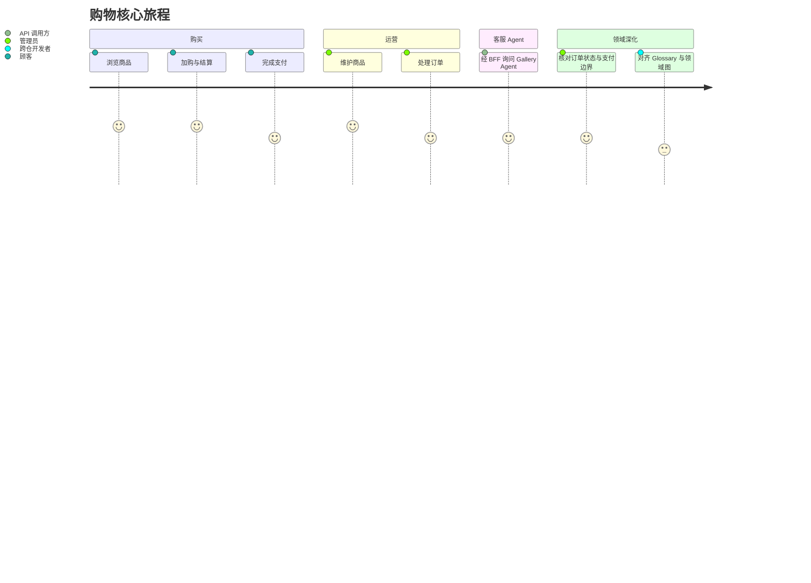

# 用户故事地图 | User Story Map — Explore Commerce
> Jeff Patton 用户故事地图；正文与验收标准合并于本文（单一文档）。  
> Jeff Patton user-story map; epics and GWT acceptance criteria live in this single document.  
> 格式 / Format：Background → `As a` / `I want` / `So that` → Scenario GIVEN-WHEN-THEN（双语 / bilingual）。

## 用户画像 | Personas

| 角色 / Role | 说明 / Description |
|------|------|
| 顾客 / Customer | 浏览商品、下单与支付 / Browses products, places orders, and pays |
| 管理员 / Admin | 管理商品、订单与用户 / Manages products, orders, and users |
| API 调用方 / API Consumer | 经 Commerce BFF 调用 Explore AI Gallery / Calls Explore AI Gallery via Commerce BFF |
| 跨仓开发者 / Cross-repo Developer | 维护订单域统一语言与 C4 / Maintains order-domain ubiquitous language and C4 |

## 旅程总览 | Journey Overview

## Backbone 故事地图 | Backbone

### 已实现

| 店面 | 订单支付 | 管理 | AI Agent BFF |
|------|----------|------|--------------|
| [US-01](#us-01-浏览商品列表) 浏览列表 | [US-04](#us-04-提交订单) 提交订单 | [US-07](#us-07-维护商品) 维护商品 | [US-10](#us-10-经-commerce-代理调用-gallery-agent) Gallery 代理 |
| [US-02](#us-02-查看商品详情并加购) 详情加购 | [US-05](#us-05-发起支付) 发起支付 | [US-08](#us-08-处理订单) 处理订单 | |
| [US-03](#us-03-管理购物车) 购物车 | [US-06](#us-06-查看结账成功) 成功页 | [US-09](#us-09-管理用户) 管理用户 | |

### 规划中

| 订单生命周期 | 订单域活文档 |
|--------------|--------------|
| [US-11](#us-11-订单仅允许合法状态迁移) 合法状态迁移 | [US-14](#us-14-glossary-补齐订单与支付术语) Glossary 订单/支付 |
| [US-12](#us-12-顾客按规则取消订单) 按规则取消 | [US-15](#us-15-订单领域模型图) Domain Model |
| [US-13](#us-13-支付结果与履约状态可区分) 支付与履约可区分 | [US-16](#us-16-结账与支付动态图) Checkout Dynamic |

## Epic 索引 | Epic Index

| Epic | 锚点 / Anchor | 状态 / Status |
|------|---------------|---------------|
| E1 店面 | [#e1](#e1) | — |
| E2 结账 | [#e2](#e2) | — |
| E3 管理 | [#e3](#e3) | — |
| E4 AI Agent BFF | [#e4](#e4) | — |
| E5 订单生命周期与支付边界 | [#e5](#e5) | — |
| E6 订单域活文档 | [#e6](#e6) | — |

---

# 用户故事正文 | User Stories

## E1 店面 / Storefront

### 背景 | Background

顾客在结账前浏览目录、查看详情并维护购物车。 / Customers browse the catalog, view details, and maintain the cart before checkout.

### US-01 浏览商品列表 / Browse product list

**As a** 顾客 / Customer  
**I want** 按分类浏览商品列表 / to browse the product list by category
**So that** 可从目录选定待购商品 / I can pick products from the catalog to buy

#### 验收标准 | Acceptance Criteria

1. **Scenario** 展示上架商品列表 / Show listed products
   **GIVEN** 目录中有上架商品 / listed products exist in the catalog
   **WHEN** 打开 `/products` / Open `/products`  
   **THEN** 展示可滚动的商品列表，并可按分类筛选 / a scrollable product list is shown and can be filtered by category

#### 状态 | Status

已实现 / Done

---

### US-02 查看商品详情并加购 / View product details and add to cart

**As a** 顾客 / Customer  
**I want** 打开商品详情并加入购物车 / to open product details and add to cart
**So that** 可按规格与数量加入待结账清单 / I can add the chosen variant and quantity to the checkout list

#### 验收标准 | Acceptance Criteria

1. **Scenario** 详情页加入购物车 / Add the shopping cart to the details page  
   **GIVEN** 用户在商品详情页 / User is on the product details page  
   **WHEN** 选择数量并加入购物车 / Select the number and join the shopping cart  
   **THEN** 购物车包含该商品与所选数量 / Shopping cart contains the product and the selected quantity  

#### 状态 | Status

已实现 / Done

---

### US-03 管理购物车 / Manage shopping cart

**As a** 顾客 / Customer  
**I want** 在购物车中调整数量或清空 / to change quantities or clear the cart
**So that** 结账前清单与合计准确 / the pre-checkout list and totals stay accurate

#### 验收标准 | Acceptance Criteria

1. **Scenario** 修改购物车条目 / Modify Shopping Car Entry  
   **GIVEN** 购物车非空 / Shopping cart is not empty  
   **WHEN** 打开 `/cart` 并修改数量或清空 / Open `/cart` and modify quantity or empty  
   **THEN** 合计与条目同步更新 / Total updated with entries  
   **AND** 可进入结账 / It's open.  

#### 状态 | Status

已实现 / Done

---

## E2 结账 / Checkout

### 背景 | Background

顾客从购物车创建订单、完成支付并查看确认页。 / Customers create orders from shopping carts, complete payments and check confirmation Page.

### US-04 提交订单 / Submission of orders

**As a** 顾客 / Customer  
**I want** 从购物车确认结账并创建订单 / Check the check from the shopping cart and create the order  
**So that** 生成可支付的订单记录 / Generate paymentable order records

#### 验收标准 | Acceptance Criteria

1. **Scenario** 创建订单 / Create order  
   **GIVEN** 购物车非空且用户可结账 / Shopping cart is not empty and the user can check out  
   **WHEN** 在 `/checkout` 确认结账 / Via `/checkout` Check.  
   **THEN** 创建 Order 记录并离开购物车流程 / Create Order Recording and leaving the shopping cart  

#### 状态 | Status

已实现 / Done

---

### US-05 发起支付 / Initiate payment

**As a** 顾客 / Customer  
**I want** 选择支付方式并付款 / Selection and payment  
**So that** 订单状态更新为已支付 / Order status updated to paid

#### 验收标准 | Acceptance Criteria

1. **Scenario** 调用支付网关 / Call payment gateway  
   **GIVEN** 订单待支付 / Orders to be paid  
   **WHEN** 选择支付方式并确认 / Selection and confirmation of payment modalities  
   **THEN** 调用支付网关（如 Stripe） / Call payment gateway (e.g. Stripe)  
   **AND** 成功后订单状态更新 / Successful post-order status update  

#### 状态 | Status

已实现 / Done

---

### US-06 查看结账成功 / View successful billing

**As a** 顾客 / Customer  
**I want** 支付成功后看到确认页 / Check page after payment is successful  
**So that** 可核对订单已受理 / Revealable orders accepted

#### 验收标准 | Acceptance Criteria

1. **Scenario** 展示支付确认页 / Show payment confirmation page  
   **GIVEN** 支付已成功 / Payment successful  
   **WHEN** 打开 `/checkout/success` / Open `/checkout/success`  
   **THEN** 展示订单确认信息 / Display order confirmation information  

#### 状态 | Status

已实现 / Done

---

## E3 管理 / Admin

### 背景 | Background

管理员在 Admin 维护商品、处理订单并查看用户账号。 / The Admin is here. Admin Maintenance of goods, processing of orders and viewing of user accounts.

### US-07 维护商品 / Maintain products

**As a** 管理员 / Admin  
**I want** 在 Admin 创建或更新商品 / Via Admin Create or update commodities  
**So that** 店面目录与后台数据一致 / The shop directory is consistent with back-office data

#### 验收标准 | Acceptance Criteria

1. **Scenario** 创建或更新商品 / Create or update commodities  
   **GIVEN** 管理员已登录 Admin / Admin Login Admin  
   **WHEN** 创建或更新商品 / Create or update commodities  
   **THEN** 店面 `/products` 展示反映变更 / The shop. `/products` Show changes  

#### 状态 | Status

已实现 / Done

---

### US-08 处理订单 / Processing orders

**As a** 管理员 / Admin  
**I want** 查看并更新订单状态 / View and update the order status  
**So that** 履约与客服可跟进订单 / Performance and customer service follow-up orders

#### 验收标准 | Acceptance Criteria

1. **Scenario** 查看并更新订单 / View and update orders  
   **GIVEN** 存在顾客订单 / Customer orders exist  
   **WHEN** 打开 Admin 订单列表 / Open Admin Order List  
   **THEN** 可见状态与关键字段并可更新 / Visible status and key fields and can be updated  

#### 状态 | Status

已实现 / Done

---

### US-09 管理用户 / Manage Users

**As a** 管理员 / Admin  
**I want** 查看店铺用户账号 / View shop user accounts  
**So that** 可处理账号查询与权限相关请求 / Addressable account search and permission-related requests

#### 验收标准 | Acceptance Criteria

1. **Scenario** 查看注册用户列表 / View list of registered users  
   **GIVEN** 管理员已登录 Admin / Admin Login Admin  
   **WHEN** 打开用户管理 / Open User Management  
   **THEN** 可见注册用户的关键摘要 / Key summary for visible registered users  

#### 状态 | Status

已实现 / Done

---

## E4 AI Agent BFF

### 背景 | Background

Commerce 经薄 BFF 调用 Explore AI Gallery（含 `support` Agent），不在店铺前端或浏览器持有 AI 服务密钥；调用时可把订单摘要并入 invoke message 作为上下文。 / Commerce BFF calls Explore AI Gallery( `support` Agent), does not AI ; calls can order invoke message .

### US-10 经 Commerce 代理调用 Gallery Agent / Via Commerce Proxy Call Gallery Agent

**As a** 已登录的 Commerce API 调用方 / Signed-in Commerce API Consumer  
**I want** 列出并调用 Explore AI Agents / List and call Explore AI Agents  
**So that** 客服与运营经本服务访问 Gallery，且 AI 密钥仅留在服务端 / Service visits for customers and operations Gallery, and AI Keys left only at service

#### 验收标准 | Acceptance Criteria

1. **Scenario** 列出可用 Agent / List Available Agent  
   **GIVEN** `EXPLORE_AI_BASE_URL` 与 `EXPLORE_AI_SERVICE_KEY` 已配置 / `EXPLORE_AI_BASE_URL` and `EXPLORE_AI_SERVICE_KEY` Configured  
   **WHEN** `GET /api/ai/agents`（带 JWT） / `GET /api/ai/agents`( JWT)  
   **THEN** 转发 `GET {AI}/api/agents`，请求头含 `X-Service-Key` 与 `X-Client-Id` / Forward `GET {AI}/api/agents`, Synchronising folder `X-Service-Key` and `X-Client-Id`  

2. **Scenario** 带订单摘要调用 support / Call with order summary support  
   **GIVEN** 同上 / Same as above  
   **WHEN** `POST /api/ai/agents/support/invoke` body 含 `message` 与可选 `orderSummary` / `POST /api/ai/agents/support/invoke` body includes `message` With Optional `orderSummary`  
   **THEN** 上游收到合并后的 message，并返回 `reply` / After receiving the merger upstream message, And back `reply`  

#### 状态 | Status

已实现 / Done

---

## E5 订单生命周期与支付边界 / Order life cycle and payment boundary

### 背景 | Background

结账已能创建订单并发起支付，但履约状态可跳步、取消规则前后端不一致，且支付结果与履约进度混在同一套状态里，客服与管理难以区分「已收款未发货」与「未付款」。 / The closing of accounts has created orders and initiated payments, but the performance status can leapfrog, the cancellation rules are inconsistent and the payment results are mixed with the performance progress, and it is difficult to distinguish between " received outstanding goods " and " outstanding payments " on the part of the client and management".

### US-11 订单仅允许合法状态迁移 / Orders only allow legal migration

**As a** 管理员 / Admin  
**I want** 订单状态只能按约定路径前进或进入取消 / The order status can only go along the agreed path or go into cancellation.  
**So that** 履约进度不可跳步或回退到非法状态 / Compliance progress cannot jump or retreat to an illegal state

#### 验收标准 | Acceptance Criteria

1. **Scenario** 拒绝跳步 / Deny Jump  
   **GIVEN** 订单状态为 `pending` / The order status is `pending`  
   **WHEN** 尝试直接改为 `shipped` 或 `delivered` / Try directly to read `shipped` or `delivered`  
   **THEN** 变更被拒绝且订单状态不变 / Change refused and order remained unchanged  

2. **Scenario** 合法前进 / Legitimate advance.  
   **GIVEN** 订单状态为 `processing` / The order status is `processing`  
   **WHEN** 更新为下一履约状态 `shipped` / Update to Next Status `shipped`  
   **THEN** 订单状态变为 `shipped` / The order status becomes `shipped`  

3. **Scenario** 终态不可再履约前进 / No more compliance.  
   **GIVEN** 订单状态为 `delivered` 或 `cancelled` / The order status is `delivered` or `cancelled`  
   **WHEN** 尝试改为其他履约状态 / Attempt to change to other status of compliance  
   **THEN** 变更被拒绝 / Change rejected  

#### 状态 | Status

规划中 / Planned

---

### US-12 顾客按规则取消订单 / Customers cancel orders according to the rules.

**As a** 顾客 / Customer  
**I want** 在约定窗口内取消未完成履约的订单 / Unfinished orders within the agreed window  
**So that** 取消策略前后端一致，已发货订单不可取消 / The cancellation strategy is consistent and shipped orders cannot be cancelled

#### 验收标准 | Acceptance Criteria

1. **Scenario** 待处理可取消 / Pending Cancelable  
   **GIVEN** 订单状态为 `pending` 且属于当前顾客 / The order status is `pending` And it belongs to the current customer.  
   **WHEN** 顾客请求取消 / Customer request canceled.  
   **THEN** 订单变为 `cancelled` / The order becomes `cancelled`  

2. **Scenario** 处理中可取消（与约定一致） / Negotiable (consensual with agreement))  
   **GIVEN** 产品约定允许在 `processing` 取消 / The product agreement allows `processing` Cancel  
   **WHEN** 顾客或管理端按同一规则取消 / The customer or manager cancels by the same rule  
   **THEN** 两端接受或拒绝结果一致 / Both ends accept or reject the same result  

3. **Scenario** 已发货不可取消 / Delivery cannot be cancelled  
   **GIVEN** 订单状态为 `shipped` 或 `delivered` / The order status is `shipped` or `delivered`  
   **WHEN** 请求取消 / Request Cancel  
   **THEN** 请求被拒绝且状态不变 / Request denied and remains unchanged  

#### 状态 | Status

规划中 / Planned

---

### US-13 支付结果与履约状态可区分 / Distinction between payment results and performance

**As a** 管理员或客服 / Admin or Support  
**I want** 查看订单时能区分是否已收款与当前履约进度 / Checking orders to distinguish between collections and current performance  
**So that** 已收款未发货与未付款不会被同一状态混淆 / Collections outstanding and unpaid will not be confused with the same status

#### 验收标准 | Acceptance Criteria

1. **Scenario** 支付成功后仍可待履约 / After payment has been successful, performance is still available  
   **GIVEN** 顾客已完成支付 / Customer paid.  
   **WHEN** 查看该订单 / View the order  
   **THEN** 可见支付已成功的标识或字段 / Visible payment of successful markings or fields  
   **AND** 履约状态仍可为待处理或处理中 / State of compliance may still be pending or in progress  

2. **Scenario** 未付款与已付款列表可区分 / List of outstanding and paid payments distinguishable  
   **GIVEN** 同时存在未付款与已付款订单 / There are also outstanding and paid orders  
   **WHEN** 在管理端按支付结果筛选或查看详情 / Filter or view details by payment at management end  
   **THEN** 两类订单可被区分，不单靠履约状态推断 / Two types of orders can be distinguished, not just from performance.  

#### 状态 | Status

规划中 / Planned

---

## E6 订单域活文档 / Order Field Work Document

### 背景 | Background

Order

### US-14 Glossary 补齐订单与支付术语 / Glossary Completion of purchase orders and payment terminology

**As a** 跨仓开发者 / Cross-repo Developer  
**I want** Glossary 写明 Order、OrderStatus、PaymentIntent 及取消与支付不变量 / Glossary Note Order, OrderStatus, PaymentIntent and cancel and pay no variables  
**So that** 实现与故事使用同一套 Preferred Terms / Achieving the same thing as a story. Preferred Terms

#### 验收标准 | Acceptance Criteria

1. **Scenario** 核心术语入表 / List of core terms  
   **GIVEN** 打开 `docs/Glossary.md` / Open `docs/Glossary.md`  
   **WHEN** 查阅订单与支付相关条目 / Access to order and payment related entries  
   **THEN** 含 Order、OrderStatus、PaymentIntent（或等价 Preferred Term）及中文对照与定义 / Includes Order, OrderStatus, PaymentIntent(Or the equivalent. Preferred Term)must use  

2. **Scenario** 不变量可核对 / Non-variable  
   **GIVEN** Glossary 中的状态与取消说明 / Glossary Status and cancellation statements in place  
   **WHEN** 对照 E5 验收场景 / Contrast E5 Receiving scene  
   **THEN** 合法迁移与取消窗口与故事表述一致 / Legitimate migration is consistent with the cancellation window and story presentation  

#### 状态 | Status

规划中 / Planned

---

### US-15 订单领域模型图 / Model maps of order areas

**As a** 跨仓开发者 / Cross-repo Developer  
**I want** `C4-Code-Domain-Model.puml` 画出 Order 聚合、行项目、状态与领域行为 / `C4-Code-Domain-Model.puml` depicts the Order aggregate, line items, status, and domain behavior  
**So that** 评审可对照代码中的聚合边界与方法 / The evaluation can be compared to the polymer boundaries and methods in the code

#### 验收标准 | Acceptance Criteria

1. **Scenario** 聚合与实体入图 / Aggregation and entity chart  
   **GIVEN** 仓库 `docs/c4-model/` / Repository `docs/c4-model/`  
   **WHEN** 打开 `C4-Code-Domain-Model.puml` / Open `C4-Code-Domain-Model.puml`  
   **THEN** 图中含 Order 聚合及订单行等实体/值对象，并标注 stereotype / Figure Order Entities such as aggregation and order lines/Value Object, and Mark stereotype  

2. **Scenario** 领域行为可核对 / Field behaviour can be checked  
   **GIVEN** 订单存在状态迁移、取消等行为 / Order-occupancy displacement, cancellation, etc.  
   **WHEN** 对照领域图 / Comparative field chart  
   **THEN** 图中以 `+method` 列出对应公共领域 API（或服务层编排所依赖的领域方法） / Figure `+method` List the corresponding public areas API(or service level organization)  

#### 状态 | Status

规划中 / Planned

---

### US-16 结账与支付动态图 / Flow of closing and payment

**As a** 架构评审参与者 / Architecture Review Participant  
**I want** `C4-Dynamic-Checkout-Payment.puml` 描述下单到支付结果再到履约起点 / `C4-Dynamic-Checkout-Payment.puml` Describe the next order to the payment and then the beginning of the performance.  
**So that** 运行时路径与 E5 支付/履约边界一致 / Run time path versus E5 Payments/Compliance boundaries are consistent

#### 验收标准 | Acceptance Criteria

1. **Scenario** 主路径完整 / Main Path Complete  
   **GIVEN** 打开该 Dynamic 图 / Open the Dynamic Figure  
   **WHEN** 沿顾客结账路径阅读 / Read along the customer's closing path  
   **THEN** 覆盖创建订单、发起支付、支付结果回写、进入履约起点 / Cover creation of orders, initiation of payments, return of payment results, entry into the performance threshold  

2. **Scenario** 与术语一致 / Consistent with terminology  
   **GIVEN** Glossary 中的 Order  
   **WHEN** 阅读图中参与者与消息 / Read participants and messages  
   **THEN** 命名使用 Preferred Terms，不另造同义名 / Synchronising folder Preferred Terms, No synonyms.  

#### 状态 | Status

规划中 / Planned

---

## 参考 | References

- [User Story Mapping — Jeff Patton](https://www.jpattonassociates.com/user-story-mapping/)
- [Domain Glossary](../Glossary.md)

