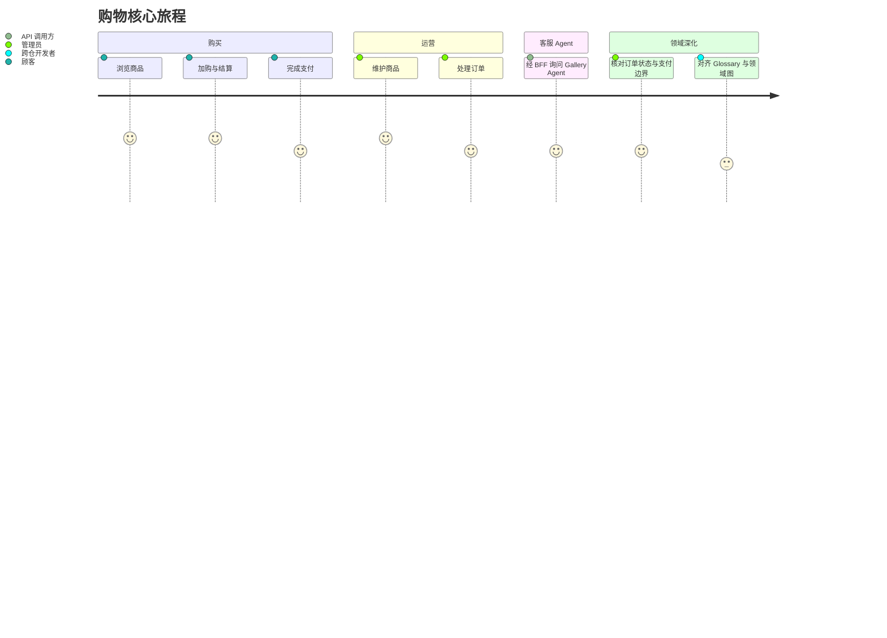

# 用户故事地图 | User Story Map — Explore Commerce
> Jeff Patton 用户故事地图；正文与验收标准合并于本文（单一文档）。  
> Jeff Patton user-story map; epics and GWT acceptance criteria live in this single document.  
> 格式 / Format：Background → `As a` / `I want` / `So that` → Scenario GIVEN-WHEN-THEN（双语 / bilingual）。

## 用户画像 | Personas

| 角色 / Role | 说明 / Description |
|------|------|
| 顾客 / Customer | 浏览商品、下单与支付 / Browses products, places orders, and pays |
| 管理员 / Admin | 管理商品、订单与用户 / Manages products, orders, and users |
| API 调用方 / API Consumer | 经 Commerce BFF 调用 Explore AI Gallery / Calls Explore AI Gallery via Commerce BFF |
| 跨仓开发者 / Cross-repo Developer | 维护订单域统一语言与 C4 / Maintains order-domain ubiquitous language and C4 |

## 旅程总览 | Journey Overview

## Backbone 故事地图 | Backbone

### 已实现

| 店面 | 订单支付 | 管理 | AI Agent BFF |
|------|----------|------|--------------|
| [US-01](#us-01-浏览商品列表) 浏览列表 | [US-04](#us-04-提交订单) 提交订单 | [US-07](#us-07-维护商品) 维护商品 | [US-10](#us-10-经-commerce-代理调用-gallery-agent) Gallery 代理 |
| [US-02](#us-02-查看商品详情并加购) 详情加购 | [US-05](#us-05-发起支付) 发起支付 | [US-08](#us-08-处理订单) 处理订单 | |
| [US-03](#us-03-管理购物车) 购物车 | [US-06](#us-06-查看结账成功) 成功页 | [US-09](#us-09-管理用户) 管理用户 | |

### 规划中

| 订单生命周期 | 订单域活文档 |
|--------------|--------------|
| [US-11](#us-11-订单仅允许合法状态迁移) 合法状态迁移 | [US-14](#us-14-glossary-补齐订单与支付术语) Glossary 订单/支付 |
| [US-12](#us-12-顾客按规则取消订单) 按规则取消 | [US-15](#us-15-订单领域模型图) Domain Model |
| [US-13](#us-13-支付结果与履约状态可区分) 支付与履约可区分 | [US-16](#us-16-结账与支付动态图) Checkout Dynamic |

## Epic 索引 | Epic Index

| Epic | 锚点 / Anchor | 状态 / Status |
|------|---------------|---------------|
| E1 店面 | [#e1](#e1) | — |
| E2 结账 | [#e2](#e2) | — |
| E3 管理 | [#e3](#e3) | — |
| E4 AI Agent BFF | [#e4](#e4) | — |
| E5 订单生命周期与支付边界 | [#e5](#e5) | — |
| E6 订单域活文档 | [#e6](#e6) | — |

---

# 用户故事正文 | User Stories

## E1 线上下单前选购 / Shopping before checkout

### 背景 | Background

顾客在付款前难以快速找到想买的商品并核对规格，容易放弃或买错。这会降低转化并增加售后咨询。我们希望在结账前提供顺畅的浏览、详情与购物车体验。 / Shoppers struggle to find the right products and variants before paying, which hurts conversion and drives support load. We need a smooth browse, detail, and cart experience up to checkout.

### US-01 按分类浏览在售商品 / Browse on-sale products by category

**As a** 顾客 / Customer  
**I want** 按分类浏览在售商品列表 / to browse on-sale products organized by category  
**So that** 我能从目录中选定待购商品 / I can shortlist what I want to buy from the catalog

#### 验收标准 | Acceptance Criteria

1. **Scenario** 看到可筛选的商品列表 / See a filterable product list  
   **GIVEN** 店铺目录中有在售商品 / on-sale products are available in the store catalog  
   **WHEN** 顾客进入商品浏览页 / the customer opens the product browse experience  
   **THEN** 看到可滚动的商品列表，并可按分类筛选 / they see a scrollable product list and can filter by category  

#### 状态 | Status

已交付 / Delivered

---

### US-02 查看商品详情并加入购物车 / View product details and add to cart

**As a** 顾客 / Customer  
**I want** 查看商品详情并按数量加入购物车 / to view product details and add items to my cart with the quantity I choose  
**So that** 我的待结账清单准确反映所选规格与数量 / my pre-checkout list reflects the variant and quantity I intended

#### 验收标准 | Acceptance Criteria

1. **Scenario** 从详情页加入购物车 / Add to cart from the product detail page  
   **GIVEN** 顾客正在查看某件商品的详情 / the customer is viewing a product’s detail page  
   **WHEN** 顾客选择数量并加入购物车 / they choose a quantity and add the item to the cart  
   **THEN** 购物车中出现该商品及所选数量 / the cart shows that product with the selected quantity  

#### 状态 | Status

已交付 / Delivered

---

### US-03 管理购物车内容 / Manage cart contents

**As a** 顾客 / Customer  
**I want** 在结账前调整数量或清空购物车 / to change quantities or clear my cart before checkout  
**So that** 订单金额与商品清单与我预期一致 / my totals and line items match what I intend to pay for

#### 验收标准 | Acceptance Criteria

1. **Scenario** 更新购物车并继续结账 / Update the cart and proceed to checkout  
   **GIVEN** 顾客的购物车中已有商品 / the customer’s cart contains at least one item  
   **WHEN** 顾客打开购物车并修改数量或清空 / they open the cart and change quantities or clear it  
   **THEN** 商品行与合计金额同步更新 / line items and order total update accordingly  
   **AND** 顾客可继续进入结账 / they can proceed to checkout  

#### 状态 | Status

已交付 / Delivered

---

## E2 结账与收款 / Checkout and payment

### 背景 | Background

顾客希望从购物车一键确认购买并完成付款，并立刻获得受理反馈。流程中断或信息不清会增加弃单与客服成本。我们需要可信赖的下单、支付与成功确认体验。 / Shoppers expect to confirm purchase from the cart, pay reliably, and get immediate confirmation. Drop-offs and unclear status raise abandonment and support cost. We need trustworthy order placement, payment, and success confirmation.

### US-04 从购物车提交订单 / Place an order from the cart

**As a** 顾客 / Customer  
**I want** 在结账页确认购买并生成订单 / to confirm purchase on checkout and receive an order record  
**So that** 我能进入付款并完成交易 / I can pay and complete the transaction against that order

#### 验收标准 | Acceptance Criteria

1. **Scenario** 确认结账后生成订单 / Order is created after checkout confirmation  
   **GIVEN** 购物车非空且顾客满足结账条件 / the cart is not empty and the customer is eligible to check out  
   **WHEN** 顾客在结账页确认下单 / the customer confirms the order on checkout  
   **THEN** 系统生成待支付订单并结束购物车选购流程 / the system creates a payable order and completes the cart checkout step  

#### 状态 | Status

已交付 / Delivered

---

### US-05 完成订单支付 / Pay for an order

**As a** 顾客 / Customer  
**I want** 选择支付方式并完成付款 / to choose a payment method and complete payment  
**So that** 商家能确认已收款并开始履约 / the business can confirm payment and start fulfillment

#### 验收标准 | Acceptance Criteria

1. **Scenario** 支付成功后订单标记为已付 / Order shows as paid after successful payment  
   **GIVEN** 存在一笔待支付订单 / there is an order awaiting payment  
   **WHEN** 顾客选择支付方式并确认付款 / the customer selects a payment method and confirms payment  
   **THEN** 支付处理完成且顾客看到进行中状态 / payment processing completes and the customer sees progress feedback  
   **AND** 支付成功后订单状态更新为已支付 / after success, the order status updates to paid  

#### 状态 | Status

已交付 / Delivered

---

### US-06 查看支付成功确认 / See payment success confirmation

**As a** 顾客 / Customer  
**I want** 付款成功后看到订单确认信息 / to see order confirmation after a successful payment  
**So that** 我能核对购买已被受理并留存凭据 / I can verify the purchase was accepted and keep a record

#### 验收标准 | Acceptance Criteria

1. **Scenario** 支付成功后展示确认页 / Confirmation page after successful payment  
   **GIVEN** 顾客已完成一笔成功支付 / the customer has completed a successful payment  
   **WHEN** 顾客进入支付成功确认页 / they open the payment success confirmation page  
   **THEN** 看到订单号、金额等关键确认信息 / they see key confirmation details such as order reference and amount  

#### 状态 | Status

已交付 / Delivered

---

## E3 店铺运营后台 / Store operations console

### 背景 | Background

运营人员需要及时更新商品、跟进订单并解答账号问题。信息分散或前后台不一致会增加履约延误与客诉。我们希望在统一后台高效维护目录、订单与用户。 / Operators must update catalog, track orders, and answer account questions. Scattered or inconsistent data causes fulfillment delays and complaints. We need one console to maintain products, orders, and customers.

### US-07 维护在售商品 / Maintain on-sale products

**As a** 管理员 / Admin  
**I want** 在后台创建或更新商品信息 / to create or update product information in the admin console  
**So that** 顾客看到的店面目录与运营数据一致 / shoppers see a storefront catalog that matches operational data

#### 验收标准 | Acceptance Criteria

1. **Scenario** 后台变更反映到店面 / Storefront reflects admin catalog changes  
   **GIVEN** 管理员已登录运营后台 / an admin is signed in to the operations console  
   **WHEN** 管理员创建或更新一件商品 / they create or update a product  
   **THEN** 顾客在商品浏览页看到相应变更 / shoppers see those changes on the product browse experience  

#### 状态 | Status

已交付 / Delivered

---

### US-08 跟进并更新订单 / Track and update orders

**As a** 管理员 / Admin  
**I want** 查看顾客订单并更新履约状态 / to view customer orders and update fulfillment status  
**So that** 履约与客服能按同一进度跟进 / fulfillment and support can follow the same progress

#### 验收标准 | Acceptance Criteria

1. **Scenario** 在订单列表查看并更新状态 / View and update status from the order list  
   **GIVEN** 系统中存在顾客订单 / customer orders exist in the system  
   **WHEN** 管理员打开订单列表 / an admin opens the order list  
   **THEN** 可看到状态与关键字段并可进行允许的更新 / they see status and key fields and can apply permitted updates  

#### 状态 | Status

已交付 / Delivered

---

### US-09 查看注册用户 / View registered customers

**As a** 管理员 / Admin  
**I want** 查看店铺注册用户的摘要信息 / to view summary information for registered store users  
**So that** 我能处理账号查询与权限相关请求 / I can handle account lookups and access-related requests

#### 验收标准 | Acceptance Criteria

1. **Scenario** 浏览注册用户摘要 / Browse registered user summaries  
   **GIVEN** 管理员已登录运营后台 / an admin is signed in to the operations console  
   **WHEN** 管理员打开用户管理 / they open user management  
   **THEN** 可看到注册用户的关键摘要信息 / they see key summary information for registered users  

#### 状态 | Status

已交付 / Delivered

---

## E4 店内智能客服接入 / In-store AI assistant access

### 背景 | Background

客服与运营需要在对顾客安全的前提下使用 AI 助手，且能结合订单上下文答疑。若密钥暴露在前端或缺少订单语境，会增加风险并降低解决率。我们希望通过受控服务端接入 Explore AI，并在需要时带入订单摘要。 / Support and operations need AI help with order context, without exposing secrets in the browser. Missing context or leaked credentials increase risk and lower resolution rates. We need server-side access to Explore AI, optionally with order summary context.

### US-10 经店铺服务安全使用 AI 助手 / Use AI assistants securely through the store service

**As a** 已登录的 Commerce API 调用方 / Signed-in Commerce API consumer  
**I want** 查看可用 AI 助手并在咨询时附带订单摘要 / to list available AI assistants and invoke them with optional order context  
**So that** 客服与运营能高效答疑且 AI 凭证仅保留在服务端 / support and operations get efficient answers while AI credentials stay server-side only

#### 验收标准 | Acceptance Criteria

1. **Scenario** 获取可用助手列表 / Retrieve the list of available assistants  
   **GIVEN** 店铺后端已配置与 Explore AI 的安全连接 / the store backend is configured for secure Explore AI connectivity  
   **WHEN** 已授权调用方请求可用 AI 助手列表 / an authorized caller requests the list of available AI assistants  
   **THEN** 店铺后端代为查询并返回助手列表，服务凭证不离开服务端 / the store backend fetches and returns the list on the caller’s behalf without exposing service credentials  

2. **Scenario** 带订单摘要咨询客服助手 / Invoke support assistant with order summary  
   **GIVEN** 同上且调用方已授权 / the same as above and the caller is authorized  
   **WHEN** 调用方发起咨询并可附上订单摘要 / the caller sends a message and may attach an order summary  
   **THEN** 助手收到合并后的咨询内容并返回可读回复 / the assistant receives the combined message and returns a readable reply  

#### 状态 | Status

已交付 / Delivered

---

## E5 订单履约与支付清晰化 / Clear order fulfillment and payment

### 背景 | Background

结账已能下单付款，但履约状态可能被错误跳转，取消规则前后不一致，且收款与发货进度混在同一状态里。客服与运营难以区分「已付款未发货」与「未付款」。我们需要可预测的订单生命周期与清晰的支付边界。 / Checkout works, but fulfillment can skip steps, cancellation rules disagree across channels, and payment blends with shipping status. Support cannot tell “paid, not shipped” from “unpaid.” We need predictable order life cycles and clear payment boundaries.

### US-11 订单状态仅允许合法流转 / Order status follows allowed transitions only

**As a** 管理员 / Admin  
**I want** 订单只能按约定路径推进或进入取消 / for orders to advance only on agreed paths or move to cancelled  
**So that** 履约进度可信且不会被跳步或退回非法状态 / fulfillment progress stays trustworthy without skips or illegal rollback

#### 验收标准 | Acceptance Criteria

1. **Scenario** 拒绝跳过中间履约步骤 / Reject skipping intermediate fulfillment steps  
   **GIVEN** 订单处于待处理状态 / an order is in pending status  
   **WHEN** 尝试直接标记为已发货或已送达 / someone attempts to mark it shipped or delivered directly  
   **THEN** 变更被拒绝且订单状态不变 / the change is rejected and the order status is unchanged  

2. **Scenario** 按序推进到下一履约状态 / Advance to the next fulfillment status in sequence  
   **GIVEN** 订单处于处理中状态 / an order is in processing status  
   **WHEN** 将状态更新为下一合法履约状态（已发货） / status is updated to the next valid fulfillment state (shipped)  
   **THEN** 订单显示为已发货 / the order shows as shipped  

3. **Scenario** 终态订单不可再推进履约 / Terminal orders cannot advance fulfillment further  
   **GIVEN** 订单已送达或已取消 / an order is delivered or cancelled  
   **WHEN** 尝试改为其他履约状态 / someone attempts to change it to another fulfillment status  
   **THEN** 变更被拒绝 / the change is rejected  

#### 状态 | Status

规划中 / Planned

---

### US-12 顾客在规则内取消订单 / Customers cancel orders within policy

**As a** 顾客 / Customer  
**I want** 在约定窗口内取消尚未完成履约的订单 / to cancel orders that have not finished fulfillment within the agreed window  
**So that** 取消策略在顾客端与运营端一致，已发货订单不可误取消 / cancellation policy is consistent for shoppers and operations, and shipped orders cannot be cancelled by mistake

#### 验收标准 | Acceptance Criteria

1. **Scenario** 待处理订单可取消 / Pending orders can be cancelled  
   **GIVEN** 订单处于待处理且属于当前顾客 / an order is pending and belongs to the current customer  
   **WHEN** 顾客请求取消该订单 / the customer requests cancellation  
   **THEN** 订单变为已取消 / the order becomes cancelled  

2. **Scenario** 处理中取消与政策一致 / Processing cancellation matches policy  
   **GIVEN** 产品政策允许在处理中阶段取消 / product policy allows cancellation while processing  
   **WHEN** 顾客或管理员按同一规则发起取消 / the customer or admin cancels under the same rule  
   **THEN** 顾客端与后台对接受或拒绝的结果一致 / shopper and admin surfaces agree on acceptance or rejection  

3. **Scenario** 已发货或已送达不可取消 / Shipped or delivered orders cannot be cancelled  
   **GIVEN** 订单已发货或已送达 / an order is shipped or delivered  
   **WHEN** 请求取消该订单 / cancellation is requested  
   **THEN** 请求被拒绝且状态不变 / the request is denied and status is unchanged  

#### 状态 | Status

规划中 / Planned

---

### US-13 同时看清收款与履约进度 / See payment and fulfillment separately

**As a** 管理员或客服 / Admin or Support  
**I want** 查看订单时能区分是否已收款与当前履约阶段 / to distinguish whether payment is captured and where fulfillment stands  
**So that** 「已收款未发货」与「未付款」不会被同一状态误导 / “paid, not shipped” and “unpaid” are not conflated in one status

#### 验收标准 | Acceptance Criteria

1. **Scenario** 已付款订单仍显示待履约 / Paid orders can still show pre-fulfillment status  
   **GIVEN** 顾客已完成该订单付款 / the customer has paid for the order  
   **WHEN** 客服或管理员查看该订单 / support or an admin views the order  
   **THEN** 可明确看到付款已成功 / payment success is clearly indicated  
   **AND** 履约状态仍可为待处理或处理中 / fulfillment may still show pending or processing  

2. **Scenario** 按付款结果区分订单 / Tell unpaid and paid orders apart  
   **GIVEN** 同时存在未付款与已付款订单 / both unpaid and paid orders exist  
   **WHEN** 在运营端按付款结果筛选或查看详情 / operations filters or views details by payment outcome  
   **THEN** 两类订单可被明确区分，无需仅凭履约状态猜测 / the two groups are clearly separable without guessing from fulfillment alone  

#### 状态 | Status

规划中 / Planned

---

## E6 订单领域共识文档 / Shared order-domain documentation

### 背景 | Background

订单与支付术语在不同团队间说法不一，导致实现与验收对不齐。沟通成本高且易引入状态与取消规则偏差。我们需要一份各方共用的术语与规则说明。 / Order and payment language differs across teams, so builds and acceptance drift apart. Misaligned cancellation and status rules raise delivery risk. We need shared terminology and rule definitions stakeholders can rely on.

### US-14 统一订单与支付术语表 / Align order and payment glossary terms

**As a** 跨仓开发者 / Cross-repo developer  
**I want** 在术语表中查阅订单、状态、支付意向及取消与支付不变量 / to look up order, status, payment intent, and cancellation/payment invariants in the glossary  
**So that** 实现与用户故事使用同一套首选术语 / implementation and user stories use the same preferred terms

#### 验收标准 | Acceptance Criteria

1. **Scenario** 核心术语可查且有中英文定义 / Core terms are listed with bilingual definitions  
   **GIVEN** 项目维护了订单领域术语表 / the project maintains an order-domain glossary  
   **WHEN** 读者查阅订单与支付相关条目 / a reader looks up order and payment entries  
   **THEN** 包含 Order、OrderStatus、PaymentIntent（或等价首选词）及中英文定义 / entries include Order, OrderStatus, PaymentIntent (or equivalent preferred terms) with bilingual definitions  

2. **Scenario** 不变量与 E5 验收场景一致 / Invariants match E5 acceptance scenarios  
   **GIVEN** 术语表中写明状态迁移与取消窗口 / the glossary documents status transitions and cancellation windows  
   **WHEN** 对照订单生命周期相关用户故事验收 / reviewers compare against order lifecycle user-story acceptance  
   **THEN** 合法迁移与取消窗口与故事表述一致 / allowed transitions and cancellation windows match the stories  

#### 状态 | Status

规划中 / Planned

---

### US-15 订单领域结构可视化 / Visualize the order domain model

**As a** 跨仓开发者 / Cross-repo developer  
**I want** 通过领域模型图理解订单聚合、行项目、状态与关键行为 / to understand the order aggregate, line items, status, and key behaviors from a domain model diagram  
**So that** 评审能与实现中的边界与职责对齐 / reviews can align with boundaries and responsibilities in the implementation

#### 验收标准 | Acceptance Criteria

1. **Scenario** 图中呈现订单聚合与组成 / Diagram shows the order aggregate and parts  
   **GIVEN** 仓库提供订单领域模型图 / the repository provides an order domain model diagram  
   **WHEN** 读者打开该领域模型图 / a reader opens the domain model diagram  
   **THEN** 可见订单聚合、订单行等实体/值对象及其角色标注 / they see the order aggregate, line items, and related entities/value objects with clear roles  

2. **Scenario** 关键领域行为可在图中核对 / Key domain behaviors are reviewable on the diagram  
   **GIVEN** 订单存在状态迁移、取消等行为需求 / orders require transitions, cancellation, and related behaviors  
   **WHEN** 读者对照领域模型图与故事验收 / a reader compares the diagram to story acceptance  
   **THEN** 图中列出对应的公共领域能力供实现与评审对齐 / the diagram lists corresponding public domain capabilities for implementation alignment  

#### 状态 | Status

规划中 / Planned

---

### US-16 结账到支付再到履约起点流程图 / Diagram checkout through payment to fulfillment start

**As a** 架构评审参与者 / Architecture review participant  
**I want** 用动态流程图看清从下单到支付结果再到履约起点的协作路径 / to see the collaboration path from order placement through payment result to fulfillment start  
**So that** 运行时路径与支付/履约边界共识一致 / the runtime path matches our agreed payment and fulfillment boundaries

#### 验收标准 | Acceptance Criteria

1. **Scenario** 主路径步骤完整可读 / Main path steps are complete and readable  
   **GIVEN** 存在结账与支付的动态流程图 / a dynamic checkout-and-payment flow diagram exists  
   **WHEN** 读者沿顾客结账主路径阅读 / a reader follows the shopper checkout main path  
   **THEN** 覆盖创建订单、发起支付、回写支付结果、进入履约起点 / it covers order creation, payment initiation, payment outcome, and fulfillment start  

2. **Scenario** 图中命名与术语表一致 / Diagram naming matches the glossary  
   **GIVEN** 术语表已定义订单相关首选词 / the glossary defines preferred order terms  
   **WHEN** 读者查看图中参与者与交互 / a reader reviews participants and interactions on the diagram  
   **THEN** 命名使用首选术语，无同义歧义 / naming uses preferred terms without ad-hoc synonyms  

#### 状态 | Status

规划中 / Planned

---

## 参考 | References

- [User Story Mapping — Jeff Patton](https://www.jpattonassociates.com/user-story-mapping/)
- [Domain Glossary](../Glossary.md)

