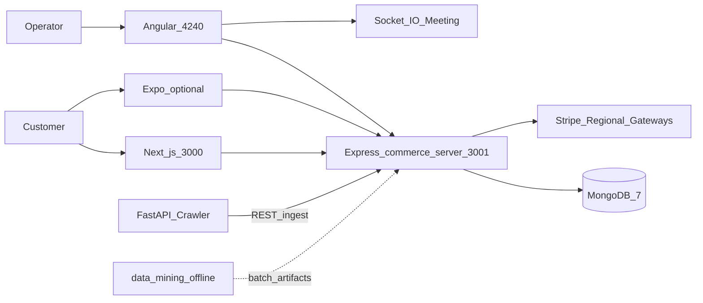
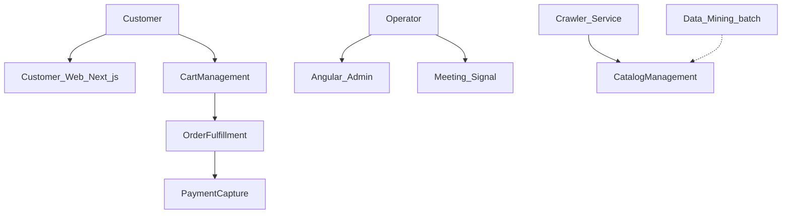
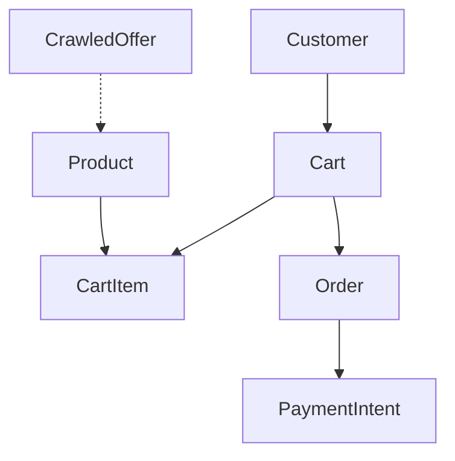
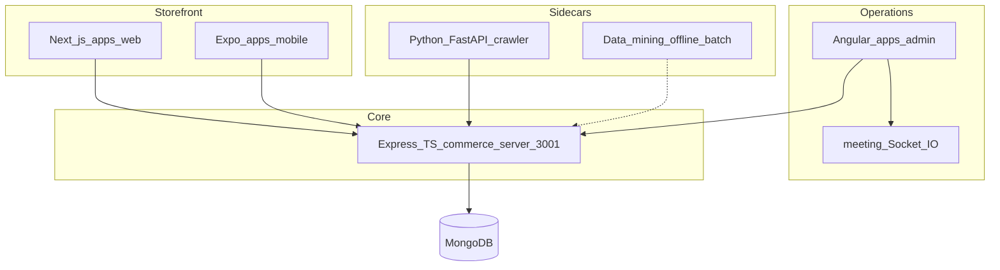
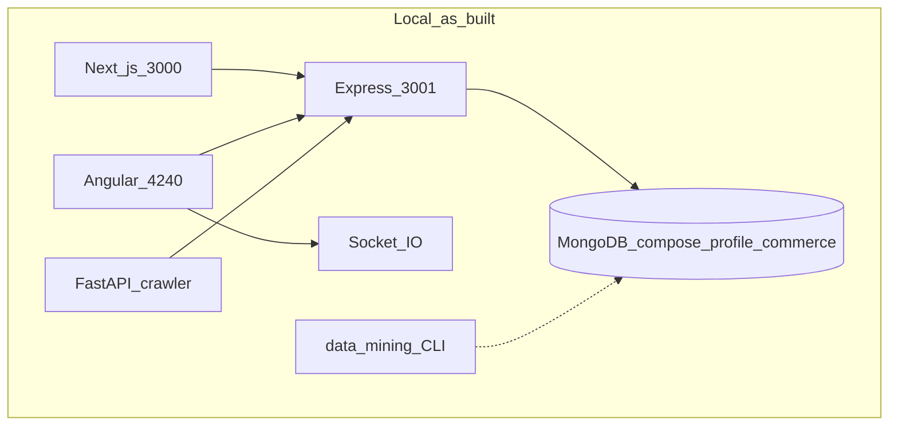
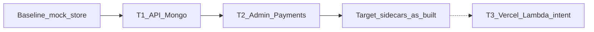

# Architecture Definition Document — Explore Commerce

| Field | Value |
| --- | --- |
| Deliverable | Architecture Definition Document (TOGAF Architecture Content Framework) |
| Reference | [TOGAF Architecture Deliverables §32.2.3](https://pubs.opengroup.org/architecture/togaf9-doc/m/chap32.html) |
| Capability | Explore Commerce (catalog, cart, orders, payments, crawler, data mining, meetings) |
| ADM phases | B–D (Architecture Vision from Phase A summarized in §1) |
| Architecture states | Baseline, Transition (T1, T2), Target |
| Companion | Architecture Requirements Specification (quantitative) — separate deliverable |
| Code-level models | [C4 model](../c4-model/README.md) |
| Preferred Terms | Idiomatic English ([Glossary](../../Glossary.md)) |

**Purpose.** Explore Commerce fails when the storefront, admin console, and integration sidecars each own a different catalog truth, when ML training blocks checkout, or when operators cannot run a meeting beside order fulfillment. This document records the as-built monorepo on this branch—honest Baseline, staged Transition, and a **Target** that matches `commerce/server` and documented containers. **AWS Lambda and Vercel production cutover are documented intent in Transition and README—not asserted as live production fact.**

---

## Contents

- [1. Vision](#1-vision)
- [2. Architecture principles](#2-architecture-principles)
- [3. Architecture models](#3-architecture-models)
  - [3.1 Business Architecture](#31-business-architecture)
  - [3.2 Data Architecture](#32-data-architecture)
  - [3.3 Application Architecture](#33-application-architecture)
  - [3.4 Technology Architecture](#34-technology-architecture)
- [4. Re-use, standards, and landscape](#4-re-use-standards-and-landscape)
  - [4.1 Re-use assessment](#41-re-use-assessment)
  - [4.2 Mapping to standards](#42-mapping-to-standards)
  - [4.3 Mapping to architecture landscape](#43-mapping-to-architecture-landscape)
- [5. Transition Architecture](#5-transition-architecture)
- [6. References](#6-references)

---

## 1. Vision

### Problem

Customers expect browse-to-checkout with OAuth sign-in and reliable payments; operators need catalog, order, and user administration plus optional enrichment from crawlers and offline purchase-intelligence models. Real-time PyTorch inference on every API request would collapse latency budgets and couple checkout to GPU availability. The failure mode is **tangled integration**: admin calling crawlers directly, training jobs on the request path, and meeting signaling sharing credentials with the commerce API.

### Stakeholders and concerns

| Stakeholder | Concern | Architectural response |
| --- | --- | --- |
| Customer | Storefront, cart, checkout | Next.js **commerce-web** `:3000` → Express **`commerce/server` `:3001`** |
| Operator | Catalog, orders, users, meetings | Angular **commerce-admin** `:4240` |
| Data team | Catalog enrichment, propensity models | FastAPI **crawler** posts into API; **data-mining** batch/offline |
| Platform engineer | MongoDB consistency, auth packages | `packages/auth`, compose profile `commerce` |
| Mobile user (optional) | Expo storefront | Same API entry `:3001` |

### Solution

**Next.js** customer web, **Angular** admin, and optional **Expo** mobile call the canonical **Express + TypeScript API** at `commerce/server` on port **3001** (`commerce-server` in workspace scripts). Sidecars integrate **asynchronously**: Python **FastAPI crawler** submits product data; **data-mining** (PyTorch/sklearn) runs **offline export → train → artifacts**, not synchronous inference on each REST call; **Socket.IO meeting signaling** supports admin WebRTC without routing shopper traffic through the meeting service.

Structural detail: [C2-Container.puml](../c4-model/C2-Container.puml). Components: [C3-Component-API.puml](../c4-model/C3-Component-API.puml), [C3-Component-Web.puml](../c4-model/C3-Component-Web.puml), [C3-Component-Admin.puml](../c4-model/C3-Component-Admin.puml). Wardley / zero-trust diagrams live under [architecture/README.md](../../architecture/README.md).

**Glossary note:** Core commerce domains (Catalog, Cart, Order, Payment, Auth) are defined in [Glossary](../../Glossary.md). **Crawler**, **Meeting Signal**, and **Data Mining** appear in C2 and architecture README but are **thin or absent in Glossary §2**—treat C2 preferred labels as interim until Glossary catch-up.

---

## 2. Architecture principles

1. **API as integration hub** — *Failure:* crawlers write MongoDB directly. *Decision:* crawler and clients integrate only through `commerce/server`. *Constraint:* FastAPI crawler **submits** catalog payloads to API routes; no bypass collections.

2. **Canonical server path** — *Failure:* docs reference `apps/api` while code lives under `server/`. *Decision:* **`commerce/server`** is the API source tree; dev port **3001**. *Constraint:* README, C4 anchors, and `pnpm dev commerce` align on this path.

3. **Offline-first data mining** — *Failure:* checkout waits on `model.forward()`. *Decision:* `services/data-mining` exports Mongo → CSV → trains → `artifacts/` offline ([data-mining README](../../../../commerce/services/data-mining/README.md)). *Constraint:* C2 “train/predict” is **batch/async intent**, not per-request synchronous PyTorch on the hot path.

4. **OAuth + JWT at the edge** — *Failure:* password sessions duplicated per app. *Decision:* `packages/auth` for JWT; Google/GitHub OAuth for customers. *Constraint:* protected API routes validate Bearer tokens consistently.

5. **Separation of shop and ops** — *Failure:* admin bundles into Next.js. *Decision:* **Next.js web** vs **Angular admin** containers. *Constraint:* separate C3 component diagrams and dev ports `3000` / `4240`.

6. **Meeting signaling is admin-scoped** — *Failure:* shoppers hit Socket.IO. *Decision:* admin connects to meeting signal for WebRTC; not part of storefront critical path. *Constraint:* Rel(admin, meeting_signal) in C2—not Rel(customer, meeting).

7. **Named surfaces in prose** — *Failure:* ambiguous “the web app.” *Decision:* always say **Next.js web**, **Angular admin**, **Expo mobile** when referring to clients.

---

## 3. Architecture models

### 3.1 Business Architecture

#### Baseline

Storefront Next.js pages with client-side cart state and mock/static product fetches—no MongoDB compose profile, no Stripe capture, no admin Angular split.

#### Target

| Domain | Business service | Outcome |
| --- | --- | --- |
| Catalog | Catalog management | SKUs, listings; crawler enrichment |
| Cart | Cart management | Session/user cart |
| Order | Order fulfillment | Checkout lifecycle |
| Payment | Payment capture | Stripe / regional gateways |
| Auth | Customer authentication | OAuth + JWT |
| Admin | Operations console | Users, orders, catalog |
| Customer Web | Storefront | Browse, cart, checkout |
| Crawler | Catalog ingestion | FastAPI scraper → API |
| Data Mining | Purchase intelligence | Offline propensity / recommender artifacts |
| Meeting | Operator collaboration | Socket.IO WebRTC signaling |

### 3.2 Data Architecture

#### Baseline

JSON fixtures or in-memory product lists without Mongoose models wired to compose.

#### Target

| Entity | Role |
| --- | --- |
| Product | Sellable catalog item |
| Cart / Cart Item | Pre-checkout basket |
| Order | Confirmed purchase aggregate |
| Payment Intent | Gateway charge request |
| Customer | Storefront user profile |
| Crawled offer | Staging from crawler before promotion to Product |

MongoDB 7 via Mongoose in `commerce/server`. Data-mining exports (`export_mongo.py`) produce CSV and artifacts under `services/data-mining/`—not authoritative runtime state.

### 3.3 Application Architecture

#### Baseline

Next.js fetch to static JSON; single Node process without `commerce-server` package boundary.

#### Target

| Container | Stack | Port (dev) |
| --- | --- | --- |
| Next.js web | Next.js, React, Zustand, shadcn | **3000** |
| Angular admin | Angular, AG Grid, ECharts | **4240** |
| API | Express, TypeScript, Mongoose | **3001** (`commerce/server`) |
| Expo mobile | React Native / Expo | optional |

### 3.4 Technology Architecture

#### Baseline

Local Node dev without `infrastructure/mongodb/compose.yaml` profile `commerce`.

#### Target

| Layer | Choice |
| --- | --- |
| Storefront | Next.js, Tailwind, Zustand |
| Admin | Angular, Bootstrap 5 |
| API | Express TS, `commerce/server` |
| Crawler | Python FastAPI, BeautifulSoup, httpx |
| Data mining | Python PyTorch, scikit-learn (**offline**) |
| Meeting | Node Socket.IO WebRTC signaling |
| Local Mongo | `infrastructure/mongodb/compose.yaml` profile `commerce` |

**Transition intent (not Target production fact):** Vercel roots `commerce/apps/web` and `commerce` legacy; **Lambda** via `commerce/server/serverless.yml` and GitHub Actions—README says do not change live settings until cutover.

---

## 4. Re-use, standards, and landscape

### 4.1 Re-use assessment

| Asset | Re-use |
| --- | --- |
| `packages/auth` | JWT + OAuth helpers across server and apps |
| `packages/payment-integration` | Stripe / gateway wiring |
| `packages/test-utils` | Shared commerce test fixtures |
| C4 under `docs/commerce/developer/c4-model` | Canonical structural views |
| Architecture README Wardley map | Genesis/custom/product placement |

### 4.2 Mapping to standards

| Standard | Application |
| --- | --- |
| OAuth 2.0 | Google / GitHub customer sign-in |
| REST | Express routers on `:3001` |
| MongoDB protocols | Mongoose models as system of record |
| Stripe Payments | Payment Intent flow for international cards |
| Socket.IO | Admin meeting signaling (WebRTC) |

### 4.3 Mapping to architecture landscape

| Landscape element | Position |
| --- | --- |
| Monorepo entry | `pnpm dev commerce` from explore-workspace root |
| API path | `commerce/server` (not `apps/api` in C4 anchor text—verify tree: server is canonical) |
| Web | `commerce/apps/web` |
| Admin | `commerce/apps/admin` |
| Crawler / mining | `commerce/services/` sidecars |
| Datadog | Named in Wardley map as product-tier observability (enablement varies by env) |
| Backlog | [User Story Map](../../product-owner/User-Story-Map.md) |

---

## 5. Transition Architecture

| State | Definition |
| --- | --- |
| Baseline | Mock storefront; no MongoDB profile |
| T1 | `commerce/server` + MongoDB + Next.js checkout |
| T2 | Angular admin + OAuth + Stripe |
| Target | Crawler + offline data-mining + meeting signaling + optional Expo |

### T1 — Core commerce API

| Domain | Change |
| --- | --- |
| Business | Catalog browse + cart + order |
| Data | MongoDB collections via Mongoose |
| Application | Express API on **3001** |
| Technology | Compose profile `commerce` |

### T2 — Operations and payments

| Domain | Change |
| --- | --- |
| Business | Admin console; payment capture |
| Data | Payment Intent records |
| Application | Angular admin; `packages/auth` |
| Technology | Stripe; ports 3000/4240/3001 |

### Target — Full sidecars (as-built)

| Domain | Change |
| --- | --- |
| Business | Crawler ingestion; meeting for operators |
| Data | Crawled offer staging; mining artifacts on disk |
| Application | Crawler → API; admin → Socket.IO |
| Technology | FastAPI crawler; offline `services/data-mining` |

### T3 — Documented deploy intent (not Target fact)

| Domain | Change |
| --- | --- |
| Technology | Vercel for Next.js and admin static hosts |
| Technology | AWS Lambda packaging for `commerce/server` per `serverless.yml` |
| Operations | Cutover guarded in README—no live change from repo |

---

## 6. References

- [TOGAF Architecture Deliverables — Architecture Definition Document §32.2.3](https://pubs.opengroup.org/architecture/togaf9-doc/m/chap32.html)
- [MongoDB](https://www.mongodb.com/docs/)
- [Stripe Payments](https://stripe.com/docs/payments)
- [Glossary](../../Glossary.md)
- [C4 model](../c4-model/README.md)
- [Architecture overview](../../architecture/README.md)
- [User Story Map](../../product-owner/User-Story-Map.md)
- [Explore Commerce README](../../../../commerce/README.md)
- [Data mining service](../../../../commerce/services/data-mining/README.md)