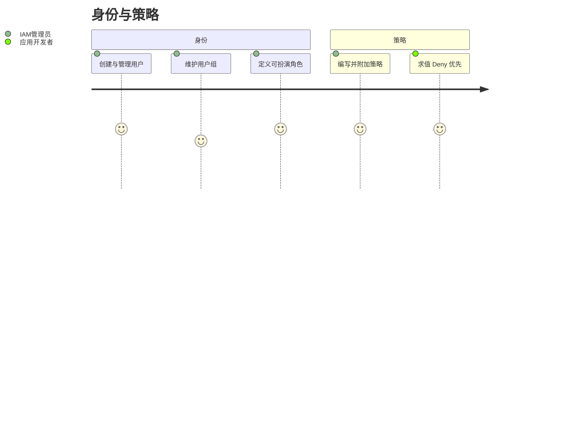
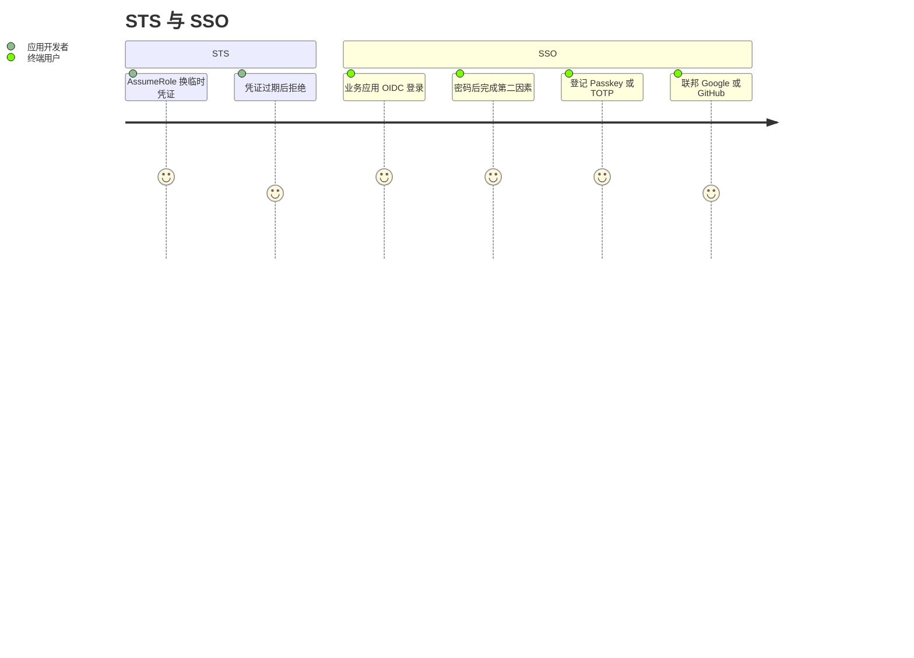
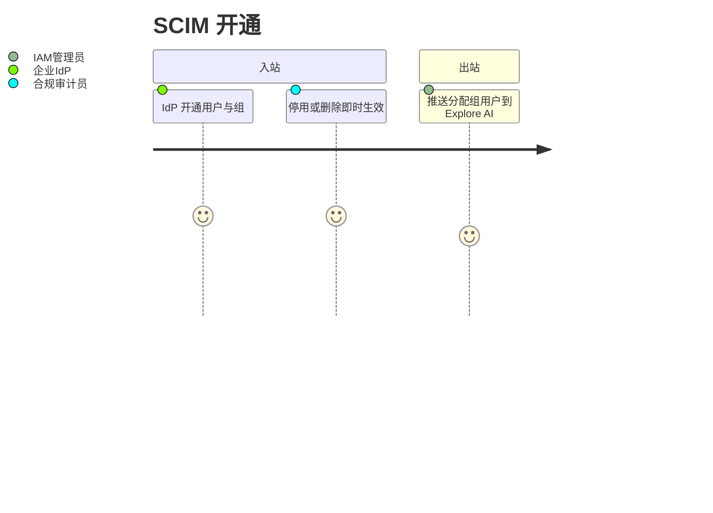
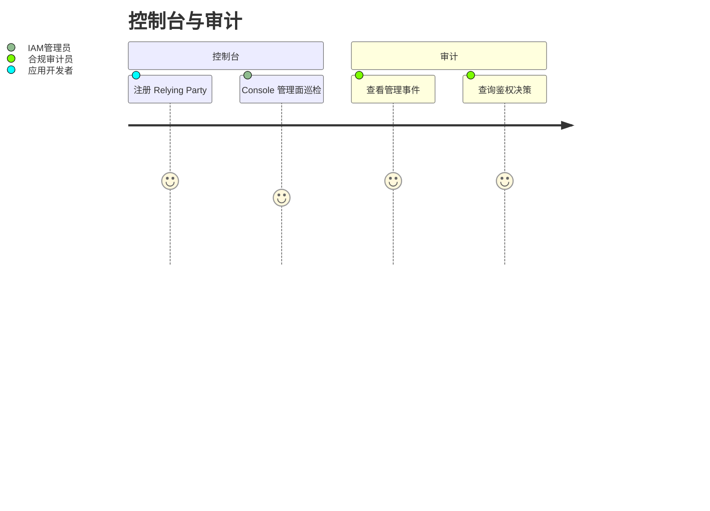
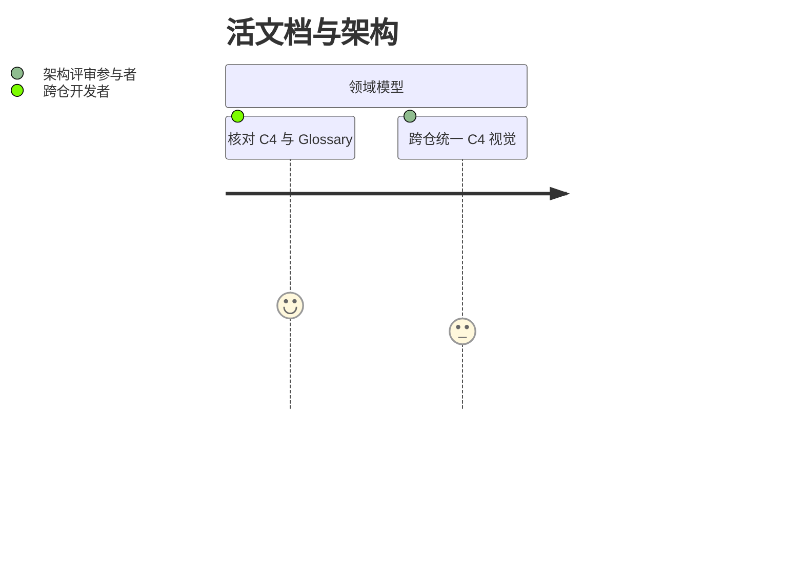

# 用户故事地图 | User Story Map — Explore IAM
> Jeff Patton 用户故事地图；正文与验收标准合并于本文（单一文档）。  
> Jeff Patton user-story map; epics and GWT acceptance criteria live in this single document.  
> 格式 / Format：Background → `As a` / `I want` / `So that` → Scenario GIVEN-WHEN-THEN（双语 / bilingual）。

## 用户画像 | Personas

| 角色 / Role | 说明 / Description |
|------|------|
| 终端用户 / End User | 经 SSO 登录业务应用（Explore AI 等） / Signs into business apps via SSO (Explore AI, etc.) |
| IAM 管理员 / IAM Admin | 在 Console 管理用户、组、角色、策略与客户端 |
| 应用开发者 / Application Developer | 注册 Relying Party、集成 OIDC 与鉴权 / Registers relying parties and integrates OIDC/authz |
| 合规审计员 / Compliance Auditor | 查询管理事件与鉴权决策日志 / Queries admin events and authz decision logs |
| 企业 IdP / Enterprise IdP | Okta |

## 旅程总览 | Journey Overview

### 身份与策略

### STS 与 SSO

### SCIM 开通

### 控制台与审计

### 活文档与架构

---

## Backbone 故事地图 | Backbone

### 已实现

| 身份 | 策略 | STS | SSO | 控制台与客户端 | 审计 |
|------|------|-----|-----|----------------|------|
| [US-01](#us-01-管理-iam-用户) 管理用户 | [US-04](#us-04-编写并附加策略) 编写/附加策略 | [US-06](#us-06-assumerole) AssumeRole | [US-08](#us-08-oidc-登录业务应用) OIDC 登录 | [US-10](#us-10-注册-relying-party) 注册客户端 | [US-12](#us-12-管理事件) 管理事件 |
| [US-02](#us-02-管理用户组) 组 | [US-05](#us-05-策略求值-deny-优先于-allow) 求值 Deny>Allow | [US-07](#us-07-临时凭证过期) 凭证过期 | [US-16](#us-16-mfa-第二因素后获得完整会话) MFA 第二因素 | | [US-13](#us-13-鉴权决策查询) 鉴权查询 |
| [US-03](#us-03-管理角色) 角色 | [US-05a](#us-05a-权限点目录github-风格-scope) 权限点目录 / [US-05b](#us-05b-agent-registry-scopewriteai_agent) `write:ai_agent` | | [US-17](#us-17-登记-passkey-或-totp) 登记 Passkey/TOTP | | |

| SCIM 开通 | 活文档与架构 |
|-----------|--------------|
| [US-18](#us-18-外部-idp-通过-scim-开通用户与组) IdP 开通用户与组 | [US-14](#us-14-领域模型图与代码一致) 领域图与代码一致 |
| [US-19](#us-19-iam-推送用户到-explore-ai) 推送到 Explore AI | [US-15](#us-15-c4-图视觉风格跨仓一致) C4 视觉风格跨仓一致 |
| [US-20](#us-20-删除与停用即时生效) 删除与停用即时生效 | [US-21](#us-21-模块间以领域事件解耦) 领域事件解耦 |

### 规划中

| SSO | 控制台与客户端 |
|-----|----------------|
| [US-09](#us-09-联邦-googlegithub) 联邦 IdP | [US-11](#us-11-console-管理面) Console |

---

## Epic 索引 | Epic Index

| Epic | 锚点 / Anchor | 状态 / Status |
|------|---------------|---------------|
| E1 身份 | [#e1](#e1) | — |
| E2 策略 | [#e2](#e2) | — |
| E3 STS | [#e3](#e3) | — |
| E4 SSO 与联邦 | [#e4](#e4) | — |
| E5 控制台与客户端 | [#e5](#e5) | — |
| E6 审计 | [#e6](#e6) | — |
| E7 活文档与架构 | [#e7](#e7) | — |
| E8 SCIM 开通 | [#e8](#e8) | — |

---

# 用户故事正文 | User Stories

## E1 身份与访问主体 / Identity & Principals

### 背景 | Background

组织需要为人员与服务账号建立可治理的长期身份。缺少统一用户生命周期会增加离职泄漏与权限漂移风险。 / Organizations need governable long-lived identities for people and service accounts. Without unified lifecycle, offboarding leaks and permission drift increase risk.

### US-01 管理 IAM 用户 / Manage IAM Users

**As a** IAM 管理员 / IAM Administrator  
**I want** 在管理控制台中创建、查看、更新并停用用户账号 / Create, view, update, and deactivate user accounts in the admin console  
**So that** 每位员工与服务账号都有清晰、可审计的身份状态，便于赋权与回收 / Every person and service account has a clear, auditable identity for granting and revoking access

#### 验收标准 | Acceptance Criteria

1. **Scenario** 创建用户 / Create a user  
   **GIVEN** 管理员已登录管理控制台，且具备用户管理权限 / An administrator is signed in with permission to manage users  
   **WHEN** 管理员提交通过校验的用户创建信息 / The administrator submits a valid user creation form  
   **THEN** 系统保存新用户，并可在用户目录中查到 / The system persists the new user in the directory  
   **AND** 新用户出现在身份列表中，状态为可用 / The user appears in the identity list as active  

2. **Scenario** 停用用户 / Deactivate a user  
   **GIVEN** 存在处于启用状态的用户账号 / An active user account exists  
   **WHEN** 管理员将该用户停用 / The administrator deactivates the user  
   **THEN** 该用户无法再完成登录，也无法获取临时访问凭证 / The user can no longer sign in or obtain temporary credentials  
   **AND** 停用操作记入审计日志，可供追溯 / Deactivation is recorded in audit logs  

#### 状态 | Status

已交付 / Delivered

---

### US-02 管理用户组 / Manage User Groups

**As a** IAM 管理员 / IAM Administrator  
**I want** 创建用户组，并将成员加入或移出组 / Create groups and add or remove members  
**So that** 我可以按组织单位批量授予和回收权限，而不必逐个调整用户 / I can grant and revoke access in bulk by org unit instead of per user

#### 验收标准 | Acceptance Criteria

1. **Scenario** 创建组并添加成员 / Create a group and add members  
   **GIVEN** 系统中至少有一名用户 / At least one user exists  
   **WHEN** 管理员创建用户组并将该用户加入组 / The administrator creates a group and adds the user  
   **THEN** 组成员关系被保存并即时生效 / Membership is saved and takes effect  
   **AND** 绑定到该组的权限策略适用于该成员 / Permissions on the group apply to that member  

2. **Scenario** 从组中移除成员 / Remove a member from a group  
   **GIVEN** 用户已是某用户组的成员 / The user belongs to a group  
   **WHEN** 管理员将该用户移出组 / The administrator removes the user from the group  
   **THEN** 该用户不再继承该组的权限 / The user no longer inherits group permissions  
   **AND** 组成员列表反映最新成员关系 / The member list shows updated membership  

#### 状态 | Status

已交付 / Delivered

---

### US-03 管理访问角色 / Manage Access Roles

**As a** IAM 管理员 / IAM Administrator  
**I want** 创建角色并定义谁可以承担该角色 / Create roles and define who may assume each role  
**So that** 应用程序与自动化能在受控前提下获得限时、最小权限的访问 / Apps and automation obtain time-bound, least-privilege access under explicit trust

#### 验收标准 | Acceptance Criteria

1. **Scenario** 创建角色 / Create a role  
   **GIVEN** 管理员具备角色管理权限 / The administrator can manage roles  
   **WHEN** 管理员创建角色并配置信任关系 / They create a role and configure trust rules  
   **THEN** 角色出现在角色目录中，可供查询与绑定策略 / The role appears in the directory and can be bound to policies  
   **AND** 信任关系可供令牌服务在承担角色时校验 / Trust rules are used when roles are assumed  

2. **Scenario** 更新信任关系 / Update trust rules  
   **GIVEN** 目标角色已存在 / The target role exists  
   **WHEN** 管理员修改角色的信任关系并保存 / They update trust rules and save  
   **THEN** 此后的承担角色请求按新信任关系判定 / Later assume-role requests use the new trust rules  
   **AND** 变更记入管理审计 / The change is audited  

#### 状态 | Status

已交付 / Delivered

---

## E2 权限策略 / Access Policies

### 背景 | Background

业务需要声明式规则描述谁能在哪些资源上执行哪些操作。策略难以统一附加会导致过度授权与合规缺口。 / The business needs declarative rules for who may do what on which resources. Hard-to-attach policies cause over-privilege and compliance gaps.

### US-04 编写并绑定权限策略 / Author and Attach Access Policies

**As a** IAM 管理员 / IAM Administrator  
**I want** 编写权限策略并将其绑定到用户、组或角色 / Author policies and attach them to users, groups, or roles  
**So that** 访问主体获得明确、可审查的权限集合 / Principals receive explicit, reviewable permission sets

#### 验收标准 | Acceptance Criteria

1. **Scenario** 创建权限策略 / Create an access policy  
   **GIVEN** 管理员打开策略编辑界面 / The administrator opens the policy editor  
   **WHEN** 提交包含允许/拒绝、操作与资源范围的有效策略 / They submit a valid policy with effect, actions, and resources  
   **THEN** 策略被保存并可在策略库中打开 / The policy is saved in the policy library  
   **AND** 策略出现在策略列表中 / The policy appears in the list  

2. **Scenario** 将策略绑定到角色 / Attach a policy to a role  
   **GIVEN** 已存在待绑定的策略与角色 / A policy and role are available  
   **WHEN** 管理员将策略绑定到该角色 / They attach the policy to the role  
   **THEN** 角色与策略的关联建立成功 / The association is established  
   **AND** 后续鉴权决策会加载该策略 / Authorization decisions include this policy  

#### 状态 | Status

已交付 / Delivered

---

### US-05 显式拒绝优先于允许 / Explicit Deny Overrides Allow

**As a** 应用开发者 / Application Developer  
**I want** 对同一请求，显式拒绝优先于允许规则 / For the same request, explicit deny overrides allow  
**So that** 收紧权限时不会被更宽泛的允许意外放行 / Tightening access is not undone by broader allow rules

#### 验收标准 | Acceptance Criteria

1. **Scenario** 显式拒绝生效 / Explicit deny wins  
   **GIVEN** 主体同时拥有允许与拒绝同一操作的策略 / Allow and deny both match the same action  
   **WHEN** 应用请求鉴权决策 / The app requests authorization  
   **THEN** 结果为拒绝 / The decision is deny  
   **AND** 理由标明显式拒绝 / The reason indicates explicit deny  

2. **Scenario** 仅允许时通过 / Allow when no deny  
   **GIVEN** 仅有匹配的允许规则且无拒绝 / Only allow rules match  
   **WHEN** 应用请求鉴权决策 / The app requests authorization  
   **THEN** 结果为允许 / The decision is allow  

#### 状态 | Status

已交付 / Delivered

---

### US-05a 维护权限点目录（OAuth 范围） / Maintain Permission Catalog (OAuth Scopes)

**As a** IAM 管理员 / IAM Administrator  
**I want** 维护统一权限点目录，每项对应标准 OAuth 范围 / Maintain a catalog mapping each permission to a standard OAuth scope  
**So that** 各产品与客户端在授权时使用一致、可理解的权限粒度 / Products and clients use consistent scope language at consent

#### 验收标准 | Acceptance Criteria

1. **Scenario** 查看权限点目录 / Browse the permission catalog  
   **GIVEN** 管理员或审计员已登录 / An administrator or auditor is signed in  
   **WHEN** 查询权限点目录 / They query the permission catalog  
   **THEN** 返回标准范围条目（如聊天读写、管理能力等） / Standard scopes are returned (e.g. chat read/write, admin)  
   **AND** 每项标明操作、资源与所属模块 / Each entry shows action, resource, and module  

2. **Scenario** 拒绝不规范的范围格式 / Reject invalid scope format  
   **GIVEN** 管理员尝试创建不符合 access:resource 命名规范的权限点 / They create a permission with invalid scope naming  
   **WHEN** 提交创建请求 / They submit the request  
   **THEN** 请求被拒绝并说明格式要求 / The request is rejected with format guidance  
   **AND** 未写入不规范条目 / No invalid entry is saved  

#### 状态 | Status

已交付 / Delivered

---

### US-05b 智能体能力统一授权范围 / Unified OAuth Scope for Agent Capabilities

**As a** IAM 管理员 / IAM Administrator  
**I want** 用单一 OAuth 范围治理智能体注册表相关能力 / Govern agent registry capabilities under one OAuth scope  
**So that** 客户端授权与合规审查更简单，避免按技能碎片化授权 / Consent and compliance review stay simple without per-skill OAuth sprawl

#### 验收标准 | Acceptance Criteria

1. **Scenario** 目录包含智能体总权限 / Catalog lists agent umbrella scope  
   **GIVEN** 系统已加载标准权限点数据 / Standard permission seed data is loaded  
   **WHEN** 管理员查看智能体写入范围 / They view the agent write scope entry  
   **THEN** 说明覆盖画廊智能体、A2A 任务与技能流水线 / Description covers gallery agents, A2A tasks, and skill pipelines  
   **AND** 资源范围涵盖智能体相关资源 / Resource pattern covers agent resources  

2. **Scenario** 聊天客户端可申请该范围 / Chat client may request scope  
   **GIVEN** Explore 聊天客户端已注册 / The Explore chat client is registered  
   **WHEN** 查看其允许申请的范围 / Allowed scopes are reviewed  
   **THEN** 列表包含智能体写入范围 / The agent write scope is included  

#### 状态 | Status

已交付 / Delivered

---

## E3 临时凭证与会话 / Temporary Credentials & Sessions

### 背景 | Background

长期凭证泄露影响面大。业务需要让调用方在信任允许下短期承担角色，以最小权限完成任务。 / Long-lived secrets widen breach impact. Callers need short-lived role assumption under trust for least-privilege work.

### US-06 承担角色获取临时凭证 / Assume Role for Temporary Credentials

**As a** 应用开发者 / Application Developer  
**I want** 在信任策略允许时承担角色并获取限时临时凭证 / Assume a role when trust permits and receive time-limited credentials  
**So that** 应用以角色身份访问受保护资源，而无需分发长期密钥 / Apps access resources as the role without long-lived secrets

#### 验收标准 | Acceptance Criteria

1. **Scenario** 信任允许时签发凭证 / Issue when trust permits  
   **GIVEN** 调用方满足目标角色的信任策略 / The caller is permitted by the role trust policy  
   **WHEN** 调用承担角色并提供合法角色标识与会话名 / They assume the role with valid identifiers  
   **THEN** 返回临时凭证及过期时间 / Temporary credentials and expiry are returned  
   **AND** 成功承担记入审计 / Success is audited  

2. **Scenario** 信任不允许时拒绝 / Deny when trust fails  
   **GIVEN** 调用方不在信任策略允许范围内 / The caller is not trusted  
   **WHEN** 调用承担角色 / They assume the role  
   **THEN** 请求被拒绝 / The request is denied  
   **AND** 不签发临时凭证 / No credentials are issued  

#### 状态 | Status

已交付 / Delivered

---

### US-07 临时凭证到期后失效 / Expired Temporary Credentials Are Rejected

**As a** 应用开发者 / Application Developer  
**I want** 过期临时凭证在访问受保护接口时被拒绝 / Expired credentials are rejected on protected APIs  
**So that** 权限不会在过期后仍被无限沿用 / Access does not continue after expiry

#### 验收标准 | Acceptance Criteria

1. **Scenario** 过期后调用失败 / Reject after expiry  
   **GIVEN** 临时凭证已超过有效期限 / Credentials are past expiry  
   **WHEN** 使用该凭证调用受保护 API / They call a protected API  
   **THEN** 认证失败 / Authentication fails  
   **AND** 错误表明凭证无效或已过期 / Error indicates invalid or expired credentials  

2. **Scenario** 有效期内仍可使用 / Valid credentials work  
   **GIVEN** 凭证仍有效且策略允许操作 / Credentials are valid and policy allows the action  
   **WHEN** 使用该凭证调用受保护 API / They call a protected API  
   **THEN** 请求进入鉴权评估 / Request proceeds to authorization  
   **AND** 不因未过期而被拒绝 / Not rejected due to lifetime alone  

#### 状态 | Status

已交付 / Delivered

---

## E4 单点登录与联合身份 / SSO & Federation

### 背景 | Background

用户需要在多个 Explore 产品间使用同一身份。IAM 作为 OIDC 提供方支撑业务单点登录，并可接入外部身份源。 / Users need one identity across Explore products. IAM is the OIDC provider for SSO with optional external IdPs.

### US-08 通过 OIDC 登录业务应用 / Sign In to Business Apps via OIDC

**As a** 终端用户 / End User  
**I want** 从业务应用跳转至 IAM 完成登录后回到应用 / Redirect to IAM to sign in and return to my app  
**So that** 我可以用一套账号顺畅使用多个 Explore 产品 / I use one account across Explore products

#### 验收标准 | Acceptance Criteria

1. **Scenario** 授权码回流成功 / Authorization code flow succeeds  
   **GIVEN** 用户访问受保护应用且尚未登录 / User opens a protected app while signed out  
   **WHEN** 应用重定向至 IAM，用户完成含第二因素的认证 / App redirects to IAM and user completes auth including second factor  
   **THEN** 浏览器带回授权码 / Browser returns with authorization code  
   **AND** 应用可换取身份令牌建立会话 / App exchanges code for tokens  

2. **Scenario** 已有会话免重复登录 / Reuse IAM session  
   **GIVEN** 用户已在 IAM 持有有效完整会话 / User has a valid full IAM session  
   **WHEN** 另一应用发起 OIDC 登录 / Another app starts OIDC sign-in  
   **THEN** 策略允许时无需再次输入主密码 / Primary password not required when policy allows  
   **AND** 需要时仍完成客户端授权同意 / Client consent collected when required  

#### 状态 | Status

已交付（OIDC、表单登录与 MFA） / Delivered (OIDC, form login, MFA)

---

### US-09 使用 Google 或 GitHub 联合登录 / Federated Sign-In with Google or GitHub

**As a** 终端用户 / End User  
**I want** 选择 Google 或 GitHub 完成联合登录 / Sign in with Google or GitHub federation  
**So that** 我不必单独维护 IAM 密码即可安全访问 / I access securely without a separate IAM password

#### 验收标准 | Acceptance Criteria

1. **Scenario** Google 联合登录成功 / Google federation succeeds  
   **GIVEN** 管理员已配置 Google 为外部身份提供方 / Google is configured as external IdP  
   **WHEN** 用户选择 Google 并完成上游认证 / User completes Google authentication  
   **THEN** IAM 映射或创建联合身份 / IAM maps or creates federated identity  
   **AND** 继续对业务应用签发 OIDC 令牌 / OIDC tokens are issued to the app  

2. **Scenario** 未启用的提供方不展示 / Disabled IdPs hidden  
   **GIVEN** 某外部身份提供方未启用 / An external IdP is disabled  
   **WHEN** 用户打开登录页 / User opens sign-in page  
   **THEN** 不显示该提供方入口 / That provider is not shown  
   **AND** 其他已启用提供方仍可用 / Other enabled providers remain available  

#### 状态 | Status

规划中 / Planned

---

### US-16 完成第二因素后获得完整会话 / Full Session After Multi-Factor Verification

**As a** 终端用户 / End User  
**I want** 密码通过后完成一种可用的第二因素 / Complete an available second factor after password  
**So that** 只有我本人能获得可用于 OIDC 的完整会话 / Only I obtain a full session eligible for OIDC

#### 验收标准 | Acceptance Criteria

1. **Scenario** 密码后进入第二因素引导 / Guided after password  
   **GIVEN** 用户提交正确密码且无完整 MFA 会话 / Correct password without full MFA session  
   **WHEN** 密码验证成功 / Password verification succeeds  
   **THEN** 进入第二因素验证页 / User sees second-factor page  
   **AND** 展示可用验证方式（一次性令牌、通行密钥、TOTP） / Available factors are listed (OTT, passkey, TOTP)  

2. **Scenario** 任一第二因素成功 / Any second factor succeeds  
   **GIVEN** 用户已通过密码因素 / Password factor satisfied  
   **WHEN** 完成 OTT、通行密钥或 TOTP 任一验证 / User completes OTT, passkey, or TOTP  
   **THEN** 会话升级为完整会话 / Session becomes full session  
   **AND** 可继续 OIDC 授权流程 / User can proceed to OIDC authorize  

3. **Scenario** 仅密码不足 / Password alone insufficient  
   **GIVEN** 仅完成密码验证 / Only password is complete  
   **WHEN** 访问需要完整会话的功能 / User accesses full-session feature  
   **THEN** 引导完成第二因素或被拒绝 / Redirected to MFA or denied until complete  

#### 状态 | Status

已交付 / Delivered

---

### US-17 登记通行密钥或 TOTP 验证器 / Enroll Passkey or TOTP Authenticator

**As a** 终端用户 / End User  
**I want** 在安全设置中登记通行密钥和/或 TOTP 验证器 / Enroll passkey and/or TOTP in security settings  
**So that** 下次登录可使用更安全的第二因素 / Future sign-ins use stronger second factors

#### 验收标准 | Acceptance Criteria

1. **Scenario** 登记 TOTP / Enroll TOTP  
   **GIVEN** 用户已登录并可打开安全设置 / User is signed in with access to security settings  
   **WHEN** 开始 TOTP 登记并扫描二维码 / User starts TOTP enrollment and scans QR  
   **THEN** TOTP 第二因素启用 / TOTP is enabled  
   **AND** 登录可选因素列表包含 TOTP / TOTP appears at sign-in  

2. **Scenario** 登记通行密钥 / Enroll passkey  
   **GIVEN** 用户已登录且浏览器支持通行密钥 / User is signed in with passkey-capable browser  
   **WHEN** 完成通行密钥注册 / User completes passkey registration  
   **THEN** 通行密钥被安全保存 / Passkey credential is stored  
   **AND** 验证页可选择通行密钥 / Passkey is offered on verification page  

#### 状态 | Status

已交付 / Delivered

---

## E5 管理控制台与集成应用 / Admin Console & Integrated Apps

### 背景 | Background

开发者需要注册依赖方应用以接入 OIDC；管理员需要在统一控制台运维身份与策略。分散工具会增加配置错误与运维成本。 / Developers register relying apps for OIDC; administrators need one console for identity and policy. Fragmented tools increase misconfiguration and ops cost.

### US-10 注册 OIDC 业务应用 / Register an OIDC Application

**As a** 应用开发者 / Application Developer  
**I want** 注册应用的客户端标识、回调地址与授权范围 / Register client ID, redirect URIs, and authorization scopes  
**So that** 我的应用可作为受信依赖方安全接入 Explore IAM / My app connects securely to Explore IAM as a relying party

#### 验收标准 | Acceptance Criteria

1. **Scenario** 成功注册客户端 / Register client successfully  
   **GIVEN** 开发者已登录控制台并具备客户端管理权限 / Developer is signed in with client admin permission  
   **WHEN** 提交合法的回调地址与授权范围 / They submit valid redirect URIs and scopes  
   **THEN** 系统创建客户端并一次性展示客户端密钥 / Client is created and secret shown once per policy  
   **AND** 客户端出现在应用列表中 / Client appears in the app list  

2. **Scenario** 非法回调被拒绝 / Reject unsafe redirect  
   **GIVEN** 开发者提交不安全或格式错误的回调地址 / Redirect URI is unsafe or invalid  
   **WHEN** 保存客户端配置 / They save the client  
   **THEN** 保存失败并显示校验错误 / Save fails with validation errors  
   **AND** 不创建客户端记录 / No client record is created  

#### 状态 | Status

已交付 / Delivered

---

### US-11 在统一控制台完成日常运维 / Operate IAM from a Unified Console

**As a** IAM 管理员 / IAM Administrator  
**I want** 在同一控制台中管理身份、策略、应用注册与审计 / Manage identity, policies, app registration, and audit in one console  
**So that** 日常运维无需在多个工具间切换 / Daily operations do not require switching tools

#### 验收标准 | Acceptance Criteria

1. **Scenario** 主导航覆盖核心能力 / Core navigation works  
   **GIVEN** 管理员已登录控制台 / Administrator is signed in  
   **WHEN** 打开身份、策略、应用与审计入口 / They open identity, policy, apps, and audit  
   **THEN** 各页面正常加载 / Pages load successfully  
   **AND** 无权限的入口被隐藏或拒绝 / Unauthorized entries are hidden or denied  

2. **Scenario** 未登录重定向至登录 / Redirect when signed out  
   **GIVEN** 管理员尚未登录 / Administrator is not signed in  
   **WHEN** 访问受保护的控制台页面 / They open a protected console route  
   **THEN** 重定向至 Explore IAM 登录 / Redirected to Explore IAM sign-in  
   **AND** 登录成功后返回原目标（如支持） / Returned to intended page after sign-in when supported  

#### 状态 | Status

规划中 / Planned

---

## E6 合规审计 / Compliance Audit

### 背景 | Background

监管与内控要求可追溯的配置变更。缺少集中管理事件查询会拖慢事件响应与审计取证。 / Regulations require traceable configuration changes. Without centralized admin event search, incident response and audits slow down.

### US-12 检索管理配置变更事件 / Search Administrative Change Events

**As a** 合规审计员 / Compliance Auditor  
**I want** 按时间与主体筛选用户、角色、策略与客户端的变更记录 / Filter change history for users, roles, policies, and clients by time and actor  
**So that** 我能还原谁在何时做了什么变更 / I can reconstruct who changed what and when

#### 验收标准 | Acceptance Criteria

1. **Scenario** 列表与筛选 / List and filter  
   **GIVEN** 系统中已有管理活动记录 / Administrative events exist  
   **WHEN** 审计员按时间范围与主体筛选 / Auditor filters by time range and principal  
   **THEN** 返回匹配的管理事件列表 / Matching admin events are returned  
   **AND** 每条记录含操作类型与目标资源 / Each entry shows action type and target resource  

2. **Scenario** 无匹配时友好空结果 / Empty result without error  
   **GIVEN** 筛选条件无命中 / Filter matches nothing  
   **WHEN** 执行查询 / Auditor runs the query  
   **THEN** 返回空列表而非系统错误 / Empty list is returned, not an error  
   **AND** 界面提示无匹配结果 / UI shows a clear no-results message  

#### 状态 | Status

已交付 / Delivered

---

### US-13 查询访问鉴权决策记录 / Query Authorization Decision Logs

**As a** 合规审计员 / Compliance Auditor  
**I want** 查询访问鉴权结果（允许/拒绝）及决策理由 / Query allow/deny decisions with reason codes  
**So that** 我能向利益相关方解释某次访问为何被允许或拒绝 / I can explain why access was allowed or denied

#### 验收标准 | Acceptance Criteria

1. **Scenario** 按上下文检索 / Search by context  
   **GIVEN** 系统已记录鉴权决策日志 / Authorization decision logs exist  
   **WHEN** 按主体、操作或时间查询 / Search by principal, action, or time  
   **THEN** 返回对应决策记录 / Matching decision records are returned  
   **AND** 记录含允许/拒绝与理由码 / Records include outcome and reason code  

2. **Scenario** 审计员只读且不可篡改 / Read-only audit access  
   **GIVEN** 审计员仅有只读审计权限 / Auditor has read-only audit permission  
   **WHEN** 查看决策详情 / They open decision details  
   **THEN** 可阅读结果与必要上下文 / They read outcomes and required context  
   **AND** 无法修改或删除审计记录 / They cannot modify or delete audit records  

#### 状态 | Status

已交付 / Delivered

---

## E7 架构对齐与活文档 / Architecture Alignment & Living Docs

### 背景 | Background

跨团队协作需要术语、领域模型图与实现对齐。文档漂移会导致评审低效与实现偏差。 / Cross-team work needs aligned terms, domain models, and code. Doc drift causes slow reviews and implementation gaps.

### US-14 领域模型图与实现保持一致 / Keep Domain Model Aligned with Code

**As a** 跨仓开发者 / Cross-Repository Developer  
**I want** 领域模型图、术语表与领域层公共接口一一对应 / Domain diagrams, glossary, and public domain APIs stay in sync  
**So that** 评审与实现时能快速核对业务概念与边界 / Reviews and delivery quickly verify concepts and boundaries

#### 验收标准 | Acceptance Criteria

1. **Scenario** 类型与角色标注一致 / Types match diagram stereotypes  
   **GIVEN** 代码库中存在身份与策略领域类型 / Identity and policy domain types exist in code  
   **WHEN** 打开领域代码模型图 / Developer opens the domain code model diagram  
   **THEN** 图中列出对应的聚合与实体 / Diagram lists matching aggregates and entities  
   **AND** 值对象与枚举标注与代码一致 / Value objects and enums match code  

2. **Scenario** 公共领域行为可核对 / Public domain API is verifiable  
   **GIVEN** 聚合上存在对外领域行为（如停用用户、策略求值） / Public domain behavior exists on aggregates  
   **WHEN** 对照领域图与源码 / Developer compares diagram and source  
   **THEN** 图中列出对外领域接口 / Diagram lists public domain methods  
   **AND** 仅用于持久化重建的内部工厂不出现在业务图中 / Persistence-only factories are omitted  

3. **Scenario** 关联关系反映实现 / Relationships match implementation  
   **GIVEN** 策略附件通过标识引用策略文档 / Policy attachments reference policy documents by ID  
   **WHEN** 查看策略相关关联 / Review policy relationships on the diagram  
   **THEN** 图为引用关系而非错误的组合导航 / Diagram shows references, not mistaken composition  
   **AND** 文档与语句的嵌入关系与存储模型一致 / Document embedding matches persistence model  

#### 状态 | Status

已交付 / Delivered

---

### US-15 统一动态序列图视觉样式 / Standardize Dynamic Diagram Styling

**As a** 架构评审参与者 / Architecture Review Participant  
**I want** 全部动态交互序列图使用一致的黑白 plain 样式 / All dynamic sequence diagrams use consistent plain black-and-white styling  
**So that** 运行时路径图易读且风格统一，降低阅读负担 / Runtime flow diagrams are readable with uniform styling

#### 验收标准 | Acceptance Criteria

1. **Scenario** 动态图轨为纯黑白 / Dynamic track is monochrome  
   **GIVEN** 动态序列图配置为 plain 白底主题 / Dynamic diagrams use plain white theme  
   **WHEN** 渲染任一动态序列图 / Any dynamic diagram is rendered  
   **THEN** 无彩色边框或彩色图例干扰 / No colored borders or role legends  
   **AND** 文档说明动态图轨采用 plain 黑白 / README states dynamic track is plain B&W  

2. **Scenario** 不再依赖旧彩色样式包 / No legacy color style dependency  
   **GIVEN** 动态图已内联 plain 样式 / Plain styles are inlined in dynamic diagrams  
   **WHEN** 检查模型目录 / Reviewer inspects the c4-model folder  
   **THEN** 不存在已废弃的彩色样式包 / Legacy zinc color style file is absent  
   **AND** 动态图未引用旧样式包 / Dynamic diagrams do not include legacy style  

#### 状态 | Status

已交付 / Delivered

---

### US-21 通过领域事件解耦核心模块 / Decouple Modules with Domain Events

**As a** IAM 开发者 / IAM Developer  
**I want** 审计、联邦清理与 SCIM 推送响应身份变更事件，而非直接耦合核心模块 / Audit, federation cleanup, and SCIM react to identity events instead of tight coupling  
**So that** 增强审计或联邦能力时不必改动身份、策略与令牌核心 / Enhance audit or federation without rewriting identity, policy, or token core

#### 验收标准 | Acceptance Criteria

1. **Scenario** 管理变更与审计同事务 / Audit with admin change  
   **GIVEN** 管理员在控制台停用用户 / Administrator deactivates a user  
   **WHEN** 系统发布用户停用领域事件 / User deactivated domain event is published  
   **THEN** 审计记录同步写入停用活动 / Audit records the disable activity in the same transaction  
   **AND** 业务事务回滚时审计一并回滚 / Audit rolls back if the business transaction rolls back  

2. **Scenario** 删除用户前清理联邦链接 / Clean federation before user delete  
   **GIVEN** 用户存在外部身份关联 / User has external federation link  
   **WHEN** 请求删除该用户 / User deletion is requested  
   **THEN** 联邦模块处理删除事件并移除关联 / Federation handler removes links on deletion event  
   **AND** 用户删除成功且不违反数据完整性约束 / User deletes cleanly without constraint violations  

3. **Scenario** 架构规则防止模块违规依赖 / Architecture tests guard boundaries  
   **GIVEN** 代码库存在架构守护测试 / Architecture rule tests exist  
   **WHEN** 模块出现循环依赖或审计被错误引用 / Circular deps or illicit audit dependencies appear  
   **THEN** 构建失败并阻止合并 / Build fails and blocks merge  

#### 状态 | Status

已交付 / Delivered

---

## E8 SCIM 自动开通 / SCIM Provisioning

### 背景 | Background

企业在 Okta 等 IdP 维护人员目录，期望通过 SCIM 自动同步到 IAM。手工开户易出错且离职回收滞后。 / Enterprises maintain directories in Okta-style IdPs and expect SCIM sync into IAM. Manual provisioning causes errors and slow offboarding.

### US-18 外部 IdP 通过 SCIM 同步用户与组 / Provision Users and Groups via SCIM

**As a** IAM 管理员 / IAM Administrator  
**I want** 授权企业 IdP 通过 SCIM 创建、更新并管理用户与组成员 / Let authorized enterprise IdPs manage users and group membership over SCIM  
**So that** 人员变动只需在 IdP 维护一次，IAM 自动保持一致 / Directory changes in the IdP propagate automatically to IAM

#### 验收标准 | Acceptance Criteria

1. **Scenario** 授权客户端创建用户 / Authorized SCIM create user  
   **GIVEN** 外部 IdP 持有具备 SCIM 写入范围的客户端凭证 / External IdP has a token with SCIM write scope  
   **WHEN** 通过 SCIM 创建用户 / IdP POSTs a SCIM user create  
   **THEN** 返回成功创建及资源位置与版本标记 / 201 with Location and version ETag  
   **AND** 管理审计记录由 SCIM 执行者创建用户 / Admin audit logs SCIM actor creating user  

2. **Scenario** 缺少范围时拒绝 / Reject without SCIM scope  
   **GIVEN** 访问令牌不含 SCIM 写入范围 / Token lacks SCIM write scope  
   **WHEN** 调用任一回 SCIM 端点 / Any SCIM v2 endpoint is called  
   **THEN** 返回禁止访问的 SCIM 错误响应 / 403 SCIM error is returned  

3. **Scenario** 并发更新冲突可感知 / Concurrency conflict surfaced  
   **GIVEN** 用户当前版本为已知 ETag / User has known version tag  
   **WHEN** 携带过期版本标记更新用户 / Update sent with stale If-Match  
   **THEN** 返回前置条件失败且数据不变 / 412 returned and user unchanged  

4. **Scenario** 组成员同步 / Group membership sync  
   **GIVEN** 目标组已存在 / Target group exists  
   **WHEN** 通过 SCIM 增删组成员 / SCIM PATCH updates members  
   **THEN** 成员变更生效并触发后续领域处理 / Membership changes apply and emit domain events  

#### 状态 | Status

已交付 / Delivered

---

### US-19 将授权用户自动开通到 Explore AI / Auto-Provision Users to Explore AI

**As a** IAM 管理员 / IAM Administrator  
**I want** IAM 将分配组内用户的变更自动推送到 Explore AI / IAM pushes eligible user changes to Explore AI automatically  
**So that** 员工首次打开 Explore AI 前账号已就绪，离组或停用后及时失效 / Accounts are ready before first use and deactivated promptly on exit

#### 验收标准 | Acceptance Criteria

1. **Scenario** 新用户与资料变更触发推送 / Push on create or profile change  
   **GIVEN** Explore AI 开通目标已启用且用户属于分配组 / Explore AI target enabled and user in assigned group  
   **WHEN** IAM 用户被创建或资料更新 / IAM user is created or updated  
   **THEN** 事务提交后异步调用 Explore AI SCIM 接口 / After commit, async SCIM call to Explore AI  
   **AND** 记录外部标识与已同步版本以便追踪 / External ID and synced version are tracked  

2. **Scenario** 重复事件不重复开通 / Idempotent on duplicate events  
   **GIVEN** 用户已同步到当前版本 / User already at current synced version  
   **WHEN** 同一变更事件被重复投递 / Duplicate delivery of same event  
   **THEN** 不再发起多余的 SCIM 调用 / No redundant SCIM call is made  

3. **Scenario** 离组或停用下游失效 / Deprovision on exit  
   **GIVEN** 用户已在 Explore AI 开通 / User provisioned in Explore AI  
   **WHEN** 用户离组或在 IAM 停用 / User leaves group or is deactivated in IAM  
   **THEN** Explore AI 账号被停用且无法登录 / Explore AI account deactivated  

4. **Scenario** 目标暂不可用时重试 / Retry when target unavailable  
   **GIVEN** Explore AI 暂时返回服务错误 / Explore AI returns 5xx  
   **WHEN** 重试次数耗尽 / Retries are exhausted  
   **THEN** 事件保持未完成状态供后续补发 / Event stays pending for scheduled redelivery  

#### 状态 | Status

已交付 / Delivered

---

### US-20 停用与删除即时切断访问 / Immediate Access Cutoff on Disable or Delete

**As a** 合规审计员 / Compliance Auditor  
**I want** IdP 停用或删除用户后，IAM 停止签发令牌并同步下游删除 / After IdP disable/delete, IAM stops token issuance and propagates deletion  
**So that** 离职人员无法继续访问，个人数据按政策擦除 / Former employees lose access and data is erased per policy

#### 验收标准 | Acceptance Criteria

1. **Scenario** 停用后拒绝续签令牌 / Deny token refresh after disable  
   **GIVEN** 用户已被 SCIM 停用或删除 / User disabled or deleted via SCIM  
   **WHEN** 使用旧会话或刷新令牌换取新令牌 / Client refreshes tokens  
   **THEN** IAM 会话终止且令牌端点拒绝 / Session ends and token endpoint rejects  

2. **Scenario** 用户名复用不继承旧授权 / Reused username does not inherit old grants  
   **GIVEN** 旧账号已改名或删除，新账号复用同名 / Old account gone, new account reuses username  
   **WHEN** 攻击者使用旧会话或刷新令牌 / Old session or refresh token is used  
   **THEN** 按当前用户标识解析并拒绝请求 / Request resolved to current user ID and denied  

3. **Scenario** 删除传播至 Explore AI / Delete propagates downstream  
   **GIVEN** 用户在 Explore AI 有已开通账号 / User has provisioned Explore AI account  
   **WHEN** 用户在 IAM 被删除 / User deleted in IAM  
   **THEN** IAM 调用下游 SCIM 删除并擦除账号数据 / IAM SCIM DELETE removes downstream account data  

#### 状态 | Status

已交付 / Delivered

---

## 参考 | References

- [Guideline](../Guideline.md)
- [User Story Mapping — Jeff Patton](https://www.jpattonassociates.com/user-story-mapping/)
- [Domain Glossary](../Glossary.md)
- [AWS IAM User Guide](https://docs.aws.amazon.com/IAM/latest/UserGuide/introduction.html)

