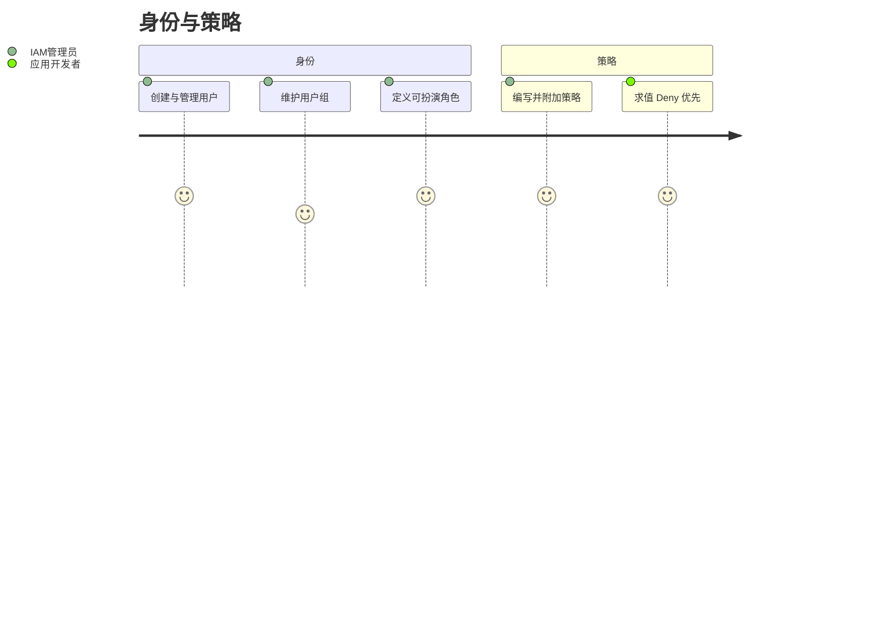
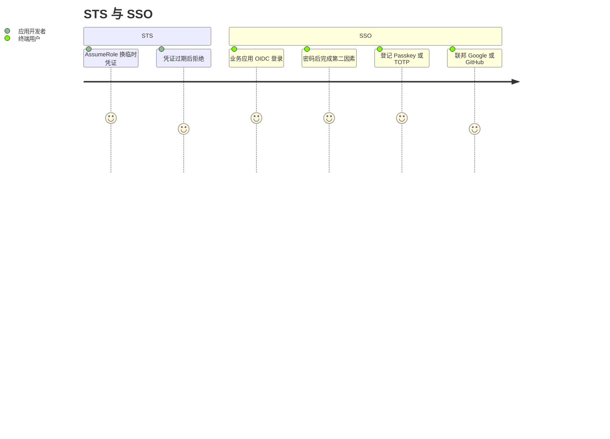
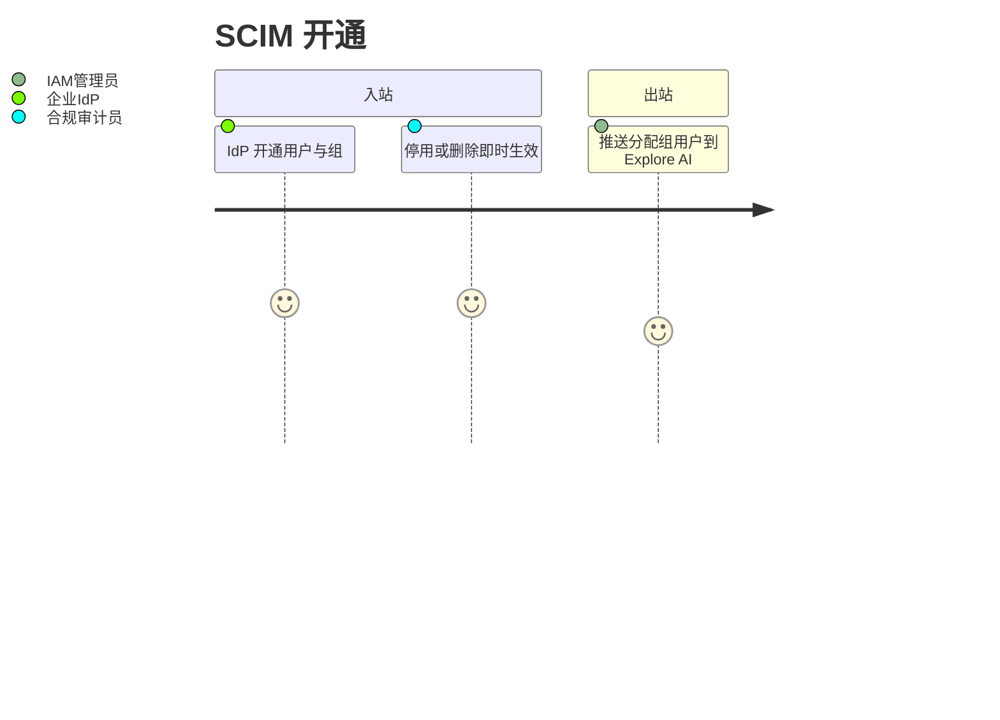
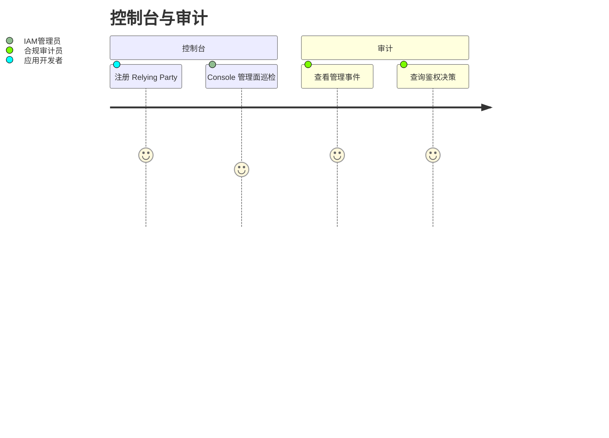
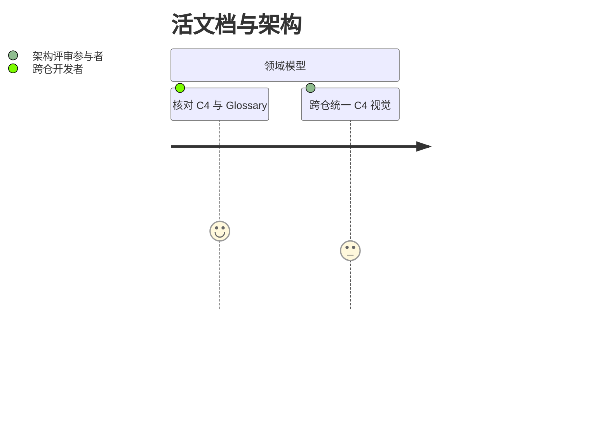

# 用户故事地图 | User Story Map — Explore IAM
> Jeff Patton 用户故事地图；正文与验收标准合并于本文（单一文档）。  
> Jeff Patton user-story map; epics and GWT acceptance criteria live in this single document.  
> 格式 / Format：Background → `As a` / `I want` / `So that` → Scenario GIVEN-WHEN-THEN（双语 / bilingual）。

## 用户画像 | Personas

| 角色 / Role | 说明 / Description |
|------|------|
| 终端用户 / End User | 经 SSO 登录业务应用（Explore AI 等） / Signs into business apps via SSO (Explore AI, etc.) |
| IAM 管理员 / IAM Admin | 在 Console 管理用户、组、角色、策略与客户端 |
| 应用开发者 / Application Developer | 注册 Relying Party、集成 OIDC 与鉴权 / Registers relying parties and integrates OIDC/authz |
| 合规审计员 / Compliance Auditor | 查询管理事件与鉴权决策日志 / Queries admin events and authz decision logs |
| 企业 IdP / Enterprise IdP | Okta |

## 旅程总览 | Journey Overview

### 身份与策略

### STS 与 SSO

### SCIM 开通

### 控制台与审计

### 活文档与架构

---

## Backbone 故事地图 | Backbone

### 已实现

| 身份 | 策略 | STS | SSO | 控制台与客户端 | 审计 |
|------|------|-----|-----|----------------|------|
| [US-01](#us-01-管理-iam-用户) 管理用户 | [US-04](#us-04-编写并附加策略) 编写/附加策略 | [US-06](#us-06-assumerole) AssumeRole | [US-08](#us-08-oidc-登录业务应用) OIDC 登录 | [US-10](#us-10-注册-relying-party) 注册客户端 | [US-12](#us-12-管理事件) 管理事件 |
| [US-02](#us-02-管理用户组) 组 | [US-05](#us-05-策略求值-deny-优先于-allow) 求值 Deny>Allow | [US-07](#us-07-临时凭证过期) 凭证过期 | [US-16](#us-16-mfa-第二因素后获得完整会话) MFA 第二因素 | | [US-13](#us-13-鉴权决策查询) 鉴权查询 |
| [US-03](#us-03-管理角色) 角色 | [US-05a](#us-05a-权限点目录github-风格-scope) 权限点目录 / [US-05b](#us-05b-agent-registry-scopewriteai_agent) `write:ai_agent` | | [US-17](#us-17-登记-passkey-或-totp) 登记 Passkey/TOTP | | |

| SCIM 开通 | 活文档与架构 |
|-----------|--------------|
| [US-18](#us-18-外部-idp-通过-scim-开通用户与组) IdP 开通用户与组 | [US-14](#us-14-领域模型图与代码一致) 领域图与代码一致 |
| [US-19](#us-19-iam-推送用户到-explore-ai) 推送到 Explore AI | [US-15](#us-15-c4-图视觉风格跨仓一致) C4 视觉风格跨仓一致 |
| [US-20](#us-20-删除与停用即时生效) 删除与停用即时生效 | [US-21](#us-21-模块间以领域事件解耦) 领域事件解耦 |

### 规划中

| SSO | 控制台与客户端 |
|-----|----------------|
| [US-09](#us-09-联邦-googlegithub) 联邦 IdP | [US-11](#us-11-console-管理面) Console |

---

## Epic 索引 | Epic Index

| Epic | 锚点 / Anchor | 状态 / Status |
|------|---------------|---------------|
| E1 身份 | [#e1](#e1) | — |
| E2 策略 | [#e2](#e2) | — |
| E3 STS | [#e3](#e3) | — |
| E4 SSO 与联邦 | [#e4](#e4) | — |
| E5 控制台与客户端 | [#e5](#e5) | — |
| E6 审计 | [#e6](#e6) | — |
| E7 活文档与架构 | [#e7](#e7) | — |
| E8 SCIM 开通 | [#e8](#e8) | — |

---

# 用户故事正文 | User Stories

## E1 身份 / Identity

### 背景 | Background

IAM 管理员维护主体体系：`User`、`Group`、`Role` 聚合根，作为策略附加与 STS 扮演的基础。 / IAM Admins maintain principals: `User`, `Group`, and `Role` aggregate roots as the basis for policy attachment and STS role assumption.

### US-01 管理 IAM 用户 / Management IAM User

**As a** IAM 管理员 / IAM Admin  
**I want** 创建、查看、更新与停用 IAM User / Create, view, update and disable IAM User  
**So that** 人员与服务账号有可管理的长期身份 / Personnel and service accounts have a manageable long-term identity

#### 验收标准 | Acceptance Criteria

1. **Scenario** 创建用户 / Create User  
   **GIVEN** 管理员已登录 IAM Console 且拥有用户管理权限 / Admin Login IAM Console And with user privacy.  
   **WHEN** 管理员提交有效的用户创建表单 / Admin submits valid user creation form  
   **THEN** 系统持久化新的 IAM User / The system lasts forever. IAM User  
   **AND** 用户出现在身份列表中 / The user appears in the identity list  

2. **Scenario** 停用用户 / Disable User  
   **GIVEN** 存在处于启用状态的 IAM User / Exists active IAM User  
   **WHEN** 管理员执行停用 / Admin Executes Disable  
   **THEN** 该用户无法再通过身份认证发起管理或 STS 操作 / The user can no longer initiate management through authentication or STS Operation  
   **AND** 停用结果可在审计中查到 / The results of the decommissioning can be found in the audit  

#### 状态 | Status

已实现 / Done

---

### US-02 管理用户组 / Manage user groups

**As a** IAM 管理员 / IAM Admin  
**I want** 创建 Group 并将用户加入或移出组 / Create Group Add or remove users  
**So that** 可以按组批量附加策略 / Additional policy by batch

#### 验收标准 | Acceptance Criteria

1. **Scenario** 创建组并加人 / Create group plus people  
   **GIVEN** 至少存在一个 IAM User / At least one exists. IAM User  
   **WHEN** 管理员创建 Group 并将该用户加入 / Admin Create Group and add the user  
   **THEN** 组与成员关系被保存 / Group-member relationship saved  
   **AND** 随后附加到组的策略适用于该成员 / The strategy then attached to the group applies to the member  

2. **Scenario** 移出组 / Remove Group  
   **GIVEN** 用户已在某 Group 中 / User is already in the Group Medium  
   **WHEN** 管理员将该用户移出 / The Admin moved the user out  
   **THEN** 用户不再继承该组策略 / User no longer inherits the group policy  
   **AND** 列表反映最新成员 / List reflects the latest members  

#### 状态 | Status

已实现 / Done

---

### US-03 管理角色 / Management role

**As a** IAM 管理员 / IAM Admin  
**I want** 创建 Role 并配置信任策略 / Create Role And set up a trust policy.  
**So that** 调用方可通过 AssumeRole 获得临时身份 / Call to pass AssumeRole Access to temporary status

#### 验收标准 | Acceptance Criteria

1. **Scenario** 创建角色 / Create Role  
   **GIVEN** 管理员拥有角色管理权限 / Admin has role management privacy  
   **WHEN** 管理员创建 Role 并设置信任策略主体 / Admin Create Role and set up a trust policy subject  
   **THEN** Role 可被查询 / Role Queryable  
   **AND** 信任策略可供 STS 求值 / Trust strategy available STS Request  

2. **Scenario** 更新信任策略 / Update Trust Policy  
   **GIVEN** Role 已存在 / Role Exists  
   **WHEN** 管理员修改信任策略并保存 / Admin modify trust policy and save  
   **THEN** 后续 AssumeRole 使用新信任策略 / Follow-up AssumeRole Use new trust policy  
   **AND** 变更写入管理审计 / Change to management audit  

#### 状态 | Status

已实现 / Done

---

## E2 策略 / Policy

### 背景 | Background

策略聚合根承载 Effect

### US-04 编写并附加策略 / Write and attach policies

**As a** IAM 管理员 / IAM Admin  
**I want** 创建 Policy Document 并将其附加到 User、Group 或 Role / Create Policy Document And attach it to User, Group or Role  
**So that** 主体获得可声明的权限集 / Subject acquires declarable competence Set

#### 验收标准 | Acceptance Criteria

1. **Scenario** 创建策略文档 / Create Policy Document  
   **GIVEN** 管理员在策略编辑页 / Admin in Strategy Edit Page  
   **WHEN** 提交包含 Effect、Action、Resource 的有效策略 / contains Effect, Action, Resource Effective policy  
   **THEN** Policy Document 被保存 / Policy Document Saved  
   **AND** 可在策略列表中打开 / Open in the policy list  

2. **Scenario** 附加到角色 / Attach to Role  
   **GIVEN** 已有 Policy Document 与 Role / Existing Policy Document and Role  
   **WHEN** 管理员将策略附加到该 Role / The Admin attaches the strategy to that Role  
   **THEN** 身份策略关联建立 / Identity Policy Linking  
   **AND** 后续鉴权会加载该策略 / Follow-up monitoring will load the strategy  

#### 状态 | Status

已实现 / Done

---

### US-05 策略求值 Deny 优先于 Allow / Policy demands Deny Priority Allow

**As a** 应用开发者 / Application Developer  
**I want** 鉴权决策对同一请求先处理显式 Deny / Secular decision-making first deals with the same request. Deny  
**So that** 收紧策略时不会被宽泛 Allow 覆盖 / Tightening the strategy will not be broad. Allow Overwrite

#### 验收标准 | Acceptance Criteria

1. **Scenario** 显式 Deny 生效 / Explicit Deny takes effect  
   **GIVEN** 主体同时拥有允许与拒绝同一 Action 的策略语句 / The subject has both permission and rejection. Action Policy statement  
   **WHEN** 调用鉴权决策 API / Call critical decision-making API  
   **THEN** 结果为 Deny / Result is Deny  
   **AND** 理由码标明显式拒绝 / Reason label clearly rejected  

2. **Scenario** 仅 Allow 时通过 / Only Allow Passed  
   **GIVEN** 主体仅有匹配的 Allow 且无 Deny / Subject only matches Allow None Deny  
   **WHEN** 调用鉴权决策 API / Call critical decision-making API  
   **THEN** 结果为 Allow / Result is Allow  

#### 状态 | Status

已实现 / Done

---

### US-05a 权限点目录（GitHub 风格 Scope） / Permission Point Directory(GitHub Style Scope)

**As a** IAM 管理员 / IAM Admin  
**I want** 维护 Permission Point 目录，每个权限点对应一个 GitHub 风格 OAuth scope / Maintenance Permission Point Directory, one for each access point GitHub Style OAuth scope  
**So that** Explore AI

#### 验收标准 | Acceptance Criteria

1. **Scenario** 列出权限点 / List permission points  
   **GIVEN** 管理员或审计员已登录 / Admin or auditor login  
   **WHEN** 调用 `GET /api/v1/permissionPoints` / Call `GET /api/v1/permissionPoints`  
   **THEN** 返回含 `write:ai_chat`、`admin:chat` 等目录项 / Return inclusive `write:ai_chat`, `admin:chat` Table of contents  
   **AND** 每项含 Action、Resource、module / Each contains Action, Resource, module  

2. **Scenario** 拒绝点分产品 Scope / No subproducts Scope  
   **GIVEN** 管理员尝试创建 `oauthScope` 为 `ai.chat` 的权限点 / Admin tries to create `oauthScope` is `ai.chat` Permission Point  
   **WHEN** 提交创建请求 / Submit creation request  
   **THEN** 请求被拒绝 / Request denied  
   **AND** 提示须使用 `{access}:{resource}` 格式 / must use `{access}:{resource}` Format  

#### 状态 | Status

已实现 / Done

---

### US-05b Agent Registry scope（write:ai_agent）

**As a** IAM 管理员 / IAM Admin  
**I want** `write:ai_agent` 表示 Gallery  
**So that** Explore 具备 Copilot Agent Registry 形态的客户端治理（非 per-skill OAuth） / Explore Existing Copilot Agent Registry Client governance in form (n) per-skill OAuth)

#### 验收标准 | Acceptance Criteria

1. **Scenario** 目录含 Agent 总闸 / Contents Agent Main gate.  
   **GIVEN** Permission 种子已加载 / Permission seed data loaded  
   **WHEN** 查看 `write:ai_agent` / View `write:ai_agent`  
   **THEN** 描述覆盖 Gallery agents、A2A tasks、pipelines/skills / Synchronising folder Gallery agents, A2A tasks, pipelines/skills  
   **AND** Resource 为 `arn:ai:::agent/*` / Resource is `arn:ai:::agent/*`  

2. **Scenario** Chat 客户端可请求该 scope / Chat Client can request this scope  
   **GIVEN** RegisteredClient `explore-chat`  
   **WHEN** 查看其 allowed scopes / View them allowed scopes  
   **THEN** 包含 `write:ai_agent` / contains `write:ai_agent`  

#### 状态 | Status

已实现 / Done

---

## E3 STS

### 背景 | Background

STS 限界上下文经 AssumeRole 签发 `TokenExchange` 聚合根（临时凭证），支撑最小权限短时会话。 / STS Boundaries Context AssumeRole Issuance `TokenExchange` Aggregation root (temporary voucher), supporting minimum permission short session.

### US-06 AssumeRole

**As a** 应用开发者 / Application Developer  
**I want** 调用 AssumeRole 并在信任策略允许时获得临时凭证 / Call AssumeRole And get a temporary pass when the trust strategy allows.  
**So that** 我可以以 Role 身份访问受保护资源 / I can do it. Role Identity access to protected resources

#### 验收标准 | Acceptance Criteria

1. **Scenario** 信任允许时签发 / Issue when trust permits  
   **GIVEN** 调用方被 Role 的信任策略允许 / Caller by Role Trust strategy allows  
   **WHEN** 调用 `AssumeRole` 并提供合法 roleArn 与 sessionName / Call `AssumeRole` And provide legal. roleArn and sessionName  
   **THEN** 返回 Temporary Credentials 与过期时间 / Back Temporary Credentials must use  
   **AND** 审计记录一次成功扮演 / Audit records played successfully  

2. **Scenario** 信任拒绝时失败 / Failed to trust when rejecting  
   **GIVEN** 调用方不在信任策略允许范围内 / Caller is not allowed in trust strategy Internal  
   **WHEN** 调用 `AssumeRole` / Call `AssumeRole`  
   **THEN** 请求被拒绝 / Request denied  
   **AND** 不签发任何临时凭证 / No temporary credentials issued  

#### 状态 | Status

已实现 / Done

---

### US-07 临时凭证过期 / Interim credentials expired

**As a** 应用开发者 / Application Developer  
**I want** 过期临时凭证被拒绝 / Obsolete temporary credentials rejected  
**So that** 会话不会无限期保持权限 / Sessions do not hold permission indefinitely

#### 验收标准 | Acceptance Criteria

1. **Scenario** 过期后调用失败 / Call after expiration failed  
   **GIVEN** 临时凭证已超过过期时间 / The temporary credential has expired.  
   **WHEN** 使用该凭证调用受保护 API / Use this document to call protected API  
   **THEN** 认证失败 / Authentication Failed  
   **AND** 提示凭证无效或已过期 / Reminder document invalid or expired  

2. **Scenario** 未过期仍可用 / Not expired available  
   **GIVEN** 临时凭证仍在有效期内且策略允许 / Temporary credentials are still valid and strategy allows  
   **WHEN** 使用该凭证调用受保护 API / Use this document to call protected API  
   **THEN** 请求可进入鉴权求值 / Request for access to forensic values  
   **AND** 不因凭证生命周期被拒 / Not rejected for credential life cycle  

#### 状态 | Status

已实现 / Done

---

## E4 SSO 与联邦 / SSO With the Federation

### 背景 | Background

Explore IAM 作为 OIDC Provider 支撑业务 SSO；可经 OAuth2 Client 联邦 Google

### US-08 OIDC 登录业务应用 / OIDC Login Operations Application

**As a** 终端用户 / End User  
**I want** 从业务应用跳转到 Explore IAM 完成 OIDC 登录后再回到应用 / Jump from Operational Application to Explore IAM Completed OIDC Login and return to application  
**So that** 我可以用统一身份使用多个 Explore 产品 / I can use more than one. Explore Products

#### 验收标准 | Acceptance Criteria

1. **Scenario** 授权码回流 / Authorized Code Flowback  
   **GIVEN** 用户访问受保护的 Relying Party 且尚未登录 / User access protected Relying Party Not yet registered  
   **WHEN** 应用重定向至 Explore IAM `/authorize` 且用户完成认证（含 [US-16](#us-16-mfa-第二因素后获得完整会话) 要求的第二因素） / Apply Redirect to Explore IAM `/authorize` and the user completes authentication [US-16](#us-16-mfa-A complete session after the second factor) Second element of the request)  
   **THEN** 浏览器带回 authorization code / Browser Bring returns authorization code  
   **AND** 应用可换取 ID Token  

2. **Scenario** 已有 IAM 会话免重复登录 / Existing IAM Sessions without duplicate login  
   **GIVEN** 用户已在 Explore IAM 持有有效完整会话 / User Already Explore IAM Hold valid full session  
   **WHEN** 另一 Relying Party 发起 OIDC 登录 / Another one. Relying Party Start OIDC Login  
   **THEN** 用户无需再次输入上游凭证（同会话策略允许时） / User does not need to enter upstream credentials again (when the same session policy allows))  
   **AND** 仍按客户端完成同意（如需要） / Consent is still done by client (if required))  

#### 状态 | Status

已实现（本地 OIDC Provider + Explore AI Registered Client；表单登录 + MFA；Jira [EXP-351](https://felixzhu.atlassian.net/browse/EXP-351)）

---

### US-09 联邦 Google/GitHub / Federated Google/GitHub

**As a** 终端用户 / End User  
**I want** 使用 Google 或 GitHub 完成联邦登录 / Complete federated sign-in with Google or GitHub  
**So that** 我不必单独维护一套 IAM 密码 / I don't have to do this alone. IAM Password

#### 验收标准 | Acceptance Criteria

1. **Scenario** Google 联邦成功 / Google Federal success.  
   **GIVEN** 管理员已配置 Google 作为外部 IdP / Admin configured Google As External IdP  
   **WHEN** 用户选择 Google 并完成上游认证 / User Selection Google and completed upstream certification  
   **THEN** Explore IAM 映射或创建 Federated Principal / Explore IAM Map or Create Federated Principal  
   **AND** 继续完成 OIDC 对 Relying Party 的签发 / Continue OIDC issuance for the relying party  

2. **Scenario** 未配置的提供方不可用 / Unconfigured Provider Not Available  
   **GIVEN** 某外部 IdP 未启用 / External IdP Not enabled  
   **WHEN** 用户打开登录页 / User opens Login Page  
   **THEN** 不展示该提供方入口 / Do not display the provider entrance  
   **AND** 其他已启用提供方仍可用 / Other enabled providers are still available  

#### 状态 | Status

规划中 / Planned

---

### US-16 MFA 第二因素后获得完整会话 / MFA A complete session after the second factor

**As a** 终端用户 / End User  
**I want** 在密码登录后完成可用的第二因素 / Second factor available after password login  
**So that** 只有我本人能获得可签发 OIDC 的完整会话 / Only I can get it myself. OIDC Full Session

#### 验收标准 | Acceptance Criteria

1. **Scenario** 密码后进入验证引导 / Password into Validation Guidance  
   **GIVEN** 用户在 `/sign-in` 提交正确密码且尚无完整 MFA 会话 / User in `/sign-in` Submit correct password and incomplete MFA Session  
   **WHEN** 认证成功处理器处理登录 / Authenticate successful processor processing login  
   **THEN** 浏览器进入 `/sign-in/verify` / Browser Entry `/sign-in/verify`  
   **AND** 页面根据 `/api/login/mfa-options` 展示可用因素（OTT、已登记 Passkey、已启用 TOTP） / Page by `/api/login/mfa-options` Show availability factors(OTT, Registered Passkey, Enabled TOTP)  

2. **Scenario** anyOf 第二因素成功 / anyOf The second factor is success.  
   **GIVEN** 用户已持有 `FACTOR_PASSWORD` / User held `FACTOR_PASSWORD`  
   **WHEN** 用户完成 OTT、WebAuthn 断言或 TOTP（含备用码）任一验证 / User completed OTT, WebAuthn Claims or claims TOTP(Any verification with backup code  
   **THEN** 会话获得对应第二因素 authority / Getting the session matched to the second factor authority  
   **AND** 可继续 OIDC authorize  

3. **Scenario** 仅密码不可作为完整会话 / Password only is not a full session  
   **GIVEN** 用户只完成密码因素 / User completes password factor only  
   **WHEN** 访问需要完整会话的端点 / Visit peer where full session is required  
   **THEN** 被引导或拒绝直至第二因素完成 / Directed or rejected until the second factor is completed  

#### 状态 | Status

已实现（`FACTOR_PASSWORD` + anyOf `FACTOR_OTT` / `FACTOR_WEBAUTHN` / `FACTOR_TOTP`）

---

### US-17 登记 Passkey 或 TOTP / Registration Passkey or TOTP

**As a** 终端用户 / End User  
**I want** 为自己登记 Passkey 和/或认证器 App（TOTP） / Register yourself. Passkey and/or certifier App(TOTP)  
**So that** 下次登录可以用钓鱼抵抗或离线第二因素 / Next login can be used to resist fishing or offline the second factor.

#### 验收标准 | Acceptance Criteria

1. **Scenario** 登记 TOTP / Registration TOTP  
   **GIVEN** 用户已登录并可访问安全设置 / User login and access security settings  
   **WHEN** 在 `/security/totp` 开始登记并扫描 QR  
   **THEN** TOTP Credential 启用 / TOTP Credential Enable  
   **AND** `/api/login/mfa-options` 将 TOTP 标为可用 / `/api/login/mfa-options` marks TOTP as available  

2. **Scenario** 登记 Passkey / Registration Passkey  
   **GIVEN** 用户已登录且浏览器支持 WebAuthn / User login and browser support WebAuthn  
   **WHEN** 完成 Passkey 注册仪式 / Completed Passkey Registration ceremony  
   **THEN** WebAuthn Credential 持久化 / WebAuthn Credential Enduring  
   **AND** 验证页可选择 Passkey 作为第二因素 / The verification page can select Passkey as a second factor  

#### 状态 | Status

已实现（`/api/v1/totp` 登记 + WebAuthn JDBC；验证页引导）

---

## E5 控制台与客户端 / Console and Client

### 背景 | Background

开发者在 Console 注册 Relying Party（`OAuthClient` 聚合根）；管理员经 Angular 管理面运维身份与策略限界上下文。 / Developer in Console Registration Relying Party(`OAuthClient` Aggregation root; Admin through Angular Manage face-to-face identity and strategy boundaries.

### US-10 注册 Relying Party / Registration Relying Party

**As a** 应用开发者 / Application Developer  
**I want** 注册 OIDC 客户端（client_id、redirect_uri、scopes） / Registration OIDC Client(client_id, redirect_uri, scopes)  
**So that** 我的应用可以作为 Relying Party 接入 Explore IAM / My application can be used as... Relying Party Access Explore IAM

#### 验收标准 | Acceptance Criteria

1. **Scenario** 创建 Registered Client / Create Registered Client  
   **GIVEN** 开发者已登录 Console 且拥有客户端管理权限 / Developer login Console and with client management privacy  
   **WHEN** 提交合法的回调 URI 与 scopes / Submit a legitimate callback URI and scopes  
   **THEN** 系统创建 Registered Client 并返回 client 凭证（按安全策略展示一次） / System Creation Registered Client And back client Certificate (show once according to security strategy))  
   **AND** 客户端可出现在列表中 / Client can appear in the list  

2. **Scenario** 非法回调被拒绝 / Illegal calls denied.  
   **GIVEN** 开发者提交不安全或格式错误的 redirect_uri / Developer submits unsafe or misformatted redirect_uri  
   **WHEN** 保存客户端 / Save Client  
   **THEN** 请求失败并提示校验错误 / Request failed and hinting for error  
   **AND** 不创建客户端记录 / Do not create client records  

#### 状态 | Status

已实现（API + `/clients` 注册页；完整 Console 壳见 US-11）

---

### US-11 Console 管理面 / Console Management

**As a** IAM 管理员 / IAM Admin  
**I want** 在统一 Console 中导航身份、策略、应用与审计 / In harmonization Console Navigation identity, strategy, application and auditing  
**So that** 我可以完成日常运维而无需多个工具 / I can do my routine without more tools.

#### 验收标准 | Acceptance Criteria

1. **Scenario** 主导航可达 / Main navigable  
   **GIVEN** 管理员已登录 Console / Admin Login Console  
   **WHEN** 打开身份、策略、应用注册、审计入口 / Open identity, strategy, application registration, audit portal  
   **THEN** 各页面可加载 / Pages to Load  
   **AND** 未授权入口被隐藏或拒绝 / Unauthorized access is hidden or denied  

2. **Scenario** 未登录被重定向 / Unlogged Redirected  
   **GIVEN** 管理员未认证 / Admin not certified  
   **WHEN** 访问受保护的 Console 路由 / Access to protected Console Route  
   **THEN** 重定向至 Explore IAM 登录 / Redirect to Explore IAM Login  
   **AND** 登录成功后回到原目标（若支持） / Return to target after login successful (if supported))  

#### 状态 | Status

规划中 / Planned

---

## E6 审计 / Audit

### 背景 | Background

审计限界上下文以不可变聚合根记录管理活动与数据访问决策，支撑追责与排障。 / The audit limit context supports accountability and exclusion by making decisions on record management activities and data access.

### US-12 管理事件 / Manage Events

**As a** 合规审计员 / Compliance Auditor  
**I want** 按时间与主体检索用户/角色/策略/客户端变更 / Retrieve users by time and subject/Role/Policy/Client Change  
**So that** 我能还原谁在何时改了什么 / I can say when someone changed something.

#### 验收标准 | Acceptance Criteria

1. **Scenario** 列表与过滤 / List and Filter  
   **GIVEN** 系统中已有管理事件 / Management events already exist in the system  
   **WHEN** 审计员按时间范围与主体过滤 / Auditors filter by time frame and subject  
   **THEN** 返回匹配的 Management Event 列表 / Returns matching Management Event List  
   **AND** 每条含操作类型与目标资源标识 / Each article contains the type of operation and target resource identifier  

2. **Scenario** 无匹配时空结果 / No matching time and space result  
   **GIVEN** 过滤条件无命中记录 / Filter condition unrecorded  
   **WHEN** 执行查询 / Execute queries  
   **THEN** 返回空列表而非错误 / Return empty list instead of error  
   **AND** UI 提示无结果 / UI shows a no-results hint  

#### 状态 | Status

已实现 / Done

---

### US-13 鉴权决策查询 / Decision-making queries

**As a** 合规审计员 / Compliance Auditor  
**I want** 查询 Authorization Decision 日志（Allow/Deny 与理由） / Question Authorization Decision Log(Allow/Deny and reason)  
**So that** 我能解释某次访问为何被拒绝或允许 / I can explain why a visit was denied or allowed.

#### 验收标准 | Acceptance Criteria

1. **Scenario** 按请求上下文检索 / Search as requested  
   **GIVEN** 已有鉴权决策日志 / Accuracy decision log exists  
   **WHEN** 按 Principal、Action 或时间查询 / Press Principal, Action Or time queries  
   **THEN** 返回对应决策记录 / Returns corresponding decision-making records  
   **AND** 含 Allow/Deny 与理由码 / Includes Allow/Deny And the reason code  

2. **Scenario** 敏感字段受控 / Sensitive field controlled  
   **GIVEN** 审计员角色仅有只读审计权限 / The role of auditors is limited to audit-only privacy  
   **WHEN** 查看决策详情 / View decision details  
   **THEN** 可读取决策结果与必要上下文 / Readable decision outcomes and necessary context  
   **AND** 不能修改或删除审计记录 / Audit records cannot be modified or deleted  

#### 状态 | Status

已实现 / Done

---

## E7 活文档与架构 / Live document and architecture

### 背景 | Background

跨仓协作要求 Glossary、C4 领域图与领域公共 API 使用同一套统一语言。术语、聚合根、实体、值对象与领域行为必须可核对。 / Cross-Silo Collaboration Requirements Glossary, C4 Area maps and domain public API Use the same unified language. Terminology, aggregate root, entity, object of value and field behaviour must be verifiable.

### US-14 领域模型图与代码一致 / Area model and code consistency

**As a** 跨仓开发者 / Cross-repo Developer  
**I want** C4 领域模型图与 Glossary、Java domain 公共 API 一一对应 / C4 Area Modelling and Glossary, Java domain Public API One-on-one.  
**So that** 评审与实现时能快速核对聚合、实体、值对象与领域行为 / Quick check of aggregate, entity, object of value and field behaviour when evaluated and achieved

#### 验收标准 | Acceptance Criteria

1. **Scenario** 类型与 stereotype 一致 / Type and stereotype Unanimously  
   **GIVEN** 代码中存在 Identity  
   **WHEN** 打开 `C4-Code-Domain-Model.puml` / Open `C4-Code-Domain-Model.puml`  
   **THEN** 图中列出对应聚合根  
   **AND** `PolicyStatement` 标注为值对象，`Effect` 与 `AuditOutcome` 标注为枚举 / `PolicyStatement` is annotated as a value object; `Effect` and `AuditOutcome` are annotated as enums  

2. **Scenario** 公共领域方法可核对 / Public domain methods are verifiable  
   **GIVEN** 聚合根上存在语义化访问器与领域行为（如 `IamUser.disable`、`PolicyEngine.evaluate`） / Semantic accessors and field behaviour on aggregate root exist (e.g. `IamUser.disable`, `PolicyEngine.evaluate`)  
   **WHEN** 对照领域图与 Java 源码 / Control field figures and Java Source  
   **THEN** 图中以 UML `+methodName(params)` 列出 public 领域 API / Figure UML `+methodName(params)` List public Area API  
   **AND** 持久化专用 `reconstitute` 工厂不出现在图中 / Enduring Specialized `reconstitute` The factory doesn't show up.  

3. **Scenario** 关联关系反映实现 / Relationships reflect realization  
   **GIVEN** `PolicyAttachment` 通过 `policyId` 引用 `PolicyDocument` / `PolicyAttachment` via `policyId` References `PolicyDocument`  
   **WHEN** 查看 Policy 包关联 / View Policy Package Association  
   **THEN** 图为引用关系而非聚合内导航 / Diagram shows references, not in-aggregate navigation  
   **AND** `PolicyDocument` 与 `PolicyStatement` 标注为 `document_json` 嵌入组合 / `PolicyDocument` and `PolicyStatement` are annotated as a `document_json` embedded composition  

#### 状态 | Status

已实现 / Done

---

### US-15 C4 Dynamic 图统一黑白 / C4 Dynamic Unified Black & White

**As a** 架构评审参与者 / Architecture Review Participant  
**I want** 全部 `C4-Dynamic-*` 序列图使用同一套 plain 黑白样式 / All `C4-Dynamic-*` Use the same sequence plain Black and White Styles  
**So that** 运行时路径图不与彩色 zinc 混用，阅读负担更低 / The road map is not coloured while running zinc It's more difficult to read.

#### 验收标准 | Acceptance Criteria

1. **Scenario** Dynamic 轨纯黑白 / Dynamic Track pure black and white  
   **GIVEN** `C4-Dynamic-*.puml` 使用 `!theme plain` 与白底 / `C4-Dynamic-*.puml` Use `!theme plain` And White Bottom  
   **WHEN** 渲染任一 Dynamic 图 / Render any Dynamic Figure  
   **THEN** 无彩色 stereotype 边框或彩色 role legend / No Colour stereotype Border or Colour role legend  
   **AND** README Dynamics 轨说明为 plain 黑白 / README Dynamics Track description is plain Black & White  

2. **Scenario** 不再依赖 style-zinc / No longer dependent style-zinc  
   **GIVEN** Dynamic 图已内联 plain 样式 / Dynamic It's connected. plain Styles  
   **WHEN** 检查 c4-model 目录 / Inspection c4-model Contents  
   **THEN** 无 `style-zinc.puml` / None `style-zinc.puml`  
   **AND** 无 Dynamic 图 `!include style-zinc.puml` / None Dynamic Figure `!include style-zinc.puml`  

#### 状态 | Status

已实现 / Done

---

### US-21 模块间以领域事件解耦 / Inter-module decoupling with field events

**As a** IAM 开发者 / IAM Developer  
**I want** 审计、联邦清理与 SCIM 推送通过领域事件响应身份变更，而不是被各模块直接注入 / Audit, federal liquidation SCIM Sending through field events to respond to identity change rather than being directly injected by modules  
**So that** 修改审计或联邦实现时不必改动身份、策略与 STS 模块 / No change in identity, strategy or strategy when auditing or federal realization STS Module

#### 验收标准 | Acceptance Criteria

1. **Scenario** 审计随业务变更同事务提交 / Audit submitted with change of business  
   **GIVEN** 管理员在控制台停用一名用户 / The Admin deactivated a user on the console  
   **WHEN** `UserService` 发布 `UserDeactivatedEvent` / `UserService` Release `UserDeactivatedEvent`  
   **THEN** `AdminActivityRecorder` 同步写入 `identity:DisableUser` / `AdminActivityRecorder` Sync Writing `identity:DisableUser`  
   **AND** 业务事务回滚时审计记录一并回滚 / Audit records rolled back when business matters rolled back  

2. **Scenario** 删除用户时联邦链接先于用户行删除 / Federal links are deleted before user lines  
   **GIVEN** 用户通过外部 IdP 登录过，存在 Federated Identity Link / User via external IdP Login. Existence. Federated Identity Link  
   **WHEN** 删除该用户 / Delete user  
   **THEN** `FederationLinkService` 处理 `UserDeletionRequestedEvent` 并删除链接 / `FederationLinkService` Processing `UserDeletionRequestedEvent` and remove links  
   **AND** 用户行删除成功，外键约束不被违反 / User line deleted successfully and external key constraints not violated  

3. **Scenario** 架构规则守护 / Structured Ruleguard  
   **GIVEN** `ArchitectureRulesTest`  
   **WHEN** 任一模块引入循环依赖，或 `audit` 之外的模块依赖 `com.iam.audit..` / either module introduces loop dependence, or `audit` Module Dependence Outside `com.iam.audit..`  
   **THEN** 构建失败 / Build Failed  

#### 状态 | Status

已实现 / Done

---

## E8 SCIM 开通 / SCIM Open

### 背景 | Background

企业在 Okta

### US-18 外部 IdP 通过 SCIM 开通用户与组 / External IdP via SCIM Open User & Group

**As a** IAM 管理员 / IAM Admin  
**I want** Okta  
**So that** 人员变动只需在企业 IdP 中维护一次 / People change only at the enterprise. IdP Maintained once

#### 验收标准 | Acceptance Criteria

1. **Scenario** 授权的 SCIM Client 创建用户 / Authorized. SCIM Client Create User  
   **GIVEN** 外部 IdP 持有 `scim-provisioner` 客户端的 `client_credentials` 令牌（`write:iam_scim`） / External IdP Hold `scim-provisioner` Client `client_credentials` token(`write:iam_scim`)  
   **WHEN** `POST /scim/v2/Users`（`application/scim+json`）  
   **THEN** 返回 201、`Location` 与弱 ETag `W/"<version>"` / Back 201, `Location` With weakness ETag `W/"<version>"`  
   **AND** 写入 `identity:CreateUser` 管理活动，Actor 为 `scim-provisioner` / Writing `identity:CreateUser` Management activities, Actor is `scim-provisioner`  

2. **Scenario** 缺少 scope 被拒 / Missing scope Rejected  
   **GIVEN** 令牌不含 `write:iam_scim` / Do not include tokens `write:iam_scim`  
   **WHEN** 调用任一 `/scim/v2` 端点 / Call any `/scim/v2` Peer  
   **THEN** 返回 403 SCIM Error（`application/scim+json`） / Back 403 SCIM Error(`application/scim+json`)  

3. **Scenario** 并发修改冲突 / And then you change  
   **GIVEN** 用户当前版本为 `W/"3"` / Current user version is as `W/"3"`  
   **WHEN** `PUT` 或 `PATCH` 携带 `If-Match: W/"2"` / `PUT` or `PATCH` Carry `If-Match: W/"2"`  
   **THEN** 返回 412，用户不变 / Back 412, User change  

4. **Scenario** 组成员同步 / Synchronise Group Membership  
   **GIVEN** 组已存在 / Group Exists  
   **WHEN** `PATCH /scim/v2/Groups/{id}` 增删 `members` / `PATCH /scim/v2/Groups/{id}` Add & Delete `members`  
   **THEN** 成员变更生效，并登记 `GroupMembershipChanged` 领域事件 / Membership change effective and registered `GroupMembershipChanged` Field Events  

#### 状态 | Status

已实现 / Done

---

### US-19 IAM 推送用户到 Explore AI / IAM must use Explore AI

**As a** IAM 管理员 / IAM Admin  
**I want** IAM 把（分配组内的）用户自动推送到 Explore AI / IAM Automatically transfer users to Explore AI  
**So that** 员工首次打开 Explore AI 前账号已就绪，离开分配组后立即停用 / The employee opened it for the first time. Explore AI Ex-account is in place. Disable as soon as you leave distribution.

#### 验收标准 | Acceptance Criteria

1. **Scenario** 新用户被推送 / New users pushed over  
   **GIVEN** Provisioning Target `explore-ai` 已启用，且用户属于分配组（或未配置分配组） / Provisioning Target `explore-ai` Enabled and the user belongs to the distribution group (or is not configured) Group)  
   **WHEN** IAM 用户被创建或资料变更 / IAM User created or information changed  
   **THEN** IAM 在事务提交后异步调用 Explore AI `/scim/v2/Users`（`write:ai_scim`） / IAM Off-the-shelf call after transaction is submitted Explore AI `/scim/v2/Users`(`write:ai_scim`)  
   **AND** `externalId` 为 IAM 用户 id，记录 Provisioned Account 与已同步版本 / `externalId` is the IAM user id; records Provisioned Account and synced version  

2. **Scenario** 重复事件幂等 / Duplicate events etc.  
   **GIVEN** Provisioned Account 已同步到当前版本 / Provisioned Account Synchronized to current version  
   **WHEN** 同一事件被重新投递 / The same incident was re-delivered.  
   **THEN** 不发起 SCIM 调用 / Do Not Start SCIM Call  

3. **Scenario** 移出分配组 / Remove Distribution Group  
   **GIVEN** 用户已推送到 Explore AI / must use Explore AI  
   **WHEN** 用户被移出分配组或在 IAM 停用 / User moved out of distribution group or IAM Disable  
   **THEN** Explore AI 账号被设为 `active=false`，无法再登录 / Explore AI Account set as `active=false`, Could not login again  

4. **Scenario** 目标暂时不可用 / Target is temporarily unavailable.  
   **GIVEN** Explore AI 返回 5xx  
   **WHEN** 重试耗尽 / It's exhausting.  
   **THEN** 事件发布保持未完成，由定时重投或重启后重投补发 / Event release remains incomplete and is replaced by a scheduled re-entry or restart Fire!  

#### 状态 | Status

已实现 / Done

---

### US-20 删除与停用即时生效 / Remove and disable immediately

**As a** 合规审计员 / Compliance Auditor  
**I want** IdP 删除或停用用户后，IAM 不再签发令牌，下游数据同步删除 / IdP After delete or disable the user, IAM Do not issue tokens anymore, delete data from downstream  
**So that** 离职人员无法继续访问，个人数据按要求擦除 / Separations could not continue to be accessed and personal data erased as required

#### 验收标准 | Acceptance Criteria

1. **Scenario** 停用或删除后拒绝签发 / Issue denied after disablement or deletion  
   **GIVEN** 用户已被 SCIM 停用或删除 / User has been SCIM Disable or Delete  
   **WHEN** 使用既有会话或刷新令牌换取新令牌 / Use an existing session or refresh a token for a new one  
   **THEN** 既有 IAM 会话被结束，令牌端点返回 `invalid_grant` / Already. IAM Session terminated, token end `invalid_grant`  

2. **Scenario** 用户名复用不继承授权 / Reuse user name does not inherit authorization  
   **GIVEN** 旧用户被改名或删除，新用户使用同一用户名 / Old users changed or deleted, new users used the same user First Name  
   **WHEN** 旧用户的会话或刷新令牌被使用 / An old user 's session or refreshing token is used  
   **THEN** 按登录时绑定的 IAM 用户 id 解析用户，请求被拒绝 / It's bound at login. IAM User id Parsing user, request denied  

3. **Scenario** 删除传播到下游 / Remove Transmission Downstream  
   **GIVEN** 用户在 Explore AI 有 Provisioned Account（即使目标已暂停） / User has a Provisioned Account in Explore AI (even if the target is suspended)  
   **WHEN** 用户在 IAM 被删除 / User is on IAM Deleted  
   **THEN** IAM 调用 Explore AI `DELETE /scim/v2/Users/{id}`，Explore AI 擦除该账号的数据 / IAM Call Explore AI `DELETE /scim/v2/Users/{id}`, Explore AI Erase the account data  

#### 状态 | Status

已实现 / Done

---

## 参考 | References

- [Guideline](../Guideline.md)
- [User Story Mapping — Jeff Patton](https://www.jpattonassociates.com/user-story-mapping/)
- [Domain Glossary](../Glossary.md)
- [AWS IAM User Guide](https://docs.aws.amazon.com/IAM/latest/UserGuide/introduction.html)

