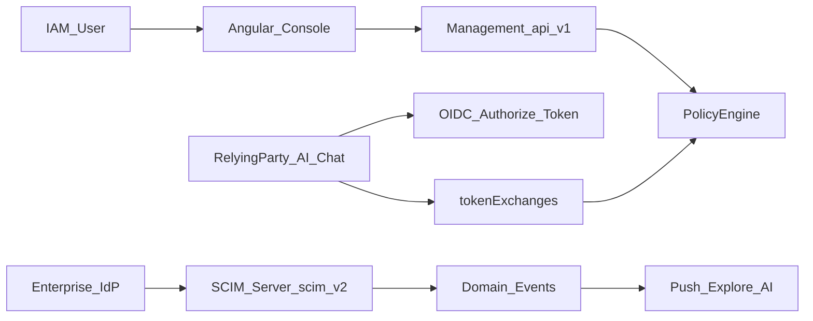
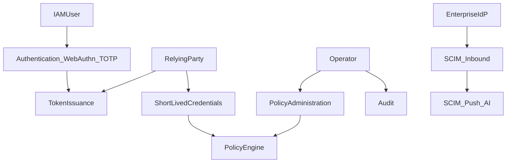
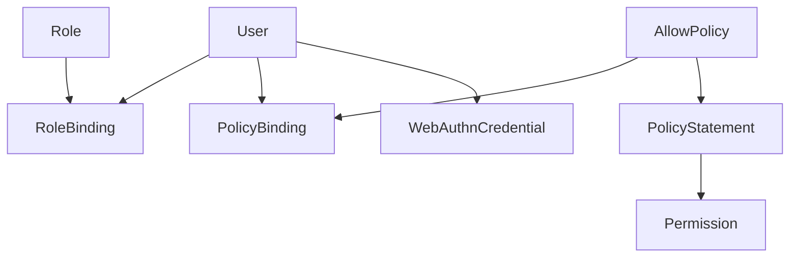
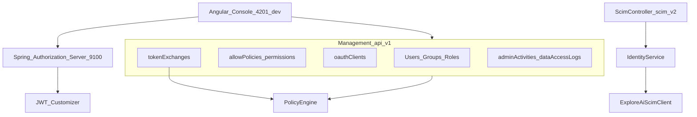
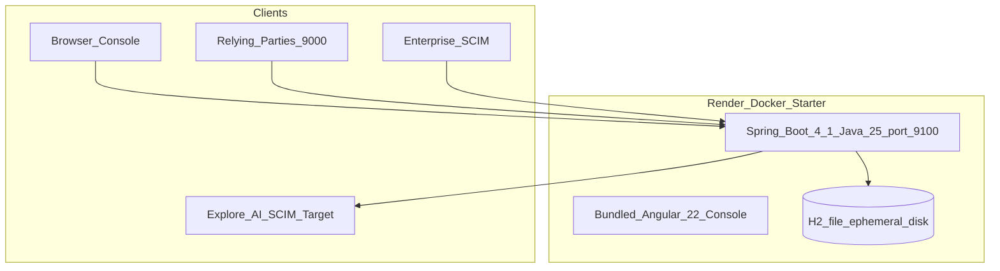
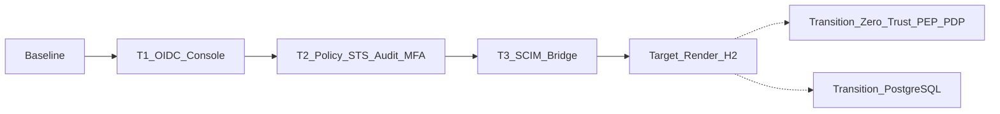

# Architecture Definition Document — Explore IAM

| Field | Value |
| --- | --- |
| Deliverable | Architecture Definition Document (TOGAF Architecture Content Framework) |
| Reference | [TOGAF Architecture Deliverables §32.2.3](https://pubs.opengroup.org/architecture/togaf9-doc/m/chap32.html) |
| Capability | Explore IAM (OIDC Provider, policy engine, STS, audit, SCIM, console) |
| ADM phases | B–D (Architecture Vision from Phase A summarized in §1) |
| Architecture states | Baseline, Transition (T1, T2, T3), Target |
| Companion | Architecture Requirements Specification (quantitative) — separate deliverable |
| Code-level models | [C4 model](../c4-model/README.md) |
| Preferred Terms | Idiomatic English ([Glossary](../../Glossary.md)) |

**Purpose.** When every Explore product invents its own login, operators cannot revoke access consistently, enterprises cannot provision users once, and auditors lack a single trail. This document captures the qualitative architecture of Explore IAM as built on this branch: one Spring Authorization Server monolith that issues OIDC tokens, evaluates identity-based policy, exchanges short-lived credentials, records admin and data-access events, and pushes accounts to Explore AI—while being explicit that PostgreSQL and full Zero Trust PEP separation are transition goals, not today's production datastore.

---

## Contents

- [1. Vision](#1-vision)
- [2. Architecture principles](#2-architecture-principles)
- [3. Architecture models](#3-architecture-models)
  - [3.1 Business Architecture](#31-business-architecture)
  - [3.2 Data Architecture](#32-data-architecture)
  - [3.3 Application Architecture](#33-application-architecture)
  - [3.4 Technology Architecture](#34-technology-architecture)
- [4. Re-use, standards, and landscape](#4-re-use-standards-and-landscape)
  - [4.1 Re-use assessment](#41-re-use-assessment)
  - [4.2 Mapping to standards](#42-mapping-to-standards)
  - [4.3 Mapping to architecture landscape](#43-mapping-to-architecture-landscape)
- [5. Transition Architecture](#5-transition-architecture)
- [6. References](#6-references)

---

## 1. Vision

### Problem

Explore AI, Chat, and future portfolio surfaces each started with local demo login. That failure mode multiplies secrets, diverges JWT claims, and blocks enterprise SCIM from a single control plane. Operators need one issuer URL, one console to register OAuth clients, enforceable Allow policies, and provable audit—not a copy-paste of Spring Security samples per repo.

### Stakeholders and concerns

| Stakeholder | Concern | Architectural response |
| --- | --- | --- |
| Relying Party developer | Stable discovery, PKCE for public clients, GitHub-style scopes | `/.well-known/openid-configuration`, `ClientSettings.requireProofKey`, scope catalog in Permissions |
| Operator | Users, groups, roles, clients, policy, audit in one SPA | Angular 22 console bundled with server; AIP-shaped `/api/v1/*` |
| Enterprise IdP admin | Provision into IAM then downstream to AI | SCIM server `/scim/v2` + Modulith outbound push |
| Security architect | Deny-over-Allow evaluation, STS for least privilege | `PolicyEngine` + `/api/v1/tokenExchanges` |
| Compliance | Admin Activity and Data Access logs | `com.iam.audit` persistence and list APIs |

### Solution

One JVM on port **9100** hosts Spring Authorization Server OIDC endpoints, the management API, SCIM ingress, STS token exchange, and the Angular console (dev proxy from **4201**). Principals authenticate with form login, OTT magic link, **WebAuthn Passkeys**, or TOTP; relying parties complete authorization code (with PKCE for public clients). Tokens carry product scopes; Explore AI validates JWTs as a resource server. After IAM commits SCIM changes, `ScimPushService` idempotently pushes users to Explore AI `/scim/v2/Users`.

SSO and native PKCE flows: [C4-Dynamic-SSOLogin.puml](../c4-model/C4-Dynamic-SSOLogin.puml), [C4-Dynamic-NativePkceLogin.puml](../c4-model/C4-Dynamic-NativePkceLogin.puml). Policy and STS: [C4-Dynamic-PolicyEvaluation.puml](../c4-model/C4-Dynamic-PolicyEvaluation.puml). Outbound provisioning: [C4-Dynamic-ScimProvisioning.puml](../c4-model/C4-Dynamic-ScimProvisioning.puml). Deployment: [C4-Deployment.puml](../c4-model/C4-Deployment.puml).

---

## 2. Architecture principles

1. **Google Cloud IAM vocabulary** — *Failure:* ad hoc role names incompatible with policy statements. *Decision:* `User`, `Group`, `Role`, `AllowPolicy`, `Permission`, `PolicyBinding` match [Glossary](../../Glossary.md). *Constraint:* management APIs and UI labels use Preferred Terms only.

2. **Deny > Allow > implicit Deny** — *Failure:* silent permit when no rule matches. *Decision:* `PolicyEngine` evaluation order is fixed. *Constraint:* new permissions register in the catalog before statements reference them; STS exchanges consult the engine before minting derived JWTs.

3. **Single origin in production** — *Failure:* split console and issuer URLs break cookies and OIDC metadata. *Decision:* packaged Angular static assets live under `server/src/main/resources/static`; one public `OIDC_ISSUER`. *Constraint:* Render Docker service serves console and `/oauth2/*` on the same host; dev console **4201** proxies `/api`, `/login`, `/webauthn`, `/ott` to **9100**.

4. **PKCE for public clients** — *Failure:* authorization code interception on mobile and SPA. *Decision:* `ClientSettings.requireProofKey` on public registrations including `explore-ai-ios`. *Constraint:* token endpoint rejects missing `code_verifier` for those clients.

5. **SCIM idempotency and push retry** — *Failure:* duplicate users or stuck partial provision downstream. *Decision:* inbound SCIM upserts emit domain events; outbound push uses Spring Modulith publications retried until success. *Constraint:* push disabled until `EXPLORE_AI_SCIM_URL` set; optional `EXPLORE_AI_SCIM_ASSIGNMENT_GROUP` scopes membership.

6. **Secrets never in URLs** — *Failure:* `client_secret` leaked via access logs. *Decision:* client authentication only on token and SCIM back-channels. *Constraint:* authorize and login query strings carry only `client_id`, `state`, and PKCE parameters.

7. **WebAuthn-first MFA path** — *Failure:* password-only accounts in a reusable IdP. *Decision:* Spring Security `HttpSecurity.webAuthn()` with JDBC credential stores alongside TOTP (`FACTOR_TOTP`) and OTT. *Constraint:* management MFA enrollment flows persist `WebAuthnCredential` and `TotpCredential` domain types.

8. **Auditable control plane** — *Failure:* undetected privilege changes. *Decision:* `AdminActivity` on mutating `/api/v1/*` calls; `DataAccessLog` for sensitive reads where implemented. *Constraint:* auditor role `ROLE_IAM_AUDITOR` read-only on audit list APIs.

---

## 3. Architecture models

### 3.1 Business Architecture

#### Baseline

Demonstration form login with seeded OIDC clients in H2; no Angular console routes for policy or audit; no SCIM server or outbound push; no STS; no `PolicyEngine` persistence.

#### Target

| Actor | Role |
| --- | --- |
| IAM User | Signs in via form login, OTT, Passkey, or TOTP |
| Operator | Manages identity, Allow policies, OAuth clients, audit review |
| Relying Party | Consumes OIDC tokens (Explore AI, Chat, native iOS) |
| Enterprise IdP | Provisions users and groups into IAM via SCIM |
| SCIM Provisioner client | Machine `client_credentials` with `write:iam_scim` |

| Business service | Package | Outcome |
| --- | --- | --- |
| Authentication | `com.iam.identity` | Form login, OAuth authorize, WebAuthn, TOTP, OTT |
| Token Issuance | SAS + `OidcTokenCustomizerConfig` | Access, ID, refresh JWTs with product scopes and permissions claim |
| Policy Administration | `com.iam.policy` | Allow policies, permissions, bindings, what-if evaluation |
| Policy Evaluation | `PolicyEngine` | Deny-over-Allow decisions for STS and management guards |
| Short-lived Credentials | `com.iam.sts` | Token exchange at `/api/v1/tokenExchanges` |
| Federation / OAuth clients | `com.iam.federation` | Registered clients via console and `/api/v1/oauthClients` |
| Provisioning | `com.iam.scim` | SCIM 2.0 server + push client to Explore AI |
| Audit | `com.iam.audit` | Admin Activity + Data Access logs |

### 3.2 Data Architecture

#### Baseline

`User` credentials and `oauth2_registered_client` rows only; no `AllowPolicy`, audit tables, WebAuthn credentials, or event publication store.

#### Target

| Entity | Role |
| --- | --- |
| `User`, `Group`, `Role` | Principals and role catalog |
| `RoleBinding`, `PolicyBinding` | Attach roles/policies to principals |
| `AllowPolicy`, `PolicyStatement` | Explicit allow/deny rules |
| `Permission` | Catalog + OAuth scope mapping (`read:`, `write:`, `admin:`) |
| `OAuthClient` / `RegisteredClient` | Relying parties with redirect URIs and PKCE flags |
| `AdminActivity`, `DataAccessLog` | Audit aggregates |
| `WebAuthnCredential`, `TotpCredential` | MFA factors |
| `FederatedIdentity` | External IdP linkage (partial) |
| Event publications | Modulith retry state for SCIM outbound |

| Store | Content | Notes |
| --- | --- | --- |
| H2 file (local) `./data/explore-iam` | All metadata + audit | Liquibase `0.1.xml` |
| H2 on Render **(production today)** | Same schema on ephemeral disk under `/app/data` | Survives restarts within plan limits; **not** durable multi-year retention |
| PostgreSQL | — | **Transition / roadmap** target per C4 Deployment; not production fact today |

Domain detail: [C4-Code-Domain-Model.puml](../c4-model/C4-Code-Domain-Model.puml).

### 3.3 Application Architecture

#### Baseline

`authorizationServerSecurityFilterChain` with form login only; no `OAuthClientController`, no SCIM filter chain, no STS controller.

#### Target

| Interface | Contract |
| --- | --- |
| OIDC | `/.well-known/openid-configuration`, `/oauth2/authorize`, `/oauth2/token`, `/.well-known/jwks.json` |
| Console auth | `/sign-in` → POST `/login`; `/webauthn`; `/ott`; TOTP verification |
| Identity (AIP) | `/api/v1/users`, `/api/v1/groups`, `/api/v1/roles` |
| Policy | `/api/v1/allowPolicies`, `/api/v1/permissions` |
| OAuth clients | `/api/v1/oauthClients` (create/list/get; secret returned once on create) |
| STS | `POST /api/v1/tokenExchanges` (authenticated callers) |
| SCIM ingress | `/scim/v2` Bearer scope `write:iam_scim` |
| SCIM egress | HTTPS to `EXPLORE_AI_SCIM_URL` + `/Users` with `write:ai_scim` |
| Audit | `/api/v1/adminActivities`, `/api/v1/dataAccessLogs` |

Filter chains: authorization server `@Order(1)`, SCIM `@Order(2)`, default SPA + management `@Order(3)` per Glossary.

### 3.4 Technology Architecture

#### Baseline

Local JVM only; console not embedded; H2 file without Render packaging.

#### Target

| Node | Decision |
| --- | --- |
| Runtime | Java 25, Spring Boot 4.1, Spring Authorization Server, Spring Modulith events |
| Crypto | TOTP at rest via `APP_TOTP_ENCRYPT_PASSWORD` + `APP_TOTP_ENCRYPT_SALT` |
| Issuer | `OIDC_ISSUER` must match public URL after first Render deploy |
| SCIM provisioner | `IAM_CLIENT_SCIM_PROVISIONER_SECRET` enables enterprise inbound client |
| SCIM outbound | `IAM_CLIENT_SCIM_OUTBOUND_SECRET` + `EXPLORE_AI_SCIM_URL` |
| Health | `GET /actuator/health` |

**Production data plane today:** Render Starter with H2 on ephemeral disk. **PostgreSQL**, static encryption, and backup drills are Transition items—not claimed as Target runtime.

---

## 4. Re-use, standards, and landscape

### 4.1 Re-use assessment

| Asset | Re-use |
| --- | --- |
| Spring Authorization Server | OIDC provider, JDBC registered clients, JWK persistence |
| Spring Security WebAuthn + OTT + TOTP | MFA stack without custom crypto protocols |
| Spring Modulith | Reliable SCIM outbound retry |
| Google AIP patterns | Management pagination and error shape |
| C4 Zero Trust diagrams | North star for PEP/PDP split ([Zero Trust Architecture](../zero-trust/Zero-Trust-Architecture.md)) |

### 4.2 Mapping to standards

| Standard | Application |
| --- | --- |
| OAuth 2.0 / OIDC | Authorization code, refresh, PKCE, custom JWT claims |
| SCIM 2.0 RFC 7643/7644 | Inbound IdP provisioning + outbound Explore AI Users |
| Google Cloud IAM model | Policy engine vocabulary and binding semantics |
| AIP-121 / AIP-158 / AIP-193 | REST management APIs |
| WebAuthn Level 3 | Passkey registration and assertion (`FACTOR_WEBAUTHN`) |

### 4.3 Mapping to architecture landscape

| Element | Position |
| --- | --- |
| Issuer (dev) | `http://localhost:9100` |
| Issuer (prod) | Render service URL matching `OIDC_ISSUER` |
| Console (dev) | `http://localhost:4201/sign-in` proxied to 9100 |
| Consumers | Explore AI (`APP_OAUTH_EXPLORE_IAM_ISSUER_URI`), Chat (`CHAT_IAM_ISSUER_URI`), native iOS PKCE clients |
| PDP (today) | IAM at token issuance + `PolicyEngine` for STS and management |
| PEP (today) | Explore AI / Chat JWT resource servers validate `iss`, signature, scopes |
| PEP / online PDP (Transition) | Audience-bound tokens, per-request policy calls, ML gateway—see [C4-ZeroTrust-Target.puml](../c4-model/C4-ZeroTrust-Target.puml) and [C4-Dynamic-ZeroTrust-Target.puml](../c4-model/C4-Dynamic-ZeroTrust-Target.puml) |
| Backlog | [User Story Map](../../product-owner/User-Story-Map.md) |

---

## 5. Transition Architecture

| State | Definition |
| --- | --- |
| Baseline | Demo login + minimal OIDC clients; no policy, SCIM, STS, or audit APIs |
| T1 | Full OIDC + bundled console + `/api/v1` identity and `/api/v1/oauthClients` on H2 |
| T2 | Policy engine + STS `/api/v1/tokenExchanges` + audit persistence + WebAuthn/TOTP/OTT |
| T3 | SCIM inbound + outbound push to Explore AI (Modulith retry) |
| Target | T3 plus production Render single-origin; **still H2 on Render until Postgres migration** |

### T1 — OIDC and console

| Domain | Notes |
| --- | --- |
| Business | Authentication + Token Issuance + OAuth client registration |
| Data | Users, registered clients, signing keys |
| Application | SAS filter chain; Angular console routes |
| Technology | Local **9100** / console **4201**; H2 `./data/explore-iam` |

### T2 — Policy, STS, audit, MFA

| Domain | Notes |
| --- | --- |
| Business | Policy Administration + Policy Evaluation + Audit |
| Data | `AllowPolicy`, `AdminActivity`, WebAuthn and TOTP credentials |
| Application | `PolicyEngine`; STS; `@PreAuthorize` on management APIs |
| Technology | TOTP encryption env vars required |

### T3 — SCIM bridge

| Domain | Notes |
| --- | --- |
| Business | Enterprise provisioning + Push to Explore AI |
| Data | SCIM-mapped users; event publication retries |
| Application | `scimSecurityFilterChain`; `ScimPushService` → AI `/scim/v2/Users` ([C4-Dynamic-ScimProvisioning.puml](../c4-model/C4-Dynamic-ScimProvisioning.puml)) |
| Technology | `EXPLORE_AI_SCIM_URL`, outbound client secret |

### Target — Operated IAM (delta from T3)

| Domain | Notes |
| --- | --- |
| Business | All Target business services live in production config |
| Data | H2 on Render ephemeral disk (**today**); plan Postgres cutover separately |
| Application | Single-origin console + OIDC on Render Docker |
| Technology | `OIDC_ISSUER` aligned to public URL |

### Transition — Zero Trust landscape (not Target fact)

Per [Zero Trust Architecture](../zero-trust/Zero-Trust-Architecture.md), moving from **Initial** toward **Advanced** includes: online PDP calls for high-risk APIs, audience- and DPoP-bound tokens, centralized SIEM export, and explore-ml as a PEP behind token exchange. These items belong in this Transition track—resource servers already act as PEPs for JWT scope checks, but full landscape alignment remains ahead of production Postgres and continuous verification.

---

## 6. References

- [TOGAF Architecture Deliverables §32.2.3](https://pubs.opengroup.org/architecture/togaf9-doc/m/chap32.html)
- [Spring Authorization Server](https://docs.spring.io/spring-authorization-server/reference/index.html)
- [SCIM 2.0 RFC 7644](https://www.rfc-editor.org/rfc/rfc7644)
- [Google Cloud IAM overview](https://cloud.google.com/iam/docs/overview)
- [Glossary](../../Glossary.md)
- [C4 model](../c4-model/README.md)
- [Zero Trust Architecture](../zero-trust/Zero-Trust-Architecture.md)
- [User Story Map](../../product-owner/User-Story-Map.md)
- [User guide](../../user-guide/README.md)