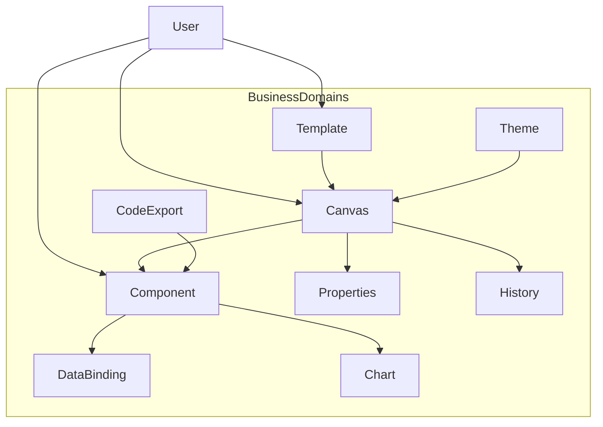

# Glossary | 领域术语表

> Explore Lowcode — Ubiquitous Language（统一语言）

---

## 0. Product naming | 产品命名

| Use | Form | Notes |
| ---- | ---- | ----- |
| Display (EN / UI title) | `Explore Lowcode` | Explore 与 Lowcode 之间空格；禁止 ExploreLowcode / Explore Low-Code / Explore LowCode |
| Repo / npm / clone dir | `explore-lowcode` | 仅小写连字符 |
| Chinese gloss | 低代码 | 英文品牌后可选括注 |
| Technique (not the product) | low-code / 低代码 | 通用技术概念；产品名不用「低代码平台」 |

**中英混排：** 中文与拉丁字母、数字之间保留半角空格，例如：`Explore Lowcode 的架构`。  
**首次出现（中文正文）：** `Explore Lowcode（低代码）`；之后可只写 `Explore Lowcode`。

---

## 1. Purpose | 文档说明

本文定义项目**统一语言**。英文 Preferred Term 为**规范名**，须与代码、架构命名一致。中文标签仅用于本地化与干系人沟通。

### Maintenance Principles

1. **术语表先行**：增改术语先落本文，再改代码
2. **代码同步**：领域模型（实体、值对象、枚举）变更须同步术语表
3. **规范名**：代码、提交与技术文档一律使用 **Preferred Term (English)**

### Reference Rules

| Scenario | Rule |
| -------- | ---- |
| TypeScript / commits | 使用 Preferred Term (English) |
| Jira / user stories | 英文为主；中文可括注 |
| UI copy | 将 Preferred Term 映射为本地化文案 |
| Cross-team communication | 英文先行；必要时补中文 |

---

## 2. Business Domains | 业务域总览

| Preferred Term | 中文 | Code Path | UI Area | Notes |
| -------------- | ---- | --------- | ------- | ----- |
| Canvas | 画布 | `src/canvas/` | 中央编辑区 | 拖放布局、预览、组件树、属性面板 |
| Component | 组件 | `src/component/` | 左栏 + 画布节点 | 类型、工厂、管理、面板 / 渲染器 |
| Properties | 属性配置 | `src/canvas/properties-panel.tsx` | 右栏 | 样式 / 数据 / 交互属性（归属 Canvas） |
| Template | 模板 | `src/template/` | 模板库 | 预制页面布局 |
| Theme | 主题 | `src/theme/` | 主题编辑器 | 色板、字体、CSS 变量 |
| Animation | 动画 | `src/theme/animation-editor.tsx` | 动画编辑器 | 动效预设（归属 Theme） |
| Data Binding | 数据绑定 | `src/data/data-binding.service.ts` | 数据面板 | 组件绑定数据源 |
| Data Source | 数据源 | `src/data/data-source.service.ts` | 数据面板 | 拉取 / 缓存 / 刷新 |
| Form Builder | 表单构建 | `src/form/` | 表单构建器 | React Hook Form + Zod |
| Chart | 图表 | `src/chart/` | 画布图表 | 基于 Recharts 的可视化 |
| Code Export | 代码导出 | `src/export/` | 导出对话框 | 生成可部署前端代码 |
| History | 历史记录 | `src/lib/history.store.ts`, `src/lib/history.ts` | 撤销/重做 | 操作历史 |
| Persistence | 持久化 | `src/lib/persistence.manager.ts` | LocalStorage | 浏览器本地项目状态 |
| Collaboration | 协作 | `src/collaboration/` | 协作 UI | 规划中 / 部分实时同步 |
| Shared UI | 共享 UI | `src/components/` | — | UI kit + shell |
| Shared hooks | 共享 hooks | `src/hooks/` | — | 跨域 hooks |
| Shared lib | 共享工具 | `src/lib/` | — | utils、持久化、历史 |

**架构（规范）：业务域目录 + 就近放置**

| Area | Path | Responsibility |
| ---- | ---- | -------------- |
| Business domains | `src/{domain}/` | UI、store、hooks、helpers 同域放置（无 CA 分层目录） |
| Components | `src/components/` | 共享可复用 UI |
| Hooks | `src/hooks/` | 共享 hooks |
| Lib | `src/lib/` | 共享非 UI 工具 |

---

## 3. Core Terms | 核心术语

| Preferred Term | 中文 | Definition | Code Anchors |
| -------------- | ---- | ---------- | ------------ |
| Component Instance | 组件实例 | 画布上的已放置节点：类型、属性、位置 | `src/component/types.ts` |
| Component Factory | 组件工厂 | 按类型创建带默认值的组件实例 | `src/component/component-factory.service.ts` |
| Component Management | 组件管理 | 对实例的 CRUD / 移动 / 选中 | `src/component/component-management.service.ts` |
| Component Panel | 组件面板 | 可拖拽组件类型调色板 | `src/component/component-panel.tsx` |
| Component Tree | 组件树 | 画布实例的层级视图 | `src/canvas/component-tree.tsx` |
| Component Renderer | 组件渲染器 | 递归渲染布局 / 数据 / 图表 / 表单节点 | `src/component/component-renderer/` |
| Preview Canvas | 预览画布 | 只读渲染设计页 | `src/canvas/preview-canvas.tsx` |
| Device Preview | 设备预览 | 响应式视口模拟（desktop/tablet/mobile） | `src/canvas/canvas.store.ts` |
| Custom Component | 自定义组件 | 用户定义的可复用组件 | `src/component/custom-components.store.ts` |
| Template Gallery | 模板库 | 浏览并应用页面模板 | `src/template/template-gallery.tsx` |
| Theme Config | 主题配置 | 颜色、字体、圆角等 token 集 | `src/theme/types.ts` / `theme.store.ts` |
| Undo / Redo | 撤销 / 重做 | 遍历画布变更历史栈 | `history.store` |
| Local Persistence | 本地持久化 | 在 LocalStorage 读写编辑器状态 | `persistence.manager.ts` |

---

## 4. Terms to Avoid | 避免使用的说法

| Avoid | Prefer | Reason |
| ----- | ------ | ------ |
| Page Builder（作域名） | Canvas + Component | 与包名 / UI 命名一致 |
| Widget（歧义） | Component Instance | 用明确的实例术语 |
| Store（单独出现） | 具名 store（`ComponentStore` 等） | 区分 Zustand 模块 |
| Backend / API（指核心编辑器） | Local Persistence | 编辑器为客户端；当前无自有 REST API |

---

## 5. Related Living Docs | 关联文档

| Document | Path |
| -------- | ---- |
| C4 Model | [c4-model/README.md](./c4-model/README.md) |
| User Story Map | [User-Story-Map.md](./User-Story-Map.md) |
