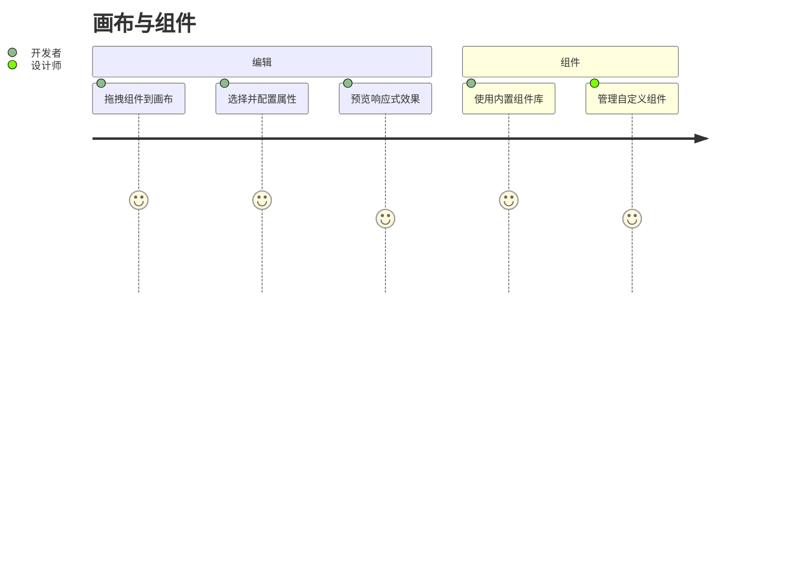
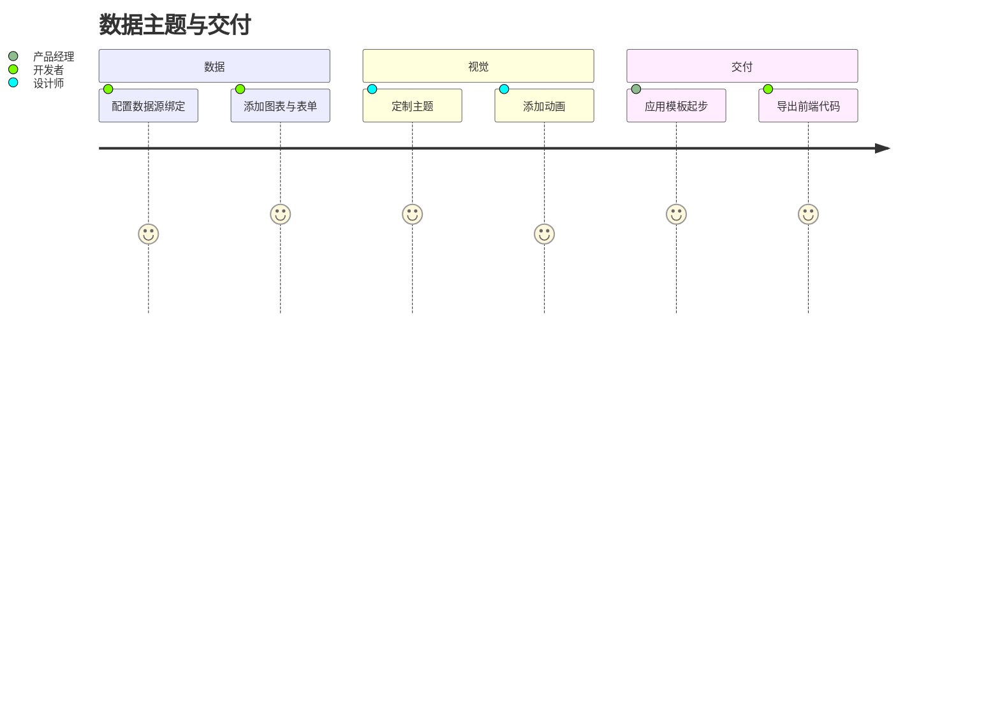

# 用户故事地图 | User Story Map — Explore Low-Code
> Jeff Patton 用户故事地图；正文与验收标准合并于本文（单一文档）。  
> Jeff Patton user-story map; epics and GWT acceptance criteria live in this single document.  
> 格式 / Format：Background → `As a` / `I want` / `So that` → Scenario GIVEN-WHEN-THEN（双语 / bilingual）。

## 用户画像 | Personas

| 角色 / Role | 说明 / Description |
|------|------|
| 开发者 / Developer | 拖拽构建页面、绑定数据、导出可部署代码 / Drag-builds pages, binds data, exports deployable code |
| 设计师 / Designer | 定制主题、动画、模板与可复用组件外观 / Customizes themes, animation, templates, and reusable component look |
| 产品经理 / Product Manager | 用模板快速搭原型并评审交互 / Prototypes quickly with templates and reviews interactions |
| 协作者 / Collaborator | 多人同时编辑同一页面（规划） / Edits the same page concurrently (planned) |
| 平台管理员 / Platform Admin | 管理组件库与权限（规划） / Manages component library and permissions (planned) |

## 旅程总览 | Journey Overview

### 画布编辑与组件

### 数据、主题与交付

---

## Backbone 故事地图 | Backbone

### 已交付

| 画布编辑 | 组件库 | 数据与图表 | 主题与动画 | 模板与导出 |
|----------|--------|------------|------------|------------|
| [US-01](#us-01-拖拽构建页面) 拖拽构建 | [US-04](#us-04-内置组件库) 内置组件 | [US-07](#us-07-数据源与绑定) 数据绑定 | [US-10](#us-10-主题编辑) 主题 | [US-12](#us-12-模板库) 模板库 |
| [US-02](#us-02-属性配置) 属性配置 | [US-05](#us-05-自定义组件) 自定义组件 | [US-08](#us-08-图表组件) 图表 | [US-11](#us-11-动画编辑) 动画 | [US-13](#us-13-代码导出) 代码导出 |
| [US-03](#us-03-预览与撤销重做) 预览/撤销 | [US-06](#us-06-组件分组与树) 分组与树 | [US-09](#us-09-表单构建器) 表单 | | |

### 进行中 / 规划中

| 协作与平台 |
|------------|
| [US-14](#us-14-实时协作编辑) 实时协作 |
| [US-15](#us-15-项目版本管理) 版本管理 |
| [US-16](#us-16-数据库连接) 数据库连接 |
| [US-17](#us-17-移动端组件库) 移动端组件 |

---

## Epic 索引 | Epic Index

| Epic | 锚点 / Anchor | 状态 / Status |
|------|---------------|---------------|
| E1 画布与可视化编辑 | [#e1](#e1) | — |
| E2 组件库 | [#e2](#e2) | — |
| E3 数据、图表与表单 | [#e3](#e3) | — |
| E4 主题与动画 | [#e4](#e4) | — |
| E5 模板与代码导出 | [#e5](#e5) | — |
| E6 协作与后续能力 | [#e6](#e6) | — |

---

## 关联文档

- [Glossary](../Glossary.md)
- [C4 Model](../c4-model/README.md)

---

# 用户故事正文 | User Stories

## E1 画布与可视化编辑 / canvas and visual editing

### 背景 | Background

开发者在中央画布拖放组件，经属性面板配置外观与行为，并支持预览与撤销/重做。 / Developer drags and drops components in the central canvas, configures appearances and behaviors through the attribute panel and supports preview and undo/Redo.

### US-01 拖拽构建页面 / Drag to build page

**As a** 开发者 / Developer  
**I want** 从组件面板拖拽组件到画布 / Drag component from the component panel to canvas  
**So that** 可视化搭建页面布局 / Visualise Page Layout

#### 验收标准 | Acceptance Criteria

1. **Scenario** 拖拽放置组件 / Drag and Drop Component  
   **GIVEN** 编辑器已打开且组件面板可见 / Editor opened and component panel visible  
   **WHEN** 将某组件类型拖到画布有效区域并放下 / Drag a component type to a canvas valid area and put it Down  
   **THEN** 画布出现对应组件实例 / Examples of matching components appearing in canvass  
   **AND** 该实例处于选中态或可立即选中 / The instance is in the selected state or can be immediately selected  

2. **Scenario** 无效放置不破坏画布 / Invalid placement of non-destructible canvas  
   **GIVEN** 正在拖拽组件 / Draging component  
   **WHEN** 在画布外取消或放置失败 / Failed to cancel or place outside the canvas  
   **THEN** 画布既有组件结构不变 / The canvas has the same component structure.  

#### 状态 | Status

已实现 / Done

---

### US-02 属性配置 / Properties Configuration

**As a** 开发者 / Developer  
**I want** 在右侧属性面板编辑选中组件的属性 / Edit properties of selected components in the right property panel  
**So that** 调整样式、文案与交互而无需改代码 / Adjust styles, scripts and interactions without changing codes

#### 验收标准 | Acceptance Criteria

1. **Scenario** 选中后展示属性 / Show Properties After Selection  
   **GIVEN** 画布上至少有一个组件实例 / There's at least one example of a component on the canvas.  
   **WHEN** 点击选中该实例 / Click to select the instance  
   **THEN** 属性面板展示该组件可编辑属性 / Properties panel displays the component editable properties  

2. **Scenario** 修改立即反映 / Changes reflect immediately  
   **GIVEN** 已选中组件且属性面板已打开 / Selected component and attribute panel opened  
   **WHEN** 修改某一属性值 / Modify a attribute value  
   **THEN** 画布上该组件呈现随之更新 / This part is updated on the canvas.  

#### 状态 | Status

已实现 / Done

---

### US-03 预览与撤销重做 / Preview and Undo

**As a** 开发者 / Developer  
**I want** 预览最终效果并撤销/重做误操作 / Preview final effect and undo/Redo error  
**So that** 安全迭代设计 / Security iterative design

#### 验收标准 | Acceptance Criteria

1. **Scenario** 进入预览模式 / Enter Preview Mode  
   **GIVEN** 画布上已有若干组件 / There are several components on the canvas.  
   **WHEN** 切换到预览 / Switch to Preview  
   **THEN** 以接近最终页面的方式展示内容 / Show content by approaching the final page  
   **AND** 编辑拖拽不再改变布局（或按产品定义禁用编辑） / Edit drag does not change layout (or disable editing by product definition))  

2. **Scenario** 撤销与重做 / Undo and Redo  
   **GIVEN** 刚完成一次改变画布的操作 / Just finished a canvas change operation  
   **WHEN** 执行撤销 / Execute Undo  
   **THEN** 画布恢复到该操作之前的状态 / Revert the canvas to the state before the operation  
   **AND** 重做可再次应用该操作 / Redo to apply the operation again  

#### 状态 | Status

已实现 / Done

---

## E2 组件库 / Component Library

### 背景 | Background

平台提供内置 UI/布局/图表等组件，并支持自定义组件与层级化组件树管理。 / Platform provides built-in UI/Layout/Chart components, etc., and support custom and hierarchical component tree management.

### US-04 内置组件库 / Internal Component Library

**As a** 开发者 / Developer  
**I want** 从分组的内置组件库中选择常用组件 / Select a common component from a grouped built-in repository  
**So that** 无需从零实现基础 UI / There's no need to get the base from zero. UI

#### 验收标准 | Acceptance Criteria

1. **Scenario** 浏览内置组件 / Browse for built-in components  
   **GIVEN** 已打开编辑器 / Opened Editor  
   **WHEN** 查看左侧组件面板 / View left assembly panel  
   **THEN** 可见分类后的内置组件（如按钮、布局、图表等） / Visible internal components after classification (e.g. buttons, layout, charts, etc.))  

2. **Scenario** 使用内置组件 / Use built-in components  
   **GIVEN** 组件面板已展示某内置组件 / Component panel has shown a built-in component  
   **WHEN** 将其放到画布 / Put it on the canvas.  
   **THEN** 渲染为该类型的默认实例 / Render as the default instance for this type  

#### 状态 | Status

已实现 / Done

---

### US-05 自定义组件 / Custom Component

**As a** 设计师 / Designer  
**I want** 创建和管理自定义组件 / Create and manage custom components  
**So that** 团队可复用业务特定 UI / Group-specific business UI

#### 验收标准 | Acceptance Criteria

1. **Scenario** 注册自定义组件 / Register Custom Component  
   **GIVEN** 具备自定义组件能力入口 / Custom component capability portal  
   **WHEN** 创建或导入自定义组件定义 / Create or import custom component definitions  
   **THEN** 该组件出现在可选用列表中 / The component appears in the optional list Medium  

2. **Scenario** 复用自定义组件 / Reuse Custom Component  
   **GIVEN** 自定义组件已存在于列表 / Custom component already exists in the list  
   **WHEN** 将其放到画布 / Put it on the canvas.  
   **THEN** 画布出现基于该定义的实例 / There are examples of canvass based on this definition  

#### 状态 | Status

已实现 / Done

---

### US-06 组件分组与树 / Component Group and Tree

**As a** 开发者 / Developer  
**I want** 通过组件树查看层级并组织组件 / View the hierarchy and organize the components through the component tree  
**So that** 快速定位与调整复杂页面结构 / Quick positioning and adjusting complex page structures

#### 验收标准 | Acceptance Criteria

1. **Scenario** 查看组件树 / View Component Tree  
   **GIVEN** 画布上存在嵌套或并列组件 / There are nested or parallel components on the canvas  
   **WHEN** 打开组件树视图 / Open component tree view  
   **THEN** 展示与画布一致的层级结构 / Show hierarchy consistent with canvas  

2. **Scenario** 从树选中组件 / Select Component From Tree  
   **GIVEN** 组件树已展示 / Component tree displayed  
   **WHEN** 点击树中某一节点 / Click on a node in a tree  
   **THEN** 画布选中对应实例且属性面板同步 / The canvas selects the corresponding instance and the attribute panel syncs  

#### 状态 | Status

已实现 / Done

---

## E3 数据、图表与表单 / Data, charts and forms

### 背景 | Background

开发者经数据面板管理数据源与绑定，用图表展示数据，并用表单构建器搭建采集界面。 / Developer manages data sources and binds through data panels, displays data in graphs and builds the collection community with form builders Noodles..

### US-07 数据源与绑定 / Data sources and binding

**As a** 开发者 / Developer  
**I want** 配置数据源并将字段绑定到组件 / Configure data sources and bind fields to components  
**So that** 页面可展示动态数据 / Pages to display dynamic data

#### 验收标准 | Acceptance Criteria

1. **Scenario** 管理数据源 / Manage data sources  
   **GIVEN** 已打开数据相关面板 / Opened Data Related Panel  
   **WHEN** 新增或选择数据源 / Add or select data sources  
   **THEN** 该数据源可被后续绑定引用 / This data source can be followed up with references  

2. **Scenario** 绑定到组件 / Bind to component  
   **GIVEN** 已存在数据源与可选中组件 / Existing data sources and selected components  
   **WHEN** 为组件配置数据绑定 / Tie component configuration data  
   **THEN** 组件按绑定规则展示或更新数据 / Component displays or updates data according to binding rules  

#### 状态 | Status

已实现 / Done

---

### US-08 图表组件 / Chart Component

**As a** 开发者 / Developer  
**I want** 在画布上使用柱状图、折线图、饼图等图表 / Use columns, circuits, pies, etc. on canvass  
**So that** 可视化展示指标 / Visual display indicator

#### 验收标准 | Acceptance Criteria

1. **Scenario** 添加图表 / Add Chart  
   **GIVEN** 组件面板包含图表类型 / Component Panel contains chart type  
   **WHEN** 将图表放到画布 / Place charts on canvas  
   **THEN** 显示默认或绑定数据后的图表 / Show charts after default or binding data  

2. **Scenario** 切换图表类型/配置 / Toggle Chart Type/Configure  
   **GIVEN** 画布上已有图表实例 / There are examples of diagrams on the canvas  
   **WHEN** 在属性中调整图表配置 / Adjust Chart Configuration in Properties  
   **THEN** 图表呈现按配置更新 / Chart presented for configuration update  

#### 状态 | Status

已实现 / Done

---

### US-09 表单构建器 / Form Builder

**As a** 开发者 / Developer  
**I want** 用表单构建器组装带校验的表单 / Compile check-checked forms with form builders  
**So that** 快速创建数据收集页面 / Quick creation of data collection page

#### 验收标准 | Acceptance Criteria

1. **Scenario** 组装表单字段 / Organise Table Fields  
   **GIVEN** 已打开表单构建能力 / Form build capability opened  
   **WHEN** 添加输入字段并配置标签/校验 / Add input fields and configure labels/Verify  
   **THEN** 画布或预览中呈现对应表单项 / Show corresponding table entries in canvas or preview  

2. **Scenario** 校验规则生效 / Validation rules in effect  
   **GIVEN** 字段已配置必填或格式校验 / Fields configured for filling or format verification  
   **WHEN** 在预览中提交非法值 / Submit invalid value in preview  
   **THEN** 展示校验反馈并阻止无效提交 / Show verified feedback and prevent invalid submission  

#### 状态 | Status

已实现 / Done

---

## E4 主题与动画 / Theme and Animation

### 背景 | Background

设计师经主题编辑器统一视觉 token，经动画编辑器为组件增加动效。 / Designer unified vision by subject editor token, Animated editor adds animation to components.

### US-10 主题编辑 / Theme Editor

**As a** 设计师 / Designer  
**I want** 可视化调整主题色、字体等 token / Visualize theme colour, font, etc. token  
**So that** 页面整体风格一致且符合品牌 / The page is consistent and consistent with the brand

#### 验收标准 | Acceptance Criteria

1. **Scenario** 打开主题编辑器 / Open Theme Editor  
   **GIVEN** 处于编辑器 / In Editor  
   **WHEN** 打开主题编辑入口 / Open Theme Edit Entry  
   **THEN** 可编辑主题相关配置项 / Editable Theme Related Profiles  

2. **Scenario** 主题应用到画布 / Theme to canvas  
   **GIVEN** 已修改主题配置 / Theme Configuration modified  
   **WHEN** 保存或即时应用 / Save or Immediate Apply  
   **THEN** 画布上受主题影响的组件外观更新 / Appearance update of thematically affected components on canvas  

#### 状态 | Status

已实现 / Done

---

### US-11 动画编辑 / Animated Editor

**As a** 设计师 / Designer  
**I want** 为选中组件配置动画效果 / Configure animation effects for selected components  
**So that** 交互与展示更具表现力 / Interaction and presentation to be more representative

#### 验收标准 | Acceptance Criteria

1. **Scenario** 为组件添加动画 / Add animation to components  
   **GIVEN** 已选中画布组件 / A canvas component has been selected  
   **WHEN** 在动画编辑器中选择或配置动画 / Select or Configure Animations in Animation Editor  
   **THEN** 该组件关联对应动画配置 / The component relates to the animation configuration  

2. **Scenario** 预览动画 / Preview Animations  
   **GIVEN** 组件已配置动画 / Component configured animated  
   **WHEN** 预览页面或触发动画预览 / Preview page or trigger animation preview  
   **THEN** 可观察到动画效果 / Animation effects observed  

#### 状态 | Status

已实现 / Done

---

## E5 模板与代码导出 / Templates and Code Export

### 背景 | Background

产品经理与开发者从模板库快速起步，并将设计导出为可部署的前端代码。 / Product Manager and developer fast start from template library and export design to deployable front-end code.

### US-12 模板库 / Template Library

**As a** 产品经理 / Product Manager  
**I want** 浏览并应用预制页面模板 / Browse and apply prefabricated page templates  
**So that** 快速得到可演示的原型 / Quick access to demonstrationable prototypes

#### 验收标准 | Acceptance Criteria

1. **Scenario** 浏览模板 / Browse Templates  
   **GIVEN** 已打开模板库 / Template library opened  
   **WHEN** 页面加载完成 / Page Load Finished  
   **THEN** 展示可用模板列表（含预览信息） / Show list of available templates (including preview information))  

2. **Scenario** 应用模板 / Apply Templates  
   **GIVEN** 已选择某一模板 / Selection of a template  
   **WHEN** 确认应用 / Confirm application  
   **THEN** 画布加载该模板对应的组件结构 / Paint cloth to load the corresponding component structure of the template  

#### 状态 | Status

已实现 / Done

---

### US-13 代码导出 / Code Export

**As a** 开发者 / Developer  
**I want** 将当前设计导出为前端代码 / Export current design to frontend code  
**So that** 可在真实项目中继续开发或部署 / Development or deployment could continue in real projects

#### 验收标准 | Acceptance Criteria

1. **Scenario** 触发导出 / Trigger Export  
   **GIVEN** 画布上已有可导出的组件树 / There are exportable component trees on the canvas  
   **WHEN** 打开代码导出并执行导出 / Open code export and execute export  
   **THEN** 生成可下载或可复制的代码产物 / Generate downloadable or replicable code products  

2. **Scenario** 导出内容可用 / Export content is available  
   **GIVEN** 导出已完成 / Export completed  
   **WHEN** 查看导出结果 / View Export Results  
   **THEN** 结果包含与当前设计对应的结构/样式信息（按导出格式） / Results include structures corresponding to current design/Style Information (by Export Format))  

#### 状态 | Status

已实现 / Done

---

## E6 协作与后续能力 / Collaboration and follow-up capacity

### 背景 | Background

规划多人协作、项目版本、外部数据库连接与移动端组件等能力，将平台从单机编辑扩展到团队与生产落地。 / Planning capacity for multi-person collaboration, project version, external database connectivity and mobile end-end components to expand the platform from single-phone editing to team and production Land.

### US-14 实时协作编辑 / Real-time collaborative editing

**As a** 协作者 / Collaborator  
**I want** 与他人同时编辑同一页面并看到对方变更 / Edit the same page at the same time as others and see changes in each other  
**So that** 团队可并行完成设计 / The team can complete the design in parallel.

#### 验收标准 | Acceptance Criteria

1. **Scenario** 多用户同时在线 / Multiple users online simultaneously  
   **GIVEN** 两名用户打开同一项目 / Two users open the same item  
   **WHEN** 一方修改画布组件 / One side modify canvas components  
   **THEN** 另一方在合理延迟内看到同步更新 / The other side sees synchronized updates within reasonable delay  

2. **Scenario** 冲突可感知 / Conflict can be felt.  
   **GIVEN** 两名用户编辑同一组件 / Two users edit the same component  
   **WHEN** 发生冲突或覆盖 / Conflict or coverage  
   **THEN** 系统提供可见提示或合并策略 / System provides visible hints or merge policies  

#### 状态 | Status

规划中 / Planned

---

### US-15 项目版本管理 / Project version management

**As a** 开发者 / Developer  
**I want** 保存项目版本并回滚 / Save project version and roll back  
**So that** 安全迭代重大改动 / Significant change in security overlap

#### 验收标准 | Acceptance Criteria

1. **Scenario** 创建版本快照 / Create Version Snapshot  
   **GIVEN** 已完成一轮编辑 / Completed round of editing  
   **WHEN** 创建版本 / Create Version  
   **THEN** 系统保存可命名的版本记录 / System to keep named version records  

2. **Scenario** 回滚到历史版本 / Rollback to History Version  
   **GIVEN** 至少存在一个历史版本 / At least one historical version exists.  
   **WHEN** 选择回滚 / Choose Rollback  
   **THEN** 画布恢复为该版本状态 / The canvas reverts to the status of this version  

#### 状态 | Status

规划中 / Planned

---

### US-16 数据库连接 / Database Connections

**As a** 开发者 / Developer  
**I want** 连接外部数据库作为数据源 / Connect external databases as data sources  
**So that** 页面可直接使用业务数据 / Pages directly using operational data

#### 验收标准 | Acceptance Criteria

1. **Scenario** 配置数据库连接 / Configure database connections  
   **GIVEN** 已打开数据源配置 / Opened Data Source Configuration  
   **WHEN** 填写并验证数据库连接信息 / Fill in and validate database connection information  
   **THEN** 连接成功并可列出可用资源（表/查询） / Successful connections and availability of resources (tables)/Question)  

2. **Scenario** 绑定查询结果 / must use  
   **GIVEN** 数据库连接可用 / Database connection available  
   **WHEN** 将查询结果绑定到组件 / Tie query results to component  
   **THEN** 组件展示来自该查询的数据 / Component displays data from the query  

#### 状态 | Status

规划中 / Planned

---

### US-17 移动端组件库 / Mobile assembly library

**As a** 设计师 / Designer  
**I want** 使用面向移动端的组件集 / Use mobile component sets  
**So that** 可设计适配手机的页面 / Designable pages for suitable mobile phones

#### 验收标准 | Acceptance Criteria

1. **Scenario** 移动端组件可见 / Mobile component visible  
   **GIVEN** 产品已提供移动端组件分类 / Product has provided a mobile component classification  
   **WHEN** 查看组件面板 / View Component Panel  
   **THEN** 可见移动端专用或适配组件 / Visible mobile-end special or fit components  

2. **Scenario** 移动预览 / Move Preview  
   **GIVEN** 画布使用移动端组件或设备预览为手机 / The canvas is previewed as a mobile phone using a mobile end component or device  
   **WHEN** 预览 / Preview  
   **THEN** 布局按移动视口合理展示 / The layout will be displayed by moving view.  

#### 状态 | Status

规划中 / Planned

---

## 参考 | References

- [Glossary](./Glossary.md)
- [C4](./c4-model/)

