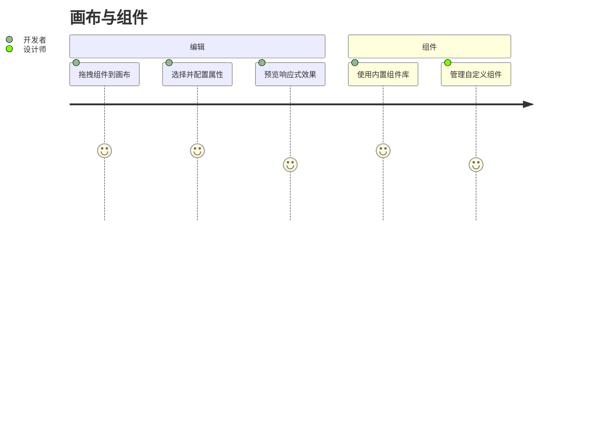
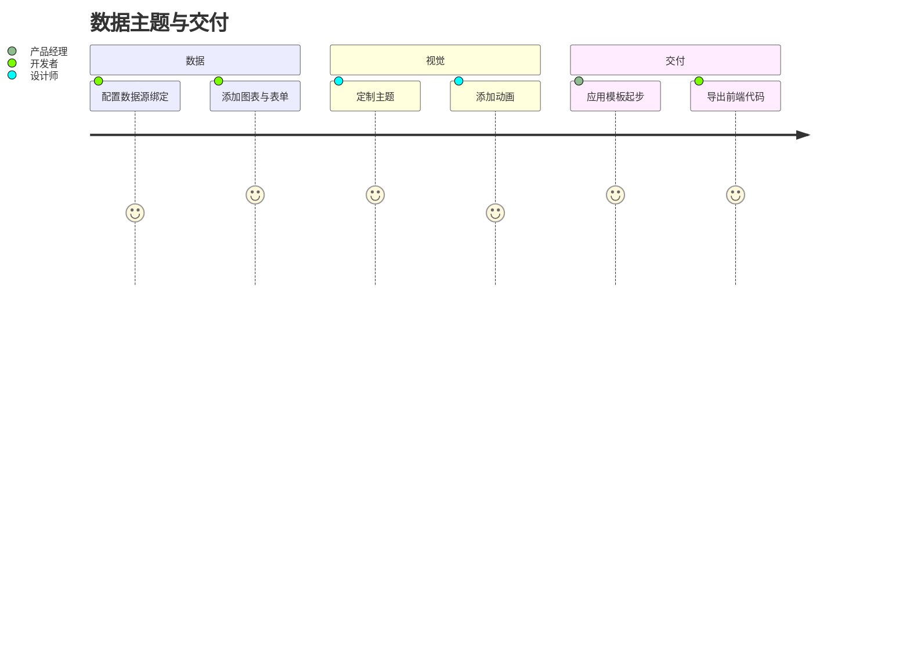

# 用户故事地图 | User Story Map — Explore Low-Code
> Jeff Patton 用户故事地图；正文与验收标准合并于本文（单一文档）。  
> Jeff Patton user-story map; epics and GWT acceptance criteria live in this single document.  
> 格式 / Format：Background → `As a` / `I want` / `So that` → Scenario GIVEN-WHEN-THEN（双语 / bilingual）。

## 用户画像 | Personas

| 角色 / Role | 说明 / Description |
|------|------|
| 开发者 / Developer | 拖拽构建页面、绑定数据、导出可部署代码 / Drag-builds pages, binds data, exports deployable code |
| 设计师 / Designer | 定制主题、动画、模板与可复用组件外观 / Customizes themes, animation, templates, and reusable component look |
| 产品经理 / Product Manager | 用模板快速搭原型并评审交互 / Prototypes quickly with templates and reviews interactions |
| 协作者 / Collaborator | 多人同时编辑同一页面（规划） / Edits the same page concurrently (planned) |
| 平台管理员 / Platform Admin | 管理组件库与权限（规划） / Manages component library and permissions (planned) |

## 旅程总览 | Journey Overview

### 画布编辑与组件

### 数据、主题与交付

---

## Backbone 故事地图 | Backbone

### 已交付

| 画布编辑 | 组件库 | 数据与图表 | 主题与动画 | 模板与导出 |
|----------|--------|------------|------------|------------|
| [US-01](#us-01-拖拽构建页面) 拖拽构建 | [US-04](#us-04-内置组件库) 内置组件 | [US-07](#us-07-数据源与绑定) 数据绑定 | [US-10](#us-10-主题编辑) 主题 | [US-12](#us-12-模板库) 模板库 |
| [US-02](#us-02-属性配置) 属性配置 | [US-05](#us-05-自定义组件) 自定义组件 | [US-08](#us-08-图表组件) 图表 | [US-11](#us-11-动画编辑) 动画 | [US-13](#us-13-代码导出) 代码导出 |
| [US-03](#us-03-预览与撤销重做) 预览/撤销 | [US-06](#us-06-组件分组与树) 分组与树 | [US-09](#us-09-表单构建器) 表单 | | |

### 进行中 / 规划中

| 协作与平台 |
|------------|
| [US-14](#us-14-实时协作编辑) 实时协作 |
| [US-15](#us-15-项目版本管理) 版本管理 |
| [US-16](#us-16-数据库连接) 数据库连接 |
| [US-17](#us-17-移动端组件库) 移动端组件 |

---

## Epic 索引 | Epic Index

| Epic | 锚点 / Anchor | 状态 / Status |
|------|---------------|---------------|
| E1 画布与可视化编辑 | [#e1](#e1) | — |
| E2 组件库 | [#e2](#e2) | — |
| E3 数据、图表与表单 | [#e3](#e3) | — |
| E4 主题与动画 | [#e4](#e4) | — |
| E5 模板与代码导出 | [#e5](#e5) | — |
| E6 协作与后续能力 | [#e6](#e6) | — |

---

## 关联文档

- [Glossary](../Glossary.md)
- [C4 Model](../c4-model/README.md)

---

# 用户故事正文 | User Stories

## E1 画布与可视化编辑 / Canvas & Visual Editing

### 背景 | Background

业务与开发团队希望通过可视化编辑快速搭建页面。缺少顺手的画布与属性配置会拖慢原型与交付节奏。 / Teams want fast visual page building. Without a smooth canvas and property panel, prototypes and delivery slow down.

### US-01 拖拽搭建页面布局 / Build Page Layout by Drag and Drop

**As a** 开发者 / Developer  
**I want** 从组件面板将组件拖到画布上 / Drag components from the palette onto the canvas  
**So that** 无需写代码即可可视化搭建页面结构 / Visually structure pages without writing code

#### 验收标准 | Acceptance Criteria

1. **Scenario** 拖放组件到画布 / Drop component on canvas  
   **GIVEN** 编辑器已打开且组件面板可见 / Editor is open with palette visible  
   **WHEN** 将组件拖到画布有效区域并放下 / User drops a component in a valid drop zone  
   **THEN** 画布上出现该组件实例 / Component instance appears on canvas  
   **AND** 实例处于选中或可立即选中状态 / Instance is selected or ready to select  

2. **Scenario** 无效放置不破坏画布 / Invalid drop leaves canvas intact  
   **GIVEN** 用户正在拖拽组件 / User is dragging a component  
   **WHEN** 在画布外取消或放置失败 / Drop is cancelled or outside canvas  
   **THEN** 画布既有结构保持不变 / Existing canvas structure is unchanged  

#### 状态 | Status

已交付 / Delivered

---

### US-02 在属性面板配置组件 / Configure Components in the Property Panel

**As a** 开发者 / Developer  
**I want** 在右侧属性面板编辑选中组件的属性 / Edit selected component properties in the right panel  
**So that** 可调整样式、文案与交互而无需改代码 / Adjust look, copy, and interaction without code changes

#### 验收标准 | Acceptance Criteria

1. **Scenario** 选中后展示可编辑属性 / Show editable properties on select  
   **GIVEN** 画布上至少有一个组件 / At least one component on canvas  
   **WHEN** 用户选中该组件 / User selects the component  
   **THEN** 属性面板展示可编辑属性项 / Property panel lists editable properties  

2. **Scenario** 修改即时反映在画布 / Changes reflect immediately  
   **GIVEN** 已选中组件且属性面板打开 / Component selected and panel open  
   **WHEN** 用户修改某一属性值 / User changes a property value  
   **THEN** 画布上该组件呈现立即更新 / Canvas preview updates immediately  

#### 状态 | Status

已交付 / Delivered

---

### US-03 预览效果并撤销误操作 / Preview and Undo Mistakes

**As a** 开发者 / Developer  
**I want** 预览接近最终效果，并支持撤销与重做 / Preview near-final output and undo or redo edits  
**So that** 可安心迭代设计而不怕无法回退 / Iterate design safely with rollback

#### 验收标准 | Acceptance Criteria

1. **Scenario** 进入预览模式 / Enter preview mode  
   **GIVEN** 画布上已有若干组件 / Canvas has components  
   **WHEN** 用户切换到预览 / User switches to preview  
   **THEN** 以接近最终页面的方式展示 / Content renders like the final page  
   **AND** 预览中不再误改布局（或按产品定义锁定编辑） / Layout editing is disabled in preview per product rules  

2. **Scenario** 撤销与重做 / Undo and redo  
   **GIVEN** 用户刚完成一次画布变更 / User just changed the canvas  
   **WHEN** 执行撤销后再执行重做 / User undoes then redoes  
   **THEN** 画布先恢复变更前状态再重新应用变更 / Canvas reverts then reapplies the change  
   **AND** 重做可再次应用该操作 / Redo to apply the operation again  

#### 状态 | Status

已交付 / Delivered

---

## E2 组件库 / Component Library

### 背景 | Background

团队需要可复用的组件资产加速页面搭建。只有零散控件会增加重复劳动与体验不一致。 / Teams need reusable component assets. Ad-hoc widgets increase duplicate work and inconsistent UX.

### US-04 使用内置组件库 / Use the Built-In Component Library

**As a** 开发者 / Developer  
**I want** 从分组内置库中选择常用 UI、布局与图表组件 / Pick common UI, layout, and chart components from grouped built-ins  
**So that** 不必从零实现基础界面元素 / Avoid rebuilding basic UI from scratch

#### 验收标准 | Acceptance Criteria

1. **Scenario** 浏览内置组件分类 / Browse built-in categories  
   **GIVEN** 编辑器已打开 / Editor is open  
   **WHEN** 查看左侧组件面板 / User opens the component palette  
   **THEN** 可见分类后的按钮、布局、图表等组件 / Categorized buttons, layouts, charts are visible  

2. **Scenario** 拖入内置组件 / Use a built-in component  
   **GIVEN** 面板展示某内置组件 / A built-in component is listed  
   **WHEN** 将其拖到画布 / User drops it on canvas  
   **THEN** 画布渲染该类型的默认实例 / Default instance of that type renders  

#### 状态 | Status

已交付 / Delivered

---

### US-05 创建并复用自定义组件 / Create and Reuse Custom Components

**As a** 设计师 / Designer  
**I want** 创建、导入并管理自定义组件 / Create, import, and manage custom components  
**So that** 团队可复用业务专属界面模式 / The team reuses business-specific UI patterns

#### 验收标准 | Acceptance Criteria

1. **Scenario** 注册自定义组件 / Register custom component  
   **GIVEN** 用户可访问自定义组件入口 / Custom component entry is available  
   **WHEN** 创建或导入组件定义 / User creates or imports a definition  
   **THEN** 组件出现在可选用列表中 / Component appears in the palette  

2. **Scenario** 复用自定义组件 / Reuse on canvas  
   **GIVEN** 自定义组件已在库中 / Custom component exists in library  
   **WHEN** 拖到画布 / User drops it on canvas  
   **THEN** 画布出现基于该定义的实例 / Instance from definition appears on canvas  

#### 状态 | Status

已交付 / Delivered

---

### US-06 用组件树管理层级结构 / Manage Hierarchy with the Component Tree

**As a** 开发者 / Developer  
**I want** 在组件树中查看并选中嵌套组件 / View and select nested components in the tree  
**So that** 复杂页面结构易于定位与调整 / Complex pages are easy to navigate and restructure

#### 验收标准 | Acceptance Criteria

1. **Scenario** 组件树与画布一致 / Tree matches canvas  
   **GIVEN** 画布存在嵌套或并列组件 / Canvas has nested or sibling components  
   **WHEN** 打开组件树 / User opens component tree  
   **THEN** 树结构与画布层级一致 / Tree hierarchy matches canvas  

2. **Scenario** 从树选中同步属性面板 / Select from tree  
   **GIVEN** 组件树已展示 / Component tree is visible  
   **WHEN** 点击树中节点 / User clicks a tree node  
   **THEN** 画布选中对应实例且属性面板同步 / Canvas and property panel sync to selection  

#### 状态 | Status

已交付 / Delivered

---

## E3 数据、图表与表单 / Data, Charts & Forms

### 背景 | Background

业务页面需要展示动态数据与采集表单。手工接线数据源费时且易错。 / Business pages need dynamic data and forms. Manual data wiring is slow and error-prone.

### US-07 配置数据源并绑定到组件 / Configure Data Sources and Bindings

**As a** 开发者 / Developer  
**I want** 管理数据源并将字段绑定到组件 / Manage data sources and bind fields to components  
**So that** 页面展示与更新真实业务数据 / Pages show and refresh live business data

#### 验收标准 | Acceptance Criteria

1. **Scenario** 管理数据源 / Manage data sources  
   **GIVEN** 数据面板已打开 / Data panel is open  
   **WHEN** 新增或选择数据源 / User adds or selects a data source  
   **THEN** 该数据源可供后续绑定使用 / Data source is available for binding  

2. **Scenario** 绑定到组件 / Bind to component  
   **GIVEN** 存在数据源与目标组件 / Data source and component exist  
   **WHEN** 为组件配置数据绑定 / User configures binding  
   **THEN** 组件按规则展示或刷新数据 / Component displays or updates per binding rules  

#### 状态 | Status

已交付 / Delivered

---

### US-08 用图表可视化指标 / Visualize Metrics with Charts

**As a** 开发者 / Developer  
**I want** 在画布上使用柱状图、折线图、饼图等图表组件 / Add bar, line, pie, and other chart types on the canvas  
**So that** 关键指标一目了然，便于决策沟通 / Metrics are visible for better decisions

#### 验收标准 | Acceptance Criteria

1. **Scenario** 添加图表组件 / Add a chart  
   **GIVEN** 组件面板包含图表类型 / Chart types are in the palette  
   **WHEN** 将图表放到画布 / User places chart on canvas  
   **THEN** 显示默认或绑定后的图表 / Chart renders with default or bound data  

2. **Scenario** 调整图表配置 / Configure chart  
   **GIVEN** 画布上已有图表 / Chart instance exists  
   **WHEN** 在属性中调整图表设置 / User changes chart settings  
   **THEN** 图表呈现按新配置更新 / Chart updates to match settings  

#### 状态 | Status

已交付 / Delivered

---

### US-09 用表单构建器采集数据 / Build Data Collection Forms

**As a** 开发者 / Developer  
**I want** 用表单构建器组装带校验的表单 / Assemble forms with validation in the form builder  
**So that** 快速上线数据采集页面并保证输入质量 / Ship data collection pages with validated input

#### 验收标准 | Acceptance Criteria

1. **Scenario** 组装表单字段 / Assemble form fields  
   **GIVEN** 表单构建能力已打开 / Form builder is open  
   **WHEN** 添加字段并配置标签与校验 / User adds fields with labels and validation  
   **THEN** 画布或预览中呈现对应表单项 / Form fields appear in canvas or preview  

2. **Scenario** 校验规则生效 / Validation enforced  
   **GIVEN** 字段已配置必填或格式规则 / Fields have required or format rules  
   **WHEN** 预览中提交非法值 / User submits invalid values in preview  
   **THEN** 展示校验反馈并阻止提交 / Validation feedback shows and submit is blocked  

#### 状态 | Status

已交付 / Delivered

---

## E4 主题与动画 / Theme & Animation

### 背景 | Background

品牌与动效影响产品感知。分散调整主题和动画会增加不一致与返工。 / Brand and motion shape product perception. Scattered theme and animation tweaks cause inconsistency and rework.

### US-10 可视化编辑主题 / Edit Theme Visually

**As a** 设计师 / Designer  
**I want** 可视化调整主题色、字体等设计令牌 / Adjust theme colors, typography, and tokens visually  
**So that** 页面整体风格一致并符合品牌规范 / Pages stay on-brand and visually consistent

#### 验收标准 | Acceptance Criteria

1. **Scenario** 打开主题编辑器 / Open theme editor  
   **GIVEN** 用户处于编辑器中 / User is in the editor  
   **WHEN** 打开主题编辑入口 / User opens theme editor  
   **THEN** 可编辑主题相关配置项 / Theme settings are editable  

2. **Scenario** 主题应用到画布 / Apply theme to canvas  
   **GIVEN** 用户已修改主题配置 / Theme settings were changed  
   **WHEN** 保存或即时应用主题 / User saves or applies theme  
   **THEN** 受主题影响的组件外观同步更新 / Themed components update on canvas  

#### 状态 | Status

已交付 / Delivered

---

### US-11 为组件配置动画效果 / Configure Component Animations

**As a** 设计师 / Designer  
**I want** 为选中组件配置入场或交互动画 / Configure entrance or interaction animations for selected components  
**So that** 演示与交互更有表现力，提升体验品质 / Presentations and interactions feel more polished

#### 验收标准 | Acceptance Criteria

1. **Scenario** 添加动画配置 / Add animation  
   **GIVEN** 画布上已选中组件 / A component is selected  
   **WHEN** 在动画编辑器中配置动画 / User configures animation  
   **THEN** 组件关联对应动画设置 / Component stores the animation settings  

2. **Scenario** 预览动画效果 / Preview animation  
   **GIVEN** 组件已配置动画 / Component has animation  
   **WHEN** 进入预览或触发动画预览 / User previews page or animation  
   **THEN** 可观察到预期动画效果 / Expected animation is visible  

#### 状态 | Status

已交付 / Delivered

---

## E5 模板与代码导出 / Templates & Code Export

### 背景 | Background

团队希望从模板快速起步并导出可部署代码。重复造轮子会延长上线周期。 / Teams want template starters and deployable export. Rebuilding from scratch lengthens time to production.

### US-12 从模板库快速起步 / Start Fast from Template Library

**As a** 产品经理 / Product Manager  
**I want** 浏览并应用预制页面模板 / Browse and apply prebuilt page templates  
**So that** 快速获得可演示原型供干系人评审 / Get demonstrable prototypes quickly for stakeholder review

#### 验收标准 | Acceptance Criteria

1. **Scenario** 浏览模板 / Browse templates  
   **GIVEN** 模板库已打开 / Template library is open  
   **WHEN** 页面加载完成 / Templates finish loading  
   **THEN** 展示可用模板及预览信息 / Available templates show with preview info  

2. **Scenario** 应用模板 / Apply template  
   **GIVEN** 用户已选择模板 / User selected a template  
   **WHEN** 确认应用 / User confirms apply  
   **THEN** 画布加载该模板的组件结构 / Canvas loads the template structure  

#### 状态 | Status

已交付 / Delivered

---

### US-13 导出可部署的前端代码 / Export Deployable Frontend Code

**As a** 开发者 / Developer  
**I want** 将当前设计导出为前端代码 / Export current design as frontend code  
**So that** 可在真实工程中继续开发或部署 / Continue engineering or deploy in a real project

#### 验收标准 | Acceptance Criteria

1. **Scenario** 触发代码导出 / Trigger export  
   **GIVEN** 画布上有可导出的组件树 / Canvas has exportable component tree  
   **WHEN** 执行代码导出 / User runs code export  
   **THEN** 生成可下载或可复制的代码产物 / Downloadable or copyable code is produced  

2. **Scenario** 导出结果与设计一致 / Export matches design  
   **GIVEN** 导出已完成 / Export completed  
   **WHEN** 查看导出结果 / User reviews export output  
   **THEN** 结果包含与当前设计一致的结构与样式信息 / Output reflects current structure and styles  

#### 状态 | Status

已交付 / Delivered

---

## E6 协作与路线图能力 / Collaboration & Roadmap

### 背景 | Background

平台需从单人编辑扩展到团队协作与生产落地。缺少协作、版本与数据源能力会限制规模化采用。 / The platform must scale from solo editing to team production. Missing collaboration, versioning, and data connectivity limits adoption.

### US-14 与他人实时协作编辑 / Collaborate on Pages in Real Time

**As a** 协作者 / Collaborator  
**I want** 与他人同时编辑同一页面并看到对方变更 / Co-edit the same page and see others' changes  
**So that** 团队可并行推进设计而不互相阻塞 / The team progresses design in parallel

#### 验收标准 | Acceptance Criteria

1. **Scenario** 多用户同步更新 / Multi-user sync  
   **GIVEN** 两名用户打开同一项目 / Two users open the same project  
   **WHEN** 一方修改画布 / One user edits the canvas  
   **THEN** 另一方在合理延迟内看到更新 / The other sees updates within acceptable delay  

2. **Scenario** 冲突可被感知 / Conflicts are visible  
   **GIVEN** 两名用户编辑同一组件 / Two users edit the same component  
   **WHEN** 发生编辑冲突 / Conflicting edits occur  
   **THEN** 系统提示冲突或提供合并策略 / System surfaces conflict or merge guidance  

#### 状态 | Status

规划中 / Planned

---

### US-15 管理项目版本并回滚 / Manage Project Versions and Rollback

**As a** 开发者 / Developer  
**I want** 保存命名版本并在需要时回滚 / Save named versions and roll back when needed  
**So that** 重大改动可安全尝试并可恢复 / Major changes are safe to try and reversible

#### 验收标准 | Acceptance Criteria

1. **Scenario** 创建版本快照 / Create version snapshot  
   **GIVEN** 用户完成一轮编辑 / User finished an editing round  
   **WHEN** 创建新版本 / User creates a version  
   **THEN** 系统保存可命名的版本记录 / Named version record is saved  

2. **Scenario** 回滚历史版本 / Roll back to history  
   **GIVEN** 存在历史版本 / A historical version exists  
   **WHEN** 选择回滚 / User chooses rollback  
   **THEN** 画布恢复为该版本状态 / Canvas restores to that version  

#### 状态 | Status

规划中 / Planned

---

### US-16 连接外部数据库作为数据源 / Connect External Databases as Data Sources

**As a** 开发者 / Developer  
**I want** 配置并验证外部数据库连接 / Configure and validate external database connections  
**So that** 页面可直接使用真实业务数据 / Pages consume live operational data

#### 验收标准 | Acceptance Criteria

1. **Scenario** 配置数据库连接 / Configure connection  
   **GIVEN** 数据源配置已打开 / Data source configuration is open  
   **WHEN** 填写并验证连接信息 / User enters and validates connection  
   **THEN** 连接成功并可浏览表或查询 / Connection succeeds and resources are listed  

2. **Scenario** 绑定查询结果 / Bind query results  
   **GIVEN** 数据库连接可用 / Database connection is healthy  
   **WHEN** 将查询结果绑定到组件 / User binds query to component  
   **THEN** 组件展示该查询返回的数据 / Component shows query data  

#### 状态 | Status

规划中 / Planned

---

### US-17 使用移动端组件设计手机页面 / Design Mobile Pages with Mobile Components

**As a** 设计师 / Designer  
**I want** 使用面向移动端的组件集与设备预览 / Use mobile component sets and device preview  
**So that** 可交付适配手机的页面体验 / Deliver pages that fit mobile viewports

#### 验收标准 | Acceptance Criteria

1. **Scenario** 移动端组件可用 / Mobile components available  
   **GIVEN** 产品提供移动端组件分类 / Mobile component category is available  
   **WHEN** 查看组件面板 / User opens palette  
   **THEN** 可见移动端专用或适配组件 / Mobile-specific or adapted components are visible  

2. **Scenario** 移动预览合理展示 / Mobile preview layout  
   **GIVEN** 画布使用移动组件或手机预览 / Canvas uses mobile components or phone preview  
   **WHEN** 进入预览 / User previews  
   **THEN** 布局按移动视口合理展示 / Layout fits the mobile viewport  

#### 状态 | Status

规划中 / Planned

---

## 参考 | References

- [Glossary](./Glossary.md)
- [C4](./c4-model/)

