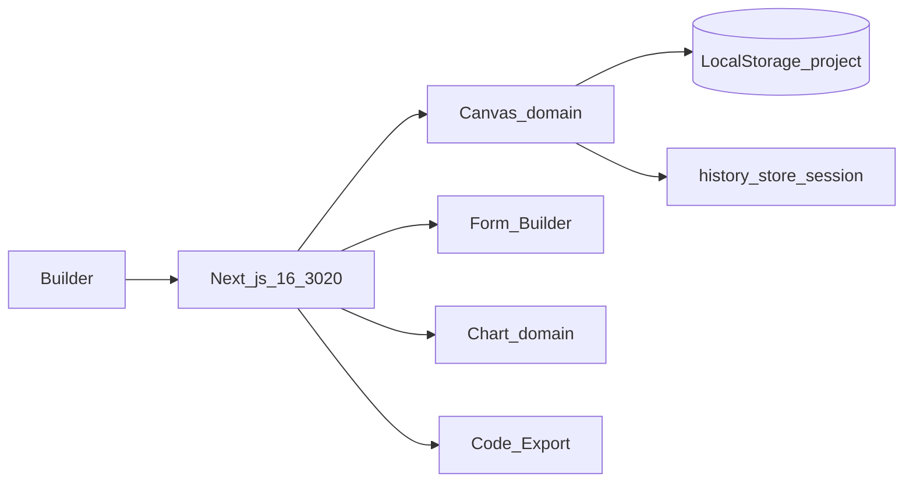
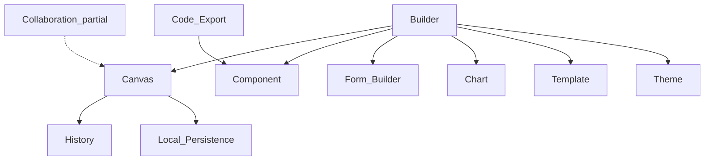
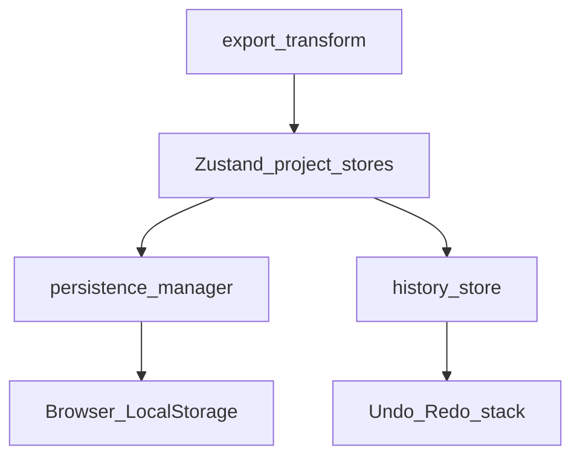
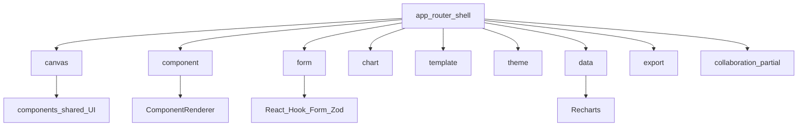
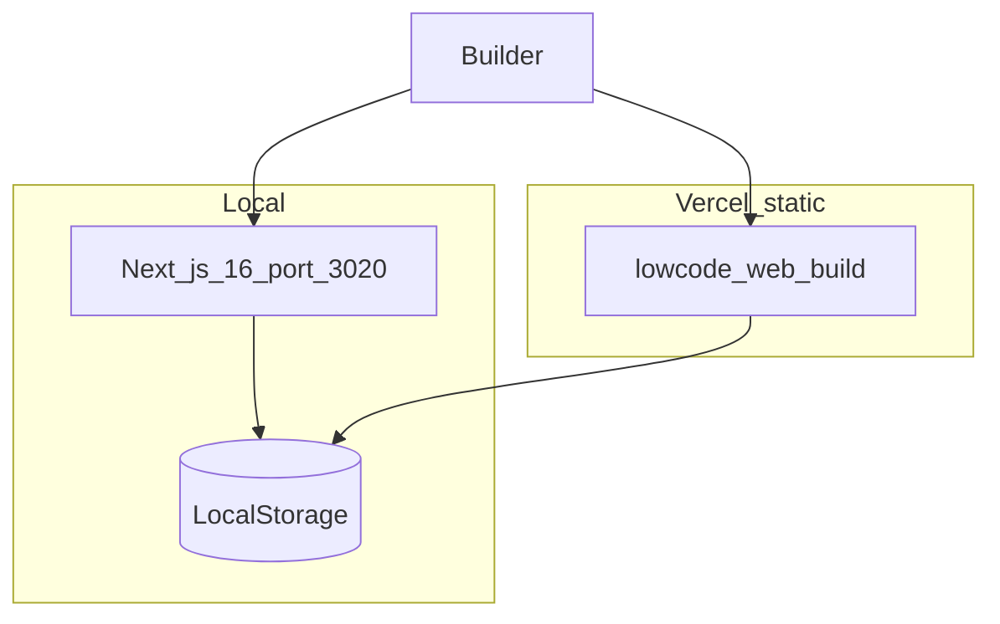
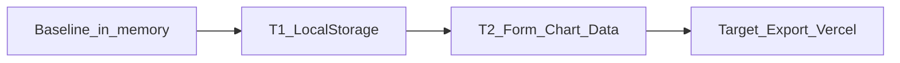

# Architecture Definition Document — Explore Lowcode

| Field | Value |
| --- | --- |
| Deliverable | Architecture Definition Document (TOGAF Architecture Content Framework) |
| Reference | [TOGAF Architecture Deliverables §32.2.3](https://pubs.opengroup.org/architecture/togaf9-doc/m/chap32.html) |
| Capability | Explore Lowcode (canvas editor, form builder, charts, export, local persistence) |
| ADM phases | B–D (Architecture Vision from Phase A summarized in §1) |
| Architecture states | Baseline, Transition (T1, T2), Target |
| Companion | Architecture Requirements Specification (quantitative) — separate deliverable |
| Code-level models | [C4 model](../c4-model/README.md) |
| Preferred Terms | Idiomatic English ([Glossary](../../Glossary.md)) |

**Purpose.** Explore Lowcode fails when page composition logic scatters across ad hoc components, when undo history collides with LocalStorage snapshots, or when teams assume a backend that does not exist. This document describes the **client-only** as-built editor on this branch—Next.js 16 on port **3020**, domain-colocated modules, and honest Baseline without inventing a Create React App heritage.

---

## Contents

- [1. Vision](#1-vision)
- [2. Architecture principles](#2-architecture-principles)
- [3. Architecture models](#3-architecture-models)
  - [3.1 Business Architecture](#31-business-architecture)
  - [3.2 Data Architecture](#32-data-architecture)
  - [3.3 Application Architecture](#33-application-architecture)
  - [3.4 Technology Architecture](#34-technology-architecture)
- [4. Re-use, standards, and landscape](#4-re-use-standards-and-landscape)
  - [4.1 Re-use assessment](#41-re-use-assessment)
  - [4.2 Mapping to standards](#42-mapping-to-standards)
  - [4.3 Mapping to architecture landscape](#43-mapping-to-architecture-landscape)
- [5. Transition Architecture](#5-transition-architecture)
- [6. References](#6-references)

---

## 1. Vision

### Problem

Product teams need to compose responsive pages from a component kit, bind sample data, theme consistently, and export front-end code—without standing up a REST API for every design iteration. The failure mode is **state schizophrenia**: treating undo stacks like durable projects, or promising real-time multi-user editing while only LocalStorage exists.

### Stakeholders and concerns

| Stakeholder | Concern | Architectural response |
| --- | --- | --- |
| Designer / developer | Canvas feedback, undo/redo, device preview | `canvas/` + `history.store` |
| Team lead | Templates, export quality | `template/`, `export/` |
| Operator | Static hosting | Vercel `lowcode/web` |
| Form author | Schema-safe forms | **Form Builder** domain (`src/form/`) |
| Analyst | Charts on canvas | **Chart** domain (`src/chart/`, Recharts) |

### Solution

A **Next.js 16** App Router SPA (`lowcode/web`, dev **[http://localhost:3020](http://localhost:3020)**) organizes code by **business domain folders** under `src/{domain}/`. Zustand stores hold editor state; **`persistence.manager.ts`** writes the **project graph** to **LocalStorage**; **`history.store.ts`** holds **session-scoped undo/redo**—distinct stores, distinct lifetimes. **Collaboration** UI exists under `src/collaboration/` but Glossary marks it **planned / partial**—not Target fact as full real-time sync.

Component structure: [C3-Component-Frontend.puml](../c4-model/C3-Component-Frontend.puml). Context: [C1-Context.puml](../c4-model/C1-Context.puml). Live demo: [https://low-code-platform-eta.vercel.app/](https://low-code-platform-eta.vercel.app/).

---

## 2. Architecture principles

1. **Domain-colocated modules** — *Failure:* “layers” folders with cross-import spaghetti. *Decision:* each domain owns UI, stores, hooks (`src/{domain}/`). *Constraint:* no top-level `application/` or `infrastructure/` packages.

2. **Two persistence semantics** — *Failure:* undo pops corrupt saved projects. *Decision:* **Local Persistence** (project blob) vs **History** (mutation stack). *Constraint:* Glossary anchors `persistence.manager.ts` and `history.store.ts`; do not persist undo stack to LocalStorage as authoritative state.

3. **Client-only core** — *Failure:* imagined CRUD API for the editor kernel. *Decision:* no first-party REST API for core editing (Glossary §4). *Constraint:* export produces downloadable artifacts; collaboration remains partial.

4. **React DnD for layout** — *Failure:* non-undoable drag hacks. *Decision:* React DnD primary interaction; history hooks record canvas mutations. *Constraint:* `use-simplified-actions` integrates with `useHistoryStore`.

5. **Schema-validated forms** — *Failure:* invalid props in Form Builder. *Decision:* React Hook Form + Zod in `src/form/`. *Constraint:* property panels use same validation mindset.

6. **Static deploy path** — *Failure:* serverful requirements for a static editor. *Decision:* Vercel static Next build (`lowcode/web`). *Constraint:* README “docs only” for live Vercel settings until cutover.

---

## 3. Architecture models

### 3.1 Business Architecture

#### Baseline

Early Next.js App Router editor with canvas and component panel only—in-memory graph lost on refresh; no export pipeline or form/chart domains.

#### Target

| Capability | Domain folder | Outcome |
| --- | --- | --- |
| Canvas editing | `canvas/` | Drag-drop, tree, properties, device preview |
| Component library | `component/` | Factory, panel, renderer, custom components |
| Form Builder | `form/` | RHF + Zod form composition |
| Chart | `chart/` | Recharts visualizations on canvas |
| Data binding | `data/` | Sources and bindings |
| Theme / Animation | `theme/` | Tokens and motion editor |
| Templates | `template/` | Gallery starters |
| Code export | `export/` | Generate front-end code |
| History | `lib/history.store.ts` | Undo / redo |
| Persistence | `lib/persistence.manager.ts` | LocalStorage project state |
| Collaboration | `collaboration/` | UI shell; **partial** real-time sync |

### 3.2 Data Architecture

#### Baseline

In-memory Zustand graph only; refresh loses work.

#### Target

| Artifact | Storage | Notes |
| --- | --- | --- |
| Project graph | LocalStorage via `persistence.manager` | Nodes, props, layout, theme tokens |
| Undo / redo stack | `history.store` (Zustand, session) | Not authoritative durability |
| Data source defs | Inside project blob | Mock/bindings for preview |
| Export bundle | Generated files / clipboard | Ephemeral download |
| Collaboration state | In-memory / partial UI | Not durable multi-user source of truth |

### 3.3 Application Architecture

#### Baseline

Single-route editor without template gallery, theme editor, or export dialog.

#### Target

| Domain folder | Responsibility |
| --- | --- |
| `canvas/` | Canvas UI, store, hooks, properties panel |
| `component/` | Factory, management, panel, renderer |
| `form/` | Form builder surfaces |
| `chart/` | Chart nodes and configuration |
| `export/` | Code generation pipeline |
| `lib/` | Persistence, history, store facade |

C3 detail: [C3-Component-Frontend.puml](../c4-model/C3-Component-Frontend.puml).

### 3.4 Technology Architecture

#### Baseline

Next.js App Router prototype on an earlier minor line without full domain split—**not** a CRA baseline (no `create-react-app` heritage claimed).

#### Target

| Layer | Choice |
| --- | --- |
| Framework | Next.js 16 App Router, React 19, TypeScript 5 |
| UI | Tailwind, Radix UI, Lucide |
| State | Zustand |
| DnD | React DnD |
| Charts | Recharts |
| Forms | React Hook Form + Zod |
| Tests | Vitest + Testing Library |
| Live | `https://low-code-platform-eta.vercel.app/` |

---

## 4. Re-use, standards, and landscape

### 4.1 Re-use assessment

| Asset | Re-use |
| --- | --- |
| Glossary domain table | Folder names, Preferred Terms |
| C4 C1/C2 | Designer context, Vercel deployment |
| Apple design tokens (when exporting UI) | Marketing alignment per workspace rules |
| `platform-header` | Shell chrome including Collaboration entry |

### 4.2 Mapping to standards

| Standard | Application |
| --- | --- |
| Next.js App Router | `src/app/` shell |
| LocalStorage persistence | Browser-only project durability |
| Zustand store patterns | Named stores per domain |
| Vitest | Unit tests including `history.store.test.ts` |

### 4.3 Mapping to architecture landscape

| Landscape element | Position |
| --- | --- |
| Monorepo path | `lowcode/web` (Vercel root) |
| Dev command | `pnpm dev lowcode` → `:3020` |
| No backend API | Editor kernel is client-side |
| Backlog | [User Story Map](../../product-owner/User-Story-Map.md) |

---

## 5. Transition Architecture

| State | Definition |
| --- | --- |
| Baseline | In-memory canvas; no LocalStorage persistence |
| T1 | Canvas + component panel + Local Persistence |
| T2 | Data binding + theme + templates + Form Builder + Chart |
| Target | Export pipeline + Vercel production + history.store integrated |

### T1 — Durable projects

| Domain | Change |
| --- | --- |
| Business | Component palette + canvas |
| Data | LocalStorage project blob |
| Application | `persistence.manager` wired |
| Technology | Next.js App Router domains |

### T2 — Rich composition

| Domain | Change |
| --- | --- |
| Business | Form Builder, Chart, data binding |
| Data | Data defs inside project blob |
| Application | `form/`, `chart/`, `data/` domains |
| Technology | Recharts, RHF + Zod |

### Target — As-built editor

| Domain | Change |
| --- | --- |
| Business | Export dialog; partial Collaboration UI |
| Data | History separate from persistence |
| Application | `export/`; `collaboration/` mounted from shell |
| Technology | Next.js 16 **:3020**; Vercel static live URL |

**Roadmap note (not Target):** Full real-time Collaboration sync is Glossary-flagged planned—do not document as shipped multi-user editing.

---

## 6. References

- [TOGAF Architecture Deliverables — Architecture Definition Document §32.2.3](https://pubs.opengroup.org/architecture/togaf9-doc/m/chap32.html)
- [Next.js App Router](https://nextjs.org/docs/app)
- [Glossary](../../Glossary.md)
- [C4 model](../c4-model/README.md)
- [User Story Map](../../product-owner/User-Story-Map.md)
- [Quick Start](../QUICKSTART.md)
- [Explore Lowcode README](../../../../lowcode/README.md)