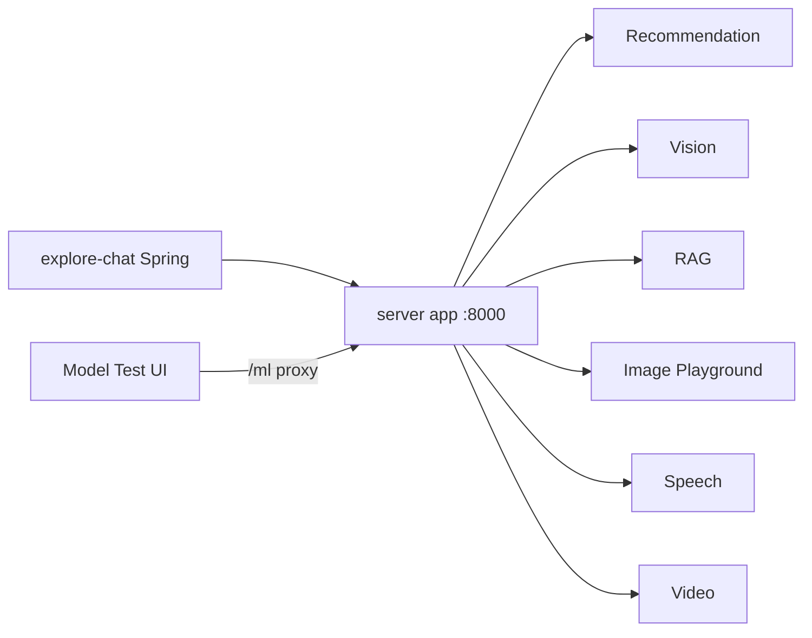

# Glossary | 领域术语表

> Explore ML — Ubiquitous Language（统一语言）

---

## 1. Purpose | 文档说明

本文件定义项目**统一语言**。英文 Preferred Term 为代码、API、架构命名的权威形式；中文仅用于沟通与本地化。

### 维护原则

1. **先 Glossary**：改代码前先增改术语
2. **与代码同步**：聚合根 / 实体 / 值对象 / 枚举变更必须回写本表
3. **Preferred Term**：代码、API、提交、技术文档一律用英文列

---

## 2. Business Domains | 业务域总览

全部模块挂在同一 FastAPI 应用（`server/main.py`，端口 `8000`）。设置为各 `config.py` 常量；仅密钥来自 `server/.env`。

| Preferred Term   | 中文       | Code / Path                  | Notes |
| ---------------- | ---------- | ---------------------------- | ----- |
| Recommendation   | 推荐       | `server/recommendation`   | Feed / Explore / Reels 排序 |
| Vision           | 视觉审核   | `server/vision`           | 标签 + 审核 |
| RAG              | 检索增强   | `server/rag`              | 文档 + 本地 Qdrant |
| Image Playground | 图像游乐场 | `server/image_playground` | 图像生成 |
| Speech           | 语音       | `server/speech`           | ASR + TTS |
| Video            | 视频生成   | `server/video`            | 视频生成 |
| Model Test UI    | 测模界面   | `web/`（`:4210`）           | Angular；代理 `/ml` |
| Fixture Data     | 测试数据   | `data/`                      | 仅小体积夹具 |

限界上下文即上表六模块；彼此不共享可变领域状态。

---

## 3. Preferred Terms | 术语表

| Preferred Term    | 中文       | Definition |
| ----------------- | ---------- | ---------- |
| Explore ML        | Explore ML | Explore 产品的可选 Python FastAPI 旁路（六模块） |
| ML App            | ML 应用    | `server/main.py` → `server.build_app`；单端口挂载全部模块路由（`PORT = 8000`） |
| Module            | 模块       | `server/` 下包，暴露 `module.py`（`router`、`health`、可选 `lifespan`）；`main.py` 导入全部六个 |
| Setting           | 设置       | `server/config.py` 或 `<module>/config.py` 常量；仅密钥（`DATABASE_URL`、`REDIS_PASSWORD`、`OPENAI_API_KEY`）来自 `server/.env` |
| Loopback Upstream | 旁路上游   | 仅由兄弟 API 经 localhost 调用；产品客户端不得直连 |
| Fixture Data      | 测试数据   | `data/` 下已提交小文件；大权重保持 gitignore |
| ASR               | 语音识别   | Speech 转写（`POST /api/v1/audios:transcribe`）；默认本地 Qwen3-ASR |
| Streaming ASR     | 流式识别   | `WS /ws/v1/audios:transcribe`；客户端发 `audio` / `commit` / `stop`，服务端回 `partial` / `final` / `error`；由 `StreamingTranscriptionSession` 缓冲 |
| TTS               | 语音合成   | Speech 合成（`POST /api/v1/voices:synthesize`）；直接返回 `audio_url`（Qwen 为 `.wav`，Edge 为 `.mp3`） |
| ML Proxy          | ML 代理    | `ng serve` 路由 `/ml` → 回环 ML 应用（去前缀、WebSocket 开）；目标见 `:web/proxy.conf.json` |
| Module Page       | 模块页     | 每模块一页（`#/<id>`）；每端点一卡片，结果以 D3 图表展示 |
| Chart             | 图表       | `:web/src/app/shared/` 下 D3 组件；计算在 `chart-math.ts` |
| Health Report     | 健康报告   | `GET /health` → `{status: ok \| degraded, modules: {name: {status, latency_ms, …}}}` |

---

## 4. Domain Terms by Module | 各模块领域术语

术语对应模块 `domain/`（或注明的 `service/` / `infra/`）中的类或常量。服务为 `XService`，由 `@lru_cache` 的 `get_x_service()` 提供。

### RAG（`server/rag`）

| Preferred Term     | 中文       | Code | Definition |
| ------------------ | ---------- | ---- | ---------- |
| Chunk              | 文本块     | `domain/chunker.py` `Chunk` | 按 token 切分的文档切片：id、文本、元数据；值对象语义 |
| Text Chunker       | 分块器     | `domain/chunker.py` `TextChunker` | 将文本或 PDF 页切为块（`CHUNK_SIZE`、`CHUNK_OVERLAP`）；领域服务 |
| Chunk Indexer      | 块索引器   | `service/indexing.py` `ChunkIndexer` | 按批 10 条嵌入并 upsert 到同一集合 |
| Collection         | 集合       | `domain/query.py` `SEARCHABLE_COLLECTIONS` | Qdrant 集合：`documents` / `posts` / `comments` / `webpages` |
| Search Hit         | 检索命中   | `domain/query.py` `SearchHit` | 一条命中：id、分数、payload；值对象 |
| Answer             | 回答       | `domain/query.py` `Answer` | LLM 文本 + 来源命中 + 检索块数 + 生成耗时；值对象 |
| Rerank Sidecar     | 重排旁路   | `infra/reranker.py` | 可选 HTTP 重排（`RERANK_URL`）；对 `top_k * 3` 候选重打分 |
| Exported Vectors   | 导出向量   | `domain/query.py` `ExportedVectors` | `documents:exportVectors` 的存库向量；空时 `dimension` 为 0 |
| Indexed Document   | 已索引文档 | `domain/document.py` `IndexedDocument` | 上传结果：id、文件名、大小、块数；实体 |
| Scraped Webpage    | 已抓取网页 | `domain/webpage.py` `ScrapedWebpage` | 单次抓取结果；`status` 为 `completed` 或 `error: ...` |
| Sync Result        | 同步结果   | `domain/sync.py` `SyncResult` | 帖子 / 评论自内容 API 同步的合计；值对象 |
| Domain Error       | 领域错误   | `domain/errors.py` | `InvalidRequestError` 400、`NotFoundError` 404、`ServiceUnavailableError` 503、`UpstreamError` 上游状态 |

### Vision（`server/vision`）

| Preferred Term      | 中文     | Code | Definition |
| ------------------- | -------- | ---- | ---------- |
| Prediction          | 预测     | `domain/prediction.py` `Prediction` | 单标签 + softmax 分数；`top_unique` 保留每标签最优；值对象 |
| Moderation Category | 审核类别 | `domain/moderation.py` `ModerationCategory` | 被标记标签及其分数；值对象 |
| Frame Verdict       | 帧结论   | `domain/moderation.py` `FrameVerdict` | 采样帧：`offset_seconds`、类别分数、`safe`；值对象 |
| Moderation Verdict  | 审核结论 | `domain/moderation.py` `ModerationVerdict` | `safe`、标记类别、各类峰值分（视频跨帧）与帧列表；值对象 |

### Image Playground and Video

| Preferred Term | 中文       | Code | Definition |
| -------------- | ---------- | ---- | ---------- |
| Job            | 生成任务   | `domain/job.py` `Job` | 一次生成：id、状态、url、error；聚合根 |
| Job Status     | 任务状态   | `domain/job.py` `JobStatus` | `pending` / `succeeded` / `failed` |
| Job Store      | 任务仓储   | `domain/job.py` `JobStore` | 内存仓储，供 `imageJobs/{id}`、`videoJobs/{id}` 轮询 |
| LoRA Adapter   | LoRA 适配器 | `infra/pipeline.py` `LORA_ADAPTER_NAME` | Image Playground 将 `IMAGE_LORA_PATH` 加载为适配器 `fine_tuned` |

### Recommendation（`server/recommendation`）

| Preferred Term   | 中文     | Code | Definition |
| ---------------- | -------- | ---- | ---------- |
| Rank             | 排序     | `feeds:rank` / `explores:rank` / `reels:rank` | 对调用方候选打分；无模型时分数为 1.0 |
| Recall           | 召回     | `feeds:recall` | 自向量仓储取用户近邻项 |
| Feature Registry | 特征注册 | `domain/feature_registry.py` | 训练与在线共用的命名特征定义 |
| Vector Store     | 向量仓储 | `domain/vector_store.py` `VectorStore` | 接口；`infra/` 中 Redis / Faiss 实现 |

---

## References

- [References](References.md)
- [Guideline](Guideline.md)
- [C4 model](c4-model/)
- [User Story Map](User-Story-Map.md)
