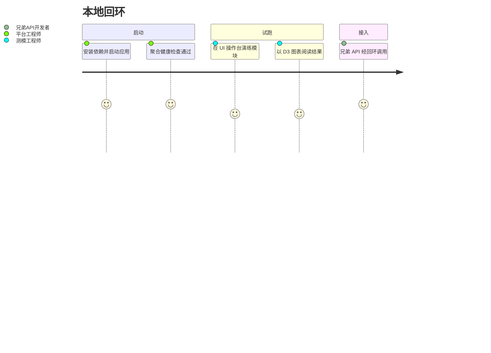

# 用户故事地图 | User Story Map — Explore ML
> Jeff Patton 用户故事地图；正文与验收标准合并于本文（单一文档）。  
> Jeff Patton user-story map; epics and GWT acceptance criteria live in this single document.  
> 格式 / Format：Background → `As a` / `I want` / `So that` → Scenario GIVEN-WHEN-THEN（双语 / bilingual）。

## 用户画像 | Personas

| 角色 / Role | 说明 / Description |
|------|------|
| 平台工程师 / Platform Engineer | 本地启动回环 ML 应用并挂载测试数据 / Starts the loopback ML app locally with fixture data |
| 兄弟 API 开发者 / Sibling API Developer | 在同一 base URL 上调用 recommendation |
| 测模工程师 / Model Test Engineer | 在 `web/` 操作台（:4210）逐模块验证 / Validates modules on the `web/` console (:4210) |

## 旅程总览 | Journey Overview

### 本地回环

健康检查：`GET /health`（:8000）；每个已加载模块返回 `status`（`ok` / `degraded` / `error`）与 `latency_ms`。

## Backbone 故事地图 | Backbone

| 模块化服务 | 统一应用 | 操作台 |
|------------|----------|--------|
| [US-01](#us-01-扁平分模块布局) 扁平布局 | [US-05](#us-05-单应用与聚合健康) 单应用 + 健康 | [US-09](#us-09-模块页) 模块页 |
| [US-02](#us-02-rag-导出向量) RAG 导出向量 | [US-06](#us-06-密钥仅存于-env) 密钥进 `.env` | [US-10](#us-10-每模块页-d3-图表) D3 图表 |
| [US-03](#us-03-websocket-流式-asr) 流式 ASR | [US-07](#us-07-视觉分数与视频审核) 视觉 / 视频 | [US-11](#us-11-rag-嵌入图谱) 嵌入图谱 |
| [US-04](#us-04-微调脚本) 微调脚本 | [US-08](#us-08-ui-代理与分模块健康) UI `/ml` 代理 | [US-12](#us-12-评估看板) 评估看板 |

## Epic 索引 | Epic Index

| Epic | 锚点 / Anchor | 状态 / Status |
|------|---------------|---------------|
| E1 模块化服务 | [#e1](#e1) | — |
| E2 统一应用 | [#e2](#e2) | — |
| E3 操作台 | [#e3](#e3) | — |

---

# 用户故事正文 | User Stories

## E1 模块化服务 / Modularized services

### 背景 | Background

推荐、视觉、RAG、语音、图像、视频各为独立限界上下文，包结构扁平。兄弟服务只调用稳定路由；模型运算留在 Explore ML 内。 / Recommendations, visualization, RAG, Voice, image and video are the context of the independent limit and the package is flat. Bro services call only stable routes; model operation stays Explore ML Internal.

### US-01 扁平分模块布局 / Flat per-module layout

**As a** 平台工程师 / Platform Engineer  
**I want** 每个模块遵循 `controller/`、`service/`、`domain/`、`infra/` / Each module follows `controller/`, `service/`, `domain/`, `infra/`  
**So that** 改一能力不必动其他模块 / You don't have to move the other modules.

#### 验收标准 | Acceptance Criteria

1. **Scenario** 模块符合分层 / Module matches the layer  
   **GIVEN** Explore ML 源码树 / Explore ML Source Tree  
   **WHEN** 打开 `server/` 下任一模块 / Open `server/` Any next module  
   **THEN** 遵循 `controller → service → domain ← infra` / Follow `controller → service → domain ← infra`  
   **AND** 领域类型（聚合根  

#### 状态 | Status

已实现 / Done

---

### US-02 RAG 导出向量 / RAG Export Vector

**As a** 兄弟 API 开发者 / Sibling API Developer  
**I want** 经 `documents:exportVectors` 导出文档向量 / Via `documents:exportVectors` Export Document Vector  
**So that** 上游可复用嵌入而不必重新入库 / Upstream re-entry without re-entry Library

#### 验收标准 | Acceptance Criteria

1. **Scenario** 导出文档向量 / Export Document Vector  
   **GIVEN** RAG 模块已加载且存在测试文档 / RAG Module loaded and test document exists  
   **WHEN** 调用导出向量路由 / Call export vector path  
   **THEN** 响应含所请求文档的向量 / Respond to vectors containing requested documents  

#### 状态 | Status

已实现 / Done

---

### US-03 WebSocket 流式 ASR / WebSocket streaming ASR

**As a** 兄弟 API 开发者 / Sibling API Developer  
**I want** 在 `/ws/v1/audios:transcribe` 上流式 ASR / Via `/ws/v1/audios:transcribe` Upstream ASR  
**So that** 语音客户端无需 HTTP 轮询即可获得中间结果 / Voice client not needed HTTP You can get intermediate results if you're in the loop.

#### 验收标准 | Acceptance Criteria

1. **Scenario** 流式转写帧 / Streaming frame  
   **GIVEN** Speech 模块已加载 / Speech Module loaded  
   **WHEN** 客户端经 WebSocket 推送音频 / Client Passes WebSocket Push Audio  
   **THEN** 返回 partial 与 final 转写帧 / Back partial and final Convert Frame  

#### 状态 | Status

已实现 / Done

---

### US-04 微调脚本 / fine-tuning script

**As a** 平台工程师 / Platform Engineer  
**I want** 除 video 外各模块提供 `training/` 脚本 / Divide video Provision of external modules `training/` Script  
**So that** 可用测试数据本地再训练 / Local retraining of available test data

#### 验收标准 | Acceptance Criteria

1. **Scenario** 列出训练脚本 / List training scripts  
   **GIVEN** 非 video 模块 / Not video Module  
   **WHEN** 列出 `training/` / List `training/`  
   **THEN** 存在微调入口脚本且有文档说明 / There is a fine-tuned entry script with a document description  

#### 状态 | Status

已实现 / Done

---

## E2 统一应用 / Uniform application

### 背景 | Background

单一回环进程、单一 base URL 暴露全部模块与聚合健康。密钥只进环境文件，不进已提交默认值。 / Single loop process, single base URL Exposure of all modules and aggregate health. Keys only enter environment file, not submitted default.

### US-05 单应用与聚合健康 / Single application and aggregate health

**As a** 平台工程师 / Platform Engineer  
**I want** 端口 8000 上一个 FastAPI 应用并提供聚合 `/health` / Port 8000 Previous FastAPI Apply and provide aggregation `/health`  
**So that** 启动与就绪检查覆盖每个已加载模块 / Start and readiness check to cover every loaded module

#### 验收标准 | Acceptance Criteria

1. **Scenario** 聚合模块健康 / Aggregation module health  
   **GIVEN** 统一应用已运行 / Harmonized application run  
   **WHEN** `GET /health`  
   **THEN** 每个已加载模块报告 `status` 与 `latency_ms` / Each loaded module report `status` and `latency_ms`  

2. **Scenario** 一次安装、一个进程 / One installation, one process  
   **GIVEN** 全新克隆 / New clone.  
   **WHEN** 使用根依赖与 `.env.example` / Use root dependency and `.env.example`  
   **THEN** 全部模块由同一进程启动 / All modules started by the same process  

#### 状态 | Status

已实现 / Done

---

### US-06 密钥仅存于 env / Key only saved on env

**As a** 平台工程师 / Platform Engineer  
**I want** 非密钥设置内联、密钥只进 `.env` / Non-key settings inline, key only `.env`  
**So that** 凭证不入库，本地启动仍有文档可循 / Credentials are not stored in the database; local startup docs remain available

#### 验收标准 | Acceptance Criteria

1. **Scenario** 密钥留在环境 / Key to Environment  
   **GIVEN** 应用配置 / Apply Configuration  
   **WHEN** 检查默认值与 `.env.example` / Check Defaults with `.env.example`  
   **THEN** 密钥仅来自环境；非密钥可为内联默认 / Keys only come from the environment; non-keys can be inline defaults  

#### 状态 | Status

已实现 / Done

---

### US-07 视觉分数与视频审核 / Visual scores and video clearance

**As a** 兄弟 API 开发者 / Sibling API Developer  
**I want** 视觉预测分数与按帧视频审核 / Visual projection scores and frame video audit  
**So that** 产品 BFF 可对结构化分数设阈值 / Products BFF Could set thresholds for structured fractions

#### 验收标准 | Acceptance Criteria

1. **Scenario** 视觉标签分数 / Visual Tab Scores  
   **GIVEN** Vision 模块已加载 / Vision Module loaded  
   **WHEN** 提交图像预测 / Submit Image Forecast  
   **THEN** 响应含各标签分数 / Response with Tab Scores  

2. **Scenario** 按帧视频审核 / Audit by frame video  
   **GIVEN** Video 模块已加载 / Video Module loaded  
   **WHEN** 提交短片 / Submit short film  
   **THEN** 按帧返回审核结果 / Return the results by frame  

#### 状态 | Status

已实现 / Done

---

### US-08 UI 代理与分模块健康 / UI Agent and submodule health

**As a** 测模工程师 / Model Test Engineer  
**I want** `web/` 操作台统一走 `/ml` 代理并展示模块健康 / `web/` Unite the table. `/ml` Agent and display module health  
**So that** 不必为六模块维护六个源 / No need to maintain six sources for six modules

#### 验收标准 | Acceptance Criteria

1. **Scenario** 经 `/ml` 代理看健康 / Via `/ml` Agent's looking at health.  
   **GIVEN** UI 指向回环应用 / UI Point to loop application  
   **WHEN** 打开操作台 / Open Operator  
   **THEN** 经 `/ml` 代理可见各模块健康 / Via `/ml` Agent can see module health  

#### 状态 | Status

已实现 / Done

---

## E3 操作台 / Operator

### 背景 | Background

`web/` 为每个 ML 模块提供一页与图表，便于兄弟产品接入 BFF 前先验证路由。 / `web/` For each ML The module provides a page and chart to facilitate bro product access BFF Check route first.

### US-09 模块页 / Module Page

**As a** 测模工程师 / Model Test Engineer  
**I want** 推荐、视觉、RAG、图像、语音、视频各有 UI 页 / Recommendations, visualization, RAG, Images, voices, videos. UI Page  
**So that** 可在操作台逐模块演练 / A module-by-desk exercise

#### 验收标准 | Acceptance Criteria

1. **Scenario** 每模块提交测试请求 / Request for testing per module  
   **GIVEN** `web/` 运行于 :4210 / `web/` Run on :4210  
   **WHEN** 打开各模块路由 / Open module route  
   **THEN** 可提交测试请求并展示结构化结果 / Could submit test requests and demonstrate structured results  

#### 状态 | Status

已实现 / Done

---

### US-10 每模块页 D3 图表 / Every module page D3 Chart

**As a** 测模工程师 / Model Test Engineer  
**I want** 每模块页带 D3 图表 / Each module page belt D3 Chart  
**So that** 分数与序列可读，不必只盯原始 JSON / Scores and sequences readable, not just original JSON

#### 验收标准 | Acceptance Criteria

1. **Scenario** 数值序列成图 / Numerical sequences  
   **GIVEN** 模块成功返回含数值序列的响应 / Module successfully returns a response to a numerical sequence  
   **WHEN** 页面渲染 / Page render  
   **THEN** D3 图表可视化该结果 / D3 Chart visualization of results  

#### 状态 | Status

已实现 / Done

---

### US-11 RAG 嵌入图谱 / RAG embedding graph

**As a** 测模工程师 / Model Test Engineer  
**I want** RAG 页提供 PCA 嵌入图谱 / RAG By page PCA Embedded  
**So that** 导出向量的簇形可见 / A cluster of export vectors is visible

#### 验收标准 | Acceptance Criteria

1. **Scenario** RAG 上 PCA 散点 / RAG Let's go. PCA scatter  
   **GIVEN** RAG 向量可用 / RAG Vector Available  
   **WHEN** 打开 RAG 页图谱 / Open RAG Page Diagram  
   **THEN** 展示 PCA 散点图 / Presentation PCA Scatter Chart  

#### 状态 | Status

已实现 / Done

---

### US-12 评估看板 / Assessment panels

**As a** 测模工程师 / Model Test Engineer  
**I want** `web/` 内有评估看板 / `web/` There's an evaluation panel inside.  
**So that** 可跨模块比较测试跑质量指标 / Testing quality indicators across modules

#### 验收标准 | Acceptance Criteria

1. **Scenario** 评估指标汇总 / Summary of assessment indicators  
   **GIVEN** 操作台 / Operator  
   **WHEN** 评估能力上线 / Assessment capacity online  
   **THEN** 看板页汇总测试评估指标 / Page summary test evaluation indicators  

#### 状态 | Status

规划中 / Planned

---

## 参考 | References

- [User Story Mapping — Jeff Patton](https://www.jpattonassociates.com/user-story-mapping/)
- [Domain Glossary](../Glossary.md)

