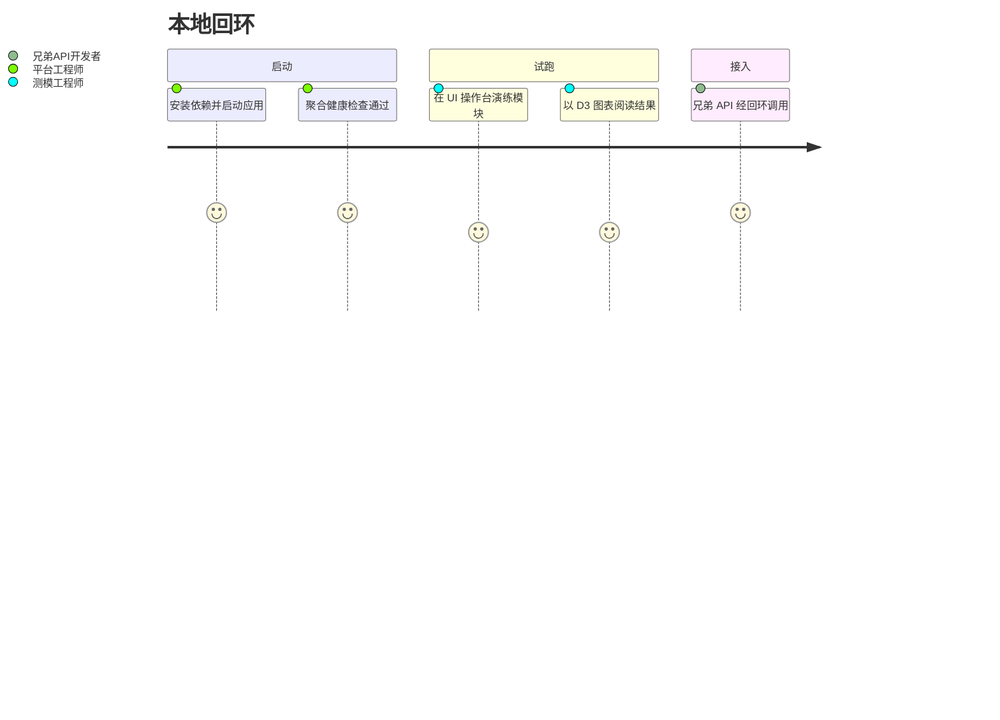

# 用户故事地图 | User Story Map — Explore ML
> Jeff Patton 用户故事地图；正文与验收标准合并于本文（单一文档）。  
> Jeff Patton user-story map; epics and GWT acceptance criteria live in this single document.  
> 格式 / Format：Background → `As a` / `I want` / `So that` → Scenario GIVEN-WHEN-THEN（双语 / bilingual）。

## 用户画像 | Personas

| 角色 / Role | 说明 / Description |
|------|------|
| 平台工程师 / Platform Engineer | 本地启动回环 ML 应用并挂载测试数据 / Starts the loopback ML app locally with fixture data |
| 兄弟 API 开发者 / Sibling API Developer | 在同一 base URL 上调用 recommendation |
| 测模工程师 / Model Test Engineer | 在 `web/` 操作台（:4210）逐模块验证 / Validates modules on the `web/` console (:4210) |

## 旅程总览 | Journey Overview

### 本地回环

健康检查：`GET /health`（:8000）；每个已加载模块返回 `status`（`ok` / `degraded` / `error`）与 `latency_ms`。

## Backbone 故事地图 | Backbone

| 模块化服务 | 统一应用 | 操作台 |
|------------|----------|--------|
| [US-01](#us-01-扁平分模块布局) 扁平布局 | [US-05](#us-05-单应用与聚合健康) 单应用 + 健康 | [US-09](#us-09-模块页) 模块页 |
| [US-02](#us-02-rag-导出向量) RAG 导出向量 | [US-06](#us-06-密钥仅存于-env) 密钥进 `.env` | [US-10](#us-10-每模块页-d3-图表) D3 图表 |
| [US-03](#us-03-websocket-流式-asr) 流式 ASR | [US-07](#us-07-视觉分数与视频审核) 视觉 / 视频 | [US-11](#us-11-rag-嵌入图谱) 嵌入图谱 |
| [US-04](#us-04-微调脚本) 微调脚本 | [US-08](#us-08-ui-代理与分模块健康) UI `/ml` 代理 | [US-12](#us-12-评估看板) 评估看板 |

## Epic 索引 | Epic Index

| Epic | 锚点 / Anchor | 状态 / Status |
|------|---------------|---------------|
| E1 模块化服务 | [#e1](#e1) | — |
| E2 统一应用 | [#e2](#e2) | — |
| E3 操作台 | [#e3](#e3) | — |

---

# 用户故事正文 | User Stories

## E1 可独立演进的 ML 能力 / Independently evolvable ML capabilities

### 背景 | Background

推荐、视觉、RAG、语音、图像、视频等能力耦在一起时，一改全动、交付风险高。兄弟产品只需稳定契约，不必触碰模型内部。期望各能力边界清晰、对外只暴露稳定接口，运算留在 Explore ML 内。 / When recommendation, vision, RAG, speech, image, and video are tangled, one change ripples everywhere and raises delivery risk. Sibling products need stable contracts, not model internals. Each capability should have clear boundaries and stable APIs while compute stays inside Explore ML.

### US-01 按能力分模块的清晰结构 / Clear per-capability module structure

**As a** 平台工程师 / Platform Engineer  
**I want** 每个 ML 能力在代码库中拥有一致、可识别的分层结构 / each ML capability to follow a consistent, recognizable layered structure in the codebase  
**So that** 增强或修复单一能力时不必牵动其他模块，降低返工与回归风险 / I can enhance or fix one capability without destabilizing others, reducing rework and regression risk

#### 验收标准 | Acceptance Criteria

1. **Scenario** 各模块遵循统一分层约定 / Each module follows the same layering contract  
   **GIVEN** Explore ML 服务代码库已就绪 / the Explore ML service codebase is available  
   **WHEN** 我审查任一业务能力模块的目录结构 / I review any business capability module's layout  
   **THEN** 接口、编排、领域与基础设施职责分离清晰 / API, orchestration, domain, and infrastructure responsibilities are clearly separated  
   **AND** 领域模型不依赖外层实现细节 / domain models do not depend on outer-layer implementation details  

#### 状态 | Status

已实现 / Done

---

### US-02 RAG 文档向量导出 / RAG document vector export

**As a** 兄弟产品 API 开发者 / Sibling product API developer  
**I want** 通过稳定接口导出已入库文档的嵌入向量 / to export embedding vectors for ingested documents through a stable API  
**So that** 上游产品可复用向量而无需重复建库，缩短集成周期 / upstream products can reuse vectors without rebuilding indexes, shortening integration time

#### 验收标准 | Acceptance Criteria

1. **Scenario** 导出请求返回对应文档向量 / Export returns vectors for requested documents  
   **GIVEN** RAG 服务已运行且存在可导出的文档 / the RAG service is running with documents available to export  
   **WHEN** 我调用文档向量导出接口 / I call the document vector export API  
   **THEN** 响应包含所请求文档的向量表示 / the response includes vector representations for the requested documents  

#### 状态 | Status

已实现 / Done

---

### US-03 语音流式转写 / Streaming speech transcription

**As a** 兄弟产品 API 开发者 / Sibling product API developer  
**I want** 通过长连接持续发送音频并实时收到转写片段 / to stream audio over a persistent connection and receive transcription updates in real time  
**So that** 语音客户端无需轮询即可获得中间与最终结果，交互更顺畅 / voice clients get partial and final text without polling, for smoother real-time UX

#### 验收标准 | Acceptance Criteria

1. **Scenario** 流式音频推送得到分段转写 / Streaming audio yields partial and final transcripts  
   **GIVEN** 语音转写服务已就绪 / the speech transcription service is ready  
   **WHEN** 客户端经 WebSocket 持续推送音频 / the client streams audio over WebSocket  
   **THEN** 服务端持续返回进行中与最终的转写文本 / the server returns in-progress and final transcript segments  

#### 状态 | Status

已实现 / Done

---

### US-04 各能力本地微调入口 / Local fine-tuning entry per capability

**As a** 平台工程师 / Platform Engineer  
**I want** 除视频外各能力提供可发现的本地微调脚本与说明 / each capability except video to offer discoverable local fine-tuning scripts and guidance  
**So that** 团队可用测试数据快速再训练，无需从零搭建流水线 / teams can retrain on test data quickly without building pipelines from scratch

#### 验收标准 | Acceptance Criteria

1. **Scenario** 非视频模块具备文档化训练入口 / Non-video modules expose documented training entry points  
   **GIVEN** 我查看除视频外的任一 ML 能力模块 / I inspect any ML capability module except video  
   **WHEN** 我查找该能力的训练相关资源 / I look for training resources for that capability  
   **THEN** 存在可执行的微调入口及配套说明 / an executable fine-tuning entry and supporting documentation are present  

#### 状态 | Status

已实现 / Done

---

## E2 统一可运维的运行面 / Unified operable runtime

### 背景 | Background

多进程、多入口会增加部署与巡检成本，兄弟产品也难以记忆多处地址。密钥若写入仓库默认值，会带来合规与泄露风险。期望单一进程、单一基址暴露全部能力，敏感配置仅来自环境。 / Multiple processes and entry points raise deploy and ops cost; sibling products struggle to remember many base URLs. Secrets in committed defaults create compliance and leak risk. One process and one base URL should expose all capabilities; sensitive config should come only from the environment.

### US-05 单进程应用与聚合健康 / Single-process app with aggregate health

**As a** 平台工程师 / Platform Engineer  
**I want** 一次启动运行全部 ML 模块，并通过单一健康端点查看各模块状态 / to run all ML modules in one process and check each module's status from one health endpoint  
**So that** 部署与就绪检查更简单，故障定位更快 / deployment and readiness checks are simpler and incidents are easier to triage

#### 验收标准 | Acceptance Criteria

1. **Scenario** 健康检查汇总各已加载模块 / Health check summarizes every loaded module  
   **GIVEN** 统一 ML 应用已在运行 / the unified ML application is running  
   **WHEN** 我请求聚合健康检查 / I request the aggregate health check  
   **THEN** 响应列出各已加载模块的状态与响应时延 / the response lists each loaded module's status and response latency  

2. **Scenario** 新环境一次安装单进程启动 / Fresh clone installs once and starts one process  
   **GIVEN** 我从干净仓库克隆并配置示例环境 / I clone a fresh repo and configure from the example environment  
   **WHEN** 我按文档安装依赖并启动服务 / I install dependencies and start the service per documentation  
   **THEN** 全部业务能力由同一进程对外提供 / all business capabilities are served by a single process  

#### 状态 | Status

已实现 / Done

---

### US-06 密钥仅存于环境配置 / Secrets live only in environment configuration

**As a** 平台工程师 / Platform Engineer  
**I want** 非敏感项可有内联默认，而密钥仅从环境注入 / non-sensitive settings to have inline defaults while secrets are injected only from the environment  
**So that** 凭证不入版本库，本地启动仍有清晰配置指引，降低泄露风险 / credentials never enter version control, local startup stays documented, and leak risk drops

#### 验收标准 | Acceptance Criteria

1. **Scenario** 仓库默认值不含真实密钥 / Committed defaults contain no real secrets  
   **GIVEN** 我审查应用配置与示例环境文件 / I review application configuration and the example environment file  
   **WHEN** 我对照运行时实际读取的配置来源 / I compare against what the runtime actually loads  
   **THEN** 密钥类项仅来自环境变量；非密钥可有安全默认值 / secret values come only from environment variables; non-secrets may have safe defaults  

#### 状态 | Status

已实现 / Done

---

### US-07 视觉评分与视频逐帧审核 / Visual scoring and frame-level video moderation

**As a** 兄弟产品 API 开发者 / Sibling product API developer  
**I want** 获得图像标签的结构化分数与视频逐帧审核结果 / to receive structured label scores for images and frame-level moderation results for video  
**So that** 产品 BFF 可设阈值自动决策，减少人工复核 / product BFFs can apply thresholds for automated decisions and less manual review

#### 验收标准 | Acceptance Criteria

1. **Scenario** 图像预测返回各标签分数 / Image prediction returns per-label scores  
   **GIVEN** 视觉分析服务已就绪 / the vision analysis service is ready  
   **WHEN** 我提交一张图像进行预测 / I submit an image for prediction  
   **THEN** 响应包含各识别标签的数值分数 / the response includes numeric scores for each recognized label  

2. **Scenario** 短视频提交返回逐帧审核 / Short video submission returns per-frame moderation  
   **GIVEN** 视频审核服务已就绪 / the video moderation service is ready  
   **WHEN** 我提交一段短视频 / I submit a short video clip  
   **THEN** 响应按帧返回审核判定结果 / the response returns moderation outcomes per frame  

#### 状态 | Status

已实现 / Done

---

### US-08 操作台统一代理与模块健康展示 / Console unified proxy and module health

**As a** 模型验证工程师 / Model validation engineer  
**I want** 操作台经单一代理访问后端，并集中展示各模块健康 / the console to reach the backend through one proxy and show module health in one place  
**So that** 不必为六个模块维护六套前端源，验证效率更高 / I do not maintain six separate front-end sources for six modules, improving validation efficiency

#### 验收标准 | Acceptance Criteria

1. **Scenario** 操作台可见各模块健康状态 / Console shows health for each module  
   **GIVEN** 操作台已指向统一 ML 后端 / the console is configured for the unified ML backend  
   **WHEN** 我打开操作台主界面 / I open the console home  
   **THEN** 经统一代理可查看各业务能力模块的健康信息 / I can see health information for each business capability module via the unified proxy  

#### 状态 | Status

已实现 / Done

---

## E3 可演练的 ML 操作台 / Hands-on ML console

### 背景 | Background

兄弟产品在接入 BFF 前需要可感知的试调用方式，否则只能依赖原始接口文档，试错成本高。分模块页面与可视化能降低理解门槛。期望操作台为每项能力提供独立演练页与可读结果展示。 / Sibling products need tangible try-it flows before BFF integration; raw API docs alone drive costly trial and error. Per-capability pages and visuals lower the learning curve. The console should offer a dedicated drill page and readable results for each capability.

### US-09 每项能力独立演练页 / Dedicated drill page per capability

**As a** 模型验证工程师 / Model validation engineer  
**I want** 推荐、视觉、RAG、图像、语音、视频各有可提交的演练页面 / recommendation, vision, RAG, image, speech, and video each to have a drill page where I can submit test calls  
**So that** 我可在操作台逐模块验证路由与响应，再推动产品集成 / I can validate routes and responses module by module before driving product integration

#### 验收标准 | Acceptance Criteria

1. **Scenario** 各模块页可提交测试并展示结构化结果 / Each module page accepts tests and shows structured results  
   **GIVEN** 操作台 Web 应用已在本地运行 / the console web app is running locally  
   **WHEN** 我依次打开各业务能力页面 / I open each business capability page in turn  
   **THEN** 我可提交测试请求并看到结构化响应展示 / I can submit test requests and see structured response output  

#### 状态 | Status

已实现 / Done

---

### US-10 模块页图表化数值结果 / Charted numeric results on module pages

**As a** 模型验证工程师 / Model validation engineer  
**I want** 在模块演练页用图表呈现数值序列与分数 / module drill pages to chart numeric series and scores  
**So that** 结果一眼可读，不必仅对照原始 JSON / results are readable at a glance instead of parsing raw JSON only

#### 验收标准 | Acceptance Criteria

1. **Scenario** 含数值序列的响应渲染为图表 / Responses with numeric series render as charts  
   **GIVEN** 某模块测试调用成功并返回含数值序列的数据 / a module test call succeeds and returns data with numeric series  
   **WHEN** 演练页完成渲染 / the drill page finishes rendering  
   **THEN** 页面以图表可视化该数值结果 / the page visualizes those numeric results in a chart  

#### 状态 | Status

已实现 / Done

---

### US-11 RAG 嵌入向量簇状图谱 / RAG embedding cluster map

**As a** 模型验证工程师 / Model validation engineer  
**I want** 在 RAG 演练页查看文档嵌入的降维散点图谱 / to view a dimension-reduced scatter map of document embeddings on the RAG drill page  
**So that** 导出向量的聚类形态可见，便于判断语义分布是否合理 / I can see how exported vectors cluster and judge whether semantic spread looks sound

#### 验收标准 | Acceptance Criteria

1. **Scenario** RAG 页展示 PCA 嵌入散点图 / RAG page shows PCA embedding scatter plot  
   **GIVEN** RAG 模块已有可用向量数据 / the RAG module has usable vector data  
   **WHEN** 我打开 RAG 演练页的图谱区域 / I open the graph area on the RAG drill page  
   **THEN** 页面展示 PCA 降维后的嵌入散点图 / the page shows a PCA scatter plot of embeddings  

#### 状态 | Status

已实现 / Done

---

### US-12 跨模块评估看板 / Cross-module evaluation dashboard

**As a** 模型验证工程师 / Model validation engineer  
**I want** 在操作台查看汇总各模块测试跑质量的评估看板 / to view an evaluation dashboard in the console that summarizes test-run quality across modules  
**So that** 我可横向比较能力表现，优先改进薄弱模块 / I can compare capability performance side by side and prioritize weaker modules

#### 验收标准 | Acceptance Criteria

1. **Scenario** 看板汇总测试评估指标 / Dashboard aggregates test evaluation metrics  
   **GIVEN** 操作台已部署且评估能力已上线 / the console is deployed and evaluation features are available  
   **WHEN** 我打开评估看板页面 / I open the evaluation dashboard page  
   **THEN** 页面汇总展示各模块相关测试评估指标 / the page summarizes test evaluation metrics relevant to each module  

#### 状态 | Status

规划中 / Planned

---

## 参考 | References

- [User Story Mapping — Jeff Patton](https://www.jpattonassociates.com/user-story-mapping/)
- [Domain Glossary](../Glossary.md)

