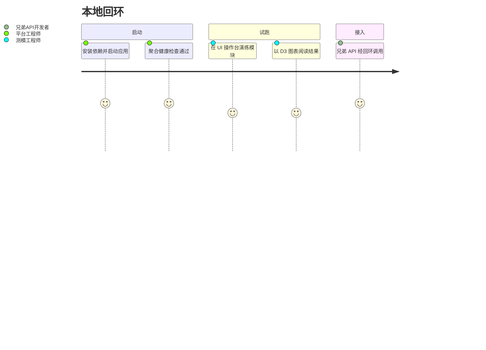

# 用户故事地图

> 格式：Jeff Patton 故事地图 + Mermaid journey + GWT（Epic 分文件）。  
> 本页为索引；正文与验收标准见 [user-stories/](./user-stories/)。

## 用户画像

| 角色 | 说明 |
|------|------|
| 平台工程师 | 本地启动回环 ML 应用并挂载测试数据 |
| 兄弟 API 开发者 | 在同一 base URL 上调用 recommendation / vision / rag / image_playground / speech / video |
| 测模工程师 | 在 `web/` 操作台（:4210）逐模块验证 |

## 旅程总览

### 本地回环

健康检查：`GET /health`（:8000）；每个已加载模块返回 `status`（`ok` / `degraded` / `error`）与 `latency_ms`。

## Backbone 故事地图

| 模块化服务 | 统一应用 | 操作台 |
|------------|----------|--------|
| [US-01](./user-stories/E1-modular-services.md#us-01-扁平分模块布局) 扁平布局 | [US-05](./user-stories/E2-unified-app.md#us-05-单应用与聚合健康) 单应用 + 健康 | [US-09](./user-stories/E3-operator-console.md#us-09-模块页) 模块页 |
| [US-02](./user-stories/E1-modular-services.md#us-02-rag-导出向量) RAG 导出向量 | [US-06](./user-stories/E2-unified-app.md#us-06-密钥仅存于-env) 密钥进 `.env` | [US-10](./user-stories/E3-operator-console.md#us-10-每模块页-d3-图表) D3 图表 |
| [US-03](./user-stories/E1-modular-services.md#us-03-websocket-流式-asr) 流式 ASR | [US-07](./user-stories/E2-unified-app.md#us-07-视觉分数与视频审核) 视觉 / 视频 | [US-11](./user-stories/E3-operator-console.md#us-11-rag-嵌入图谱) 嵌入图谱 |
| [US-04](./user-stories/E1-modular-services.md#us-04-微调脚本) 微调脚本 | [US-08](./user-stories/E2-unified-app.md#us-08-ui-代理与分模块健康) UI `/ml` 代理 | [US-12](./user-stories/E3-operator-console.md#us-12-评估看板) 评估看板 |

## Epic 索引

| Epic | 文件 | 故事 | 状态 |
|------|------|------|------|
| E1 模块化服务 | [E1-modular-services.md](./user-stories/E1-modular-services.md) | US-01 – US-04 | 已实现 |
| E2 统一应用 | [E2-unified-app.md](./user-stories/E2-unified-app.md) | US-05 – US-08 | 已实现 |
| E3 操作台 | [E3-operator-console.md](./user-stories/E3-operator-console.md) | US-09 – US-12 | 已实现（US-12 规划中） |

## 参考

- [User Story Mapping — Jeff Patton](https://www.jpattonassociates.com/user-story-mapping/)
- [Domain Glossary](../Glossary.md)
