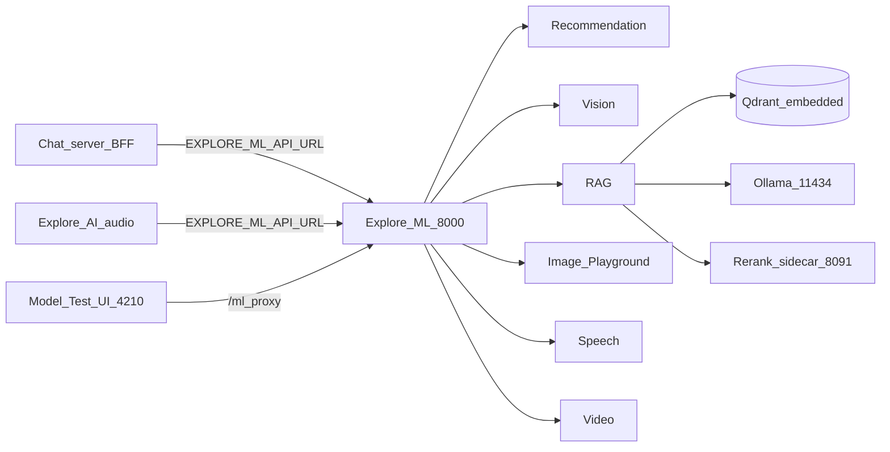
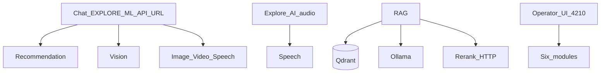
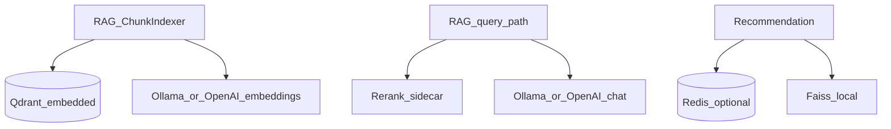
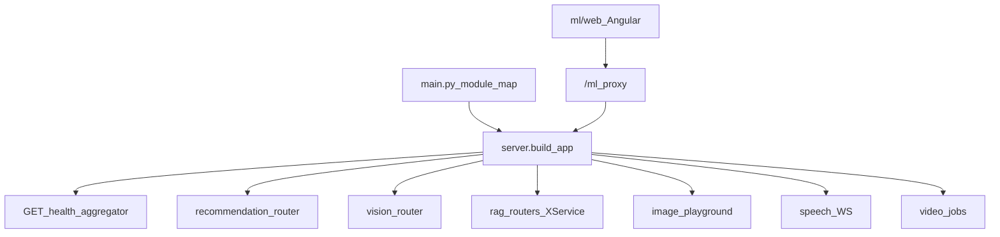
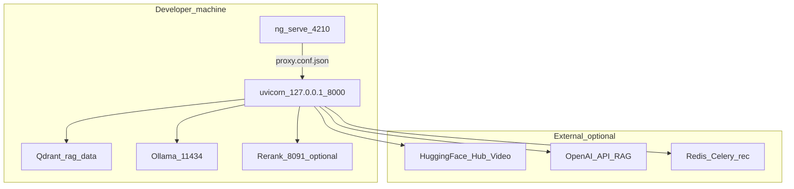
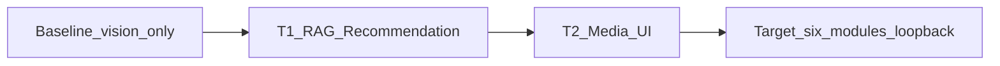

# Architecture Definition Document — Explore ML

| Field | Value |
| --- | --- |
| Deliverable | Architecture Definition Document (TOGAF Architecture Content Framework) |
| Reference | [TOGAF Architecture Deliverables §32.2.3](https://pubs.opengroup.org/architecture/togaf9-doc/m/chap32.html) |
| Capability | Explore ML (loopback FastAPI sidecar, six modules, model-test UI) |
| ADM phases | B–D (Architecture Vision from Phase A summarized in §1) |
| Architecture states | Baseline, Transition (T1, T2), Target |
| Companion | Architecture Requirements Specification (quantitative) — separate deliverable |
| Code-level models | [C4 model](../c4-model/README.md) |
| Preferred Terms | Idiomatic English ([Glossary](../../Glossary.md)) |

**Purpose.** Explore products fail when every JVM or Node API embeds its own torch stack, when operators cannot tell which module is ready before ingest, or when browsers gain a direct path to GPU memory. This Architecture Definition Document records how Explore ML is organized today and how it evolved from a single-endpoint script: qualitative models across Business, Data, Application, and Technology domains, with honest Baseline and Transition states and an as-built **Target** that matches the codebase on this branch—not roadmap capabilities stated as shipped fact.

---

## Contents

- [1. Vision](#1-vision)
- [2. Architecture principles](#2-architecture-principles)
- [3. Architecture models](#3-architecture-models)
  - [3.1 Business Architecture](#31-business-architecture)
  - [3.2 Data Architecture](#32-data-architecture)
  - [3.3 Application Architecture](#33-application-architecture)
  - [3.4 Technology Architecture](#34-technology-architecture)
- [4. Re-use, standards, and landscape](#4-re-use-standards-and-landscape)
  - [4.1 Re-use assessment](#41-re-use-assessment)
  - [4.2 Mapping to standards](#42-mapping-to-standards)
  - [4.3 Mapping to architecture landscape](#43-mapping-to-architecture-landscape)
- [5. Transition Architecture](#5-transition-architecture)
- [6. References](#6-references)

---

## 1. Vision

### Problem

**Explore Chat** needs feed rank, vision moderation, and generative media without bloating **chat/server**. **Explore AI Lab** needs TTS and ASR without shipping Qwen weights inside the JVM. Operators need a single health surface before they wire `EXPLORE_ML_API_URL`. The failure mode is N duplicate Python environments, public `:8000` exposure, or product clients dialing ML directly—bypassing the product API’s auth and quota layers.

**Primary consumers (Target):** Chat BFF (recommendation, vision, image/video/voice generation) and Explore AI audio (`EXPLORE_ML_API_URL` for speech). **Portfolio** and **Commerce** are not consumers of this app—Commerce maintains separate data-mining helpers outside this six-module process.

### Stakeholders and concerns

| Stakeholder | Concern | Architectural response |
| --- | --- | --- |
| Chat / AI API engineers | Stable AIP-style `/api/v1` operations on one port | Six packages, one `build_app` shell; no duplicate operation paths |
| ML engineer | Isolated modules, pytest per package, weights outside git | `server/<module>/`; `LOCAL_MODELS_ROOT` at `~/Codes/models` |
| Operator | Per-module readiness before demo | Aggregated `GET /health` with `latency_ms` |
| Security | No internet-facing ML by default | Loopback upstream; product PEP owns authn/z |

### Solution

One **uvicorn** process on **`:8000`** mounts **recommendation**, **vision**, **rag**, **image_playground**, **speech**, and **video**. Sibling APIs set **`EXPLORE_ML_API_URL`** to `http://127.0.0.1:8000` and call over loopback only. The **Angular model-test UI** on **`:4210`** proxies **`/ml/*`** (prefix stripped, WebSocket on) for manual verification—`pnpm dev ml` starts both. RAG uses embedded **Qdrant**, **Ollama** (or OpenAI) for embeddings and generation, and an optional **rerank sidecar** at `RERANK_URL`.



C1 external systems, module layering, and deployment defaults are in [C1-Context.puml](../c4-model/C1-Context.puml), [C3-Component.puml](../c4-model/C3-Component.puml), and [C4-Deployment.puml](../c4-model/C4-Deployment.puml). Operator flows: [User Guide](../../user-guide/README.md).

---

## 2. Architecture principles

Each principle states a failure mode, the decision, and an enforceable constraint.

1. **Loopback trust boundary** — *Failure:* mobile apps hit `:8000` and skip Chat JWT checks. *Decision:* product **clients never** call Explore ML; only sibling APIs and the model-test UI do. *Constraint:* bind dev to loopback; Chat/AI set `EXPLORE_ML_API_URL` to `http://127.0.0.1:8000`; document in integration guides.

2. **Single app, six modules** — *Failure:* port sprawl and conflicting OpenAPI paths. *Decision:* `server/main.py` imports six `module.py` entrypoints into `build_app`. *Constraint:* `test_should_not_register_the_same_operation_in_two_modules` guards route ownership.

3. **Module contract** — *Failure:* ad hoc Flask blueprints with inconsistent errors. *Decision:* each package exports `router`, `health()`, optional `lifespan()`. *Constraint:* operations under `/api/v1/<collection>:<method>` with no module prefix in the URL (AIP-136 custom methods).

4. **Health transparency** — *Failure:* operators discover missing Ollama only after a failed ingest. *Decision:* aggregated health aggregates per-module probes plus shell-added `latency_ms`. *Constraint:* overall `status` is `degraded` when any module reports non-`ok`.

5. **Weights out of repo** — *Failure:* multi-gigabyte commits and slow CI. *Decision:* `LOCAL_MODELS_ROOT` and Hugging Face ids (e.g. Video `COGVIDEOX_MODEL`) live outside git. *Constraint:* [Model download](../../user-guide/model-download.md) for Speech, Image Playground, rerank, and feed ranker paths.

6. **Secrets in `.env` only** — *Failure:* API keys in `config.py`. *Decision:* tunables are constants in `server/config.py` and `<module>/config.py`; secrets (`DATABASE_URL`, `REDIS_PASSWORD`, `OPENAI_API_KEY`) load from `server/.env`. *Constraint:* never commit `.env`.

7. **Glossary-first naming** — *Failure:* UI and OpenAPI disagree on module names. *Decision:* [Glossary](../../Glossary.md) Preferred Terms (`RAG`, `Image Playground`, `Health Report`, …) govern docs and commits. *Constraint:* new endpoints update Glossary and C4 when boundaries change.

---

## 3. Architecture models

Baseline, Transition, and **Target** are labeled explicitly. Target describes what ships on this branch; aspirational module splits or cloud-hosted Qdrant appear only in §5 roadmap notes—not as Target facts.

### 3.1 Business Architecture

#### Baseline

A single Python script exposing one vision prediction endpoint—no shared health, no recommendation or RAG, no operator UI, no workspace `pnpm dev ml` integration.

#### Target

| Module | Business outcome | Representative operations |
| --- | --- | --- |
| Recommendation | Rank Feed, Explore, and Reels candidates; vector recall | `POST feeds:rank`, `explores:rank`, `reels:rank`, `feeds:recall` |
| Vision | Image labels and image/video moderation | `images:predict`, `images:moderate`, `videos:moderate` |
| RAG | Document Q&A, streaming answers, corpus sync | `documents:query`, `documents:streamQuery`, `posts:sync`, `webpages:scrape`, … |
| Image Playground | Text-to-image jobs with polling | `images:generate`, `GET imageJobs/{id}` |
| Speech | TTS and ASR (file + WebSocket streaming) | `voices:synthesize`, `audios:transcribe`, `WS /ws/v1/audios:transcribe` |
| Video | Text-to-video jobs with polling | `videos:generate`, `GET videoJobs/{id}` |
| Model Test UI | Manual endpoint exercise with D3 charts | Dev-only; not a product surface |

| Consumer (product) | Typical module use |
| --- | --- |
| **Chat BFF** | Recommendation rank; vision on publish; image/video/voice generate |
| **Explore AI Lab** | Speech TTS/ASR via `com.ai.audio` loopback client |
| **Model Test UI** | All modules for smoke tests |



### 3.2 Data Architecture

#### Baseline

In-memory tensors per request; no vector store; no job polling contract.

#### Target

| Domain artifact | Store | Module |
| --- | --- | --- |
| Chunk embeddings | Qdrant collections `documents`, `posts`, `comments`, `webpages` | RAG |
| Rank / recall features | Optional Redis / DB URLs in recommendation config | Recommendation |
| Generation jobs | In-process `JobStore` | Image Playground, Video |
| Audio payloads | Transient request bodies; synthesized media URLs via `BASE_URL` | Speech |
| Local checkpoints | Filesystem under `LOCAL_MODELS_ROOT` | Vision fine-tune, Speech, Image LoRA, RAG rerank weights, feed ranker |
| Video weights | Hugging Face Hub id `COGVIDEOX_MODEL` | Video |



RAG retrieval rescores `top_k * 3` candidates when **`RERANK_ENABLED`** and **`RERANK_URL`** (`http://127.0.0.1:8091` by default) respond; otherwise answers proceed without rerank ([operator-setup](../../user-guide/operator-setup.md)). Collections initialize on module `lifespan` via `get_qdrant_service().initialize_collections()`.

### 3.3 Application Architecture

#### Baseline

Monolithic router files without shared exception mapping or composed lifespan.

#### Target



| Shell responsibility | Behavior |
| --- | --- |
| `build_app(modules)` | Registers each module `router`; runs composed `lifespan` in order |
| `GET /health` | Awaits each `module.health()`; adds `latency_ms`; sets top-level `status` |
| OpenAPI | `GET /docs` lists all modules in one document |

**`GET /health` schema (as-built)**

| Field | Type | Meaning |
| --- | --- | --- |
| `status` | `ok` \| `degraded` | `ok` only if every module’s `status` is `ok` |
| `modules` | object | Keys: `recommendation`, `vision`, `rag`, `image_playground`, `speech`, `video` |
| `modules.<name>.status` | `ok` \| `degraded` | Module-local readiness |
| `modules.<name>.latency_ms` | number | Shell-measured probe time (≥ 0) |
| `modules.<name>.*` | varies | Module-specific fields, e.g. `recommendation.ranker` (bool), `vision.model` (`resnet50` \| `fine_tuned`), `rag.qdrant` / `rag.embeddings` (bools) |

Example shape (illustrative):

```json
{
  "status": "degraded",
  "modules": {
    "recommendation": { "status": "ok", "ranker": true, "latency_ms": 0.42 },
    "rag": {
      "status": "degraded",
      "qdrant": true,
      "embeddings": false,
      "latency_ms": 12.1
    }
  }
}
```

RAG reports **`degraded`** until Ollama (or configured embedding provider) is reachable—app still starts because heavy libraries load lazily ([server/README.md](../../../ml/server/README.md)).

| Operation family | Prefix examples |
| --- | --- |
| Recommendation | `/api/v1/feeds:rank`, `reels:rank`, `feeds:recall` |
| Vision | `/api/v1/images:predict`, `videos:moderate` |
| RAG | `/api/v1/documents:query`, `documents:streamQuery`, `collections` |
| Generative | `/api/v1/images:generate`, `videos:generate`, `voices:synthesize` |
| Streaming ASR | `WS /ws/v1/audios:transcribe` (`partial` / `final` / `error` events) |

Domain types (`Chunk`, `SearchHit`, `Answer`, `Job`, `ModerationVerdict`, …) live per module `domain/` per [Glossary §4](../../Glossary.md).

### 3.4 Technology Architecture

#### Baseline

Python 3.10, manual `uvicorn`, CPU-only torch, no Angular UI, no Nx `pnpm dev ml`.

#### Target



| Component | Choice |
| --- | --- |
| Runtime | Python 3.11+, FastAPI, uvicorn; `pnpm dev ml` from workspace root |
| ML app | `ml/server/main.py` → `server.build_app`; port **8000** (`PORT` in `config.py`) |
| Model Test UI | Angular, NG-ZORRO, Tailwind, D3 in `ml/web`; port **4210**; proxy `/ml` |
| CI | `pytest` on app + RAG; UI test/build on GitHub Actions (Python 3.12 / Node 22) |
| Optional workers | Celery for recommendation jobs when Redis configured |
| Container | Documented in `server/README.md`; not required for local dev |

**Roadmap note (not Target):** hosted Qdrant cluster or split speech microservice are backlog items only—they are not required for the single-process Target above.

---

## 4. Re-use, standards, and landscape

### 4.1 Re-use assessment

| Asset | Re-use |
| --- | --- |
| FastAPI + uvicorn | One OpenAPI surface for six modules |
| Qdrant embedded path | RAG collections without separate infra in dev |
| Ollama | RAG embeddings and local chat completion |
| Rerank HTTP sidecar | Optional second-stage scoring (`RERANK_URL`) |
| Hugging Face Hub | Video `COGVIDEOX_MODEL` when local weights absent |
| AIP-style custom methods | Shared verb naming with Chat Nest/Python helpers |
| C4 + Glossary | Module boundaries and external system map for onboarding |
| D3 chart kit (`ml/web/src/app/shared/`) | Operator visualization per module page |

### 4.2 Mapping to standards

| Standard | Application |
| --- | --- |
| [AIP-136 custom methods](https://google.aip.dev/136) | `collection:verb` paths (`feeds:rank`, `documents:query`) |
| [FastAPI](https://fastapi.tiangolo.com/) | Routers per module; global exception handlers in RAG |
| [OpenAPI 3](https://swagger.io/specification/) | Unified `/docs` on `:8000` |
| Health aggregate pattern | Top-level `ok`/`degraded` + per-module probes (Glossary **Health Report**) |
| WebSocket streaming | Speech `StreamingTranscriptionSession` event contract |
| Loopback integration | Product APIs own TLS, auth, and quotas; ML trusts localhost |
| TOGAF content framework | This ADD; companion ARS for numeric SLOs when published |

### 4.3 Mapping to architecture landscape

| Landscape element | Position |
| --- | --- |
| Monorepo path | `ml/server`, `ml/web`, `ml/data` |
| Dev entry | `pnpm dev ml` (FastAPI **8000** + UI **4210**) |
| Product-only run | `cd ml/server && uvicorn main:app --port 8000` |
| Primary upstream callers | **Chat** (`EXPLORE_ML_API_URL`); **Explore AI** audio client |
| Explicit non-consumers | Portfolio; Commerce data-mining (separate stack) |
| Chat integration doc | [Chat python-services](../../../chat/developer/python-services.md) |
| AI integration | Explore AI `EXPLORE_ML_API_URL` for speech module |
| Living docs | [Glossary](../../Glossary.md), [C4](../c4-model/README.md), [User Guide](../../user-guide/README.md), [User Story Map](../../product-owner/User-Story-Map.md) |

---

## 5. Transition Architecture

| State | Definition |
| --- | --- |
| Baseline | Single vision endpoint script; no composed health |
| T1 | Recommendation + RAG with Qdrant and optional Redis; shared `build_app` |
| T2 | Speech + image/video job modules; Angular model-test UI + `/ml` proxy |
| Target | All six modules under `pnpm dev ml`; documented loopback consumers (Chat BFF + Explore AI audio) |

### T1 — Rank and retrieve

| Domain | Change |
| --- | --- |
| Business | Feed/Explore/Reels rank and recall callable from Chat BFF |
| Data | Qdrant collections for RAG; optional Redis for recommendation |
| Application | `recommendation` and `rag` packages with `module.py` health hooks |
| Technology | Embedded Qdrant; Ollama for embeddings; `GET /health` aggregates modules |

### T2 — Media and operator UI

| Domain | Change |
| --- | --- |
| Business | Generative image/video jobs; TTS/ASR including streaming WS |
| Data | In-memory `JobStore`; audio URL emission via `BASE_URL` |
| Application | `image_playground`, `speech`, `video` routers; `ml/web` module pages |
| Technology | UI **4210** proxy; `LOCAL_MODELS_ROOT` for Qwen speech and LoRA image paths |

### Target — Full sidecar (per-domain delta from T2)

| Domain | Change |
| --- | --- |
| Business | RAG rerank sidecar optional path; vision fine-tuned head when `MODEL_PATH` set |
| Data | Four searchable RAG collections; sync from content API |
| Application | No duplicate OpenAPI operations across modules; Chat + AI documented as sole product callers |
| Technology | Workspace `pnpm dev ml`; CI pytest subset; loopback-only contract enforced in user guide |



---

## 6. References

- [TOGAF Architecture Deliverables — Architecture Definition Document §32.2.3](https://pubs.opengroup.org/architecture/togaf9-doc/m/chap32.html)
- [FastAPI](https://fastapi.tiangolo.com/)
- [Uvicorn](https://docs.uvicorn.org/)
- [Qdrant documentation](https://qdrant.tech/documentation/)
- [Google AIP custom methods](https://google.aip.dev/136)
- [Glossary](../../Glossary.md)
- [C4 model](../c4-model/README.md)
- [User Guide](../../user-guide/README.md)
- [Operator setup](../../user-guide/operator-setup.md)
- [Model download](../../user-guide/model-download.md)
- [Python services layout](../python-services.md)
- [Server README](../../../ml/server/README.md)
- [User Story Map](../../product-owner/User-Story-Map.md)