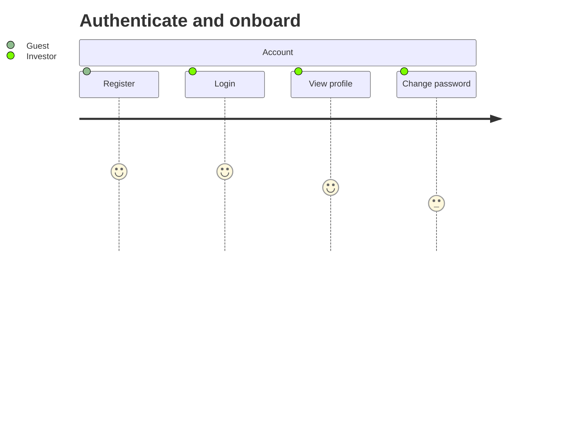
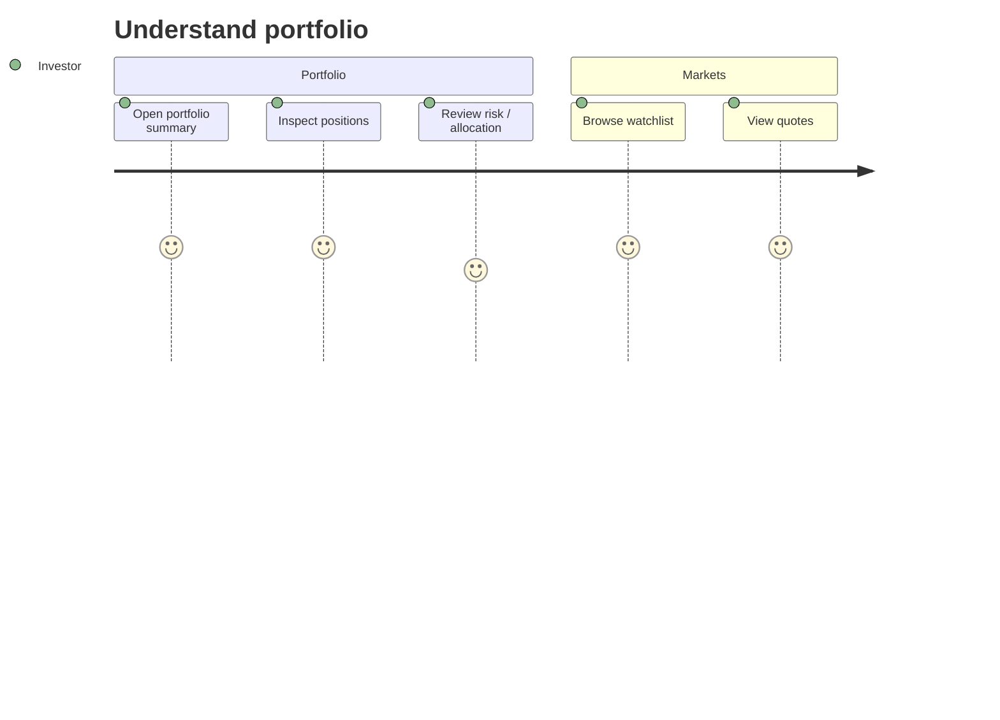
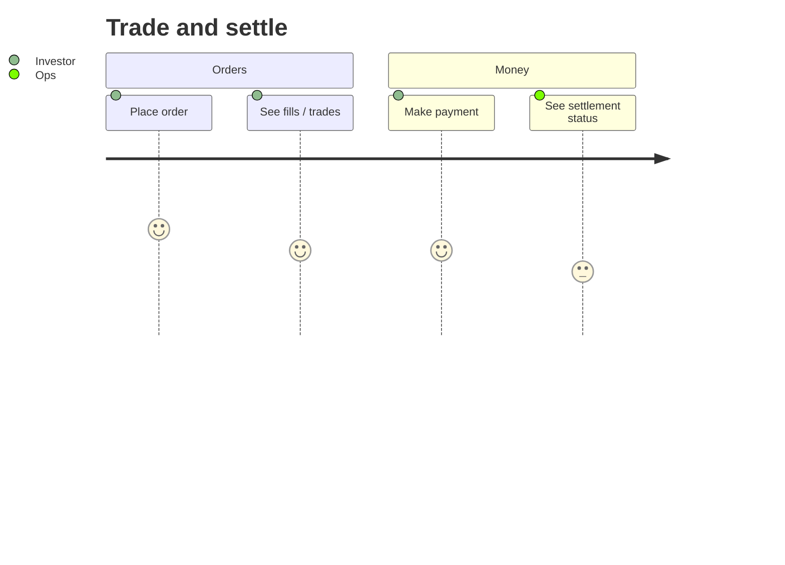
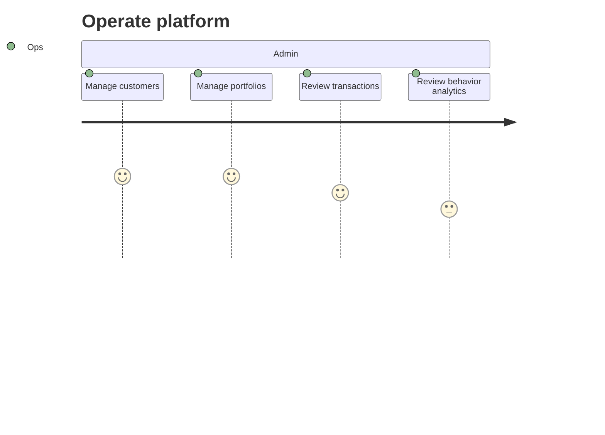

# 用户故事地图 | User Story Map — Explore Portfolio
> Jeff Patton 用户故事地图；正文与验收标准合并于本文（单一文档）。  
> Jeff Patton user-story map; epics and GWT acceptance criteria live in this single document.  
> 格式 / Format：Background → `As a` / `I want` / `So that` → Scenario GIVEN-WHEN-THEN（双语 / bilingual）。

## 用户画像 | Personas

| 角色 / Role | 说明 / Description |
| ---- | ---- |
| 投资者 / Investor | 经 portal |
| 投顾 | 经 admin 管理客户、账户、组合与流水 / Manages customers, accounts, portfolios, and ledgers via admin |
| 访客 / Guest | 注册与认证 / Registers and authenticates |
| 开发者 / Developer | 灌数、跑本地栈、扩展 API / Seeds data, runs the local stack, extends APIs |

## 旅程总览 | Journey Overview

### 认证与入驻

### 理解组合

### 交易与清算

### 运营（Admin）

---

## 骨干故事地图

### 已完成

| Auth | Customers & accounts | Instruments & markets | Portfolios | Watchlists & quotes |
| ---- | -------------------- | --------------------- | ---------- | ------------------- |
| [US-01](#us-01-register) Register | [US-04](#us-04-manage-customers) Customers | [US-06](#us-06-instrument-catalog) Instruments | [US-08](#us-08-portfolio-crud) Portfolios | [US-10](#us-10-watchlists) Watchlists |
| [US-02](#us-02-login) Login | [US-05](#us-05-manage-accounts) Accounts | [US-07](#us-07-market-data-records) Market data | [US-09](#us-09-positions) Positions | [US-11](#us-11-quotes) Quotes |
| [US-03](#us-03-session) Session | | | | |

| Trading | Payments | Analytics | Surfaces | Bonds & options | Blockchain |
| ------- | -------- | --------- | -------- | --------------- | ---------- |
| [US-12](#us-12-orders) Orders | [US-14](#us-14-payments) Payments | [US-16](#us-16-portfolio-analytics) Portfolio analytics | [US-18](#us-18-admin-console) Admin | [US-21](#us-21-bonds) Bonds | [US-23](#us-23-blockchain-demo) Blockchain demo |
| [US-13](#us-13-trades) Trades | [US-15](#us-15-settlements--cash) Settlements & cash | [US-17](#us-17-behavior--forecast) Behavior & forecast | [US-19](#us-19-portal) Portal | [US-22](#us-22-options) Options | |
| | | | [US-20](#us-20-mobile) Mobile | | |

## Epic 索引 | Epic Index

| Epic | 锚点 / Anchor | 状态 / Status |
|------|---------------|---------------|
| E1 — Auth | [#e1](#e1) | — |
| E2 — Customers & Accounts | [#e2](#e2) | — |
| E3 — Instruments & Markets | [#e3](#e3) | — |
| E4 — Portfolios & Positions | [#e4](#e4) | — |
| E5 — Watchlists & Quotes | [#e5](#e5) | — |
| E6 — Orders & Trades | [#e6](#e6) | — |
| E7 — Payments & Settlements | [#e7](#e7) | — |
| E8 — Analytics & Risk | [#e8](#e8) | — |
| E9 — Admin, Portal, Mobile surfaces | [#e9](#e9) | — |
| E10 — Bonds & Options | [#e10](#e10) | — |
| E11 — Blockchain demo | [#e11](#e11) | — |

## Related

- [User Story Mapping — Jeff Patton](https://www.jpattonassociates.com/user-story-mapping/)
- [Glossary](../Glossary.md)
- [C4](../c4-model/)

---

# 用户故事正文 | User Stories

## E1 — Auth

### 背景 | Background

注册、登录与会话接口门禁 FinPulse 的 portal、admin 与 mobile。 / Registration, login to the session interface Ban FinPulse Via portal, admin and mobile.

### US-01 Register

**As a** 访客 / Guest  
**I want** 以邮箱与密码注册 / Registered in mailbox and password  
**So that** 形成可供后续登录的 Customer 记录 / Form a follow-up login Customer Records

#### 验收标准 | Acceptance Criteria

1. **Scenario** 合法注册 / Legal registration  
   **GIVEN** 合法注册载荷 / Legally registered payload  
   **WHEN** `POST /api/v1/auth/register`  
   **THEN** API 返回 token + customer，并持久化用户 / API returns token + customer, and sustain users  

2. **Scenario** 拒绝重复邮箱 / Deny repetition of mailboxes  
   **GIVEN** 已存在的邮箱 / Existing email  
   **WHEN** 尝试注册 / Try registration  
   **THEN** API 返回客户端错误，不创建第二用户 / API Return client error, do not create second user  

#### 状态 | Status

已完成

---

### US-02 Login

**As a** 已注册用户 / Registered User  
**I want** 登录 / Login  
**So that** 获得调用 API 的 Bearer token / Get Call API Via Bearer token

#### 验收标准 | Acceptance Criteria

1. **Scenario** 合法凭证 / Legitimate credential  
   **GIVEN** 合法凭证 / Legitimate credential  
   **WHEN** `POST /api/v1/auth/login`  
   **THEN** API 返回 `{ token, customer }` / API returns `{ token, customer }`  

2. **Scenario** 拒绝非法凭证 / Reject illegal documents  
   **GIVEN** 非法凭证 / Illegal documents  
   **WHEN** 尝试登录 / Try login  
   **THEN** API 拒绝请求 / API Request denied  

#### 状态 | Status

已完成

---

### US-03 Session

**As a** 已登录用户 / Signed-in User  
**I want** `/auth/me`、登出与改密 / `/auth/me`, Logout and Decrypt  
**So that** 可查看或结束当前会话 / Can view or close the current session

#### 验收标准 | Acceptance Criteria

1. **Scenario** 当前用户 / Current User  
   **GIVEN** 合法 Bearer token / Legal Bearer token  
   **WHEN** `GET /api/v1/auth/me`  
   **THEN** 返回当前 customer / Return Current customer  

2. **Scenario** 登出 / Logout  
   **GIVEN** 合法 Bearer token / Legal Bearer token  
   **WHEN** `POST /api/v1/auth/logout`  
   **THEN** 会话失效（204） / Session invalid(204)  

#### 状态 | Status

已完成

---

## E2 — Customers & Accounts

### 背景 | Background

Customer 与 Account 的 CRUD 支撑组合、支付与 admin 工作流。 / Customer and Account Via CRUD Support grouping, payment and admin Workstream.

### US-04 Manage customers

**As a**     
**I want** 创建与更新 Customer / Create & Update Customer  
**So that** 客户记录对组合与支付保持准确 / Client records are accurate for portfolio and payment

#### 验收标准 | Acceptance Criteria

1. **Scenario** Customer CRUD  
   **GIVEN** 已授权访问 / Visits authorized  
   **WHEN** 调用 Customer CRUD 接口 / Call Customer CRUD Interface  
   **THEN** Customer 持久化，并按 API 文档列表  

#### 状态 | Status

已完成

---

### US-05 Manage accounts

**As a**     
**I want** 为 Customer 管理 Account / Yes Customer Management Account  
**So that** 组合与资金挂到正确账户 / Portfolio and funds to the correct account

#### 验收标准 | Acceptance Criteria

1. **Scenario** Account CRUD  
   **GIVEN** 一个 Customer / One. Customer  
   **WHEN** 使用 Account CRUD / Use Account CRUD  
   **THEN** Account 关联该 Customer，并出现在列表  

#### 状态 | Status

已完成

---

## E3 — Instruments & Markets

### 背景 | Background

Position 与 Order 引用标的目录及已存市场观测。 / Position and Order Catalogue of references and stored market observations.

### US-06 Instrument catalog

**As a** 用户 / user  
**I want** 经 API 获取 Instrument / Via API Access Instrument  
**So that** Position 与 Order 使用稳定的 symbol 与 id / Position and Order Use stable symbol and id

#### 验收标准 | Acceptance Criteria

1. **Scenario** 列出 Instrument / List Instrument  
   **GIVEN** 已灌入的 Instrument / Filled Instrument  
   **WHEN** `GET /api/v1/instruments`  
   **THEN** 返回带稳定 id  

#### 状态 | Status

已完成

---

### US-07 Market data records

**As a**     
**I want** MarketData CRUD  
**So that** 历史观测持久化，供分析与行情使用 / Endurance of historical observations for analytical and contextual use

#### 验收标准 | Acceptance Criteria

1. **Scenario** MarketData CRUD  
   **GIVEN** MarketData 载荷 / MarketData Load  
   **WHEN** 调用 MarketData 接口 / Call MarketData Interface  
   **THEN** 记录按 API 契约持久化 / Record Press API Contract durability  

#### 状态 | Status

已完成

---

## E4 — Portfolios & Positions

### 背景 | Background

Portfolio 聚合持仓；Position 记录各标的数量。 / Portfolio aggregates holdings; Position records quantity per instrument.

### US-08 Portfolio CRUD

**As a**     
**I want** Portfolio  
**So that** 持仓按账户或委托分组 / Holding by account or commissioning group

#### 验收标准 | Acceptance Criteria

1. **Scenario** Portfolio CRUD  
   **GIVEN** Account  
   **WHEN** 使用 Portfolio CRUD / Use Portfolio CRUD  
   **THEN** Portfolio 持久化且可列表 / Portfolio Persistent and listable  

#### 状态 | Status

已完成

---

### US-09 Positions

**As a**     
**I want** Portfolio 内的 Position / Portfolio Inside Position  
**So that** 可见各 Instrument 数量 / Visible Instrument Number

#### 验收标准 | Acceptance Criteria

1. **Scenario** Position CRUD  
   **GIVEN** Portfolio 与 Instrument / Portfolio and Instrument  
   **WHEN** 使用 Position CRUD  
   **THEN** Position 反映数量与 Instrument 引用 / Position Reflect quantity and Instrument References  

#### 状态 | Status

已完成

---

## E5 — Watchlists & Quotes

### 背景 | Background

投资者在自选中跟踪代码，经 REST 或可用流式通道读取行情。 / Investors are choosing their own tracking code. REST Or you can read lines using stream channels..

### US-10 Watchlists

**As a**     
**I want** Watchlist 与明细 / Watchlist And detail  
**So that** 关注代码跨会话持久 / Focus on code inter-session duration

#### 验收标准 | Acceptance Criteria

1. **Scenario** Watchlist CRUD  
   **GIVEN** 已认证用户 / Accredited Users  
   **WHEN** 调用 Watchlist 与 WatchlistItem API / Call Watchlist and WatchlistItem API  
   **THEN** 列表与明细持久化 / List & Detailed Endurance  

#### 状态 | Status

已完成

---

### US-11 Quotes

**As a**     
**I want** 标的行情 / Mark Line  
**So that** portal 与 mobile 可获得当前价格 / portal and mobile Available current price

#### 验收标准 | Acceptance Criteria

1. **Scenario** Quote API  
   **GIVEN** 一组 symbol / Group symbol  
   **WHEN** 调用 Quote API（Java 与/或 Python 聚合  
   **THEN** 按 API 文档返回或推送行情载荷 / Press API Document returns or pushes the case load  

#### 状态 | Status

已完成

---

## E6 — Orders & Trades

### 背景 | Background

Order 下达交易；成交以 Trade 记录呈现给投资者与运营。 / Order Deals made; deal made Trade Records presented to investors and operations.

### US-12 Orders

**As a**     
**I want** 创建与查看 Order / Create and View Order  
**So that** 标的交易可提交并可回查 / Subject transactions may be submitted and retraced

#### 验收标准 | Acceptance Criteria

1. **Scenario** Order API  
   **GIVEN** 合法委托载荷 / Legitimate entrusted load  
   **WHEN** 调用 Order API / Call Order API  
   **THEN** Order 持久化且可检索 / Order Sustained and searchable  

#### 状态 | Status

已完成

---

### US-13 Trades

**As a**     
**I want** Trade  
**So that** 成交列表字段与文档一致 / The transaction list field corresponds to the document

#### 验收标准 | Acceptance Criteria

1. **Scenario** Trade API  
   **GIVEN** Trade 记录 / Trade Records  
   **WHEN** 调用 Trade API / Call Trade API  
   **THEN** 列表  

#### 状态 | Status

已完成

---

## E7 — Payments & Settlements

### 背景 | Background

Payment 记录资金活动；Settlement 与 CashTransaction 记录交易后资金变动。 / Payment Recording of financial activities; Settlement and CashTransaction Changes in funds after recording transactions.

### US-14 Payments

**As a**     
**I want** 提交 Payment / Submit Payment  
**So that** 账户入金被记录 / Account entry recorded

#### 验收标准 | Acceptance Criteria

1. **Scenario** Payment API  
   **GIVEN** 合法支付载荷 / Legally paid load  
   **WHEN** 调用 Payment API / Call Payment API  
   **THEN** Payment 持久化（启用评分时可能含欺诈字段） / Payment Endurance (possibly fraud fields when ratings are enabled))  

#### 状态 | Status

已完成

---

### US-15 Settlements & cash

**As a**     
**I want** Settlement 与 CashTransaction / Settlement and CashTransaction  
**So that** 交易后资金变动可追踪 / Post-transaction funds are traceable

#### 验收标准 | Acceptance Criteria

1. **Scenario** Settlement 与资金 API / Settlement and funds API  
   **GIVEN** Settlement  
   **WHEN** 调用对应 API / Call Match API  
   **THEN** 记录按 API 文档持久化 / Record Press API Document Duration  

#### 状态 | Status

已完成

---

## E8 — Analytics & Risk

### 背景 | Background

Python Analytics 提供组合聚合、风险摘要、行为事件与预测钩子。 / Python Analytics Provide combination aggregates, risk summaries, behavioural events and forecast hooks.

### US-16 Portfolio analytics

**As a**     
**I want** 组合聚合与风险摘要 / Combined aggregation and risk summary  
**So that** 无需临时 SQL 即可获得敞口数据 / It doesn't have to be temporary. SQL So you can get open data.

#### 验收标准 | Acceptance Criteria

1. **Scenario** Analytics 接口 / Analytics Interface  
   **GIVEN** 后端服务已启动 / Backend service started  
   **WHEN** 调用 analytics  
   **THEN** 返回聚合  

#### 状态 | Status

已完成

---

### US-17 Behavior & forecast

**As a**     
**I want** 行为事件与预测钩子 / Behavioural events and prognosis hooks  
**So that** 产品分析与模型演示具备可存输入输出 / Product analysis and model demonstration with available input output

#### 验收标准 | Acceptance Criteria

1. **Scenario** 行为事件 / Behaviour  
   **GIVEN** 事件载荷 / Event Load  
   **WHEN** `POST /api/v1/analytics/events`  
   **THEN** 事件入库且可列表 / Event library and listable  

2. **Scenario** 预测 / Projections  
   **GIVEN** MLflow model URI  
   **WHEN** 调用 forecast model 接口 / Call forecast model Interface  
   **THEN** 返回预测或明确错误 / Return prediction or clear error  

#### 状态 | Status

已完成

---

## E9 — Admin, Portal, Mobile surfaces

### 背景 | Background

Admin、portal 与 mobile 共用 Java API 入口与共享包。 / Admin, portal and mobile Shared Java API Access and sharing packages.

### US-18 Admin console

**As a**     
**I want** Admin Web 应用 / Admin Web Apply  
**So that** 可在浏览器管理客户、组合与流水 / Manage customers, grouping and running water in browsers

#### 验收标准 | Acceptance Criteria

1. **Scenario** Admin 对接 API / Admin Console API  
   **GIVEN** `pnpm dev:admin`  
   **WHEN** Admin 指向 :8801 / Admin Point :8801  
   **THEN** 核心管理页对接 API 加载 / Core management page docking API Load  

#### 状态 | Status

已完成

---

### US-19 Portal

**As a**     
**I want** Portal Web 应用 / Portal Web Apply  
**So that** 浏览器可用组合与市场能力 / Browser Available Combination and Market Capacity

#### 验收标准 | Acceptance Criteria

1. **Scenario** Portal 对接灌数 / Portal Number of connections  
   **GIVEN** `pnpm dev:portal`  
   **WHEN** Portal 对接 :8801 运行 / Portal Console :8801 Run  
   **THEN** 灌数场景下组合  

#### 状态 | Status

已完成

---

### US-20 Mobile

**As a**     
**I want** 移动应用 / Move Apply  
**So that** 设备上加载仪表盘与自选数据 / Load dashboard and selected data on device

#### 验收标准 | Acceptance Criteria

1. **Scenario** Mobile 仪表盘 / Mobile dashboard  
   **GIVEN** 已配置 `EXPO_PUBLIC_API_BASE_URL` 的 Expo mobile / Configured `EXPO_PUBLIC_API_BASE_URL` Via Expo mobile  
   **WHEN** 打开仪表盘  
   **THEN** 数据自 API 入口加载 / Data from API Load the entrance  

#### 状态 | Status

已完成

---

## E10 — Bonds & Options

### 背景 | Background

Bond 与 Option 资源扩展 Instrument 模型，覆盖固收与衍生品。 / Bond and Option Resource Extension Instrument Models covering solid harvests and derivatives.

### US-21 Bonds

**As a**     
**I want** Bond 资源 / Bond Resources  
**So that** 固收持仓可关联 Instrument / Consistency holds associated. Instrument

#### 验收标准 | Acceptance Criteria

1. **Scenario** Bond API  
   **GIVEN** Bond 载荷 / Bond Load  
   **WHEN** 调用 Bond API / Call Bond API  
   **THEN** Bond 持久化，并按设计关联 Instrument / Bond Endurance and relevance by design Instrument  

#### 状态 | Status

已完成

---

### US-22 Options

**As a**     
**I want** Option 资源 / Option Resources  
**So that** 期权合约按 API 契约持久化 / The option contract. API Contract durability

#### 验收标准 | Acceptance Criteria

1. **Scenario** Option API  
   **GIVEN** Option 载荷 / Option Load  
   **WHEN** 调用 Option API / Call Option API  
   **THEN** Option 按 API 契约持久化 / Option Press API Contract durability  

#### 状态 | Status

已完成

---

## E11 — Blockchain demo

### 背景 | Background

Mobile 含钱包连接与测试网 ETH 转账演示路径（如 Sepolia）。 / Mobile Wallet Connection and Test Network ETH Transfer demonstration path (e. g.) Sepolia).

### US-23 Blockchain demo

**As a**     
**I want** 连接钱包并尝试测试网转账 / Connect wallets and try to test network transfers  
**So that** 展示连接状态与转账结果，且不触碰生产资金 / Show connectivity and transfer results without touching production funds

#### 验收标准 | Acceptance Criteria

1. **Scenario** 测试网钱包连接 / Test Wallet Connection  
   **GIVEN** Mobile 区块链页面与测试网配置 / Mobile blockchain Page and Test Network Configuration  
   **WHEN** 连接钱包 / Connect Wallet  
   **THEN** 应用展示连接状态，且不影响生产资金 / Application to demonstrate connectivity without affecting production funds  

2. **Scenario** 演示转账反馈 / Show transfer feedback  
   **GIVEN** 已在测试网连接钱包 / A web-connected wallet has been tested  
   **WHEN** 发起演示转账 / Start demonstration transfer  
   **THEN** 应用展示 JSON-RPC 路径的成功  

#### 状态 | Status

已完成

---

## 参考 | References

- [Glossary](./Glossary.md)
- [C4](./c4-model/)

