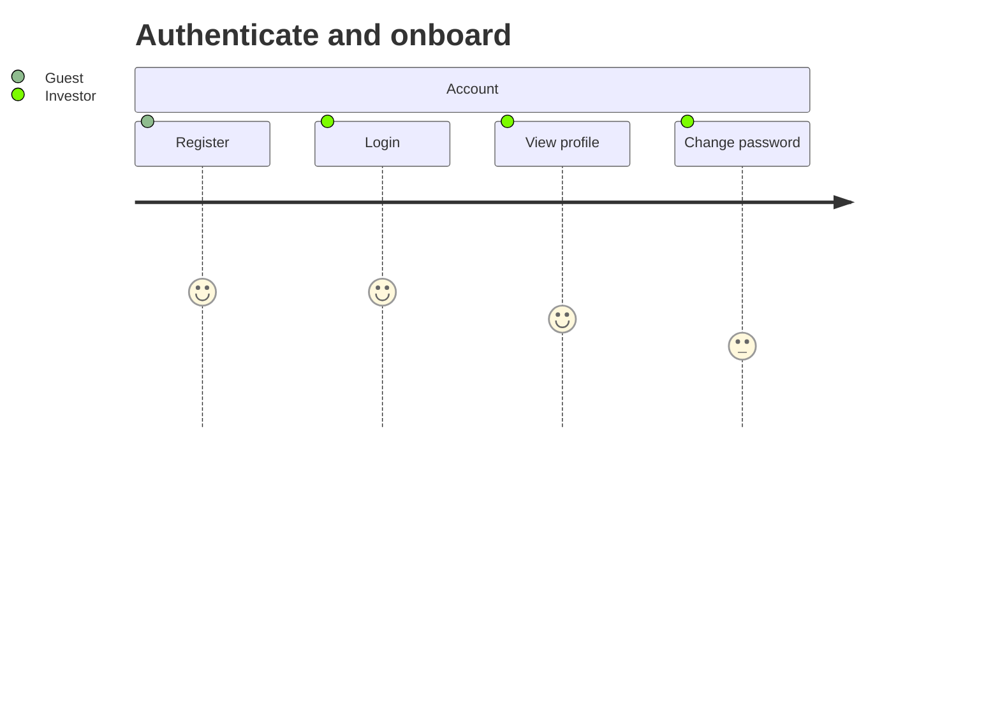
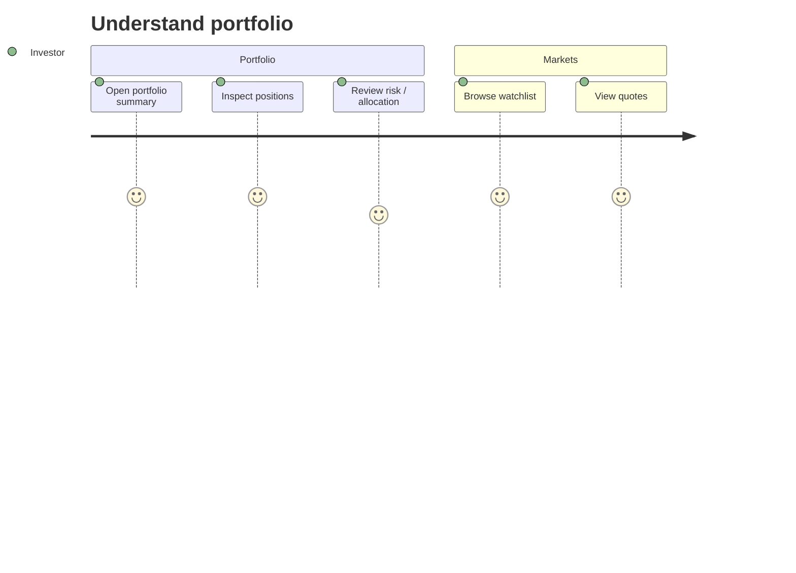
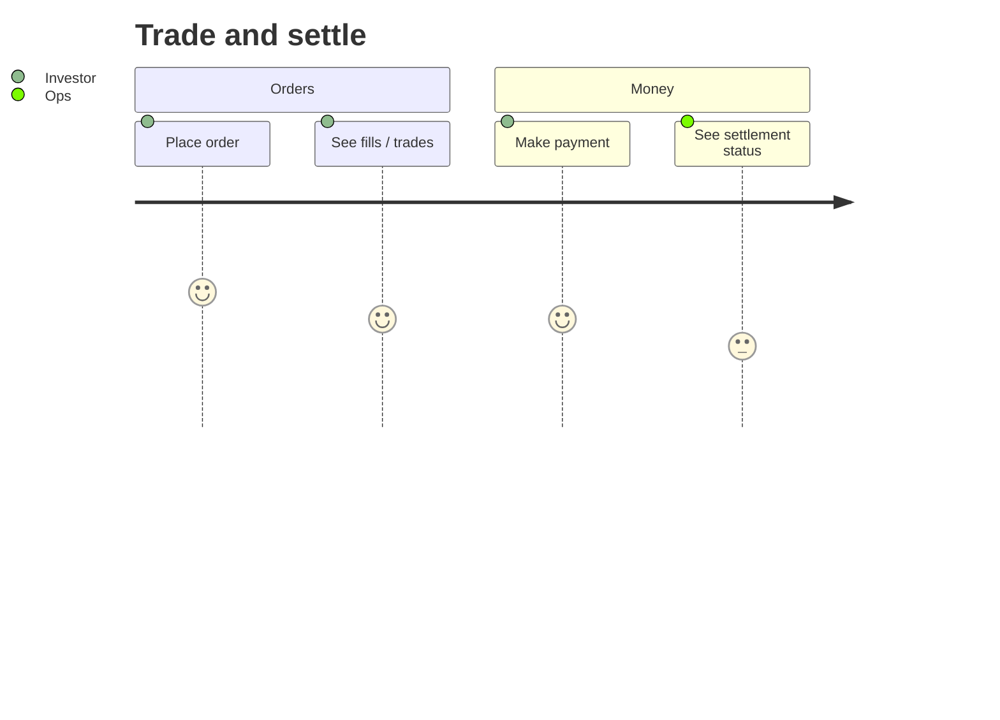
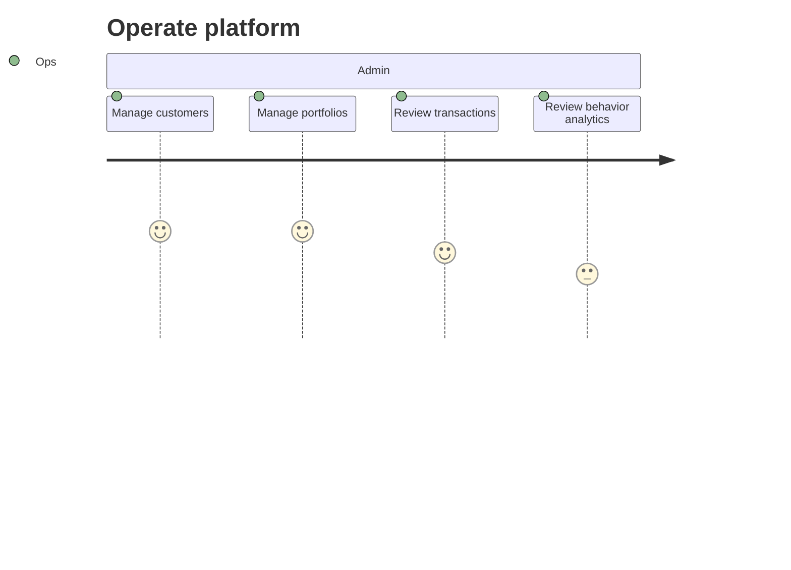

# 用户故事地图 | User Story Map — Explore Portfolio
> Jeff Patton 用户故事地图；正文与验收标准合并于本文（单一文档）。  
> Jeff Patton user-story map; epics and GWT acceptance criteria live in this single document.  
> 格式 / Format：Background → `As a` / `I want` / `So that` → Scenario GIVEN-WHEN-THEN（双语 / bilingual）。

## 用户画像 | Personas

| 角色 / Role | 说明 / Description |
| ---- | ---- |
| 投资者 / Investor | 经 portal |
| 投顾 | 经 admin 管理客户、账户、组合与流水 / Manages customers, accounts, portfolios, and ledgers via admin |
| 访客 / Guest | 注册与认证 / Registers and authenticates |
| 开发者 / Developer | 灌数、跑本地栈、扩展 API / Seeds data, runs the local stack, extends APIs |

## 旅程总览 | Journey Overview

### 认证与入驻

### 理解组合

### 交易与清算

### 运营（Admin）

---

## 骨干故事地图

### 已完成

| Auth | Customers & accounts | Instruments & markets | Portfolios | Watchlists & quotes |
| ---- | -------------------- | --------------------- | ---------- | ------------------- |
| [US-01](#us-01-register) Register | [US-04](#us-04-manage-customers) Customers | [US-06](#us-06-instrument-catalog) Instruments | [US-08](#us-08-portfolio-crud) Portfolios | [US-10](#us-10-watchlists) Watchlists |
| [US-02](#us-02-login) Login | [US-05](#us-05-manage-accounts) Accounts | [US-07](#us-07-market-data-records) Market data | [US-09](#us-09-positions) Positions | [US-11](#us-11-quotes) Quotes |
| [US-03](#us-03-session) Session | | | | |

| Trading | Payments | Analytics | Surfaces | Bonds & options | Blockchain |
| ------- | -------- | --------- | -------- | --------------- | ---------- |
| [US-12](#us-12-orders) Orders | [US-14](#us-14-payments) Payments | [US-16](#us-16-portfolio-analytics) Portfolio analytics | [US-18](#us-18-admin-console) Admin | [US-21](#us-21-bonds) Bonds | [US-23](#us-23-blockchain-demo) Blockchain demo |
| [US-13](#us-13-trades) Trades | [US-15](#us-15-settlements--cash) Settlements & cash | [US-17](#us-17-behavior--forecast) Behavior & forecast | [US-19](#us-19-portal) Portal | [US-22](#us-22-options) Options | |
| | | | [US-20](#us-20-mobile) Mobile | | |

## Epic 索引 | Epic Index

| Epic | 锚点 / Anchor | 状态 / Status |
|------|---------------|---------------|
| E1 — Auth | [#e1](#e1) | — |
| E2 — Customers & Accounts | [#e2](#e2) | — |
| E3 — Instruments & Markets | [#e3](#e3) | — |
| E4 — Portfolios & Positions | [#e4](#e4) | — |
| E5 — Watchlists & Quotes | [#e5](#e5) | — |
| E6 — Orders & Trades | [#e6](#e6) | — |
| E7 — Payments & Settlements | [#e7](#e7) | — |
| E8 — Analytics & Risk | [#e8](#e8) | — |
| E9 — Admin, Portal, Mobile surfaces | [#e9](#e9) | — |
| E10 — Bonds & Options | [#e10](#e10) | — |
| E11 — Blockchain demo | [#e11](#e11) | — |

## Related

- [User Story Mapping — Jeff Patton](https://www.jpattonassociates.com/user-story-mapping/)
- [Glossary](../Glossary.md)
- [C4](../c4-model/)

---

# 用户故事正文 | User Stories

## E1 身份与访问 / Identity & Access

### 背景 | Background

访客与员工无法安全进入 FinPulse 前，门户与管理端无法识别用户身份，影响合规与会话连续性。建立统一的注册、登录与会话能力后，portal、admin 与 mobile 可在同一信任边界内为投资者与运营提供服务。 / Without secure sign-in, FinPulse cannot know who is using the portal, admin console, or mobile app—hurting compliance and session continuity. Unified registration, login, and session management lets all channels serve investors and operators within one trust boundary.

### US-01 访客注册 / Guest Registration

**As a** 访客 / Prospective Investor (Guest)  
**I want** 使用邮箱与密码完成自助注册 / sign up with my email and password  
**So that** 我拥有可再次登录的 Customer 身份，并能开始使用 FinPulse / I have a Customer identity I can use to sign in and start using FinPulse

#### 验收标准 | Acceptance Criteria

1. **Scenario** 成功创建新 Customer / Successfully create a new Customer  
   **GIVEN** 我提供了尚未注册的合法邮箱与符合策略的密码 / I provide a valid, unused email and a password that meets policy  
   **WHEN** 我提交注册信息 / I complete the registration form  
   **THEN** 系统创建 Customer 记录、让我处于已登录状态，并展示我的基本资料 / the system creates my Customer record, signs me in, and shows my profile  

2. **Scenario** 拒绝重复使用同一邮箱 / Reject duplicate email registration  
   **GIVEN** 该邮箱已绑定另一位 Customer / an email is already registered to another Customer  
   **WHEN** 我尝试用同一邮箱再次注册 / I try to register with that email again  
   **THEN** 注册被拒绝，且不产生第二个用户 / registration is rejected and no duplicate Customer is created  

#### 状态 | Status

已完成 / Done

---

### US-02 用户登录 / Sign In

**As a** 已注册投资者 / Registered Investor  
**I want** 使用邮箱与密码登录 FinPulse / sign in to FinPulse with my email and password  
**So that** 我能以已认证身份使用组合、行情与交易相关能力 / I can use portfolio, market, and trading features as an authenticated user

#### 验收标准 | Acceptance Criteria

1. **Scenario** 凭证正确时建立会话 / Establish session with valid credentials  
   **GIVEN** 我拥有已注册 Customer 且凭证正确 / I have a registered Customer account with valid credentials  
   **WHEN** 我提交登录信息 / I sign in with my email and password  
   **THEN** 系统让我进入已登录状态并展示与我关联的 Customer 信息 / I am signed in and see my Customer profile  

2. **Scenario** 凭证错误时不放行 / Deny sign-in with invalid credentials  
   **GIVEN** 我提供的邮箱或密码不正确 / I enter an incorrect email or password  
   **WHEN** 我尝试登录 / I attempt to sign in  
   **THEN** 登录失败，且我仍处于未认证状态 / sign-in fails and I remain unauthenticated  

#### 状态 | Status

已完成 / Done

---

### US-03 会话管理 / Session Management

**As a** 已登录投资者 / Signed-in Investor  
**I want** 查看我的资料、安全登出并在需要时修改密码 / view my profile, sign out securely, and change my password when needed  
**So that** 我能掌控当前会话，并在共享或遗失设备时降低账户风险 / I control my active session and reduce account risk on shared or lost devices

#### 验收标准 | Acceptance Criteria

1. **Scenario** 查看当前登录身份 / View current signed-in identity  
   **GIVEN** 我已成功登录 / I am signed in  
   **WHEN** 我打开「我的资料」或等价入口 / I open my profile or account area  
   **THEN** 我看到与当前会话关联的 Customer 信息 / I see the Customer details tied to my current session  

2. **Scenario** 登出结束会话 / Sign out ends the session  
   **GIVEN** 我已登录且希望结束本次使用 / I am signed in and choose to end my session  
   **WHEN** 我选择登出 / I sign out  
   **THEN** 当前会话失效，后续操作需重新登录 / my session ends and protected actions require sign-in again  

#### 状态 | Status

已完成 / Done

---

## E2 客户与账户 / Customers & Accounts

### 背景 | Background

客户与资金账户数据分散或滞后时，组合归属与出入金会对不上账，运营与合规纠错成本高。以 Customer 与 Account 为主数据并支持全生命周期维护后，组合、支付与管理流程能挂到正确主体上。 / When Customer and Account master data is wrong or stale, portfolio ownership and cash activity do not reconcile, increasing ops and compliance cost. Reliable Customer and Account lifecycle management anchors portfolios, payments, and admin workflows to the right party.

### US-04 维护客户主数据 / Maintain Customer Records

**As a** 运营人员 / Operations Specialist  
**I want** 创建、更新与查询 Customer 主数据 / create, update, and look up Customer master records  
**So that** 客户信息在组合、支付与客服流程中保持一致、可追溯 / customer information stays accurate and traceable across portfolio, payment, and support workflows

#### 验收标准 | Acceptance Criteria

1. **Scenario** 授权用户维护 Customer / Authorized user maintains Customer data  
   **GIVEN** 我拥有管理 Customer 的权限 / I am authorized to manage Customer records  
   **WHEN** 我新增或更新 Customer 信息并保存 / I create or update a Customer and save  
   **THEN** 变更被持久化，且我能在客户列表中看到最新记录 / changes are saved and the Customer appears correctly in the directory  

#### 状态 | Status

已完成 / Done

---

### US-05 管理资金账户 / Manage Accounts

**As a** 运营人员 / Operations Specialist  
**I want** 为指定 Customer 开立并维护其 Account / open and maintain Accounts for a given Customer  
**So that** Portfolio 与资金活动始终挂在正确的账户与客户名下 / portfolios and cash activity stay linked to the correct Account and Customer

#### 验收标准 | Acceptance Criteria

1. **Scenario** Account 关联 Customer / Account linked to Customer  
   **GIVEN** 目标 Customer 已存在 / a target Customer exists  
   **WHEN** 我为该 Customer 创建或更新 Account / I create or update an Account for that Customer  
   **THEN** Account 显示在所选 Customer 下，且能在账户列表中检索 / the Account is linked to that Customer and appears in account lists  

#### 状态 | Status

已完成 / Done

---

## E3 标的与市场数据 / Instruments & Markets

### 背景 | Background

标的标识不统一时，Position 与 Order 容易引用错误代码，行情与估值也无法对齐。维护权威的 Instrument 目录与可回放的市场观测后，交易、持仓与分析共用同一套标的语言。 / Inconsistent Instrument identifiers cause bad Position and Order references and misaligned quotes. A trusted Instrument catalog and persisted market observations give trading, holdings, and analytics a single source of truth.

### US-06 浏览标的目录 / Browse Instrument Catalog

**As a** 投资者或分析师 / Investor or Analyst  
**I want** 查询与浏览 FinPulse 中的 Instrument 目录 / search and browse the FinPulse Instrument catalog  
**So that** 我在下单与查看 Position 时能使用稳定、一致的标的标识 / I use stable Instrument identifiers when placing orders and viewing positions

#### 验收标准 | Acceptance Criteria

1. **Scenario** 列出可用 Instrument / List available Instruments  
   **GIVEN** 系统已录入一批 Instrument / the system has Instrument master data loaded  
   **WHEN** 我打开标的目录或按条件筛选 / I open the instrument catalog or apply filters  
   **THEN** 我看到每条 Instrument 的稳定标识与展示信息 / I see each Instrument with stable ids and display attributes  

#### 状态 | Status

已完成 / Done

---

### US-07 维护市场观测 / Maintain Market Data

**As a** 数据运营人员 / Market Data Operator  
**I want** 录入、更新与查询历史市场观测（MarketData） / capture, update, and query historical market observations (MarketData)  
**So that** 分析与行情展示有可追溯的价格与指标来源 / analytics and quote views can rely on auditable historical market data

#### 验收标准 | Acceptance Criteria

1. **Scenario** 持久化 MarketData / Persist MarketData records  
   **GIVEN** 我准备了针对某 Instrument 的有效市场观测 / I have valid market observation data for an Instrument  
   **WHEN** 我提交该 MarketData 记录 / I submit the MarketData record  
   **THEN** 记录被保存，且后续查询能返回同一观测 / the observation is stored and retrievable in later queries  

#### 状态 | Status

已完成 / Done

---

## E4 组合与持仓 / Portfolios & Positions

### 背景 | Background

持仓分散在多个账户或委托维度时，投资者难以回答「我现在有什么」。以 Portfolio 聚合、以 Position 记录各 Instrument 数量后，门户与 mobile 能一致呈现敞口与结构。 / When holdings are scattered across accounts, investors cannot see what they own. Portfolios group positions; Positions quantify each Instrument so portal and mobile show a coherent exposure view.

### US-08 管理 Portfolio / Manage Portfolios

**As a** 投资者或顾问 / Investor or Advisor  
**I want** 为 Account 创建、调整并查看 Portfolio / create, adjust, and view Portfolios for an Account  
**So that** 持仓按账户或投资策略分组，便于理解与汇报 / holdings are grouped by account or strategy for clarity and reporting

#### 验收标准 | Acceptance Criteria

1. **Scenario** Portfolio 挂接 Account / Portfolio tied to Account  
   **GIVEN** 目标 Account 已存在 / a target Account exists  
   **WHEN** 我创建或更新 Portfolio 并保存 / I create or update a Portfolio and save  
   **THEN** Portfolio 被保存，且出现在该 Account 的组合列表中 / the Portfolio is saved and listed under that Account  

#### 状态 | Status

已完成 / Done

---

### US-09 查看与维护 Position / Manage Positions

**As a** 投资者 / Investor  
**I want** 在 Portfolio 内查看并维护各 Instrument 的 Position / view and maintain Positions for each Instrument within a Portfolio  
**So that** 我能清楚看到每个标的的数量与引用是否正确 / I clearly see quantity per Instrument and that references are correct

#### 验收标准 | Acceptance Criteria

1. **Scenario** Position 反映数量与标的 / Position shows quantity and Instrument  
   **GIVEN** Portfolio 与目标 Instrument 均已存在 / a Portfolio and target Instrument exist  
   **WHEN** 我录入或调整该 Instrument 的 Position / I record or adjust the Position for that Instrument  
   **THEN** Position 展示最新数量，并正确关联 Instrument / the Position shows the updated quantity and links to the Instrument  

#### 状态 | Status

已完成 / Done

---

## E5 自选与行情 / Watchlists & Quotes

### 背景 | Background

投资者若无法持续跟踪关注标的，容易错过价格变化与决策窗口。自选列表配合可拉取的行情后，portal 与 mobile 能在登录会话间保持关注列表并获得当前价格。 / Without a persistent watchlist and timely quotes, investors miss price moves. Watchlists plus fetchable quotes let portal and mobile keep favorites and show current prices across sessions.

### US-10 管理自选列表 / Manage Watchlists

**As a** 投资者 / Investor  
**I want** 创建自选（Watchlist）并管理其中的 Instrument 明细 / create Watchlists and manage the Instruments I follow  
**So that** 我关注的标的在每次登录后仍然可用，无需重新配置 / my watched Instruments persist across sessions without re-entry

#### 验收标准 | Acceptance Criteria

1. **Scenario** 自选与明细持久化 / Watchlist and items persist  
   **GIVEN** 我已登录 / I am signed in  
   **WHEN** 我新增自选或向其中添加、移除 Instrument / I create a Watchlist or add/remove Instruments  
   **THEN** 自选及其明细被保存，下次打开仍与上次一致 / the Watchlist and its items are saved and unchanged on my next visit  

#### 状态 | Status

已完成 / Done

---

### US-11 查看标的行情 / View Quotes

**As a** 投资者 / Investor  
**I want** 查看我关注 Instrument 的当前行情（Quote） / see current Quotes for the Instruments I care about  
**So that** 我在 portal 与 mobile 上能基于最新价格做决策 / I can decide using up-to-date prices on portal and mobile

#### 验收标准 | Acceptance Criteria

1. **Scenario** 按标的获取行情 / Retrieve quotes for symbols  
   **GIVEN** 我选定一组 Instrument 标识 / I have a set of Instrument symbols selected  
   **WHEN** 我请求刷新行情或打开行情视图 / I refresh quotes or open the quote view  
   **THEN** 系统展示各标的的最新价格与关键字段 / the system shows current prices and key fields for each Instrument  

#### 状态 | Status

已完成 / Done

---

## E6 订单与成交 / Orders & Trades

### 背景 | Background

无法下达或追溯 Order 时，投资者与运营都无法确认委托是否有效、是否成交。可提交、可查询的 Order 与对应的 Trade 记录后，交易意图与结果对双方透明。 / Without traceable Orders, neither investors nor operations can confirm intent or execution. Submittable, queryable Orders and Trade records make intent and outcomes transparent.

### US-12 提交与查询订单 / Submit and Review Orders

**As a** 投资者 / Investor  
**I want** 创建 Order 并查看其状态与历史 / place Orders and review their status and history  
**So that** 我的交易意图被系统受理且事后可核对 / my trading intent is accepted and auditable after submission

#### 验收标准 | Acceptance Criteria

1. **Scenario** Order 可被保存与检索 / Order saved and retrievable  
   **GIVEN** 我填写了符合规则的 Order 信息 / I have entered a valid Order  
   **WHEN** 我提交该 Order / I submit the Order  
   **THEN** Order 被记录，且我能在订单列表中查到它 / the Order is stored and appears in my order history  

#### 状态 | Status

已完成 / Done

---

### US-13 查看成交记录 / View Trades

**As a** 投资者或运营人员 / Investor or Operations Specialist  
**I want** 浏览与 Order 相关的 Trade 成交明细 / browse Trade execution details related to Orders  
**So that** 我确认实际成交与文档、对账字段一致 / I confirm executions match documented and reconciliation fields

#### 验收标准 | Acceptance Criteria

1. **Scenario** 列出 Trade 记录 / List Trade records  
   **GIVEN** 系统中存在与委托相关的 Trade 数据 / Trade records exist for relevant Orders  
   **WHEN** 我打开成交列表或按条件筛选 / I open the trade list or apply filters  
   **THEN** 我看到符合范围的 Trade 条目及约定字段 / I see matching Trades with the expected attributes  

#### 状态 | Status

已完成 / Done

---

## E7 支付与交割 / Payments & Settlements

### 背景 | Background

出入金与交割记录缺失时，账户余额与交易后资金变动无法对账，争议处理困难。Payment 记录资金活动，Settlement 与 CashTransaction 记录交割后变动，使资金流水可审计。 / Missing payment and settlement records break balance reconciliation. Payments capture funding activity; Settlements and CashTransactions trace post-trade cash movement for auditability.

### US-14 记录入金与支付 / Record Payments

**As a** 投资者或运营人员 / Investor or Operations Specialist  
**I want** 发起并查看 Account 相关的 Payment / initiate and review Payments against an Account  
**So that** 入金与资金活动有据可查，账户余额反映真实变动 / funding activity is recorded so balances reflect real cash movement

#### 验收标准 | Acceptance Criteria

1. **Scenario** Payment 成功入账 / Payment recorded successfully  
   **GIVEN** 我提交了符合规则的支付信息 / I provide valid payment details  
   **WHEN** 我确认提交 Payment / I confirm the Payment submission  
   **THEN** Payment 被保存，且可在支付历史中查看（含风控相关字段时一并展示） / the Payment is saved and visible in payment history, including risk fields when enabled  

#### 状态 | Status

已完成 / Done

---

### US-15 追踪交割与现金流水 / Track Settlements & Cash

**As a** 运营或清算人员 / Operations or Settlement Specialist  
**I want** 查询 Settlement 与 CashTransaction 记录 / query Settlement and CashTransaction records  
**So that** 交易后的资金变动端到端可追踪、可对账 / post-trade cash changes are traceable end to end for reconciliation

#### 验收标准 | Acceptance Criteria

1. **Scenario** 交割与资金变动可查 / Settlement and cash activity queryable  
   **GIVEN** 存在与交易相关的 Settlement 或现金变动 / Settlement or cash activity exists for relevant trades  
   **WHEN** 我按账户或时间范围查询流水 / I query activity by Account or date range  
   **THEN** 返回的记录字段与业务约定一致且可存档 / returned records match agreed fields and remain available for audit  

#### 状态 | Status

已完成 / Done

---

## E8 分析与风险 / Analytics & Risk

### 背景 | Background

依赖临时查询拼凑组合敞口时，决策慢且易出错。Analytics 服务提供组合聚合、风险摘要与行为洞察后，产品与风控团队无需手写 SQL 即可获得标准化指标。 / Ad-hoc SQL for exposure is slow and error-prone. Analytics delivers portfolio aggregates, risk summaries, and behavioral insight as ready-to-use metrics.

### US-16 组合分析与风险摘要 / Portfolio Analytics & Risk

**As a** 投资经理或风控人员 / Portfolio Manager or Risk Officer  
**I want** 查看 Portfolio 层面的聚合指标与风险摘要 / view portfolio-level aggregates and risk summaries  
**So that** 我无需临时查库即可掌握敞口与风险概况 / I understand exposure and risk without ad-hoc database queries

#### 验收标准 | Acceptance Criteria

1. **Scenario** 获取分析结果 / Retrieve analytics output  
   **GIVEN** 分析服务已对目标 Portfolio 数据就绪 / analytics services are available for the target Portfolio data  
   **WHEN** 我请求组合分析或风险视图 / I request portfolio analytics or a risk view  
   **THEN** 系统返回聚合指标与摘要，可供展示或导出 / the system returns aggregates and summaries suitable for display or export  

#### 状态 | Status

已完成 / Done

---

### US-17 行为事件与预测 / Behavior Events & Forecasting

**As a** 产品分析师或数据科学家 / Product Analyst or Data Scientist  
**I want** 上报行为事件并调用预测模型获取结果 / record behavioral events and run forecast models for predictions  
**So that** 产品改进与模型演示具备可存的输入输出，便于复现与评估 / product learning and model demos have storable inputs and outputs for replay and evaluation

#### 验收标准 | Acceptance Criteria

1. **Scenario** 行为事件入库 / Behavioral event captured  
   **GIVEN** 我准备了符合 schema 的行为事件 / I have a behavioral event that matches the expected schema  
   **WHEN** 我提交该行为事件 / I submit the behavioral event  
   **THEN** 事件被保存，且能在事件列表中检索 / the event is stored and appears in event listings  

2. **Scenario** 预测模型返回结果或明确失败 / Forecast returns result or clear failure  
   **GIVEN** 已配置可用的预测模型（如 MLflow 注册的模型） / a forecast model is configured and available  
   **WHEN** 我发起预测请求并提供输入 / I request a forecast with the required inputs  
   **THEN** 我收到预测结果，或在输入或模型异常时收到可理解的错误说明 / I receive a prediction or a clear error when inputs or the model are invalid  

#### 状态 | Status

已完成 / Done

---

## E9 管理端、门户与移动 / Admin, Portal & Mobile

### 背景 | Background

能力仅停留在后端时，运营与投资者无法自助完成日常工作。Admin、portal 与 mobile 共用同一服务能力后，各渠道体验一致且交付成本可控。 / Backend-only capabilities block daily work for ops and investors. Shared services across admin, portal, and mobile keep experiences consistent and delivery efficient.

### US-18 管理控制台 / Admin Console

**As a** 运营管理员 / Operations Administrator  
**I want** 在浏览器中使用 Admin 控制台管理 Customer、Portfolio 与流水 / use the Admin console in a browser to manage Customers, Portfolios, and activity  
**So that** 我无需直连数据库即可完成日常运营任务 / I complete routine operations without direct database access

#### 验收标准 | Acceptance Criteria

1. **Scenario** 管理页加载业务数据 / Admin pages load live data  
   **GIVEN** Admin 应用已启动且后端服务可用 / the Admin app is running and backend services are available  
   **WHEN** 我打开核心管理页面 / I open core management pages  
   **THEN** 页面展示来自服务的客户、组合与流水数据 / pages show Customers, Portfolios, and activity from the live services  

#### 状态 | Status

已完成 / Done

---

### US-19 投资者门户 / Investor Portal

**As a** 投资者 / Investor  
**I want** 在浏览器中使用 Portal 查看组合与市场能力 / use the Portal in a browser to access portfolio and market features  
**So that** 我能在桌面环境完成投资相关的自助操作 / I self-serve investment tasks from a desktop browser

#### 验收标准 | Acceptance Criteria

1. **Scenario** 门户展示组合与市场 / Portal shows portfolio and market data  
   **GIVEN** Portal 已部署且后端与演示数据就绪 / the Portal is deployed with backend and seed data available  
   **WHEN** 我登录并进入组合或市场视图 / I sign in and open portfolio or market views  
   **THEN** 我看到与账号关联的组合与市场内容 / I see portfolio and market content tied to my account  

#### 状态 | Status

已完成 / Done

---

### US-20 移动应用体验 / Mobile App Experience

**As a** 投资者 / Investor  
**I want** 在手机上打开 FinPulse 移动应用查看仪表盘与自选 / open the FinPulse mobile app to see my dashboard and watchlists  
**So that** 我在移动场景下也能快速掌握持仓与关注标的 / I stay informed on holdings and watchlists while on the go

#### 验收标准 | Acceptance Criteria

1. **Scenario** 移动端仪表盘加载数据 / Mobile dashboard loads data  
   **GIVEN** 移动应用已配置正确的服务地址且我已登录 / the mobile app points to the correct API and I am signed in  
   **WHEN** 我打开仪表盘 / I open the dashboard  
   **THEN** 仪表盘展示来自服务的持仓与自选等关键信息 / the dashboard shows holdings, watchlists, and other key data from the services  

#### 状态 | Status

已完成 / Done

---

## E10 债券与期权 / Bonds & Options

### 背景 | Background

仅支持 generic Instrument 时，固收与衍生品持仓无法表达合约细节。Bond 与 Option 扩展模型后，Portfolio 与 Position 能覆盖更广的资产类别。 / Generic Instruments alone cannot represent fixed income and derivatives properly. Bond and Option extensions let Portfolios and Positions cover broader asset classes.

### US-21 管理债券标的 / Manage Bonds

**As a** 产品或数据运营人员 / Product or Data Operator  
**I want** 维护 Bond 资料并关联到 Instrument / maintain Bond definitions linked to Instruments  
**So that** 固收持仓能在 Portfolio 中正确引用标的与合约属性 / fixed-income holdings reference the right Instrument and contract attributes in Portfolios

#### 验收标准 | Acceptance Criteria

1. **Scenario** Bond 持久化并关联 Instrument / Bond saved and linked to Instrument  
   **GIVEN** 我准备了有效的 Bond 业务字段 / I have valid Bond attributes to register  
   **WHEN** 我保存该 Bond 记录 / I save the Bond record  
   **THEN** Bond 被存储，并按设计关联对应 Instrument / the Bond is stored and linked to its Instrument as designed  

#### 状态 | Status

已完成 / Done

---

### US-22 管理期权合约 / Manage Options

**As a** 产品或数据运营人员 / Product or Data Operator  
**I want** 维护 Option 合约资料并纳入标的体系 / maintain Option contracts within the Instrument ecosystem  
**So that** 期权持仓与委托能使用一致的合约标识与字段 / options positions and orders use consistent contract ids and fields

#### 验收标准 | Acceptance Criteria

1. **Scenario** Option 按约定持久化 / Option stored per contract rules  
   **GIVEN** 我准备了符合规则的 Option 合约数据 / I have Option contract data that meets validation rules  
   **WHEN** 我提交保存该 Option / I submit and save the Option  
   **THEN** Option 被持久化，字段与业务约定一致 / the Option is stored with fields matching the agreed contract model  

#### 状态 | Status

已完成 / Done

---

## E11 区块链演示 / Blockchain Demo

### 背景 | Background

移动端需要以零生产风险展示钱包连接与链上转账流程，帮助利益相关方理解 Web3 集成形态。限定在测试网上的演示路径可在不触碰真实资金的前提下验证体验。 / Stakeholders need a zero-production-risk demo of wallet connect and transfers on mobile. A testnet-only path proves the Web3 experience without touching real funds.

### US-23 测试网钱包演示 / Testnet Wallet Demo

**As a** 投资者或演示观众 / Investor or Demo Viewer  
**I want** 在移动应用中连接测试网钱包并尝试演示转账 / connect a testnet wallet in the mobile app and try a demo transfer  
**So that** 我能看到连接状态与转账反馈，且全程不涉及生产资金 / I see connection status and transfer feedback without any production funds at risk

#### 验收标准 | Acceptance Criteria

1. **Scenario** 钱包连接状态可见 / Wallet connection status visible  
   **GIVEN** 移动应用区块链页面已配置为测试网环境 / the mobile blockchain screen is configured for testnet  
   **WHEN** 我发起连接钱包 / I connect my wallet  
   **THEN** 应用展示已连接状态，且不访问生产资金 / the app shows connected status and does not touch production funds  

2. **Scenario** 演示转账有明确反馈 / Demo transfer shows clear feedback  
   **GIVEN** 我已在测试网成功连接钱包 / my wallet is connected on testnet  
   **WHEN** 我发起一笔演示转账 / I initiate a demo transfer  
   **THEN** 应用展示成功或失败结果，便于理解链上流程 / the app shows success or failure so the on-chain flow is understandable  

#### 状态 | Status

已完成 / Done

---

## 参考 | References

- [Glossary](./Glossary.md)
- [C4](./c4-model/)

