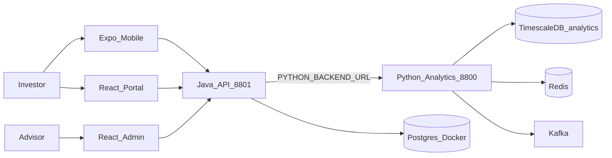
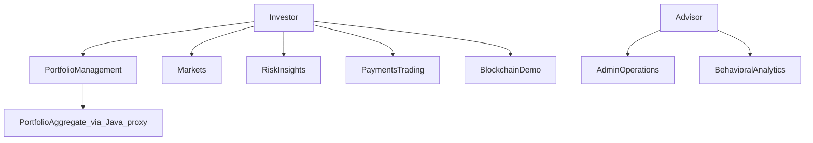
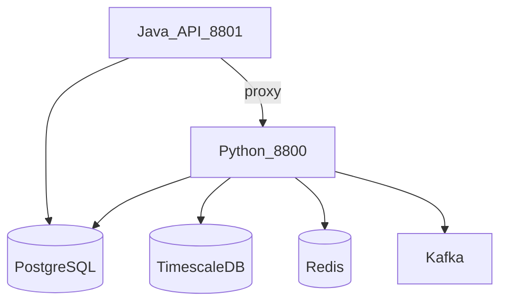
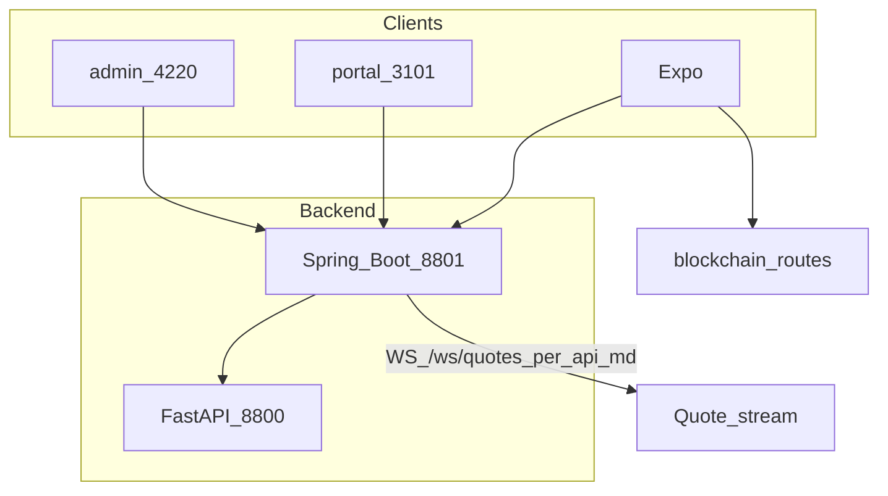
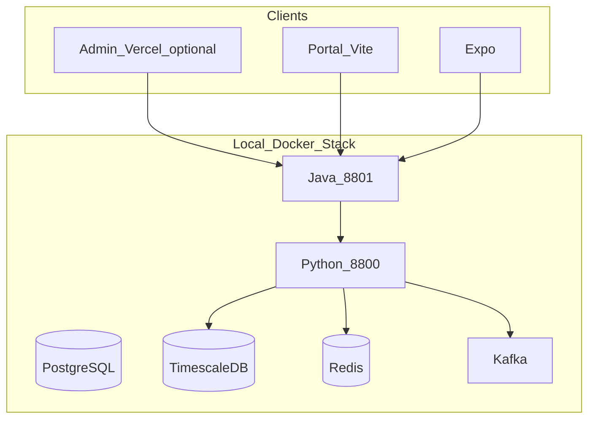
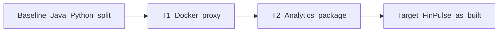

# Architecture Definition Document — FinPulse

| Field | Value |
| --- | --- |
| Deliverable | Architecture Definition Document (TOGAF Architecture Content Framework) |
| Reference | [TOGAF Architecture Deliverables §32.2.3](https://pubs.opengroup.org/architecture/togaf9-doc/m/chap32.html) |
| Capability | FinPulse (portfolio, markets, risk, payments, blockchain demo, analytics) |
| ADM phases | B–D (Architecture Vision from Phase A summarized in §1) |
| Architecture states | Baseline, Transition (T1, T2), Target |
| Companion | Architecture Requirements Specification (quantitative) — separate deliverable |
| Code-level models | [C4 model](../c4-model/README.md) |
| Preferred Terms | Idiomatic English ([Glossary](../../Glossary.md)) |

**Purpose.** FinPulse fails when every client speaks a different API dialect, analytics bypass the transactional boundary, or operators cannot reconcile holdings with behavior data. This Architecture Definition Document records how the portfolio monorepo is organized on this branch: qualitative models across Business, Data, Application, and Technology domains, with an honest Baseline, staged Transition, and a **Target** that matches the as-built codebase—not roadmap items dressed as present fact.

---

## Contents

- [1. Vision](#1-vision)
- [2. Architecture principles](#2-architecture-principles)
- [3. Architecture models](#3-architecture-models)
  - [3.1 Business Architecture](#31-business-architecture)
  - [3.2 Data Architecture](#32-data-architecture)
  - [3.3 Application Architecture](#33-application-architecture)
  - [3.4 Technology Architecture](#34-technology-architecture)
- [4. Re-use, standards, and landscape](#4-re-use-standards-and-landscape)
  - [4.1 Re-use assessment](#41-re-use-assessment)
  - [4.2 Mapping to standards](#42-mapping-to-standards)
  - [4.3 Mapping to architecture landscape](#43-mapping-to-architecture-landscape)
- [5. Transition Architecture](#5-transition-architecture)
- [6. References](#6-references)

---

## 1. Vision

### Problem

Investors and advisors need one place to see holdings, live quotes, risk, payments, and operational CRM views across mobile, portal, and admin—without every surface inventing its own auth, analytics transport, or market-data path. The failure mode is **split-brain integration**: UIs that call Python analytics directly while transactional state lives in Java, duplicate event pipelines, and quote streams that bypass the public API contract.

### Stakeholders and concerns

| Stakeholder | Concern | Architectural response |
| --- | --- | --- |
| Investor | Portfolio, watchlists, quotes, payments | Portal and Expo target Java `:8801` only |
| Advisor / operator | Clients, portfolios, transactions, behavior | Admin REST and analytics views via Java entry + shared analytics package |
| Data engineer | Durable time series, cache, event bus | Postgres/Timescale family, Redis, Kafka on analytics path (per C2) |
| Growth team | Consistent experiments and event schema | `@explore/portfolio-analytics` + GrowthBook hooks |
| Mobile user (demo) | Blockchain wallet demo on testnet | `blockchain` Java module + mobile routes (Sepolia) |

### Solution

React 19 **admin** (`:4220`), **portal** (`:3101`), and **Expo mobile** call the **Java Spring Boot API on `:8801`** as the sole client-facing HTTP entry. Python **FastAPI analytics on `:8800`** serves portfolio aggregation, quotes, risk, forecast, and event ingestion—but **only through Java proxy routes** (`PYTHON_BACKEND_URL`), not via direct admin-to-Python calls in production-style wiring. Shared packages (`@explore/portfolio-analytics`, UI, utils) unify tracking; GrowthBook wraps portal experiments.

Runtime paths are detailed in [C4-Dynamic-Portfolio-Aggregate.puml](../c4-model/C4-Dynamic-Portfolio-Aggregate.puml) (REST aggregate via Java proxy) and [C4-Dynamic-Quotes-Subscribe.puml](../c4-model/C4-Dynamic-Quotes-Subscribe.puml) (quote subscribe with optional Redis/Kafka fan-out). Container topology: [C2-Container.puml](../c4-model/C2-Container.puml). Domain language: [C4-Code-Domain-Model.puml](../c4-model/C4-Code-Domain-Model.puml).

---

## 2. Architecture principles

Each principle states a failure mode, the decision, and an enforceable constraint.

1. **Java owns the public API surface** — *Failure:* clients hard-code `:8800` and drift from auth and versioning on `:8801`. *Decision:* all product UIs use `http://127.0.0.1:8801` (or deployed equivalent) as API base. *Constraint:* configure `VITE_API_BASE_URL` / `EXPO_PUBLIC_API_BASE_URL` to `:8801`; analytics POST uses `/api/v1/analytics/events` on Java, which proxies to Python.

2. **Python owns analytics composition** — *Failure:* portfolio aggregates and quote history reimplemented in Java. *Decision:* FastAPI routers on `:8800` own aggregation, WS quote handling, risk/forecast, and event storage. *Constraint:* Java exposes **proxy routes** only; no Admin → Python direct HTTP in intended architecture (see C3 `java_proxy`).

3. **Per-feature DDD in Java** — *Failure:* CRUD anarchy across packages. *Decision:* `controller → service → domain ← infra` (+ `mapper` when needed). *Constraint:* typed ids and kernel bases in `com.finpulse.server.common.domain.model`; Glossary package names are law.

4. **Shared analytics transport** — *Failure:* each app invents event shape and identify semantics. *Decision:* `AnalyticsProvider` + `useAnalytics()` from `@explore/portfolio-analytics`. *Constraint:* admin **Behavior** (`/behavior`) lists events proxied through Java.

5. **GrowthBook at the UI edge** — *Failure:* experiments forked per app. *Decision:* `GrowthBookProvider` in portal (and package support elsewhere). *Constraint:* experiment keys live in analytics package config, not ad hoc feature flags in each Vite app.

6. **Bazel for Java API** — *Failure:* nondeterministic local Java builds. *Decision:* `server/` built with Bazel (`//server:server`). *Constraint:* CI and QUICKSTART document `bazel run //server:server` and Make alternates.

7. **Docker-backed local data plane** — *Failure:* “works on my laptop” without Postgres, Redis, or Kafka. *Decision:* `pnpm dev:server` lifts Docker dependencies and seeds. *Constraint:* document ports `8801` / `8800` in README and [api.md](../api.md).

---

## 3. Architecture models

Baseline, Transition, and **Target** are labeled explicitly. Target describes what ships on this branch; production cutover notes appear only in §5—not as Target facts.

### 3.1 Business Architecture

#### Baseline

Early FinPulse slices: React admin and portal shells with Java feature modules for Customer, Portfolio, and Order, plus a separate Python analytics service. Local persistence followed **PostgreSQL in Docker** (and H2 slices for isolated preference tests per C4)—not undocumented SQLite fixtures. Mobile and blockchain demo were added after the core CRM and market read paths stabilized.

#### Target

| Actor | Role |
| --- | --- |
| Investor | Holdings, watchlists, quotes, insights, payments on portal/mobile |
| Advisor | Client, portfolio, transaction management in admin |
| Operator | Behavior analytics review, risk/forecast views |

| Business service | Glossary / module | Outcome |
| --- | --- | --- |
| Auth | `auth` | Login, register, Bearer session |
| Customer / Account | `customer`, `account` | Client and cash account lifecycle |
| Portfolio / Position | `portfolio`, `position` | Holdings container and quantities |
| Markets | `watchlist`, `quote`, `instrument` | Symbols, live/historical quotes |
| Trading | `order`, `trade`, `payment`, `settlement` | Tickets, fills, funding |
| Risk / Analytics | Python `analytics` | VaR, events, MLflow-oriented endpoints |
| Blockchain demo | `blockchain` | Mobile demo wallet / Sepolia (E11) |
| Behavioral analytics | `@explore/portfolio-analytics` | track/identify + admin Behavior drawer |

### 3.2 Data Architecture

#### Baseline

Transactional entities in **PostgreSQL (Docker)** via Java JPA; Python analytics reading the same store or dedicated analytics schemas as migrations evolved. Preference slices may use **H2** locally (C4 README)—not claimed SQLite unless explicitly introduced in docs.

#### Target

| Store | Role | Notes |
| --- | --- | --- |
| PostgreSQL (Docker) | Java transactional aggregates | Customer, Portfolio, Order, Payment, etc. |
| TimescaleDB | Quote and portfolio time series | README data stack; analytics path |
| Redis | Hot quote cache, session helpers | Python analytics (C2) |
| Kafka | Portfolio / quote events (optional paths) | Produce/consume on analytics side |
| Event store (analytics) | Behavior events | `POST /api/v1/analytics/events` via Java proxy |

Kernel entities and aggregates: [C4-Code-Domain-Model.puml](../c4-model/C4-Code-Domain-Model.puml).

### 3.3 Application Architecture

#### Baseline

Admin-only or portal-only demos against Java CRUD without full analytics proxy wiring; analytics package not yet shared across all surfaces.

#### Target

| Surface | Port | Tech |
| --- | --- | --- |
| Java API | **8801** | Spring Boot, Bazel `//server:server` |
| Python Analytics | **8800** | FastAPI (`analytics/`) |
| Admin | 4220 | React 19 + Vite + Emotion |
| Portal | 3101 | React 19 + Vite |
| Mobile | Expo | RN; blockchain demo screens |

Dynamic views: [C4-Dynamic-Auth-Login.puml](../c4-model/C4-Dynamic-Auth-Login.puml), [C4-Dynamic-Portfolio-Aggregate.puml](../c4-model/C4-Dynamic-Portfolio-Aggregate.puml), [C4-Dynamic-Quotes-Subscribe.puml](../c4-model/C4-Dynamic-Quotes-Subscribe.puml). REST catalog: [api.md](../api.md).

### 3.4 Technology Architecture

#### Baseline

pnpm monorepo with Vite React apps and dual backend processes; Docker compose brought up manually before `dev:server` unified the script.

#### Target

| Layer | Choice |
| --- | --- |
| Web / mobile | React 19, Expo, Emotion, Radix |
| Java | Spring Boot, per-feature packages under `com.finpulse.server` |
| Python | FastAPI analytics |
| Analytics UX | `@explore/portfolio-analytics`, GrowthBook |
| Monorepo | pnpm workspaces + shared packages |
| Admin deploy | Vercel root `portfolio/admin` (docs only until cutover) |

---

## 4. Re-use, standards, and landscape

### 4.1 Re-use assessment

| Asset | Re-use |
| --- | --- |
| `@explore/portfolio-analytics` | track/identify, GrowthBook, admin Behavior transport |
| `@explore/portfolio-ui` / `utils` | Shared visual and helper primitives |
| C4 dynamics | Onboarding for auth, aggregate proxy, quotes subscribe |
| Glossary domain table | Java package and API prefix alignment |
| User Story Map E11 | Blockchain demo scope |

### 4.2 Mapping to standards

| Standard | Application |
| --- | --- |
| REST + OpenAPI | Java `/api/v1/*`; Python docs at `:8800/docs` when running |
| Bearer auth | `Authorization: Bearer` on protected Java routes |
| WebSocket subscribe | `{ "type": "subscribe", "symbols": [...] }` on `/ws/quotes` (documented at Java entry) |
| DDD layering | `controller → service → domain ← infra` per architecture rules |
| TOGAF content framework | This ADD + quantitative ARS (when published) |

### 4.3 Mapping to architecture landscape

| Landscape element | Position |
| --- | --- |
| Monorepo paths | `portfolio/server`, `portfolio/analytics`, `portfolio/admin`, `portfolio/portal`, `portfolio/mobile` |
| Dev entry | `pnpm dev portfolio`; `pnpm dev:server` for backends |
| Primary API | `http://127.0.0.1:8801` |
| Analytics internal | `http://127.0.0.1:8800` via proxy |
| C4 structural track | `C4_blue_new` for C1–C3; zinc dynamics for runtime |
| Backlog | [User Story Map](../../product-owner/User-Story-Map.md) |

---

## 5. Transition Architecture

| State | Definition |
| --- | --- |
| Baseline | Java domain CRUD + Python analytics split; Postgres/H2 local; UI shells without shared analytics package |
| T1 | Docker data plane + `pnpm dev:server` + Java proxy to Python |
| T2 | Shared analytics + portal/mobile + GrowthBook + Behavior admin |
| Target | Full capability map on `main`: mobile payments, blockchain demo, quote WS, risk endpoints |

### T1 — Unified backend entry

| Domain | Change |
| --- | --- |
| Business | Portfolio and quote reads through Java |
| Data | Docker Postgres; analytics DB migrations |
| Application | `PYTHON_BACKEND_URL` proxy routes in Java |
| Technology | Ports 8801/8800; Bazel Java server |

### T2 — Shared client analytics

| Domain | Change |
| --- | --- |
| Business | Behavioral analytics operator view |
| Data | Event ingestion via proxied POST |
| Application | `@explore/portfolio-analytics` on all surfaces |
| Technology | GrowthBook provider in portal; admin `/behavior` |

### Target — As-built FinPulse (per-domain delta from T2)

| Domain | Change |
| --- | --- |
| Business | Blockchain demo (mobile); full glossary domains active |
| Data | TimescaleDB/Redis/Kafka on analytics path per C2 |
| Application | Expo mobile; WS quotes; no direct Admin→Python |
| Technology | Vercel admin (documented); optional prod edge not asserted here |

**Roadmap note (not Target):** Changing live Vercel project settings from the repo is explicitly deferred per README until cutover.

---

## 6. References

- [TOGAF Architecture Deliverables — Architecture Definition Document §32.2.3](https://pubs.opengroup.org/architecture/togaf9-doc/m/chap32.html)
- [TimescaleDB](https://www.timescale.com/)
- [Glossary](../../Glossary.md)
- [C4 model](../c4-model/README.md)
- [User Story Map](../../product-owner/User-Story-Map.md)
- [Quick Start](../QUICKSTART.md)
- [API](../api.md)
- [FinPulse README](../../../../portfolio/README.md)