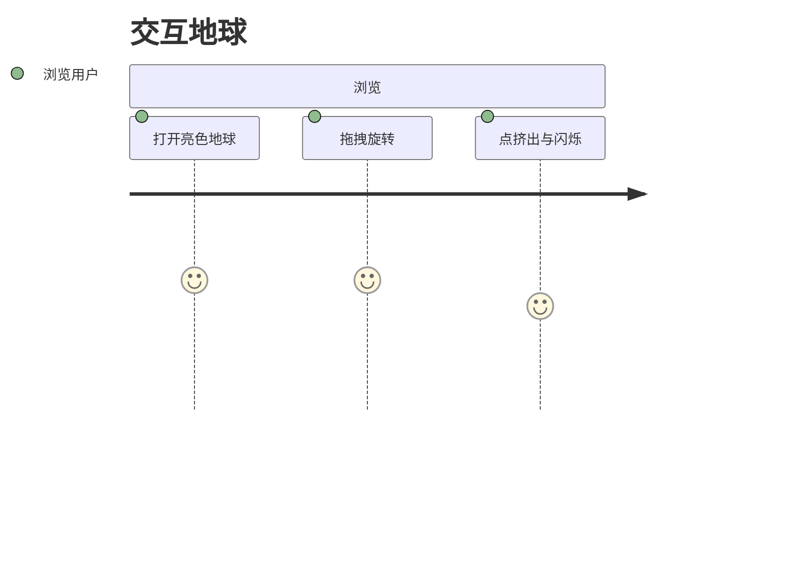
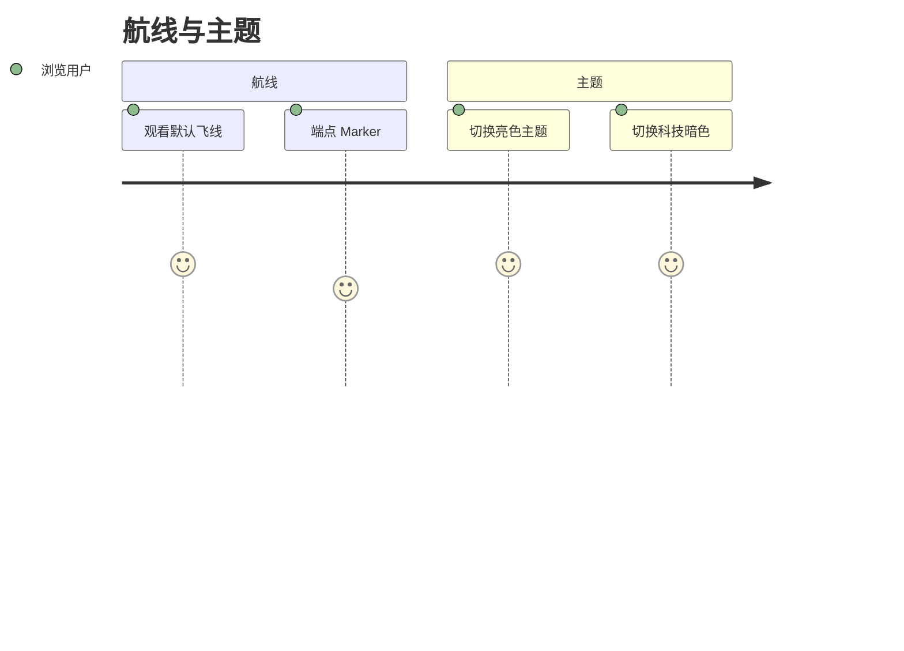

# 用户故事地图 | User Story Map — Explore Three
> Jeff Patton 用户故事地图；正文与验收标准合并于本文（单一文档）。  
> Jeff Patton user-story map; epics and GWT acceptance criteria live in this single document.  
> 格式 / Format：Background → `As a` / `I want` / `So that` → Scenario GIVEN-WHEN-THEN（双语 / bilingual）。

## 用户画像 | Personas

| 角色 / Role | 说明 / Description |
|------|------|
| 浏览用户 / Viewer | 在浏览器中旋转地球、观看飞线与主题切换 / Rotates the globe in the browser and watches flight arcs and theme switches |
| 开发者 / Developer | 基于 `src/{geography,route,theme,globe}` 扩展地球仪可视化 / Extends globe visualization under `src/{geography,route,theme,globe}` |

## 旅程总览 | Journey Overview

### 交互地球

### 航线与主题

---

## Backbone 故事地图 | Backbone

### 已交付

| 交互地球 | 飞线航线 | 主题切换 |
|----------|----------|----------|
| [US-01](#us-01-拖拽旋转地球) 拖拽旋转 | [US-03](#us-03-默认国际航线飞线) 默认飞线 | [US-05](#us-05-亮色主题地球) 亮色主题 |
| [US-02](#us-02-陆地点挤出与闪烁) 挤出与闪烁 | [US-04](#us-04-航线端点-marker) 端点 Marker | [US-06](#us-06-科技暗色主题地球) 科技暗色 |

---

## Epic 索引 | Epic Index

| Epic | 锚点 / Anchor | 状态 / Status |
|------|---------------|---------------|
| E1 交互地球 | [#e1](#e1) | — |
| E2 飞线航线 | [#e2](#e2) | — |
| E3 主题切换 | [#e3](#e3) | — |

---

# 用户故事正文 | User Stories

## E1 交互地球 / Interactive globe

### 背景 | Background

浏览用户须经指针与 WebGL 地球仪交互，理解陆地轮廓与动态点效果。 / Viewers interact via pointer and WebGL globe to understand land outlines and animated points.

### US-01 拖拽旋转地球 / Drag to rotate the globe

**As a** 浏览用户 / Viewer  
**I want** 拖拽旋转 3D 地球仪 / to drag-rotate the 3D globe  
**So that** 我可以从任意角度查看陆地与航线 / I can view land and routes from any angle

#### 验收标准 | Acceptance Criteria

1. **Scenario** 指针悬停并拖拽 / Pointer hover and drag  
   **GIVEN** 用户打开亮色或暗色地球页 / User opens light or dark globe pages  
   **WHEN** 指针悬停在球体上并按下拖拽 / the pointer hovers on the sphere and drags  
   **THEN** 地球随拖拽旋转 / the globe rotates with the drag  
   **AND** 光标在悬停时为 pointer、拖拽时为 grabbing / Cursor is pointer on hover and grabbing while dragging  

#### 状态 | Status

已实现 / Done

---

### US-02 陆地点挤出与闪烁 / Land points squeeze out and flash

**As a** 浏览用户 / Viewer  
**I want** 拖拽时陆地点轻微挤出并持续闪烁 / Slightly squeezed out of land points while dragging and scintillating  
**So that** 地球表面呈现有生命力的视觉反馈 / The Earth's surface has a living visual feedback.

#### 验收标准 | Acceptance Criteria

1. **Scenario** 拖拽触发挤出 / Drag to trigger squeeze  
   **GIVEN** 用户指针与球体相交 / User pointer intersects with sphere  
   **WHEN** 开始拖拽 / Start dragging.  
   **THEN** 陆地点 `u_maxExtrusion` 经 GSAP 略微增大 / land markers `u_maxExtrusion` Via GSAP A slight increase.  
   **AND** 释放后恢复 / Recovery after release  
   **AND** 点着色器随时间独立闪烁 / Light the colorer to shine independently over time  

#### 状态 | Status

已实现 / Done

---

## E2 飞线航线 / Flight routesssssssssssssssssssssssssssssss

### 背景 | Background

地球仪经默认国际航线展示飞线动画与端点标记。 / The globe shows animated flight arcs and endpoint markers on default international routes.

### US-03 默认国际航线飞线 / Default international route flight arcs

**As a** 浏览用户 / Viewer  
**I want** 看到连接全球城市的动画飞线 / See the animated flight arcs connecting cities around the world.  
**So that** 我能感知地点之间的路径关系 / I can sense the path between locations.

#### 验收标准 | Acceptance Criteria

1. **Scenario** 加载默认航线 / Loading the default route  
   **GIVEN** `DEFAULT_ROUTES` 包含六条城市场景 / `DEFAULT_ROUTES` It contains six city scenes.  
   **WHEN** `GlobeService.mount` 完成引导 / `GlobeService.mount` Complete Guidance  
   **THEN** 每条航线渲染为动画 Tube 飞线 / Every route is rendered animated. Tube arc route  
   **AND** 飞线使用弧线纹理与主题配色 / Flyline uses arc texture and theme colour  

#### 状态 | Status

已实现 / Done

---

### US-04 航线端点 Marker / Line End Marker

**As a** 浏览用户 / Viewer  
**I want** 在航线起点与终点看到光点标记 / See the light mark at the beginning and end of the route.  
**So that** 我能识别航线两端城市位置 / I can locate the city at both ends of the route.

#### 验收标准 | Acceptance Criteria

1. **Scenario** 端点 Marker / Peer Marker  
   **GIVEN** 一条 `FlightRoute` 已创建飞线 / One. `FlightRoute` Created flight arc  
   **WHEN** 调用 `createMarker` 于 origin 与 destination / Call `createMarker` on origin and destination  
   **THEN** 两端显示 disc 纹理平面 / Show both ends disc Texture plane  
   **AND** 颜色与该航线飞线一致 / Color matches that route flight arc  

#### 状态 | Status

已实现 / Done

---

## E3 主题切换 / Theme Switch

### 背景 | Background

产品提供亮色与科技暗色两套视觉主题，经路由与导航切换。 / The product offers light and tech-dark themes switched via routes and navigation.

### US-05 亮色主题地球 / Light-theme globe

**As a** 浏览用户 / Viewer  
**I want** 打开亮色主题地球 / Open the light-theme globe page  
**So that** 我能看到暖色渐变陆地点与浅色球体 / I can see warm ground point and light ball. Body

#### 验收标准 | Acceptance Criteria

1. **Scenario** 访问亮色路由 / Access bright colour route  
   **GIVEN** 用户打开 `/` 或 `/globe-light` / User opens `/` or `/globe-light`  
   **WHEN** 页面挂载 `Globe` 组件 / Page Mount `Globe` Component  
   **THEN** 使用 `BRIGHT_THEME` 与 `BRIGHT_COLORS` / Use `BRIGHT_THEME` and `BRIGHT_COLORS`  
   **AND** NavBar 可导航至暗色主题 / NavBar navigates to the dark theme  

#### 状态 | Status

已实现 / Done

---

### US-06 科技暗色主题地球 / Dark-theme globe

**As a** 浏览用户 / Viewer  
**I want** 打开科技暗色主题地球 / Open the dark-theme globe page  
**So that** 我能看到冷色霓虹风格的陆地点与飞线 / I can see cold neon-style land spots and fly lines.

#### 验收标准 | Acceptance Criteria

1. **Scenario** 访问暗色路由 / Access dark path  
   **GIVEN** 用户打开 `/globe-dark` / User opens `/globe-dark`  
   **WHEN** 页面挂载 `GlobeDarkTheme` 组件 / Page Mount `GlobeDarkTheme` Component  
   **THEN** 使用 `TECH_THEME` 与 `TECH_COLORS` / Use `TECH_THEME` and `TECH_COLORS`  
   **AND** 点光源位置按暗色主题配置 / Point light source position configured by dark theme  

#### 状态 | Status

已实现 / Done

---

## 参考 | References

- [Glossary](../Glossary.md)
- [C4 模型](../c4-model/)

