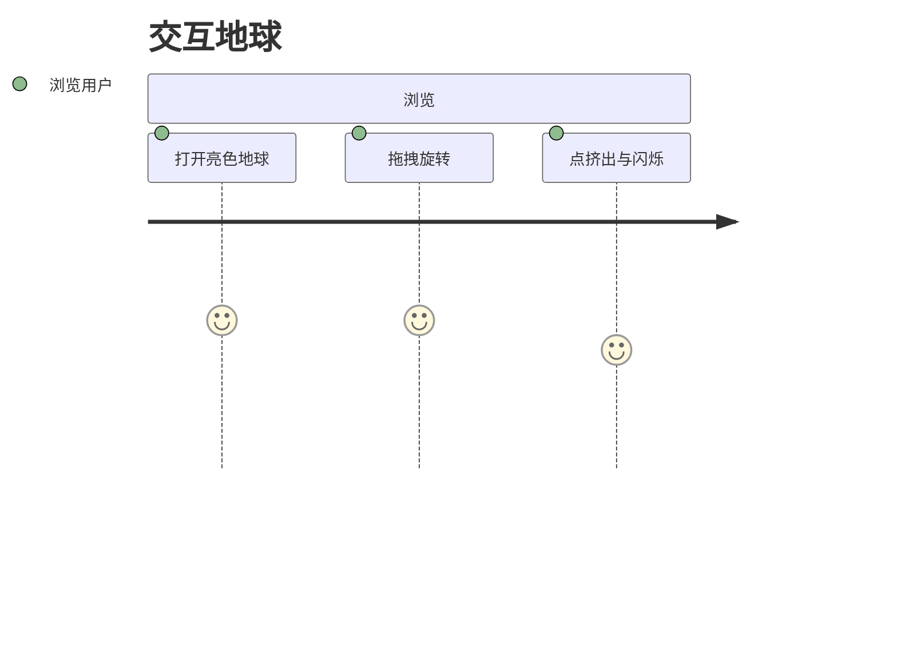
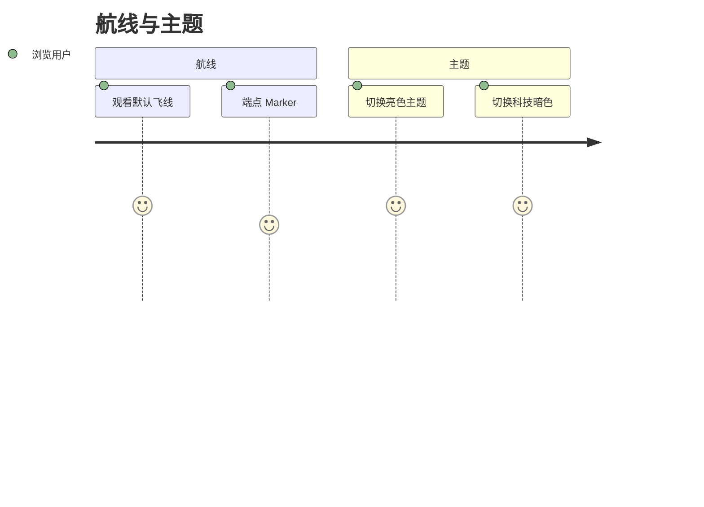

# 用户故事地图 | User Story Map — Explore Three
> Jeff Patton 用户故事地图；正文与验收标准合并于本文（单一文档）。  
> Jeff Patton user-story map; epics and GWT acceptance criteria live in this single document.  
> 格式 / Format：Background → `As a` / `I want` / `So that` → Scenario GIVEN-WHEN-THEN（双语 / bilingual）。

## 用户画像 | Personas

| 角色 / Role | 说明 / Description |
|------|------|
| 浏览用户 / Viewer | 在浏览器中旋转地球、观看飞线与主题切换 / Rotates the globe in the browser and watches flight arcs and theme switches |
| 开发者 / Developer | 基于 `src/{geography,route,theme,globe}` 扩展地球仪可视化 / Extends globe visualization under `src/{geography,route,theme,globe}` |

## 旅程总览 | Journey Overview

### 交互地球

### 航线与主题

---

## Backbone 故事地图 | Backbone

### 已交付

| 交互地球 | 飞线航线 | 主题切换 |
|----------|----------|----------|
| [US-01](#us-01-拖拽旋转地球) 拖拽旋转 | [US-03](#us-03-默认国际航线飞线) 默认飞线 | [US-05](#us-05-亮色主题地球) 亮色主题 |
| [US-02](#us-02-陆地点挤出与闪烁) 挤出与闪烁 | [US-04](#us-04-航线端点-marker) 端点 Marker | [US-06](#us-06-科技暗色主题地球) 科技暗色 |

---

## Epic 索引 | Epic Index

| Epic | 锚点 / Anchor | 状态 / Status |
|------|---------------|---------------|
| E1 交互地球 | [#e1](#e1) | — |
| E2 飞线航线 | [#e2](#e2) | — |
| E3 主题切换 | [#e3](#e3) | — |

---

# 用户故事正文 | User Stories

## E1 可探索的交互地球 / Interactive globe experience

### 背景 | Background

访客需要直观把握全球陆地分布与动态标注，却无法用固定视角满足浏览意图。静态展示削弱沉浸感，难以建立对地理关系的感知。期望通过自然手势旋转地球，从任意角度观察。 / Visitors need an intuitive sense of global land and live markers, but a fixed view cannot match how they want to explore. Static presentation weakens immersion and geographic context. They expect to rotate the globe naturally and inspect any angle.

### US-01 拖拽旋转地球 / Drag to rotate the globe

**As a** 浏览用户 / Viewer  
**I want** 用拖拽手势旋转三维地球 / to rotate the 3D globe by dragging  
**So that** 我能从任意角度查看陆地与航线，浏览更顺畅 / I can view land and routes from any angle for smoother exploration

#### 验收标准 | Acceptance Criteria

1. **Scenario** 悬停与拖拽时地球跟随旋转 / Globe rotates on hover and drag  
   **GIVEN** 我已打开亮色或暗色地球页面 / I have opened the light or dark globe page  
   **WHEN** 指针移到球面上并按住拖拽 / I hover over the sphere and drag while holding  
   **THEN** 地球朝向随拖拽方向转动 / the globe orientation follows my drag  
   **AND** 悬停时显示可拖拽光标，拖拽中显示抓取态光标 / the cursor shows pointer on hover and grabbing while dragging  

#### 状态 | Status

已实现 / Done

---

### US-02 陆地标注随交互脉动 / Land markers pulse during interaction

**As a** 浏览用户 / Viewer  
**I want** 在拖拽地球时看到陆地点轻微凸起并持续闪烁 / to see land markers gently rise and shimmer while I drag the globe  
**So that** 地球表面更有生命力，交互反馈更清晰可信 / the surface feels alive and my interactions are clearly acknowledged

#### 验收标准 | Acceptance Criteria

1. **Scenario** 拖拽时标注凸起并恢复 / Markers extrude on drag and settle on release  
   **GIVEN** 我的指针已与球面接触 / my pointer is over the globe surface  
   **WHEN** 我开始拖拽旋转 / I start dragging to rotate  
   **THEN** 陆地点标注轻微凸起，释放后平滑回落 / land markers rise slightly and ease back when I release  
   **AND** 各标注独立闪烁，不随拖拽同步停止 / each marker keeps its own shimmer independent of drag  

#### 状态 | Status

已实现 / Done

---

## E2 全球航线可视化 / Global route visualization

### 背景 | Background

访客希望一眼看出城市之间的联通关系，纯静态地图难以传达路径与动感。缺少默认航线时，产品难以展示核心价值。加载后应呈现连贯的弧线动画，帮助理解全球连接。 / Visitors want to see how cities connect at a glance; static maps rarely convey paths and motion. Without default routes, the product cannot show its core value. On load, animated arcs should make global links obvious.

### US-03 默认国际航线飞线动画 / Default international flight arcs

**As a** 浏览用户 / Viewer  
**I want** 看到连接主要国际城市的动画飞线 / to see animated flight arcs linking major international cities  
**So that** 我能快速感知地点之间的路径关系，建立全球联通印象 / I quickly grasp how places connect and form a mental map of global links

#### 验收标准 | Acceptance Criteria

1. **Scenario** 进入页面即见默认航线飞线 / Default route arcs appear on entry  
   **GIVEN** 产品内置六条代表性国际城市航线 / the product ships with six representative international city routes  
   **WHEN** 地球场景完成加载 / the globe scene finishes loading  
   **THEN** 每条航线以动画弧线呈现 / each route appears as an animated arc  
   **AND** 飞线样式与当前主题配色一致 / arc styling matches the active theme colors  

#### 状态 | Status

已实现 / Done

---

### US-04 航线起讫点光点标记 / Origin and destination markers on routes

**As a** 浏览用户 / Viewer  
**I want** 在每条航线起点与终点看到醒目光点 / to see clear light markers at each route's origin and destination  
**So that** 我能准确识别航线两端城市，减少误读 / I can identify both endpoint cities accurately and avoid misreading routes

#### 验收标准 | Acceptance Criteria

1. **Scenario** 航线两端显示与弧线同色标记 / Matching markers at both route ends  
   **GIVEN** 一条国际航线已在地球上绘制 / an international route is drawn on the globe  
   **WHEN** 航线渲染完成 / route rendering completes  
   **THEN** 起点与终点各显示光点标记 / light markers appear at origin and destination  
   **AND** 标记颜色与该航线弧线一致 / marker color matches that route's arc  

#### 状态 | Status

已实现 / Done

---

## E3 双主题视觉体验 / Dual visual themes

### 背景 | Background

不同场景与受众对地球仪明暗风格偏好不同；单一主题难以兼顾演示与科技展示。切换成本过高会降低对比体验。需提供亮色与暗色两套完整视觉，并可从导航一键切换。 / Audiences prefer different bright or dark globe styles; one theme cannot serve every demo or tech showcase. High switching friction hurts comparison. The product should offer complete light and dark visuals with easy navigation between them.

### US-05 亮色主题地球 / Light-theme globe

**As a** 浏览用户 / Viewer  
**I want** 打开亮色风格的地球页面 / to open the globe in the light visual style  
**So that** 我能看到暖色陆地与浅色球体，适合日常浏览与演示 / I see warm land tones and a light sphere suited to everyday viewing and presentations

#### 验收标准 | Acceptance Criteria

1. **Scenario** 进入亮色页呈现暖色地球 / Warm light-theme globe on bright entry  
   **GIVEN** 我通过首页或亮色地球入口进入 / I enter via the home or light-globe entry  
   **WHEN** 地球页面加载完成 / the globe page finishes loading  
   **THEN** 球体与陆地点采用亮色主题配色 / the sphere and land markers use the light theme palette  
   **AND** 导航栏提供进入暗色主题的入口 / the navigation offers a path to the dark theme  

#### 状态 | Status

已实现 / Done

---

### US-06 科技暗色主题地球 / Dark tech-theme globe

**As a** 浏览用户 / Viewer  
**I want** 打开科技暗色风格的地球页面 / to open the globe in the dark tech visual style  
**So that** 我能看到冷色霓虹陆地点与飞线，强化科技感展示 / I see cool neon land markers and arcs that reinforce a high-tech showcase

#### 验收标准 | Acceptance Criteria

1. **Scenario** 进入暗色页呈现霓虹风格地球 / Neon dark-theme globe on dark entry  
   **GIVEN** 我通过暗色地球入口进入 / I enter via the dark-globe entry  
   **WHEN** 暗色地球页面加载完成 / the dark globe page finishes loading  
   **THEN** 球体、陆地点与飞线采用暗色科技配色 / the sphere, markers, and arcs use the dark tech palette  
   **AND** 场景光照与暗色主题整体氛围一致 / scene lighting matches the dark theme atmosphere  

#### 状态 | Status

已实现 / Done

---

## 参考 | References

- [Glossary](../Glossary.md)
- [C4 模型](../c4-model/)

