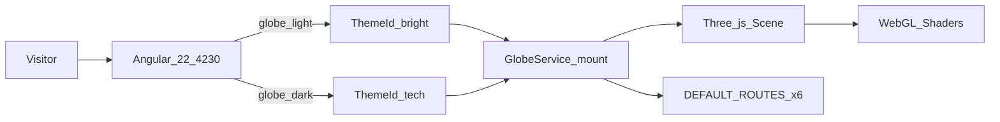
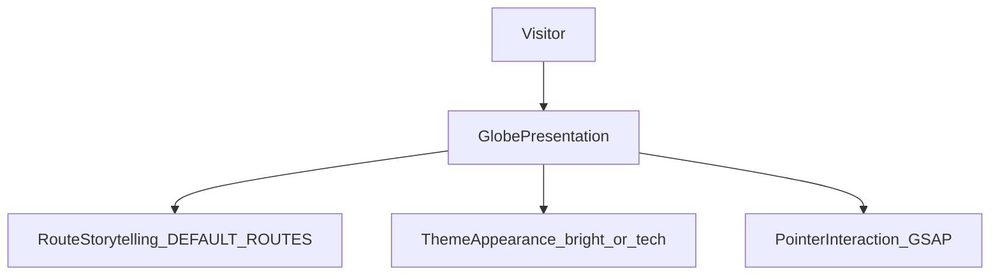
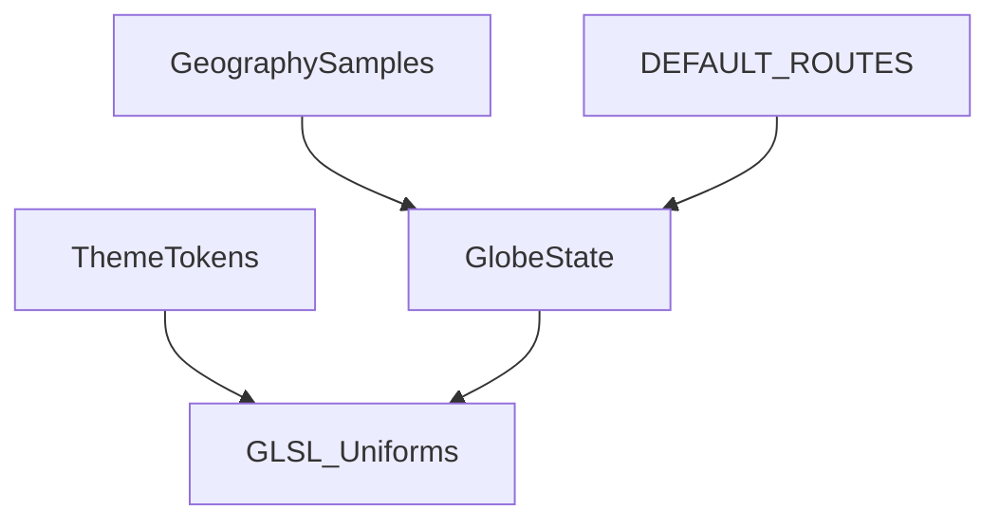
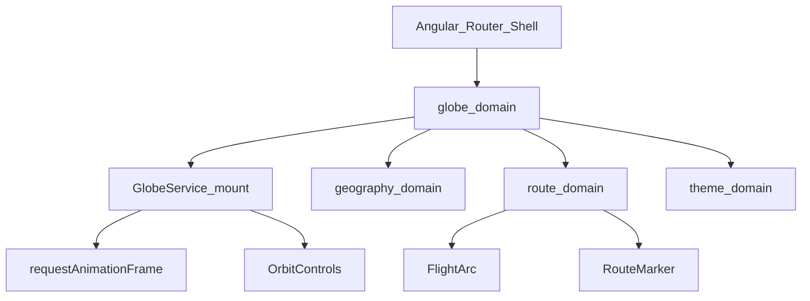
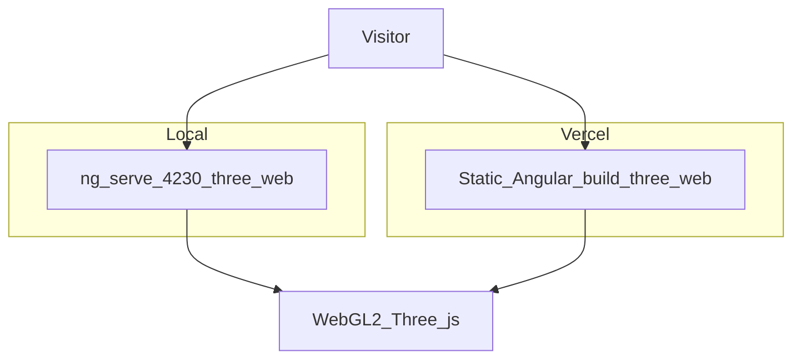
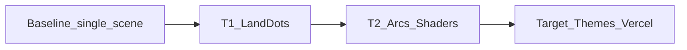

# Architecture Definition Document — Explore Three

| Field | Value |
| --- | --- |
| Deliverable | Architecture Definition Document (TOGAF Architecture Content Framework) |
| Reference | [TOGAF Architecture Deliverables §32.2.3](https://pubs.opengroup.org/architecture/togaf9-doc/m/chap32.html) |
| Capability | Explore Three (interactive Three.js globe, themes, flying routes) |
| ADM phases | B–D (Architecture Vision from Phase A summarized in §1) |
| Architecture states | Baseline, Transition (T1, T2), Target |
| Companion | Architecture Requirements Specification (quantitative) — separate deliverable |
| Code-level models | [C4 model](../c4-model/README.md) |
| Preferred Terms | Idiomatic English ([Glossary](../../Glossary.md)) |

**Purpose.** Explore Three fails when WebGL resources leak across route changes, when theme tokens drift from Angular routes, or when “default routes” are redefined in every demo fork. This document captures the **static, client-only** as-built globe—Angular 22 + Three.js + GSAP—with canonical theme routes, six **DEFAULT_ROUTES**, and deployment from `three/web` to Vercel.

---

## Contents

- [1. Vision](#1-vision)
- [2. Architecture principles](#2-architecture-principles)
- [3. Architecture models](#3-architecture-models)
  - [3.1 Business Architecture](#31-business-architecture)
  - [3.2 Data Architecture](#32-data-architecture)
  - [3.3 Application Architecture](#33-application-architecture)
  - [3.4 Technology Architecture](#34-technology-architecture)
- [4. Re-use, standards, and landscape](#4-re-use-standards-and-landscape)
  - [4.1 Re-use assessment](#41-re-use-assessment)
  - [4.2 Mapping to standards](#42-mapping-to-standards)
  - [4.3 Mapping to architecture landscape](#43-mapping-to-architecture-landscape)
- [5. Transition Architecture](#5-transition-architecture)
- [6. References](#6-references)

---

## 1. Vision

### Problem

Visitors expect a memorable, performant 3D globe—land dots, twinkling stars, animated arcs between cities—with smooth pointer interaction and a deployable static front end. The failure mode is **monolithic demo code**: one component owns scene setup, shaders, and routing, so theme swaps leak GPU memory and route-specific palettes diverge from Glossary.

### Stakeholders and concerns

| Stakeholder | Concern | Architectural response |
| --- | --- | --- |
| Visitor | Drag rotation, readable geography, animated routes | `GlobeHostComponent` + GSAP extrusion |
| Developer | Domain folders | `geography`, `route`, `theme`, `globe` |
| Operator | Static deploy | Vercel `three/web`; live URL below |

### Solution

**Angular 22** hosts the shell on dev port **4230** (`pnpm dev three`). Domain services orchestrate **Three.js** scene graph, custom **GLSL** shaders, and **GSAP** tweens. Theme routes map **ThemeId** `bright` vs `tech` to **`/`**, **`/globe-light`**, and **`/globe-dark`**. **RouteService** exposes **`DEFAULT_ROUTES`**—six international city pairs driving **FlightArc** animations. No backend: geography and routes compile from static TypeScript modules.

Lifecycle detail: [C4-Dynamic-Globe-Bootstrap.puml](../c4-model/C4-Dynamic-Globe-Bootstrap.puml) (mount → render loop → **dispose**). Domain types: [C4-Code-Domain-Model.puml](../c4-model/C4-Code-Domain-Model.puml). **Live:** [https://three-explore-xi.vercel.app/](https://three-explore-xi.vercel.app/).

---

## 2. Architecture principles

1. **Domain folders over generic services** — *Failure:* `src/domain/` dumping ground. *Decision:* `src/geography/`, `src/route/`, `src/theme/`, `src/globe/` per Glossary. *Constraint:* geography and theme files do not import `three` where forbidden by Glossary layering notes.

2. **Dispose on teardown** — *Failure:* GPU memory growth on navigation. *Decision:* dynamic bootstrap ends with Three.js `dispose`. *Constraint:* follow C4-Dynamic-Globe-Bootstrap sequence.

3. **Shader-driven effects** — *Failure:* DOM overlays for twinkle. *Decision:* GLSL uniforms for stars and scatter. *Constraint:* `LandDotsGroup`, textures from `globe.config`.

4. **GSAP for interaction polish** — *Failure:* jittery drag feedback. *Decision:* GSAP tweens complement OrbitControls on `GlobeHostComponent`. *Constraint:* no duplicate animation systems.

5. **Canonical theme routes** — *Failure:* ad hoc `/dark` paths. *Decision:* `/`, `/globe-light` → bright; `/globe-dark` → tech. *Constraint:* Glossary route table is law.

6. **Static hosting only** — *Failure:* invented BFF API. *Decision:* bundled static data; Vercel SPA rewrite. *Constraint:* no persistence layer in Target.

---

## 3. Architecture models

### 3.1 Business Architecture

#### Baseline

Single Three.js demo component with inline setup—no Angular router themes, no domain split, no dispose discipline.

#### Target

| Capability | Outcome |
| --- | --- |
| Globe presentation | Rotatable earth with land-mass dot field |
| Route storytelling | Six **DEFAULT_ROUTES** great-circle arcs |
| Visual theme | **ThemeId** `bright` vs `tech` via routes |
| Interaction | Click-drag with GSAP extrusion feedback |

| Route | Theme |
| --- | --- |
| `/`, `/globe-light` | `bright` theme + colors |
| `/globe-dark` | `tech` theme + colors |

### 3.2 Data Architecture

#### Baseline

Hard-coded lat/long pairs inside one component.

#### Target

| Artifact | Role |
| --- | --- |
| `GeoCoord` / `SpherePoint` | Geography primitives (`geography/geo-coord.ts`) |
| `FlightRoute` | Origin/destination pairs |
| `DEFAULT_ROUTES` | Six international pairs (`RouteService.defaultRoutes`) |
| `ThemeId` | `bright` \| `tech` |
| `ThemeAppearance` | Lights, CTA stroke, source URL |
| Texture assets | Line/dot URLs in `globe.config` |

All data is static modules in the bundle—no database.

### 3.3 Application Architecture

#### Baseline

One `*.component.ts` with inline Three.js bootstrap.

#### Target

| Module | Key types / files |
| --- | --- |
| `globe/` | `GlobeService.mount`, `GlobeGroup`, `GlobeHostComponent`, `globe.config` |
| `geography/` | `GeoCoord.projectToSpherePoint` |
| `route/` | `FlightArc`, `RouteMarker`, `DEFAULT_ROUTES` |
| `theme/` | `ThemeService`, `ThemeId`, `ThemeAppearance` |

Dynamic view: [C4-Dynamic-Globe-Bootstrap.puml](../c4-model/C4-Dynamic-Globe-Bootstrap.puml).

### 3.4 Technology Architecture

#### Baseline

Webpack-era single bundle without Angular CLI domain layout.

#### Target

| Layer | Choice |
| --- | --- |
| UI | Angular 22, router, services |
| 3D | Three.js, OrbitControls, custom GLSL |
| Motion | GSAP |
| CSS | Tailwind CSS v4 |
| Deploy | `three/web` Vercel root; `vercel.json` SPA rewrite |
| Live URL | https://three-explore-xi.vercel.app/ |
| Node | ≥ 22.22.3 per `web/.nvmrc` |

---

## 4. Re-use, standards, and landscape

### 4.1 Re-use assessment

| Asset | Re-use |
| --- | --- |
| GitHub / Stripe globe inspirations | Arc and dot patterns (attributed in product README) |
| C4 Code domain model | Geography / Route / Theme types |
| Glossary route + kernel tables | ThemeId, DEFAULT_ROUTES naming |
| `style.puml` | Structural C4 white/black tokens |

### 4.2 Mapping to standards

| Standard | Application |
| --- | --- |
| Angular style guide | `*.page.ts`, `*.service.ts`, `*.component.ts` naming |
| Three.js dispose pattern | GPU cleanup on route destroy |
| Static SPA hosting | Vercel rewrite to `index.html` |

### 4.3 Mapping to architecture landscape

| Landscape element | Position |
| --- | --- |
| Monorepo path | `three/web` |
| Dev command | `pnpm dev three` → `:4230` |
| Domains | `src/geography/`, `src/route/`, `src/theme/`, `src/globe/` |
| Dynamic onboarding | Globe bootstrap sequence diagram |
| Backlog | [User Story Map](../../product-owner/User-Story-Map.md) |

---

## 5. Transition Architecture

| State | Definition |
| --- | --- |
| Baseline | Static spinning mesh; no routes |
| T1 | Land dots + OrbitControls + geography module |
| T2 | Flying lines + twinkle shaders + `DEFAULT_ROUTES` |
| Target | GSAP extrusion + theme routes + Vercel production + dispose discipline |

### T1 — Land and controls

| Domain | Change |
| --- | --- |
| Business | Recognizable continents via dot field |
| Data | Geography samples as modules |
| Application | `LandDotsGroup`, OrbitControls |
| Technology | Angular CLI structure |

### T2 — Arcs and shaders

| Domain | Change |
| --- | --- |
| Business | Animated international routes (six defaults) |
| Data | `FlightRoute` + `DEFAULT_ROUTES` |
| Application | `FlightArc`, `RouteMarker`, GLSL twinkle |
| Technology | Custom shaders in globe pipeline |

### Target — As-built globe

| Domain | Change |
| --- | --- |
| Business | Bright vs tech themes on distinct routes |
| Data | `ThemeId`, `ThemeAppearance` |
| Application | `GlobeHostComponent` GSAP; bootstrap dispose |
| Technology | Angular 22 + Three.js; **:4230**; **three/web** on Vercel |

---

## 6. References

- [TOGAF Architecture Deliverables — Architecture Definition Document §32.2.3](https://pubs.opengroup.org/architecture/togaf9-doc/m/chap32.html)
- [Three.js documentation](https://threejs.org/docs/)
- [Angular](https://angular.dev/)
- [Glossary](../../Glossary.md)
- [C4 model](../c4-model/README.md)
- [C4-Dynamic-Globe-Bootstrap.puml](../c4-model/C4-Dynamic-Globe-Bootstrap.puml)
- [User Story Map](../../product-owner/User-Story-Map.md)
- [Explore Three README](../../../../three/README.md)