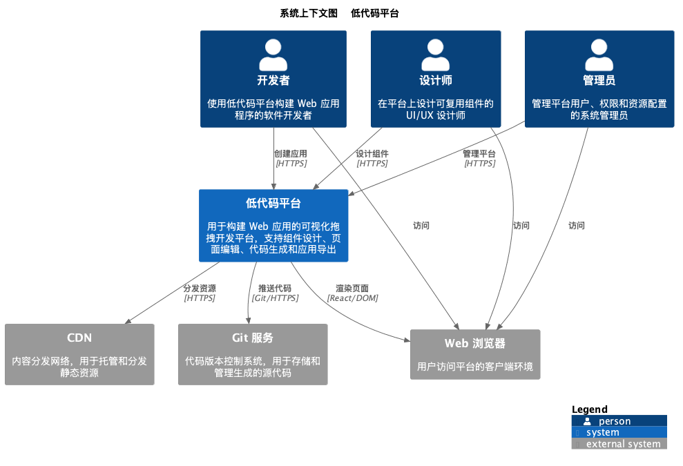
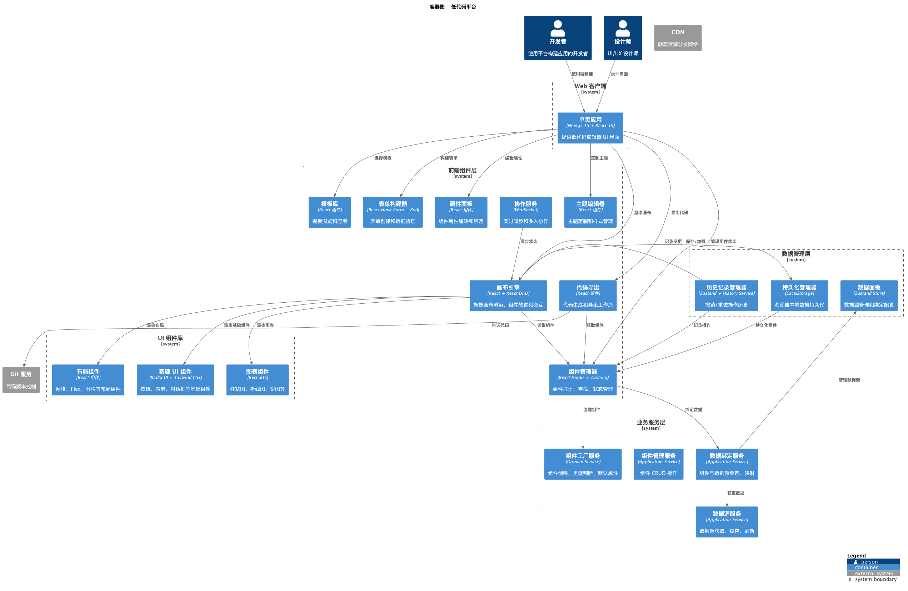

# Explore Lowcode

[](../LICENSE)
[](https://nextjs.org/)
[](https://react.dev/)
[](https://www.typescriptlang.org/)

Explore Lowcode brings visual page building into everyday product work. Our mission is to help teams design, compose, and ship interfaces faster—without sacrificing clarity or code quality.

**Live:** [https://low-code-platform-eta.vercel.app/](https://low-code-platform-eta.vercel.app/)

## Table of Contents

- [Features](#features)
- [Tech Stack](#tech-stack)
- [Prerequisites](#prerequisites)
- [Getting Started](#getting-started)
- [Usage](#usage)
- [Testing](#testing)
- [Project Structure](#project-structure)
- [Deployment](#deployment)
- [Documentation](#documentation)
- [Contributing](#contributing)
- [License](#license)

## Features

| Area | Capability |
|------|------------|
| **Canvas** | Drag-and-drop layout, component tree, properties panel, responsive device preview |
| **Components** | Built-in UI kit, charts, forms; custom component builder and grouping |
| **Data** | Data sources, binding, and table / list / card style views |
| **Theme** | Theme tokens and animation editor |
| **Templates** | Gallery of page templates to start from |
| **Export** | Export designed pages as front-end code |
| **Persistence** | Local project state via browser LocalStorage; undo / redo history |

## Tech Stack

| Layer | Choice |
|-------|--------|
| App | Next.js 16 (App Router), React 19, TypeScript |
| UI | Tailwind CSS, Radix UI, Lucide |
| DnD | React DnD |
| State | Zustand |
| Charts | Recharts |
| Forms | React Hook Form + Zod |
| Tests | Vitest + Testing Library |

Source is organized by **business domain** under `src/{domain}/` (UI, stores, and helpers colocated). Shared UI lives in `src/components/`, shared hooks in `src/hooks/`, and shared utilities in `src/lib/`. See [Glossary](../docs/lowcode/Glossary.md) and the local skill
[`lowcode-architecture`](~/.cursor/skills/reference/explore-workspace/lowcode-architecture.md).

## Prerequisites

| Tool | Version |
|------|---------|
| Node.js | 18+ |
| pnpm | latest recommended |
| Git | latest |

No API keys are required for the local editor.

## Getting Started

**Monorepo (explore-workspace root):**

```bash
pnpm dev lowcode
```

Opens the editor at [http://localhost:3020](http://localhost:3020).

**Product-only:**

```bash
cd web
pnpm install
pnpm dev
```

## Usage

1. Drag a component from the left **Component Panel** onto the **Canvas**.
2. Select the component and edit props in the right **Properties** panel.
3. Use **Preview** (and device controls) to inspect the result.
4. Optionally apply a **Template**, adjust **Theme**, bind **Data**, or **Export** code.

## Testing

```bash
pnpm test
pnpm test:coverage
```

## Project Structure

```
explore-lowcode/
├── src/
│   ├── app/                 # Next.js App Router shell
│   ├── canvas/              # Canvas UI, store, hooks
│   ├── component/           # Factory, panel, renderer, stores
│   ├── template/ theme/ data/ chart/ form/ export/ collaboration/
│   ├── components/          # Shared UI kit + chrome
│   ├── hooks/               # Shared hooks
│   └── lib/                 # utils, persistence, history, store facade
└── public/
```

## Deployment (docs only)

| Setting | Value |
|---------|-------|
| Vercel Root Directory (monorepo) | `lowcode/web` |
| Config | [`web/vercel.json`](web/vercel.json) |

Do not change live Vercel project settings from this repo until cutover.

| Target | Notes |
|--------|--------|
| [Vercel](https://vercel.com) | Recommended for Next.js; import the GitHub repo and deploy |
| Self-hosted | `pnpm build` then `pnpm start` (binds to the host `PORT` when set) |

## Documentation

| Doc | Link |
|-----|------|
| C4 model | [docs/c4-model/](../docs/lowcode/c4-model/) |
| Glossary | [docs/Glossary.md](../docs/lowcode/Glossary.md) |
| Reference | [docs/Reference.md](../docs/lowcode/Reference.md) |
| User story map | [docs/User-Story-Map.md](../docs/lowcode/User-Story-Map.md) |





## Contributing

Issues and pull requests are welcome. Use the repository [pull request template](web/.github/pull_request_template.md) (why paragraph, References, Jira link).

## License

[Apache-2.0](../LICENSE) © Felix
