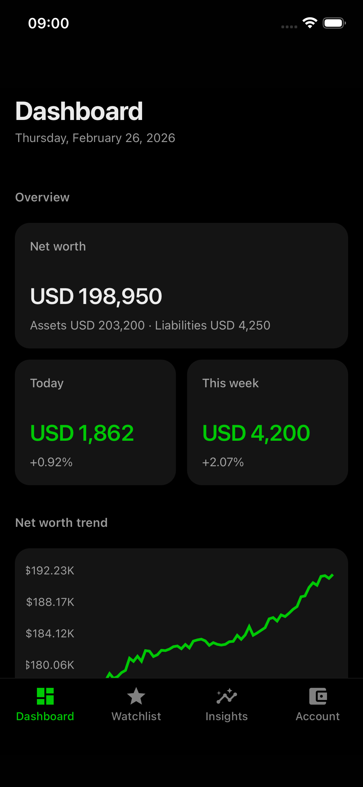
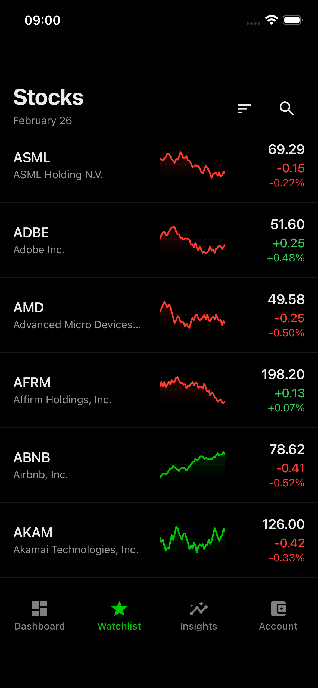
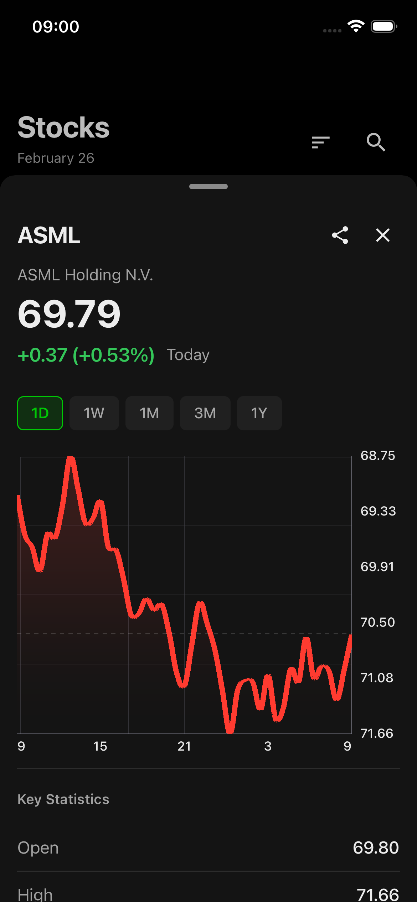
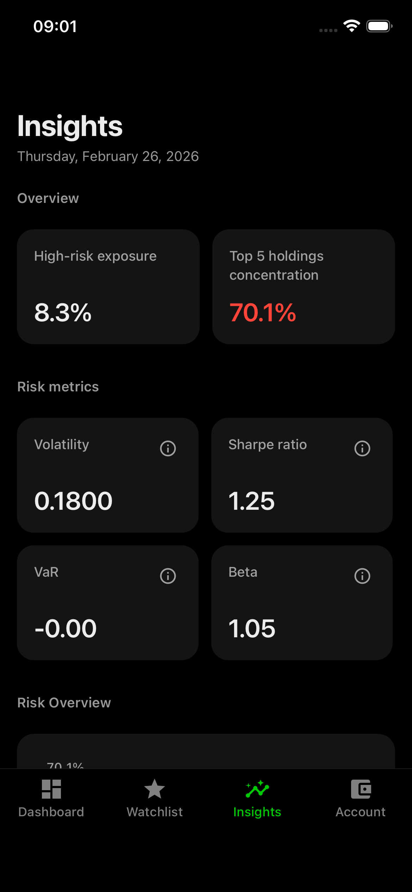
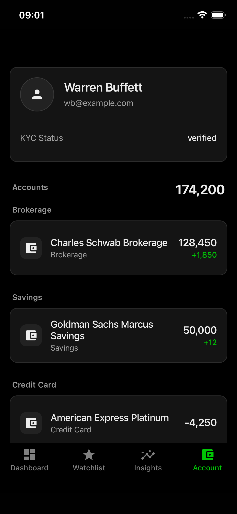
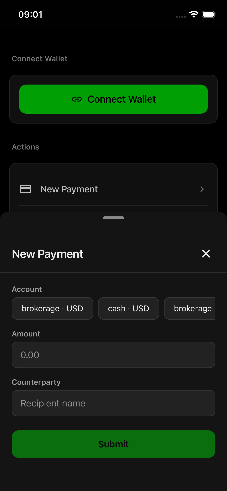
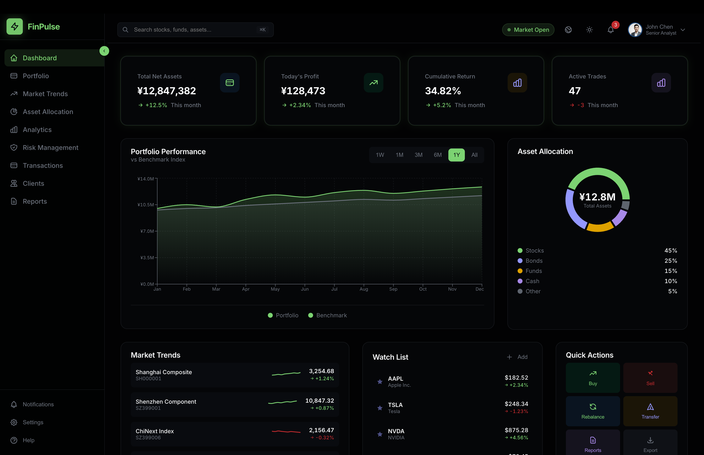
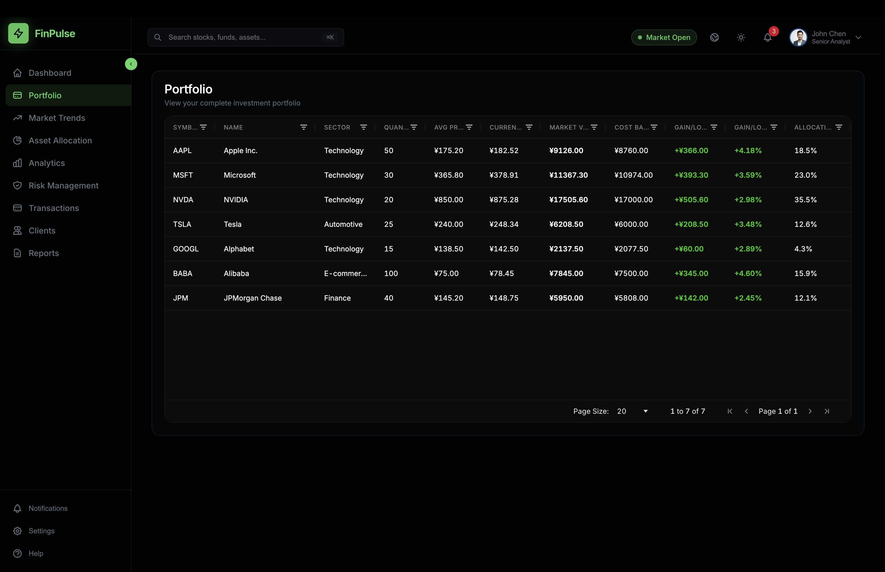
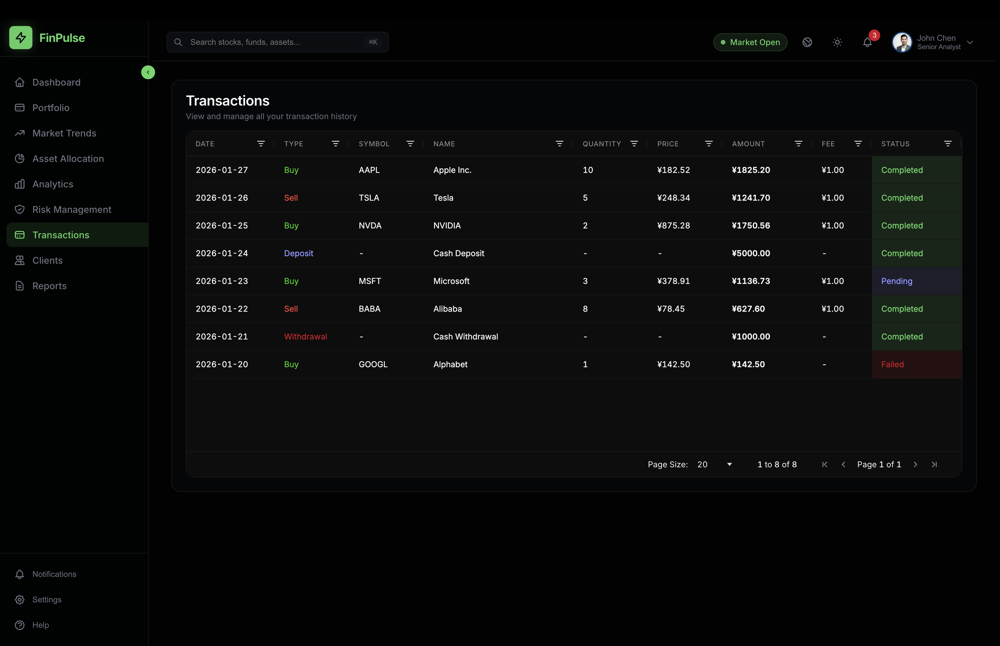
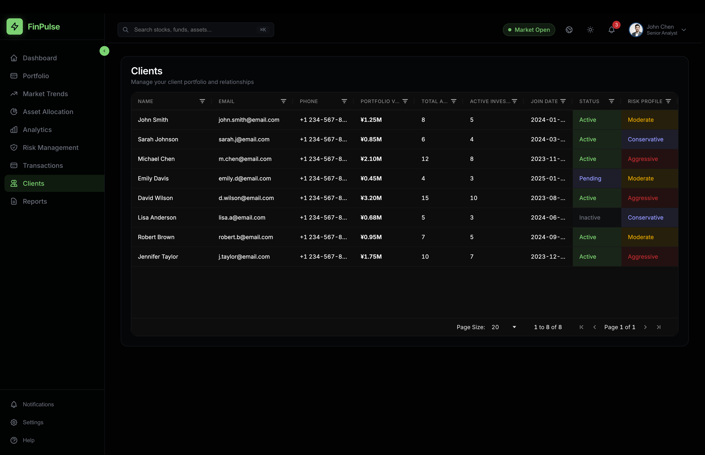

# FinPulse

[](LICENSE)
[](https://react.dev/)
[](https://openjdk.org/)
[](https://pnpm.io/)

FinPulse brings financial technology into everyday life. Our mission is to drive breakthroughs that benefit people, society, and the portfolios we manage every day.

Chinese docs: see bilingual [docs/Glossary.md](docs/Glossary.md). Living docs live under [`docs/`](docs/).

## Table of Contents

- [Features](#features)
- [Screenshots](#screenshots)
- [Tech Stack](#tech-stack)
- [Prerequisites](#prerequisites)
- [Getting Started](#getting-started)
- [Analytics](#analytics)
- [Project Structure](#project-structure)
- [Scripts](#scripts)
- [Testing](#testing)
- [Documentation](#documentation)
- [Deployment](#deployment)
- [Contributing](#contributing)
- [Security](#security)
- [License](#license)

## Features

| Area | Capability |
|------|------------|
| **Portfolio** | Holdings, performance, and account views for investors and advisors |
| **Markets** | Watchlists, quotes, and stock detail on mobile and web |
| **Risk** | Insights and risk metrics for portfolio monitoring |
| **Payments / trading** | Payment and trade flows from the mobile client |
| **Admin** | Client, portfolio, and transaction management console |
| **Analytics** | Shared `@explore/portfolio-analytics` event tracking and GrowthBook A/B hooks |

## Screenshots

### Mobile

<p align="center">
  
  
  
</p>
<p align="center">
  
  
  
</p>

### Admin

<p align="center">
  
  
  
  
</p>

## Tech Stack

| Layer | Choice |
|-------|--------|
| Web | React 19 + Vite, Emotion, Radix UI |
| Mobile | React Native + Expo |
| Shared packages | `@explore/portfolio-analytics`, `@explore/portfolio-ui`, `@explore/portfolio-utils` |
| Backend | Java Spring Boot API (primary entry :8801), Python FastAPI analytics (:8800) |
| Data | TimescaleDB, Redis, Kafka |
| Tooling | pnpm workspaces, TypeScript 5; Bazel for Java API (`server/`) |

Architecture notes: [docs/developer/c4-model/](docs/developer/c4-model/), [docs/developer/QUICKSTART.md](docs/developer/QUICKSTART.md).

## Prerequisites

| Tool | Version |
|------|---------|
| Node.js | 18+ |
| pnpm | 10.6+ |
| Python | 3.10+ |
| Docker | latest (for local backend stack) |
| Bazelisk | optional; Bazel for root Java (`//:server`) |

## Getting Started

```bash
git clone https://github.com/felixzhu97/explore-workspace.git
cd explore-workspace
pnpm install
pnpm dev portfolio
```

| Surface | Default URL |
|---------|-------------|
| Java API | http://localhost:8801 |
| Analytics | http://localhost:8800 |
| Admin | http://localhost:4220 |
| Portal | http://localhost:3101 |
| Mobile | Expo (`pnpm --dir portfolio/mobile start` if started alone) |

After the backend is up, use `http://127.0.0.1:8801` as the API entry.

- Admin analytics: set `VITE_API_BASE_URL` (e.g. `http://127.0.0.1:8801/api/v1`) or use the default dev proxy.
- Mobile analytics: set `EXPO_PUBLIC_API_BASE_URL` (e.g. `http://localhost:8801`; `/api/v1` is appended automatically).

## Analytics

Portal, admin, and mobile use `@explore/portfolio-analytics` via `AnalyticsProvider` and `useAnalytics().track()` / `identify()`. Events post to `POST /api/v1/analytics/events` (Console transport when no API is configured in development). The admin **Behavior** page (`/behavior`) lists events; row click opens a drawer with user details (`userId`, email, name).

## Project Structure

```text
explore-portfolio/
├── server/            # Java (Spring) API — Bazel //server:server
├── analytics/         # FastAPI analytics (:8800)
├── admin/             # React admin console
├── portal/            # React investor portal
├── mobile/            # React Native (Expo)
├── packages/
│   ├── analytics/     # @explore/portfolio-analytics
│   ├── ui/            # @explore/portfolio-ui
│   └── utils/         # @explore/portfolio-utils
├── scripts/           # Backend start, seed, database helpers
└── docs/              # Product, data, and R&D docs (en / zh)
```

### Java (`server/`)

Per-feature packages follow `controller → service → domain ← infra` (+ `mapper`).
Bazel targets live under `server/BUILD.bazel`. API listens on **:8801** when started via `pnpm dev:server`.

```bash
bazel run //server:server
bazel test //server:UserPreferenceControllerTest
# or: make -f server/Makefile.java java-run / java-test
```

## Scripts

| Script | Description |
|--------|-------------|
| `pnpm dev:admin` | Admin Vite dev server |
| `pnpm dev:portal` | Portal Vite dev server |
| `pnpm dev:mobile` | Expo mobile |
| `pnpm dev:server` | Backend (Docker + APIs + seed) |
| `pnpm build` | Build admin (and workspace deps as configured) |
| `pnpm test:all` | Run workspace unit tests |
| `pnpm test:api` | Python API tests |
| `pnpm lint` | ESLint (admin) |

## Testing

```bash
pnpm test:all
pnpm test:all:coverage
pnpm test:api
```

## Documentation

| Doc | Link |
|-----|------|
| Glossary | [docs/Glossary.md](docs/Glossary.md) |
| Quick start | [docs/developer/QUICKSTART.md](docs/developer/QUICKSTART.md) |
| API | [docs/developer/api.md](docs/developer/api.md) |
| C4 model | [docs/developer/c4-model/](docs/developer/c4-model/) |
| CI/CD | [docs/developer/cicd/](docs/developer/cicd/) |
| User Story Map | [docs/product-owner/User-Story-Map.md](docs/product-owner/User-Story-Map.md) |

## Deployment

**Vercel (admin)** — configure in the Vercel dashboard only; do not change live project settings from this repo.

| Setting | Value |
|---------|-------|
| Root Directory (monorepo) | `portfolio/admin` |
| Install | `cd ../.. && pnpm install` (see [`admin/vercel.json`](admin/vercel.json)) |
| Build | `cd ../.. && pnpm --filter portfolio-admin build` |
| Output | `dist` (under `portfolio/admin`) |

Legacy single-repo layout (`portfolio/` as root): see [`vercel.json`](vercel.json) at the product root (`outputDirectory`: `admin/dist`).

## Contributing

See [CONTRIBUTING.md](CONTRIBUTING.md). Issues and pull requests are welcome. Please follow the [Code of Conduct](CODE_OF_CONDUCT.md). Prefer small, focused PRs with a clear why and test notes.

## Security

Report vulnerabilities as described in [SECURITY.md](SECURITY.md).

## License

[Apache-2.0](LICENSE) © Felix Zhu
